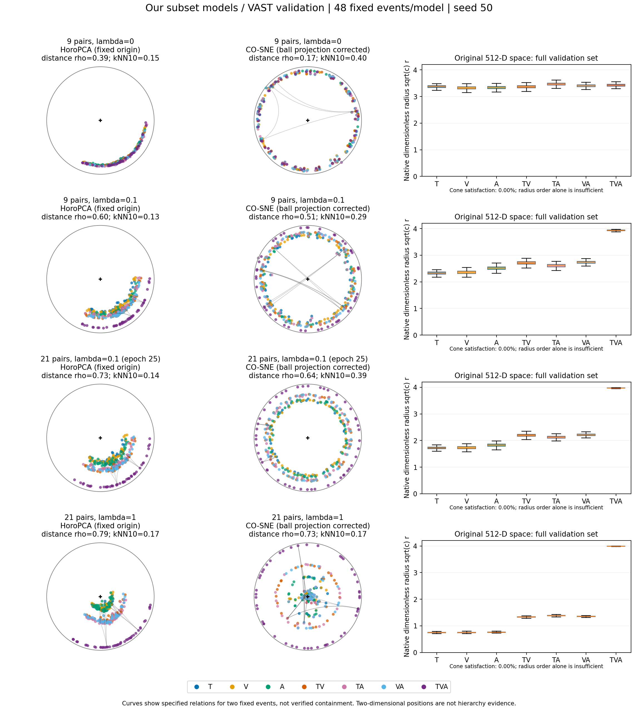
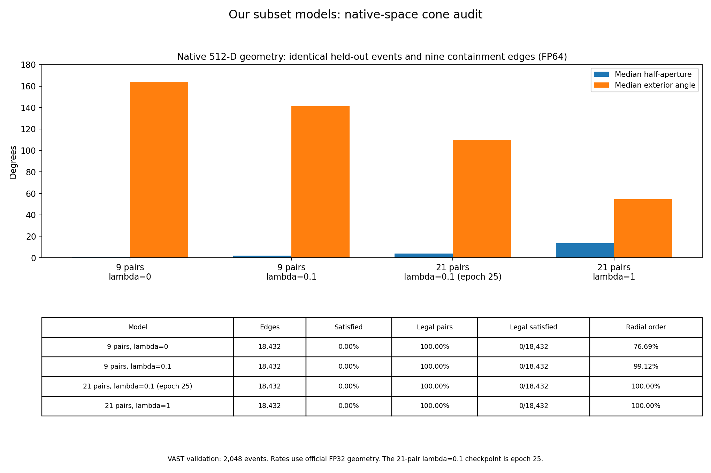
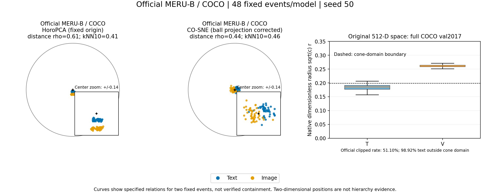
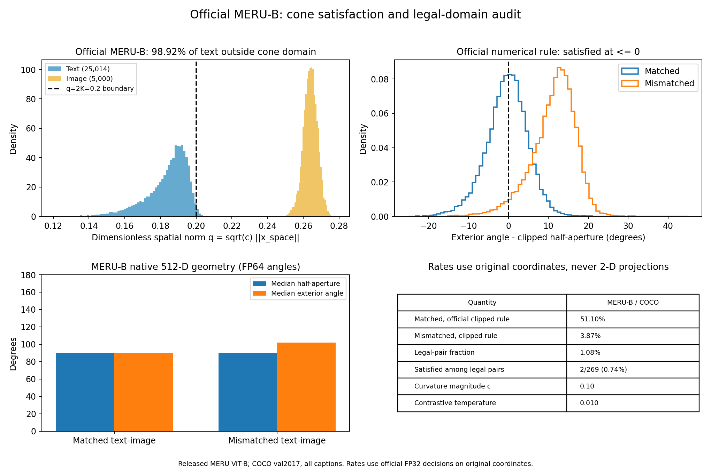

# 子集层级初版与配对数量消融

[返回实验总览](../README.md)

| 字段 | 内容 |
|---|---|
| 编号 | EXP-002 |
| 项目 | Hyperbolic-Omnimodal |
| 状态 | 初版停止；固定预算后续消融已完成 |
| 实验日期 / 最后核对 | 2026-10-16 / 2026-10-20 |
| 前序 / 后续 | [历史 Parent 消融](EXP-001-zero-shot-baselines.md#7-历史-parent-消融) / [机制实验](EXP-003-subset-mechanisms.md) |

## 要回答的问题

七个观测子集 T、V、A、TV、TA、VA、TVA 的九条包含边，能否与对比检索共同学成？减少对比配对或增大锥损失是否有帮助？

## 协议与运行

复用已审计的 VAST pooled encoder 特征，按来源视频重新分组划分：训练 82,611，验证 2,048，测试 2,048。冻结阶段训练头部。完整初始化、训练与晋级规则见[实验说明](../../Hyperbolic-Omnimodal/experiments/subset_hierarchy/README.md)。

| 运行组 | 变化 | 结果位置与状态 |
|---|---|---|
| subset_hierarchy_v0_20261016 | H0 λ=0 与 H1 λ=0.1，21 对 | [初版目录](../../Hyperbolic-Omnimodal/outputs/subset_hierarchy_v0_20261016/)；H0 达预算但未满足收敛规则，控制器停止晋级 |
| subset_hierarchy_ablation_20261016 | 21 对 λ=1；9 对 λ=0.1 | [消融摘要](../results/EXP-002/2026-10-20/ablation_summary.json)；30 轮固定预算完成 |
| subset_hierarchy_control9_20261016 | 9 对 λ=0，匹配弱约束参考 | [控制组摘要](../results/EXP-002/2026-10-20/control9_summary.json)；30 轮固定预算完成 |

## 结果

以下是后续三组 **epoch 30 的验证集十二方向 macro R@1**，不是测试成绩，也不是多种子均值。

可比较指标按展示精度排名：**最优值加粗**，<ins>次优值加下划线</ins>，并列同标；R@1 越高越好，未加权 entailment 越低越好。标记不代表统计显著性。

| 条件 | R@1 % | 未加权 entailment |
|---|---:|---:|
| 21 对，λ=1 | 22.689 | **0.7716** |
| 9 对，λ=0.1 | **29.435** | <ins>2.2043</ins> |
| 9 对，λ=0 | <ins>29.301</ins> | 2.8514 |

## 图表与几何审计

以下为当时保存的四张主图，直接展示原始 PNG，并提供矢量 PDF。原始图组来自 `geometry_audit_20261016`；本次只补录已有图和数值，没有重训、重新降维或重新选模。

### 四组子集模型的投影与半径

[打开原图](../results/EXP-002/2026-10-20/figures/geometry_overview_seed50.png) · [下载矢量 PDF](../results/EXP-002/2026-10-20/figures/geometry_overview_seed50.pdf)

从上到下是 9 对 λ=0、9 对 λ=0.1、21 对 λ=0.1、21 对 λ=1。**21 对 λ=0.1 使用初版 epoch 25，其余三组使用 epoch 30**；不能将整张图理解为四组完全等步数的消融。

左、中两列使用每组固定的 48 个验证事件、七个子集共 336 个点，降维 seed50；颜色表示观测子集，不是语义类别。右列使用完整 2,048 个验证事件的原始 512 维表示。加入约束后半径层次更明显，TVA 靠近半径上限，但二维环状分布和关系连线不能证明锥包含，CO-SNE 本身也包含径向惩罚。

降维会损失邻域信息：这四组 HoroPCA 的 kNN10 保留率约为 13.10%–16.90%，CO-SNE 为 16.52%–40.30%。图形应结合[投影质量数值](../results/EXP-002/2026-10-20/figures/visualization_metrics_seed50.json)解释。

### 原始空间中的锥约束

[打开原图](../results/EXP-002/2026-10-20/figures/cone_audit_comparison.png) · [下载矢量 PDF](../results/EXP-002/2026-10-20/figures/cone_audit_comparison.pdf)

包含率在原始 512 维空间计算，每组检查相同 2,048 个验证事件的九条边，共 18,432 条；不从二维投影推断。下表的角度为官方几何实现的 FP64 中位数：

| 条件 | 半开角中位数 | 外角中位数 | 半径顺序正确率 | 严格包含数 |
|---|---:|---:|---:|---:|
| 9 对，λ=0，epoch 30 | 0.79° | 163.92° | 76.69% | **0 / 18,432** |
| 9 对，λ=0.1，epoch 30 | 1.95° | 141.48° | <ins>99.12%</ins> | **0 / 18,432** |
| 21 对，λ=0.1，epoch 25 | 3.88° | 110.07° | **100.00%** | **0 / 18,432** |
| 21 对，λ=1，epoch 30 | 13.73° | 54.67° | **100.00%** | **0 / 18,432** |

半径顺序正确率及相同分母下的严格包含数越高越好；后者全为零，均列并列最优，没有次优值，但不表示严格包含成功。半开角与外角没有独立的单调优劣，不单列排名；各组 checkpoint 轮数差异仍适用。

四组边都位于合法锥域，官方实现与本地实现在包含判定上完全一致。约束能改善径向顺序并降低角度违约，但仍没有边满足严格包含。数据及 checkpoint 哈希见[子集模型审计 JSON](../results/EXP-002/2026-10-20/figures/subset_cone_audit.json)。

### 官方 MERU 的投影参照

[打开原图](../results/EXP-002/2026-10-20/figures/meru_geometry_overview_seed50.png) · [下载矢量 PDF](../results/EXP-002/2026-10-20/figures/meru_geometry_overview_seed50.pdf)

这是官方 MERU ViT-B checkpoint 在 COCO 上的独立参照：投影取 48 个固定图文事件，右侧半径统计使用完整 COCO val2017。它与上面的 VAST 子集模型采用不同数据和骨干，不能作为同条件检索或几何性能排名。

### 官方 MERU 的定义域与包含判定

[打开原图](../results/EXP-002/2026-10-20/figures/meru_cone_audit.png) · [下载矢量 PDF](../results/EXP-002/2026-10-20/figures/meru_cone_audit.pdf)

该审计覆盖 5,000 张图像的 25,014 条 caption。官方 FP32 截断规则下，正配对满足率为 51.10%，错配对为 3.87%；但 98.92% 的文本点落在锥定义域之外。仅看合法的 269 对时，满足关系的只有 2 对，即 0.74%。因此不能把 51.10% 直接当作合法域严格包含率，与我们模型的零包含率比较。

完整数值见 [MERU 审计 JSON](../results/EXP-002/2026-10-20/figures/meru_cone_audit.json)。采用的最终图版将 MERU 与我们的四组模型分开，替代了早期混排图；版本记录见 [plot_revision.json](../results/EXP-002/2026-10-20/figures/plot_revision.json)，实现检查见 [visualization_implementation_checks.json](../results/EXP-002/2026-10-20/figures/visualization_implementation_checks.json)。所有补录文件的来源与 SHA-256 已加入[结果清单](../results/manifest.json)。

## 结论与下一步

9 对弱约束比 9 对无约束在该验证读数上高约 0.134 pp；该单种子差异不能视为稳定收益。21 对强约束降低违约，同时检索更差；这里同时改变了配对数量和权重，不能单独归因于某一变量。

初版的“停止”是预算与晋级规则触发，不能记成完整端到端实验已完成。后续用 EXP-003 系统检查训练机制和种子。

## 变更记录

- 2026-10-16：初版停止，另开固定预算消融和 9 对无约束控制。
- 2026-10-20：补录；明确区分停止状态、固定预算完成与收敛证明。
- 2026-10-20：补录四张原始主图、对应 PDF 与审计数值；注明各组 checkpoint 轮数、可视化采样范围和 MERU 参照的比较边界。
