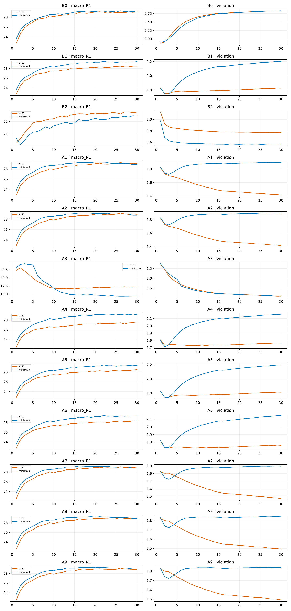

# 子集层级机制与三种子复核

[返回实验总览](../README.md)

| 字段 | 内容 |
|---|---|
| 编号 | EXP-003 |
| 项目 | Hyperbolic-Omnimodal |
| 状态 | 已完成；未通过严格双目标标准 |
| 实验日期 / 最后核对 | 2026-10-16 / 2026-10-20 |
| 前序 / 后续 | [初版与消融](EXP-002-subset-pilot.md) / [冻结迁移](EXP-004-frozen-transfer.md) |

## 要回答的问题

温度、半径梯度、兼容性与训练顺序等机制，能否同时改善严格包含并保持检索？

## 协议与运行

9 对和 21 对分别筛选，再进行训练细节与 seed 50/51/52 复核。共 57 次正式运行、2 次额外共享 warmup、15 次锁定测试评估；固定预算全部完成。数据延续 EXP-002。完整条件保存在[运行目录](../../Hyperbolic-Omnimodal/outputs/subset_mechanisms_20261016/)。

## 结果

主指标为十二个不重叠模态检索方向的平均 R@1，单位 %；± 为三个训练种子的样本标准差。

| 选定参考 | 验证 R@1 | 测试 R@1 | 测试严格边满足率 |
|---|---:|---:|---:|
| 9 对，B1，λ=0.1，固定温度 | 29.439 ± 0.015 | 28.942 ± 0.043 | 0% |
| 21 对，A1，共享可学习温度，9 对 warmup | 29.088 ± 0.049 | 28.779 ± 0.066 | 0% |

21 对共享温度机制在训练细节比较前将验证平均违约从 1.8246 降至 1.4160 rad，但严格包含仍为零。纯层级准备阶段曾出现正配对和错配对都 100% 包含、检索约 2.06%；加入对比训练后二者包含率回到零。

权威结果：[完成摘要](../results/EXP-003/2026-10-20/completion_summary.json)、[全条件表](../results/EXP-003/2026-10-20/comparison.csv)、[几何对照图](../../Hyperbolic-Omnimodal/outputs/subset_mechanisms_20261016/geometry_overview_paired.pdf)。

## 头部训练曲线

[打开完整预览](../results/EXP-003/2026-10-20/paired_training_curves.png) · [下载原始 PDF](../results/EXP-003/2026-10-20/paired_training_curves.pdf)

每行对比同一机制的 9 对（蓝）与 21 对（橙）模型，横轴为 epoch；左列是验证集十二方向 macro R@1（%），右列是平均锥违约（rad）。图只包含 seed50 的 standard 训练，不是三种子均值或测试集曲线。各条件均独立从共享 warmup 开始。

| 图中标签 | 机制 |
|---|---|
| B0 / B1 / B2 | 锥约束权重 λ=0 / 0.1 / 1 |
| A1 | 学习共享温度 |
| A2 | 学习不同关系类型的温度 |
| A3 | 停止 NCE 对半径的梯度 |
| A4 | 增加 parent-cap 兼容性项 |
| A5 | 训练锥半开角乘以 1.2 |
| A6 | 蕴含损失中增加外角项 |
| A7 | 在 A2 上加入 parent-dependent 温度 |
| A8 | 增加不确定性校准 |
| A9 | 增加正熵项 |

PNG 由原始单页 PDF 以 150 DPI 渲染，渲染来源和哈希见结果清单；未重新训练、重算指标或重画曲线。

## 结论与下一步

没有配置同时通过检索和严格包含改善的标准。违约降低属于部分进展；正负样本都被包含属于无区分能力的退化，不能作为成功。

选定 9 对 λ=0.1 seed50 参考进入冻结迁移与域内微调；它是验证选定参考，不是已验证的层级成功模型。

## 变更记录

- 2026-10-16：正式队列和锁定测试完成，记录中无剩余失败任务。
- 2026-10-20：补录并保留十二方向指标口径。
- 2026-10-20：加入原始配对训练曲线 PDF 与可直接查看的 PNG 预览，并解释机制标签。
