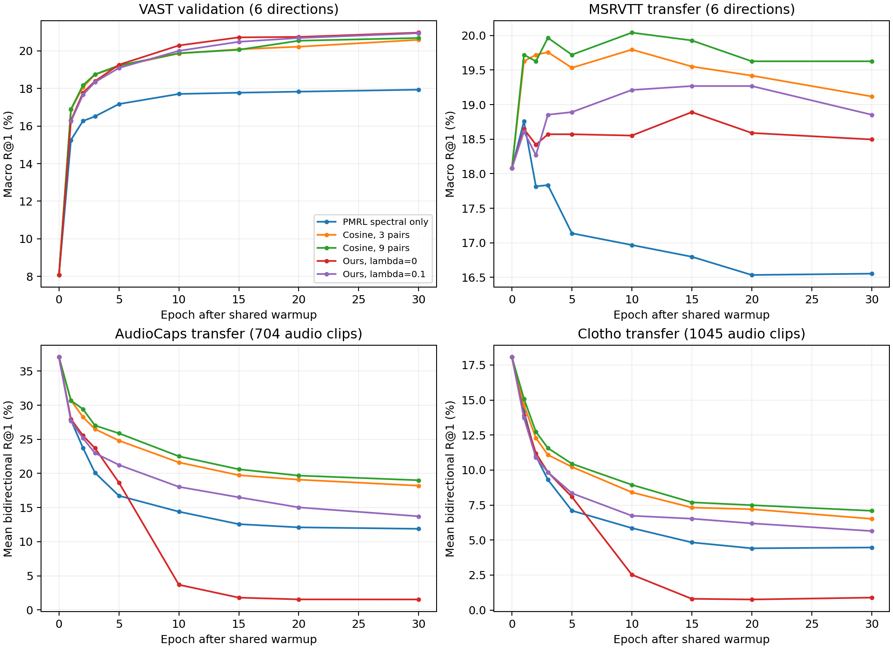

# 官方权重与本地模型的冻结迁移评测

[返回实验总览](../README.md)

| 字段 | 内容 |
|---|---|
| 编号 | EXP-004 |
| 项目 | Hyperbolic-Omnimodal |
| 状态 | 已完成 |
| 实验日期 / 最后核对 | 2026-10-16 至 17 / 2026-10-20 |
| 前序 / 后续 | [子集机制](EXP-003-subset-mechanisms.md) / [迁移诊断](EXP-005-transfer-diagnostics.md)、[MSRVTT 微调](EXP-006-msrvtt-finetune.md) |

## 要回答的问题

官方 VAST、GRAM、PMRL checkpoint 与本地层级模型，在相同输入和检索协议下，各自擅长哪些方向？优势能否迁移到其他数据集？

## 协议

不在目标数据集训练或选 checkpoint，不使用 ITM。官方三种模型使用原生头与余弦打分；本地模型使用 EXP-003 的 9 对 λ=0.1 seed50 参考和负测地距离。训练历史不同。

VAST 为 2,048 样本；MSRVTT 为音视频齐全的 884 条交集，不是完整 1K。AudioCaps 为可用的 704 条，Clotho 为 1,045 条；音频任务保留每条五个 caption，音频到文本按任一正例最优排名计算。

## 结果

表内各指标列的**最优值加粗**，<ins>次优值加下划线</ins>；显示精度下的并列值同样标记。Recall 越高越好，MedR 越低越好；音频表中两个方向分别排名。

### 六方向平均概览

| 模型 | VAST 六方向平均 R@1 % | MSRVTT 六方向平均 R@1 % |
|---|---:|---:|
| VAST | 8.46 | 18.10 |
| GRAM | 12.80 | 17.91 |
| PMRL | <ins>18.33</ins> | **19.97** |
| Ours | **20.52** | <ins>19.19</ins> |

T 表示文本，V 表示视频，A 表示音频。Recall 指标单位均为 %，展示到小数点后两位；CSV 保留原始精度。Macro 为六个方向的算术平均。以下是冻结 checkpoint 的完整检索读数。

### VAST 测试样本集，2,048 条

[下载完整 CSV](../results/EXP-004/2026-10-20/vast_comparison.csv)

#### R@1

| 模型 | T→V | V→T | T→A | A→T | V→A | A→V | Macro |
|---|---:|---:|---:|---:|---:|---:|---:|
| VAST | 27.88 | 13.33 | 2.15 | 2.29 | 2.73 | 2.39 | 8.46 |
| GRAM | 35.21 | 22.75 | 5.62 | 4.20 | 5.03 | 4.00 | 12.80 |
| PMRL | **40.72** | **40.33** | <ins>6.69</ins> | **6.84** | <ins>7.76</ins> | <ins>7.67</ins> | <ins>18.33</ins> |
| Ours | <ins>36.72</ins> | <ins>36.43</ins> | **6.88** | <ins>6.54</ins> | **18.51** | **18.02** | **20.52** |

#### R@5

| 模型 | T→V | V→T | T→A | A→T | V→A | A→V | Macro |
|---|---:|---:|---:|---:|---:|---:|---:|
| VAST | 47.51 | 33.06 | 6.49 | 5.81 | 8.98 | 6.45 | 18.05 |
| GRAM | 57.13 | 42.97 | 14.79 | 11.04 | 13.92 | 12.55 | 25.40 |
| PMRL | **63.57** | **63.38** | <ins>18.12</ins> | <ins>17.04</ins> | <ins>20.31</ins> | <ins>20.51</ins> | <ins>33.82</ins> |
| Ours | <ins>59.77</ins> | <ins>59.81</ins> | **18.95** | **18.80** | **40.33** | **40.04** | **39.62** |

#### R@10

| 模型 | T→V | V→T | T→A | A→T | V→A | A→V | Macro |
|---|---:|---:|---:|---:|---:|---:|---:|
| VAST | 55.62 | 45.02 | 10.30 | 8.64 | 12.50 | 9.33 | 23.57 |
| GRAM | 66.21 | 52.20 | 20.61 | 16.06 | 21.00 | 19.14 | 32.54 |
| PMRL | **71.58** | **71.92** | <ins>25.44</ins> | <ins>24.27</ins> | <ins>29.49</ins> | <ins>29.74</ins> | <ins>42.07</ins> |
| Ours | <ins>68.60</ins> | <ins>69.43</ins> | **27.29** | **26.61** | **50.78** | **51.03** | **48.96** |

#### 中位排名 MedR

数值越低越好；不计算跨方向的平均中位排名。

| 模型 | T→V | V→T | T→A | A→T | V→A | A→V |
|---|---:|---:|---:|---:|---:|---:|
| VAST | 7 | 14 | 408 | 368 | 311 | 320 |
| GRAM | <ins>3</ins> | 9 | 83 | 118 | 75 | 90 |
| PMRL | **2** | **2** | <ins>55</ins> | <ins>59</ins> | <ins>32</ins> | <ins>35</ins> |
| Ours | <ins>3</ins> | <ins>3</ins> | **42** | **43** | **10** | **10** |

### MSRVTT 音视频交集，884 条

[下载完整 CSV](../results/EXP-004/2026-10-20/msrvtt_comparison.csv)

#### R@1

| 模型 | T→V | V→T | T→A | A→T | V→A | A→V | Macro |
|---|---:|---:|---:|---:|---:|---:|---:|
| VAST | **43.67** | **41.74** | 6.56 | **6.45** | 4.64 | 5.54 | 18.10 |
| GRAM | 41.97 | 36.31 | <ins>7.35</ins> | <ins>6.00</ins> | 8.37 | 7.47 | 17.91 |
| PMRL | <ins>42.99</ins> | <ins>41.52</ins> | **7.81** | **6.45** | <ins>11.20</ins> | <ins>9.84</ins> | **19.97** |
| Ours | 36.76 | 35.52 | 5.77 | 5.43 | **15.95** | **15.72** | <ins>19.19</ins> |

#### R@5

| 模型 | T→V | V→T | T→A | A→T | V→A | A→V | Macro |
|---|---:|---:|---:|---:|---:|---:|---:|
| VAST | <ins>68.33</ins> | <ins>65.27</ins> | 16.86 | 15.95 | 13.46 | 14.93 | 32.47 |
| GRAM | <ins>68.33</ins> | 63.69 | <ins>17.65</ins> | <ins>16.40</ins> | 24.89 | 21.04 | 35.33 |
| PMRL | **68.67** | **66.40** | **20.14** | **19.12** | <ins>28.62</ins> | <ins>27.26</ins> | **38.37** |
| Ours | 61.65 | 59.28 | 16.06 | 14.82 | **37.22** | **35.86** | <ins>37.48</ins> |

#### R@10

| 模型 | T→V | V→T | T→A | A→T | V→A | A→V | Macro |
|---|---:|---:|---:|---:|---:|---:|---:|
| VAST | 76.70 | <ins>75.90</ins> | 23.19 | 24.21 | 20.02 | 20.81 | 40.14 |
| GRAM | <ins>78.17</ins> | 72.85 | <ins>24.77</ins> | <ins>24.66</ins> | 32.47 | 28.39 | 43.55 |
| PMRL | **78.51** | **76.92** | **29.75** | **26.02** | <ins>38.24</ins> | <ins>37.10</ins> | **47.76** |
| Ours | 71.15 | 69.23 | 23.87 | 23.19 | **47.40** | **47.17** | <ins>47.00</ins> |

本次 MSRVTT 汇总 CSV 未提供 MedR，页面仅展示已保存的 Recall 指标。

### AudioCaps 与 Clotho

| 模型 | AudioCaps T→A / A→T R@1 % | Clotho T→A / A→T R@1 % |
|---|---|---|
| VAST | **32.05** / **42.05** | <ins>16.13</ins> / **20.00** |
| GRAM | 30.28 / 36.08 | 14.45 / 15.79 |
| PMRL | <ins>31.99</ins> / <ins>41.19</ins> | **16.94** / <ins>18.18</ins> |
| Ours | 9.80 / 20.17 | 4.75 / 7.08 |

## 关联训练曲线

这里汇集三组已有曲线，分别来自 EXP-003、EXP-005 和 EXP-006。它们对应不同训练阶段、方法条件与指标口径；EXP-004 本身是冻结评测，上面的完整结果表保持不变。

### 1. VAST 子集模型的头部训练

[打开完整预览](../results/EXP-003/2026-10-20/paired_training_curves.png) · [下载原始矢量 PDF](../results/EXP-003/2026-10-20/paired_training_curves.pdf) · [EXP-003 条件与结论](EXP-003-subset-mechanisms.md)

每行是一个机制条件，蓝色为 9 对，橙色为 21 对；横轴为 30 轮头部训练的 epoch。左列是 VAST **验证集十二方向** macro R@1，右列是原空间平均锥违约，单位 rad；这里不是本页 VAST 测试集的六方向分数。

该图使用 seed50 的 standard 训练，B0/B1/B2 对应 λ=0/0.1/1；A1–A9 的机制释义见 EXP-003。每个条件独立从共享 warmup 开始，不能把上下两行视作连续训练阶段。原图只有 PDF，页面 PNG 是由该 PDF 渲染的预览，未重画曲线或重算指标。

### 2. 随 VAST 训练轮数变化的跨数据集迁移

[打开原图](../results/EXP-005/2026-10-20/transfer_curves.png) · [下载矢量 PDF](../results/EXP-005/2026-10-20/transfer_curves.pdf) · [逐轮数值 JSON](../results/EXP-005/2026-10-20/comparison.json) · [EXP-005 诊断结论](EXP-005-transfer-diagnostics.md)

该图比较五种冻结编码器下的头部训练目标：PMRL spectral、cosine3、cosine9、无锥双曲模型和 λ=0.1 双曲模型；这些不是本页四个官方/本地 checkpoint 的重复评测。横轴是共享 warmup 后的 epoch，记录 0/1/2/3/5/10/15/20/30。

上排分别为 VAST 验证集与 MSRVTT 迁移的**六方向**平均 R@1，下排是 AudioCaps 704 条与 Clotho 1,045 条的双向平均 R@1。VAST 域内提高没有伴随音频文本迁移提高。跨域曲线用于探索退化过程，不按测试曲线重新挑选最佳 checkpoint。

### 3. 后续 MSRVTT 端到端微调

下面是已有的四模型 MSRVTT 训练对比图，对应[EXP-006 端到端微调](EXP-006-msrvtt-finetune.md)。EXP-004 本身只做冻结推理，上面的完整结果表均是微调前结果。

[打开原图](../results/EXP-006/2026-10-20/training_comparison.png) · [下载矢量 PDF](../results/EXP-006/2026-10-20/training_comparison.pdf) · [训练及选模汇总](../results/EXP-006/2026-10-20/comparison.json)

左图是 500 个验证视频上、随 epoch 变化的六方向平均 R@1，黑圈标出由验证集选中的 checkpoint；它不是训练 loss 曲线。右图比较相同 884 个测试视频上的微调前后表现，蓝柱对应本页 MSRVTT 冻结结果。

使用的是补足完整十轮预算后的当前图版：VAST、GRAM、PMRL、Ours 分别选中 epoch 6、10、8、10。微调后的测试平均 R@1 分别为 20.98%、19.74%、20.70%、24.87%；这些分数属于 EXP-006，不替换本页冻结评测主表。本次直接补录已有图，没有重新训练或重新选模。

## 结果文件

结果与每组的审计文件分别位于：

- [VAST 对比 CSV](../results/EXP-004/2026-10-20/vast_comparison.csv)
- [MSRVTT 对比 CSV](../results/EXP-004/2026-10-20/msrvtt_comparison.csv)
- [AudioCaps 与 Clotho 对比 CSV](../results/EXP-004/2026-10-20/audio_comparison.csv)
- [协议与 checkpoint 来源说明](../../Hyperbolic-Omnimodal/experiments/subset_hierarchy/README.md)

## 结论与下一步

我们的视频与音频方向较强，文本相关方向的优势不足，音频文本跨域迁移明显下降。VAST 与我们共享冻结 encoder 输出，因此差异位于头部学习和打分阶段，但这不能单独识别锥损失的因果贡献。

VAST cohort 可能与官方预训练数据重叠，不能称为认证零样本；各模型训练史不同，不能称为匹配训练对照。AudioCaps 后续发现一条与训练源重叠，去重诊断见 EXP-005。

## 变更记录

- 2026-10-16 至 17：依次完成 VAST、MSRVTT、AudioCaps 和 Clotho 评测。
- 2026-10-20：补录；与 EXP-003 的十二方向结果分开记录。
- 2026-10-20：展开 VAST 与 MSRVTT 六方向及 macro 的 R@1/5/10，补入 VAST 中位排名，数值由原 CSV 生成。
- 2026-10-20：增加关联 EXP-006 的 MSRVTT 十轮微调曲线、PDF 和选模汇总，明确与本页冻结评测结果的区别。
- 2026-10-20：按用户要求补齐全部三组已有曲线，追加 VAST 头部训练和跨数据集迁移曲线；保留各自来源及指标口径。
- 2026-10-20：按列标记最优与次优值，处理并列和 MedR 的反向排序；原始数字未改变。
