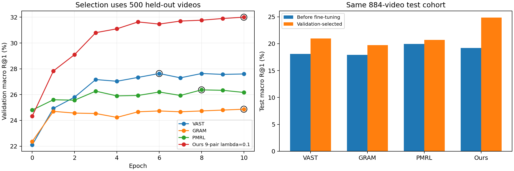

# MSRVTT 端到端微调与几何分析

[返回实验总览](../README.md)

| 字段 | 内容 |
|---|---|
| 编号 | EXP-006 |
| 项目 | Hyperbolic-Omnimodal |
| 状态 | 已完成；含补足预算的后续实验 |
| 实验日期 / 最后核对 | 2026-10-17 / 2026-10-20 |
| 前序 / 后续 | [冻结迁移](EXP-004-frozen-transfer.md) / [低维对照](EXP-009-lowdim-finetune.md) |

## 要回答的问题

VAST、GRAM、PMRL 与我们的方法，在同一 MSRVTT 输入协议和微调预算下表现如何？检索提升是否伴随严格包含关系？

## 协议与版本

四种方法端到端微调，按验证集六方向 macro R@1 选 checkpoint，包含 epoch 0。测试为相同的 884 个音视频齐全的视频，不是完整 MSRVTT-1K。输出均为 512 维。完整协议、优化器和初始化说明见[项目实验文档](../../Hyperbolic-Omnimodal/experiments/subset_hierarchy/README.md)和[运行目录](../../Hyperbolic-Omnimodal/outputs/msrvtt_finetune_20261017/)。

| 版本 | 运行情况 | 位置 |
|---|---|---|
| 初始早停 | VAST/GRAM/PMRL 分别完成 9/4/6 轮，Ours 10 轮 | [历史归档](../../Hyperbolic-Omnimodal/outputs/msrvtt_finetune_20261017/early_stopped_20261017/) |
| 当前完整预算 | 原状态恢复，四者均完成 10 轮、1,160 次更新，无跳步；仍由验证集选模 | 顶层 comparison.csv / comparison.json |

补足预算是在看过初始测试结果后提出的后续实验，不能写成全新预注册测试。

## 当前结果

六方向测试平均 R@1，单位 %：

微调前、完整预算后分别在各自列内比较，R@1 越高越好；**加粗**为最优，<ins>下划线</ins>为次优。选中 epoch 是配置记录，不参与排名。

| 模型 | 微调前 | 完整预算后 | 选中 epoch |
|---|---:|---:|---:|
| VAST | 18.10 | <ins>20.98</ins> | 6 |
| GRAM | 17.91 | 19.74 | 10 |
| PMRL | **19.97** | 20.70 | 8 |
| Ours，9 对 λ=0.1 | <ins>19.19</ins> | **24.87** | 10 |

Ours 相对 VAST 的 macro 提升 3.88 pp，条件样本 bootstrap 区间 [2.70, 5.09] pp。候选库和 checkpoint 固定，区间不是训练种子不确定性。视频→音频与音频→视频分别提升 15.61 和 14.37 pp；文本视频方向仍偏向 VAST。

几何测量中八类边半径顺序正确率 100%，A→TA 为 99.77%，但九类边的严格锥满足率均为 0%。平均 exterior angle 为 30.19°–146.08°，平均 aperture 仅 1.79°–2.91°，显示径向顺序与角度包含没有共同学成。

## 训练曲线

[打开原图](../results/EXP-006/2026-10-20/training_comparison.png) · [下载矢量 PDF](../results/EXP-006/2026-10-20/training_comparison.pdf) · [选模与结果汇总](../results/EXP-006/2026-10-20/comparison.json)

左图是 500 个验证视频上随 epoch 变化的六方向 macro R@1，黑圈为验证选中的 checkpoint；右图是相同 884 个测试视频上微调前后的 macro R@1。图版对应四种方法均完成十轮预算后的结果。各模型的绝对训练 loss 不在这张图中。

## 结果位置

- [最终结果表](../results/EXP-006/2026-10-20/comparison.csv)
- [检索与训练分析 PDF](../results/EXP-006/2026-10-20/analysis_figures.pdf)
- [几何分析 PDF](../results/EXP-006/2026-10-20/hyperbolic_geometry_report.pdf)
- [几何数值](../results/EXP-006/2026-10-20/geometry_summary.json)

## 结论与下一步

本轮域内微调检索收益明确，主要来自视频音频方向；这是单种子结果，不证明锥损失的独立贡献或跨域能力。严格包含仍失败。低维实验 EXP-009 将加入欧氏/双曲、有锥/无锥成对控制，但其结果尚未产生。

## 变更记录

- 2026-10-17：初始早停结果保存，随后补足统一十轮预算并重算报告与 bootstrap。
- 2026-10-20：补录；当前主表使用完整预算版本。
- 2026-10-20：补入已有训练对比 PNG/PDF 与机器可读汇总，供本页和 EXP-004 共用。
