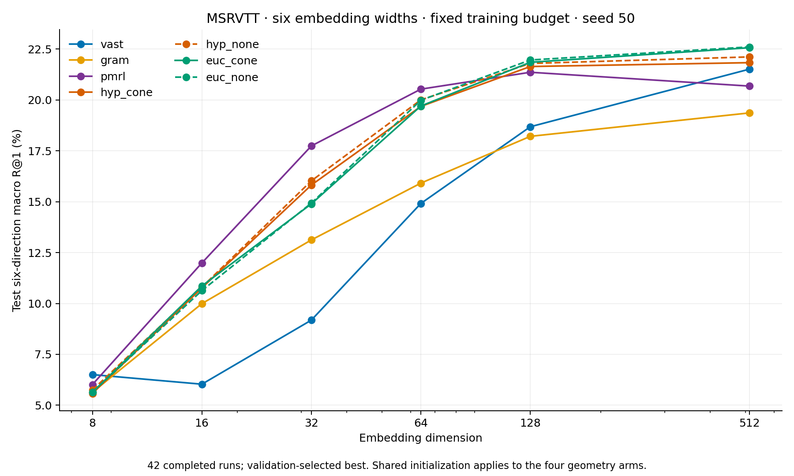
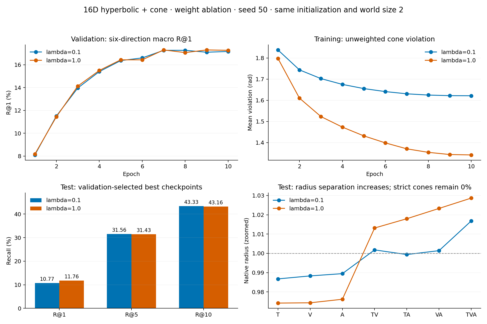
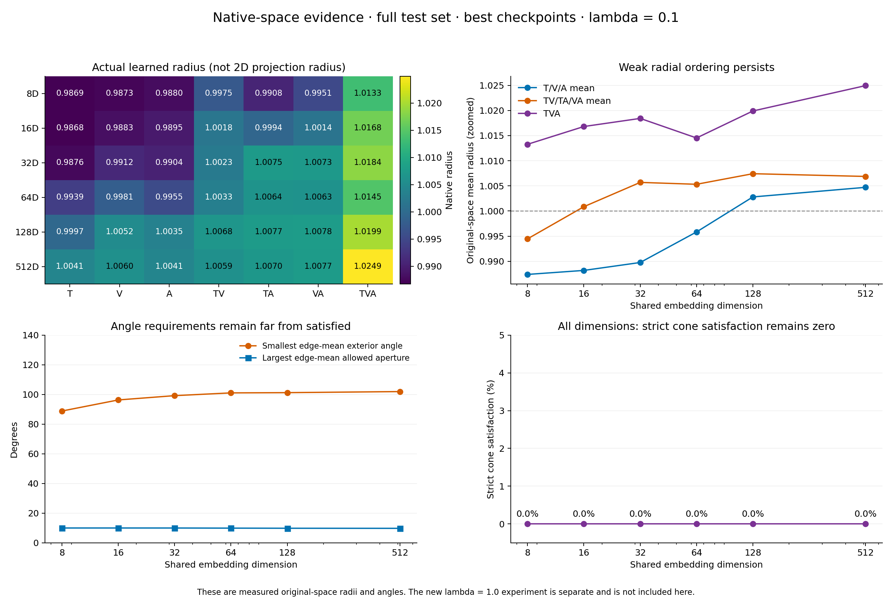

# 多模态低维端到端几何对照

[返回实验总览](../README.md) · [五方法展示版](../results/EXP-009/2026-10-20-server-b-five-methods/README.md)

| 字段 | 内容 |
|---|---|
| 编号 / 项目 | EXP-009 / Hyperbolic-Omnimodal |
| 状态 | **MSRVTT：42 组主实验与 1 组 λ 消融全部完成**；ActivityNet 未进入本轮正式训练 |
| 实验日期 / 最后核对 | 2026-10-19 至 2026-10-20 / 2026-10-20T17:57:38.608924+00:00 |
| 来源服务器 | server-b，交接接收端；本机路径按 SYNC.md 登记在忽略的 `config/servers.local.json` |
| 前序 | [旧 MSRVTT 微调](EXP-006-msrvtt-finetune.md)、[几何对照](EXP-007-coco-geometry.md) |
| 运行与证据 | [43 次完成训练及失败重跑记录](../runs/EXP-009/README.md)、[源码与启动清单](../results/EXP-009/2026-10-20-server-b/provenance/run_provenance.json) |

## 范围、完成数与读数口径

初始交接计划为 MSRVTT 与 ActivityNet、7 方法 × 4 维度，共 56 组。接收端按用户要求先执行 MSRVTT 的 28 组，随后增加 16D、64D 各 7 组，形成 **6 维度 × 7 方法 = 42 组**。另增加 16D `hyp_cone`、λ=1.0 的 1 组探索性对照，合计 **43 次完成训练**。ActivityNet 的缓存与任务计划保留，未报告其正式训练成绩；旧主目录报告中的 28 个 PENDING 属于 ActivityNet，不能当作 MSRVTT 未完成。

每组均有有效 DONE 与测试记录，完成 10 轮、1,160 次更新。测试为相同 884 个音视频齐全的 MSRVTT 视频，**不是完整 MSRVTT-1K**。所有训练仅 seed=50，不报告多训练种子的均值、标准差或统计显著性。

使用验证集 T↔V、T↔A、V↔A 六方向平均 R@1 选 best，允许 epoch0，并列保留最早轮次；训练满十轮后加载 best 评估测试集。表中不是统一使用 last，也不是按测试分数选模。Recall 单位为 %；六方向等权平均；推理无 ITM 重排。

## 实验细节

### 数据、输入与优化

| 项目 | 实际设置 |
|---|---|
| 数据划分 | MSRVTT train/val/test=7427/500/884；所有 43 组共享相同数据 READY 与测试 ID 哈希 |
| 数据使用 | 本轮只在 MSRVTT 上更新参数；VAST 指预训练来源及原生基线模型，不代表本轮执行了 VAST 数据上的子集头预训练 |
| 视频 | 缓存 32 个均匀候选帧、短边 256；每次取 2 帧，输入 224×224 |
| 视频增强 | 训练分段随机取帧、随机方形裁剪（面积采样 0.8–1.0，失败回退中心方形裁剪）、0.5 概率翻转；评估固定取帧并 resize 到 224×224 |
| 音频 / 文本 | 本机音频源为 MP3，经固定缓存处理为 16 kHz、64 维 fbank，取 1 个 1024 帧窗口；文本最多 40 tokens。训练每视频每轮随机取一条 caption，验证/测试用第一条 |
| 采样 | 按视频/epoch/seed50 固定随机采样；全局 batch64，每轮打乱，丢弃不足一个全局 batch 的末尾，不补重复 ID |
| 预算 | 10 epochs；7427//64=116 步/轮，共 1160 步；不早停 |
| 优化器 | AdamW，betas=(0.9,0.98)，weight decay=0.01，梯度裁剪 norm=2 |
| 学习率 | 视觉编码器 5e-7；其余可训练参数含半径头最高 2e-5；5% 线性 warmup 后余弦衰减 |
| 更新范围 | 三个编码器共同微调；自有版本训练七个子集方向/半径头，原生基线按其实际可训练检索模块更新 |
| 精度 | CUDA autocast FP16；自有方向头 FP32、几何计算 FP64；非有限梯度使运行失败，不静默跳步 |
| 卡数 | VAST 各维度单卡；GRAM 16D 成功重跑单卡；64D 七方法均单卡；其他主实验多数双卡。每组实际 world size 已写入 CSV/运行记录，所有组全局 batch 均为 64 |

原始协议：[28 组主体](../results/EXP-009/2026-10-20-server-b/provenance/protocol_main28.json)、[16D](../results/EXP-009/2026-10-20-server-b/provenance/protocol_d16.json)、[64D](../results/EXP-009/2026-10-20-server-b/provenance/protocol_d64.json)、[λ=1.0](../results/EXP-009/2026-10-20-server-b/provenance/protocol_lambda1.json)。数据哈希见 [MSRVTT READY](../results/EXP-009/2026-10-20-server-b/provenance/msrvtt_ready.json)。

### 四个自有版本的结构与目标

四者共享同一 VAST 预训练编码器、七个头的配对初始化和训练数据。七种表示为 T、V、A、TV、TA、VA、TVA；对应模态 pooled 特征拼接后经线性方向头、单位方向归一化及独立半径头。半径范围为 [0.21,4]，全部初始化为 1。欧氏表示为 `r·u`，双曲 Lorentz 空间坐标为 `sinh(r)·u`，曲率固定为 -1。

| 版本 | 对比距离 | 锥约束 |
|---|---|---|
| hyp_cone | 双曲测地距离 | λ=0.1，K=0.1 |
| hyp_none | 双曲测地距离 | λ=0；仍保留七个头与可学习半径 |
| euc_cone | 欧氏距离（非平方距离） | λ=0.1，K=0.2 |
| euc_none | 欧氏距离（非平方距离） | λ=0；仍保留七个头与可学习半径 |

九组对比 pair 为：T↔V、T↔A、V↔A；T↔VA、V↔TA、A↔TV；TV↔TVA、TA↔TVA、VA↔TVA。每组双向交叉熵后对九组等权平均，温度固定 0.07；每个查询有 1 个正例和 63 个批内负例，DDP 使用可微全局候选汇集。

九条锥边为 T→TV、T→TA、V→TV、V→VA、A→TA、A→VA、TV→TVA、TA→TVA、VA→TVA。锥项是同一样本父子边 `relu(exterior_angle − aperture)` 的均值；与九组对比 pair 不是同一关系集。自有版本不额外加入原生基线的 ITM 等辅助损失；原生 VAST/GRAM/PMRL 保留各自目标。VAST/GRAM 保留作者的候选梯度分离约定，PMRL 在 DDP 中使用全局候选池；这与自有版本的可微候选汇集不同。本轮主检索表只评估六个单模态方向，没有直接测试融合子集检索或层级推理。

### 低维初始化与旧 512D 方案的关键差异

按数据集及预训练模型家族分别使用训练集的归一化 T/V/A 512D 特征，拟合未中心化二阶矩的正交投影基；同一家族的三模态共享坐标，按维度取嵌套前导坐标。四个自有分支统一使用 VAST 家族的基；原生 GRAM/PMRL 各自使用其训练特征拟合的基。自有 T/V/A/VA 方向头由 VAST 初始化，TV/TA/TVA 由对应单模态头组合。**D512 使用恒等投影**。四个几何分支在同维度共享完全相同的初始七头权重；所有半径权重清零并重置为 r=1。这里是初始化用的线性投影；HoroPCA/CO-SNE 仅用于事后可视化。

**本轮未加载旧 `minimal9_B1_standard_s50/best.pt` 子集头，也没有额外的 VAST 冻结头预训练。** 这使本轮可作为共同初始化下的宽度/几何对照，但不能当作 EXP-006 的直接复现或仅改变维度的跨实验消融。

| 环节 | EXP-006 的旧 512D 微调 | 本轮，包括 512D |
|---|---|---|
| 进入 MSRVTT 前的任务预算 | VAST 缓存特征，训练样本82611、batch256；warmup 8轮/2576步，加头部主训练30轮/9660步，合计38轮/12236步 | 无单独子集头预训练阶段 |
| 实际导入 MSRVTT 的头 | 主训练第22轮 `best.pt`（主训练7084步，之前另有2576步warmup） | 不加载旧子集头；方向头重新构造、半径重置为1 |
| MSRVTT 起点 | VAST 骨干 + 已训练的七头，继承径向结构 | VAST 骨干 + 重新构造的七头，半径统一 r=1 |
| MSRVTT 训练 | 十轮、全局 batch64、最高头部 LR 2e-5 | 相同十轮/全局 batch/LR 预算 |
| 原空间平均半径 T/V/A → 双模态 → TVA | 2.161 → 2.487 → 3.934 | 512D best：1.0047 → 1.0069 → 1.0249 |

旧来源证据见 [EXP-006 起始权重说明](EXP-006-msrvtt-finetune.md#微调前的结果从哪里来)、[原协议](../results/EXP-006/2026-10-20/provenance/finetune_protocol.json)及 [EXP-003 头部训练](EXP-003-subset-mechanisms.md)。新同步的[旧训练预算与checkpoint审计](../results/EXP-004/2026-10-21/training/checkpoint_audit.json)已补齐此前缺失的信息：共享warmup为8轮/2576步，主训练任务为30轮/9660步；实际导入MSRVTT的是主训练第22轮的best，而旧VAST冻结测试使用第30轮last。基础协议记录warmup_lr=3e-4、head_lr=1e-4；第25/30轮实际记录LR=5e-5。任务完成预算与选中checkpoint的训练步数应分开解释。旧方案径向分层明显，但严格锥包含同样未成功。

## 主实验结果：42 组

每列在同一维度内比较七方法，R@1 越高越好；按两位小数标记 **最优**、<ins>次优</ins>，并列同标。不能把单训练 seed 的小差异当作显著优势。

| 方法 | 8D | 16D | 32D | 64D | 128D | 512D |
|---|---:|---:|---:|---:|---:|---:|
| VAST | **6.50** | 6.03 | 9.18 | 14.91 | 18.68 | 21.51 |
| GRAM | 5.64 | 9.99 | 13.12 | 15.91 | 18.21 | 19.36 |
| PMRL | <ins>6.01</ins> | **11.99** | **17.74** | **20.53** | 21.36 | 20.68 |
| 双曲有锥 | 5.58 | 10.77 | 15.82 | 19.68 | 21.64 | 21.83 |
| 双曲无锥 | 5.75 | 10.80 | <ins>16.03</ins> | <ins>20.00</ins> | 21.79 | 22.12 |
| 欧氏有锥 | 5.64 | <ins>10.86</ins> | 14.89 | 19.70 | <ins>21.85</ins> | <ins>22.57</ins> |
| 欧氏无锥 | 5.64 | 10.63 | 14.93 | 19.98 | **21.96** | **22.61** |

[图 PDF](../results/EXP-009/2026-10-20-server-b/retrieval_vs_dimension.pdf) · [原始精度 CSV，42组](../results/EXP-009/2026-10-20-server-b/retrieval_42.csv) · [完整六方向 R@1/5/10 与 MedR 表](../results/EXP-009/2026-10-20-server-b/directional_results.md) · [43组结构化指标](../results/EXP-009/2026-10-20-server-b/metrics_43.json)

### 平均 R@5

| 方法 | 8D | 16D | 32D | 64D | 128D | 512D |
|---|---:|---:|---:|---:|---:|---:|
| VAST | **22.49** | 19.70 | 25.47 | 34.33 | 38.63 | 41.70 |
| GRAM | 17.85 | 26.11 | 30.73 | 33.77 | 35.84 | 37.90 |
| PMRL | 19.40 | 31.45 | **40.48** | **43.61** | 44.44 | 43.53 |
| 双曲有锥 | <ins>20.53</ins> | <ins>31.56</ins> | <ins>37.65</ins> | 42.55 | <ins>45.93</ins> | 45.57 |
| 双曲无锥 | 20.19 | 31.17 | 37.48 | <ins>43.34</ins> | **45.97** | 45.93 |
| 欧氏有锥 | 20.14 | **31.71** | 36.31 | 42.72 | 45.91 | <ins>46.10</ins> |
| 欧氏无锥 | 19.98 | 31.30 | 36.27 | 43.21 | 45.85 | **46.42** |

### 平均 R@10

| 方法 | 8D | 16D | 32D | 64D | 128D | 512D |
|---|---:|---:|---:|---:|---:|---:|
| VAST | **34.20** | 29.96 | 36.52 | 44.87 | 48.76 | 51.19 |
| GRAM | 26.07 | 35.67 | 40.48 | 42.59 | 44.53 | 46.25 |
| PMRL | 29.47 | 42.78 | **52.09** | <ins>54.68</ins> | 54.83 | 54.19 |
| 双曲有锥 | 31.98 | <ins>43.33</ins> | <ins>49.89</ins> | 54.32 | 56.73 | 57.20 |
| 双曲无锥 | 31.84 | 43.27 | 49.77 | <ins>54.68</ins> | 56.90 | 57.24 |
| 欧氏有锥 | 31.84 | 43.19 | 48.89 | 54.30 | <ins>57.03</ins> | <ins>57.37</ins> |
| 欧氏无锥 | <ins>32.03</ins> | **43.51** | 49.00 | **54.71** | **57.13** | **57.52** |

在这一个 seed 下：VAST 的 8D 平均 R@1 最高；PMRL 在 16/32/64D 最高；欧氏无锥在 128/512D 最高。四个自有版本中，双曲在 32D 有较明显相对优势，但没有表现出跨维度一致优势。锥项在原 λ=0.1 主实验中没有稳定提升 R@1。

## 后续 16D 权重消融：λ=0.1 → 1.0

这是看到原结果后提出的探索性实验，不并入原 42 组的固定条件排名。保持相同 VAST 起点、半径 r=1、16D、seed50、双卡 world size=2、全局 batch64、十轮预算；从头训练，仅将自有锥损失系数从 0.1 改为 1.0。实际损失日志已确认 λ=1.0 生效，不只是改了配置标签；[唯一训练源码改动](../results/EXP-009/2026-10-20-server-b/provenance/lambda1_loss_weight.patch)。

| λ | 测试 R@1 | 测试 R@5 | 测试 R@10 | 严格锥满足率 | Best epoch |
|---:|---:|---:|---:|---:|---:|
| 0.1 | <ins>10.77</ins> | **31.56** | **43.33** | **0.00**% | 7 |
| 1.0 | **11.76** | <ins>31.43</ins> | <ins>43.16</ins> | **0.00**% | 7 |

R@1 增加 **1.00 个百分点**，R@5/10 小幅下降；严格锥满足率仍为 0%。增加权重扩大了径向间隔、降低了原空间违约，但未建立严格包含。表中零满足率的并列加粗遵循排名格式，不表示约束成功。该实验仍是本轮重新初始化流程，没有补回旧方案的头预训练。

上排分别为验证 R@1 和训练中的**未加权**锥违反量；下排为 best 测试 Recall 与原空间平均半径，不能混同验证/测试或加权/未加权损失。

[消融图 PDF](../results/EXP-009/2026-10-20-server-b/lambda16_comparison.pdf) · [完整消融结果及验证曲线](../results/EXP-009/2026-10-20-server-b/lambda_comparison.json) · [两种权重的训练/验证曲线CSV](../results/EXP-009/2026-10-20-server-b/lambda16_training_curves.csv)

## 几何可视化与约束是否充分

原 λ=0.1 的 8/16/32/64/128/512D 双曲有锥模型，best 测试与最后一轮验证的严格锥满足率均为 **0%**。各维度 TVA 的**平均原空间半径**均为七类表示中最大；存在弱径向顺序，但角度条件远未满足。不能把 CO-SNE 中 TVA 靠近中心解释为原空间 TVA 半径最小。

HoroPCA 和 CO-SNE 每个维度固定抽取同一批 48 个测试视频、7 子集共 336 点；训练种子及本报告投影种子均为 50。原空间指标使用完整 884 视频。图中的颜色是观测子集类型，不是语义类别；灰色连线表示指定父子关系，不代表通过了包含判定。

[8/16D 投影图](../results/EXP-009/2026-10-20-server-b/geometry/projections_8_16.png) · [32/64D 投影图](../results/EXP-009/2026-10-20-server-b/geometry/projections_32_64.png) · [128/512D 投影图](../results/EXP-009/2026-10-20-server-b/geometry/projections_128_512.png) · [全部五页 PDF](../results/EXP-009/2026-10-20-server-b/geometry/all_widths_geometry_report.pdf)

HoroPCA 使用作者实现、500步、LR=0.05，Frechet 中心化后把原始原点通过等距变换复位；CO-SNE 使用作者实现、1000步、perplexity20、LR=5、径向项步长0.1、gamma0.1。记录了旧 torch.solve 的兼容更新、CO-SNE 越界点的径向投影修正及调试历史内存优化，原始作者梯度约定保留；[实现来源](../results/EXP-009/2026-10-20-server-b/geometry/author_implementation_manifest.json)、[数值一致性检查](../results/EXP-009/2026-10-20-server-b/geometry/implementation_checks.json)。

CO-SNE 的距离与半径保真度偏低；部分半径排序相关性为负，二维环状或中心聚集不能证明层级。HoroPCA 也丢失邻域信息。质量数值见 [CSV](../results/EXP-009/2026-10-20-server-b/geometry/projection_quality.csv)、[保真度图](../results/EXP-009/2026-10-20-server-b/geometry/projection_faithfulness.png)、[分析来源](../results/EXP-009/2026-10-20-server-b/geometry/provenance.json)。此前单独的16D探索曾尝试投影 seed50/51/52及较小步长，它们不代表多模型训练；本页跨维度图只使用投影seed50。

目前检索与 entailment 共用同一维度，没有独立 entailment 分支。现有高维对照不支持“仅因16D太小而失败”，但还没有独立固定检索16D、只改变 entailment 维度的消融。权重、头部预训练、半径优化和父锥兼容性需要分开检验。

## 执行过程、失败与偏离

1. 2026-10-19：接收源码与标注，使用本服务器已授权数据目录重建/核验缓存；旧 `/data-nfs` 路径只作为历史记录，未继续访问。
2. 2026-10-20：按用户要求只运行 MSRVTT。VAST 低维 AMP 温度梯度溢出通过温度除法前转 FP32 修复；原始公式、batch 与 AMP 初始 scale1024 保持不变，随后重新生成相应 CPU/GPU 验证证据。此数值兼容修改属于实际源码版本。
3. 原28组及16D扩展通过各自源代码对应的 CPU 和 GPU 门槛。16D GRAM 首次双卡尝试触发 29.6328125 GiB 的进程分配上限，失败记录保留；用户要求直接重跑后改为 GPU1 单卡、cap40GiB，从头训练并跳过新增单卡预检，全局batch仍为64。
4. 64D 起初等待16D完成；随后用户要求利用空出的GPU2/3/6提前并行。完成CPU验证与profiling后，用户明确要求停止测试、按已用显存<40GiB的卡直接训练，因此64D GPU预检被中止，**没有完整GPU_READY**。
5. 64D最终七方法各单卡，GPU0/2/3/4/5/6/7分别运行VAST/GRAM/PMRL/双曲有锥/双曲无锥/欧氏有锥/欧氏无锥，cap40GiB。独立控制器监控显存和磁盘余量，未停止其他人的进程。
6. λ=1.0 独立快照按用户要求直接在GPU1/2训练；只做源码/资源一致性核对，没有新完整CPU/GPU门槛，不把它写成已通过预检。最终43组全部完成预算和测试；源码、协议、输入与结果哈希均已核对。

逐项命令、PID、GPU、运行时间、实际 world size、源码/协议哈希和失败恢复关系见[单次运行目录](../runs/EXP-009/README.md)与[完整来源清单](../results/EXP-009/2026-10-20-server-b/provenance/run_provenance.json)。代码基础 commit `8457b8e615837203f48d3c11957ae8777811a827` 仅代表交接底座；实际训练使用未提交修订与独立快照，以各运行源码摘要为准，不能用当前仓库 HEAD 冒充执行版本。

## 结论与后续

- 本轮42组可以比较共同初始化协议下的维度与几何；不能直接归因旧方案与新方案512D的差异，因为旧方案额外训练过子集头。
- 不同 world size 保持全局 batch64，但可能改变随机流和数值轨迹；特别是 GRAM 16D 的单卡重跑及64D全单卡设置，不能宣称与双卡运行逐步数值完全相同。
- 单训练seed下，λ=1.0对16D测试R@1有约1pp提升，但没有解决严格锥包含，也不能认定为稳定泛化收益。
- 径向顺序、二维投影形状、检索指标与严格包含是不同目标。更清楚的后续对照是分别检验旧头预训练链条、独立entailment分支以及约束优化；本记录不表示这些额外训练已经启动。

## 变更记录

- 2026-10-19：源端交接停止，原计划56组尚未完成；保留该历史状态。
- 2026-10-20：server-b完成MSRVTT原28组，补充16D与64D共14组；最终42组主实验。
- 2026-10-20：新增16D λ=1.0单种子对照并完成；总43组。补充六维度可视化、原空间审计、与旧头预训练流程的区别。
- 本次记录写入前先同步远端 `main` 到 `036662223464326f27a263599a4e9a754dd48268`，并重新fetch核对跟踪分支；未在本次记录任务中提交或推送。

- 2026-10-20T18:33:04.858832+00:00：新增独立五方法展示视图；完整七方法表格、图像和原始数值保留。同步远端 `92aad7219cfadbceed98af5895795fe7eed9fc11` 后补齐旧头部训练8轮warmup及best第22轮的来源说明。
