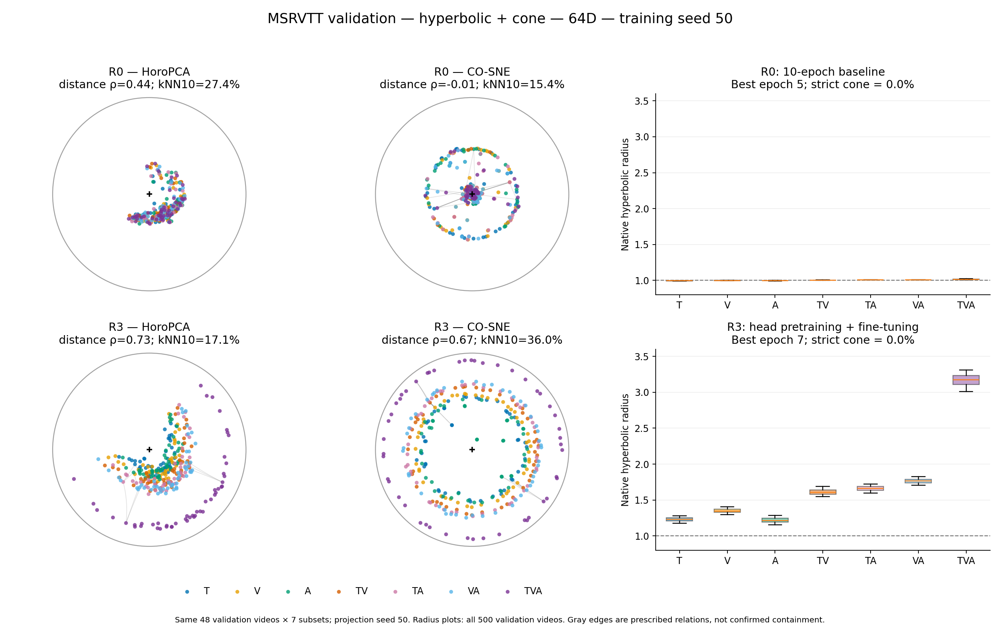

# 64D优先的检索训练方案比较

[返回实验总览](../README.md)

| 字段 | 内容 |
|---|---|
| 编号 | EXP-20261021-server-b-retrieval-training |
| 项目 | Hyperbolic-Omnimodal |
| 状态 | 64D全部完成；14/20选定条件测试完成；扩维训练已中断，原因待确认 |
| 最后核对 | 2026-10-25T07:22:03.941622+00:00（UTC） |
| 前序 | [EXP-009](EXP-009-lowdim-finetune.md) |

## 问题与协议

延长MSRVTT微调、提高低维头学习率、增加VAST头部预训练，能否提高64D检索，并迁移到32/128/512D？严格锥包含是辅助诊断，不作为选模目标。本轮不新增8D或16D训练。

| 项目 | 约定 |
|---|---|
| 方法 | VAST、GRAM、PMRL、双曲有锥、欧氏无锥 |
| 数据 | MSRVTT 7427/500/884；原缓存、train-only PCA与初始化复用 |
| VAST预训练 | accepted标注86707；新版来源视频分组82608/2048/2051，非旧划分逐样本复现 |
| R0 | 现有10轮基线；seed50复用已审计历史结果 |
| R1 | 共同初始化重新训练30轮，3480次MSRVTT更新 |
| R2 | 10轮；方向/半径头最高LR=1e-4，其余原参数学习率不变 |
| R3 | 冻结编码器：8轮warmup LR3e-4，30轮主训练最高LR1e-4，batch256；继承头再微调10轮 |
| 联合微调 | batch64；视觉LR5e-7，其余原参数LR2e-5；AdamW(.9,.98)，wd=.01，clip=2，5%warmup后余弦衰减 |
| 自有目标 | 双曲有锥λ=.1；欧氏无锥λ=0；固定温度.07，半径[.21,4] |
| 原生目标 | 保留原有损失，包括需要的ITM/DAM路径 |
| 选择 | 每方法仅按64D seed50验证六方向macro R@1选方案；同分R@5、较少更新步数、R0/R2/R1/R3 |
| checkpoint | 验证R@1，含epoch0，同分保留较早轮；测试不参与筛选 |
| 种子 | 当前仅seed50；2026-10-23用户取消多seed，旧51/52结果与断点保留但不继续或纳入报告 |
| GPU | 当前准入为占用<45GiB（09:28 UTC按用户要求调整），无测速或独立GPU预跑；64D单卡batch64；原生VAST冻结阶段固定四卡 |
| 资源保护 | 单进程40GiB上限，GPU空闲>=8GiB，数据盘当前预留40GiB（2026-10-23用户调整），启动和写入另留检查点空间；串行原子写入 |

完整轻量配置：[protocol_summary.json](../results/EXP-20261021-server-b-retrieval-training/2026-10-21-implementation/protocol_summary.json)。

## 实现与运行证据

- 本机源码和使用说明（server-b本机：`Hyperbolic-Omnimodal/code/outputs/lowdim_retrieval_20261021/README.md`）。独立快照，未覆盖旧实验。
- [源码清单](../results/EXP-20261021-server-b-retrieval-training/2026-10-21-implementation/source_manifest.json)，当前摘要 `5c50f53951e21a6350d78ea3b11526e9f5c02abac483909907161375fe420337`。
- [CPU验证](../results/EXP-20261021-server-b-retrieval-training/2026-10-21-implementation/validation_summary.json)：19项单元/回归检查，5组四进程global batch256损失与梯度等价性，18个真实媒体CPU抽检。
- [首批启动快照](../results/EXP-20261021-server-b-retrieval-training/2026-10-21-implementation/launch_snapshot.json)与[运行目录](../runs/EXP-20261021-server-b-retrieval-training/README.md)。
- 原协调器PID `721837` 已退出，所记录VAST32D进程也已退出；旧status.json最后更新时间为2026-10-25 06:35:26 UTC，不能作为仍在训练的证据。当前运行情况见最新结果快照。
- 原始结果根：`/data0/xiaobo.xia/yuxuan.gao/lowdim_retrieval_20261021`。

当前进度：五方法64D已完成并锁定方案；双曲、欧氏、GRAM的32/128/512D训练及测试均完成。VAST、PMRL扩维尚未完成，训练现已中断。历史暂停和恢复记录保留在下文。

2026-10-21 05:45 UTC按用户要求取消“自有方法全部完成后才启动原生基线”的阶段等待。GPU5/6/7分别提前运行VAST/GRAM/PMRL的64D R1，训练源码、参数、数据和选模规则不变。新增调度层位于封存训练源码之外：[接管证据](../results/EXP-20261021-server-b-retrieval-training/2026-10-21-parallel-screen/handover.json)、[调度器清单与检查](../results/EXP-20261021-server-b-retrieval-training/2026-10-21-parallel-screen/controller_manifest.json)、本机使用说明（server-b本机：`Hyperbolic-Omnimodal/code/outputs/lowdim_retrieval_20261021/control/parallel_20261021/README.md`）。

## 已完成双曲方案的验证集几何可视化

2026-10-23：已用同一批验证视频比较R0/R1/R2/R3的HoroPCA和CO-SNE。R3原空间单/双/三模态平均半径约1.265/1.679/3.168，R0则约0.996/1.005/1.014；仅延长微调的R1仍较接近半径1。R3两种投影均显示TVA外移，其半径相关性分别为0.863和0.979，但严格锥满足率仍为0%。数据和训练阶段同时变化，不能只归因于训练轮数。详见[完整图文与数值](../results/EXP-20261021-server-b-retrieval-training/2026-10-23-geometry-validation/README.md)。

图左/中为固定48个验证视频×7子集，训练及投影seed50；右侧为全部500验证视频的原空间半径。各方案使用按检索选出的checkpoint，颜色为子集类型，灰线不代表包含成立。未使用最终测试集。[完整四页PDF](../results/EXP-20261021-server-b-retrieval-training/2026-10-23-geometry-validation/geometry_validation_report.pdf) · [R1/R2图](../results/EXP-20261021-server-b-retrieval-training/2026-10-23-geometry-validation/geometry_R1_vs_R2.png) · [原空间CSV](../results/EXP-20261021-server-b-retrieval-training/2026-10-23-geometry-validation/native_geometry.csv) · [保真度CSV](../results/EXP-20261021-server-b-retrieval-training/2026-10-23-geometry-validation/projection_quality.csv)。

## 结果与判定

当前权威快照：[2026-10-25完整64D与部分扩维测试](../results/EXP-20261021-server-b-retrieval-training/2026-10-25-current-results/README.md)。MSRVTT test884、六方向macro、仅seed50：14/20选定条件＋2对照已验证。64D双曲22.13%、欧氏21.81%、PMRL21.79%、VAST18.70%、GRAM16.53%；其他三个维度欧氏优于双曲，严格包含率仍为0%。调度器已退出，VAST32D warmup保留第5轮断点，原因待确认；本次没有重启训练。

2026-10-24T09:09:50.906574+00:00：已完成4个方法的64D正式测试（双曲R1、欧氏R1、VAST R3、GRAM R1），两个R0对照CPU复核；实测59.91–65.59秒/模型，峰值7.83–7.84GiB。PMRL原进程保留，后续就绪模型自动测试，三个扩维任务仍按原顺序等待。11项CPU检查及6份结果溯源核验通过。见[部分测试结果](../results/EXP-20261021-server-b-retrieval-training/2026-10-24-method-tests/README.md)。测试仅在逐方法验证锁定后读取884样本，不改变选模规则；全体选择锁仍等待PMRL。远端状态尚未核实，自动审批拒绝了git fetch，本轮只登记本机。

2026-10-24T08:16:46.953317+00:00：清理已批准的取消分支续训状态与闲置ActivityNet解码缓存后，空间阻塞解除，GRAM已自动在GPU5开始微调。按用户要求立即恢复PMRL冻结训练第8轮step2576断点，GPU1/2/6/7，与GRAM并行；PMRL PID1649042已完成第9轮真实参数更新，GRAM PID1639066未重启。此前启动显存不足导致失败任务不再入队，本次重建队列并加最多3次、60/120/300秒冷却的有限资源重试；只识别本次日志中的明确启动显存准入错误，不掩盖数值/文件错误，历史失败保留。7项CPU检查通过。见[恢复策略](../results/EXP-20261021-server-b-retrieval-training/2026-10-24-pmrl-recovery/recovery_policy.json)、[接管](../results/EXP-20261021-server-b-retrieval-training/2026-10-24-pmrl-recovery/handover.json)、[实际续训](../results/EXP-20261021-server-b-retrieval-training/2026-10-24-pmrl-recovery/progress.json)。

2026-10-23T11:08:33.309227+00:00：VAST PID1913822已在GPU7完成正式微调的实际参数更新，损失和梯度正常；GRAM/PMRL原进程继续，当前无失败。见[启动后证据](../results/EXP-20261021-server-b-retrieval-training/2026-10-23-vast-joint-gpu7/progress.json)。

2026-10-23T11:07:26.747135+00:00：VAST64D R3的预训练已全部完成，按用户要求在GPU7启动10轮MSRVTT微调（seed50、global batch64、world size1），继承冻结阶段最佳适配参数。与PMRL在GPU7共享，原GRAM3798136、PMRL1465285进程未重启。7项CPU检查通过，保护线及每卡最多两个本任务rank保持；若GPU7余量不足先暂停新增微调。见[调度策略](../results/EXP-20261021-server-b-retrieval-training/2026-10-23-vast-joint-gpu7/runtime_schedule.json)、[接管](../results/EXP-20261021-server-b-retrieval-training/2026-10-23-vast-joint-gpu7/handover.json)。仍仅seed50，扩维继续暂缓。

2026-10-23T07:05:41.961669+00:00：PMRL PID1290393已在GPU1/2/6/7从第5轮断点继续到第6轮，实际参数更新正常。VAST与GRAM原进程未重启，无新增失败；见[实际续训证据](../results/EXP-20261021-server-b-retrieval-training/2026-10-23-pmrl-gpu1267/progress.json)。

2026-10-23T07:04:41.302208+00:00：按用户要求在GPU1/2/6/7新增PMRL64D seed50 R3 warmup续训，从第5轮step1610完整检查点恢复；optimizer及四rank RNG核验通过。新调度器保留VAST856070和GRAM3798136原进程，三组四卡映射见[运行策略](../results/EXP-20261021-server-b-retrieval-training/2026-10-23-pmrl-gpu1267/runtime_schedule.json)。每卡最多两个本任务rank，GPU<45GiB准入、8GiB余量和磁盘40GiB保护不变；先暂停新增PMRL处理余量不足。8项CPU检查通过，无测速。三个扩维任务继续暂缓，多seed不恢复。见[接管证据](../results/EXP-20261021-server-b-retrieval-training/2026-10-23-pmrl-gpu1267/handover.json)。

2026-10-23T06:51:50.459985+00:00：按用户要求暂停GPU2/3/4的三个扩维实验，均保留第1轮step116完整断点，推迟到64D候选全部完成后恢复。GRAM64D R3冻结阶段已在GPU3/4/5/6从第16轮step5152恢复至第17轮，真实优化步正常。VAST原PID856070保留在GPU1/2/3/4完成最后一轮，暂与GRAM共享GPU3/4；仅允许这个已确认旧进程共享，不允许第二个新四卡组占用3–6。随后按依赖在同组卡继续PMRL。仅seed50、global batch256、保护线保持；9项CPU检查通过，无测速。见[暂停记录](../results/EXP-20261021-server-b-retrieval-training/2026-10-23-priority64-gpu3to6/paused_expansions.json)、[调度策略](../results/EXP-20261021-server-b-retrieval-training/2026-10-23-priority64-gpu3to6/runtime_schedule.json)、[实际续训](../results/EXP-20261021-server-b-retrieval-training/2026-10-23-priority64-gpu3to6/progress.json)。

2026-10-23T06:37:34.173777+00:00：GPU2双曲32D、GPU3欧氏32D、GPU4双曲128D三项seed50 R1均已完成真实更新；world size1、global batch64实核通过，损失和梯度正常。VAST原进程继续，无新增失败；三个已取消多seed进程均退出。见[启动证据](../results/EXP-20261021-server-b-retrieval-training/2026-10-23-seed50-only/progress.json)。

2026-10-23T06:36:13.810302+00:00：用户要求GPU2/3/4各启动一个单卡实验，并明确不做多seed。当前范围改为仅seed50：GPU2双曲32D R1、GPU3欧氏32D R1、GPU4双曲128D R1，均30轮、global batch64，首次运行world size由原计划2改为1；无既有同条件检查点被改变。VAST PID856070继续运行。双曲seed51/52、欧氏seed51活动任务已停止，分别保存到16/4/3轮，历史文件保留。后续训练、评估、报告及绘图均移除多seed依赖。12项CPU检查含全局batch样本等价与实际生成单seed报告通过。见[执行范围](../results/EXP-20261021-server-b-retrieval-training/2026-10-23-seed50-only/execution_scope.json)、[取消记录](../results/EXP-20261021-server-b-retrieval-training/2026-10-23-seed50-only/cancelled_multiseed.json)、[接管](../results/EXP-20261021-server-b-retrieval-training/2026-10-23-seed50-only/handover.json)、[控制器清单](../results/EXP-20261021-server-b-retrieval-training/2026-10-23-seed50-only/controller_manifest.json)。以下多seed启动记录为历史。

2026-10-23T06:05:53.727138+00:00：GPU5欧氏R1 seed51已完成真实参数更新，损失和梯度正常；四个实验并行，三个原进程均未重启。见[运行证据](../results/EXP-20261021-server-b-retrieval-training/2026-10-23-gpu5-euc/progress.json)。

2026-10-23T06:04:33.419968+00:00：按用户要求在GPU5补一个既定实验。欧氏无锥64D seed50四候选及R3前置阶段均完成，按原规则独立锁定R1，提前seed51、30轮、单卡batch64复核；固定GPU5，沿用显存/磁盘保护。VAST、双曲seed51/52原进程全部保留。6项CPU检查通过，无GPU测速。见[选模](../results/EXP-20261021-server-b-retrieval-training/2026-10-23-gpu5-euc/selection.json)、[接管](../results/EXP-20261021-server-b-retrieval-training/2026-10-23-gpu5-euc/handover.json)、[控制器清单](../results/EXP-20261021-server-b-retrieval-training/2026-10-23-gpu5-euc/controller_manifest.json)。

2026-10-23T05:58:46.781383+00:00核对：seed52 PID456697已在GPU1与VAST同卡，正式优化步损失和梯度正常；VAST仍运行于GPU1/2/3/4，seed51仍在GPU6，两项旧任务均未重启。当前三个实验并行，无新增失败。见[实际运行证据](../results/EXP-20261021-server-b-retrieval-training/2026-10-23-overlay-seed52/progress.json)。

2026-10-23T05:57:19.203648+00:00：用户明确要求直接在GPU1–4叠加一个实验，不做测速或吞吐观察。新增同卡许可仅限双曲有锥64D R1 seed52单卡复核，与VAST冻结训练的一个rank共享GPU1–4中余量最大的卡；保留VAST PID856070和seed51 PID3904627原进程。其他任务仍独占本任务分配的卡，禁止同卡第三个rank。GPU<45GiB准入、8GiB运行余量及数据盘40GiB保护不变；不足时优先暂停新增seed52再复查原任务。12项CPU调度与资源检查通过，未做GPU性能试跑。见[资源策略](../results/EXP-20261021-server-b-retrieval-training/2026-10-23-overlay-seed52/runtime_policy.json)和[接管记录](../results/EXP-20261021-server-b-retrieval-training/2026-10-23-overlay-seed52/handover.json)。

2026-10-23T04:39:27.592407+00:00核对：新增双曲R1 seed51在GPU6上已完成真实优化步，损失与梯度正常；VAST原进程继续运行于GPU1/2/3/4，当前两个实验并行，无失败。见[运行证据](../results/EXP-20261021-server-b-retrieval-training/2026-10-23-early-selected/progress.json)。

2026-10-23T04:37:51.148690+00:00：用户要求再启动一个实验。双曲有锥的64D seed50四候选及前置阶段均已完成并核验，按原规则独立锁定R1，提前运行既定seed51复核（单卡、global batch64、30轮）。R0/R1/R2/R3验证macro R@1为25.9333/28.6000/26.7333/28.1000；不读取测试集，其他方法及全体锁仍待完成。只调整调度顺序，不增加实验总数。VAST进程856070保持GPU1/2/3/4运行，未重启。见[选模证据](../results/EXP-20261021-server-b-retrieval-training/2026-10-23-early-selected/selection.json)、[接管记录](../results/EXP-20261021-server-b-retrieval-training/2026-10-23-early-selected/handover.json)、[调度器及8项检查](../results/EXP-20261021-server-b-retrieval-training/2026-10-23-early-selected/controller_manifest.json)。

2026-10-23T03:50:48.088951+00:00核对：VAST冻结训练已在GPU1/2/3/4从第24轮检查点恢复至第25轮，实际参数更新通过，损失及梯度有限；新调度器无失败。见[恢复后进度](../results/EXP-20261021-server-b-retrieval-training/2026-10-23-disk40/progress.json)。

2026-10-23T03:49:18.993799+00:00：用户将数据盘保护线调整为40GiB。新外部调度器与训练包装器共同覆盖调度/暂停/检查点写入保护，原封存训练源码摘要和训练条件不变；8项检查含真实CPU spawn验证通过。见[运行时策略](../results/EXP-20261021-server-b-retrieval-training/2026-10-23-disk40/runtime_policy.json)与[恢复记录](../results/EXP-20261021-server-b-retrieval-training/2026-10-23-disk40/recovery.json)。

恢复前核对：四个R0种子对照全部完成；VAST/GRAM R3冻结阶段分别保存到24/30、16/30轮，因数据盘低于80GiB曾被暂停。PMRL warmup保存到5/8轮，重启后的第6轮尾部长时间无更新。已停止经身份核实的PMRL进程2676599及其rank，保留检查点重新排队；具体停滞原因尚未确诊。恢复优先完成VAST冻结阶段。没有清理或删除用户数据。

2026-10-22T06:25:55.369656+00:00核对：新启动的3个R0任务均已完成真实优化步，编码器和头部梯度非零、损失有限；PMRL原进程持续推进，无任务失败。见[启动后进度](../results/EXP-20261021-server-b-retrieval-training/2026-10-22-early-controls/progress.json)。

2026-10-22 06:22 UTC：按用户要求利用空余卡，将原计划的双曲有锥、欧氏无锥R0 seed51/52四个单卡对照提前加入队列；不依赖选模，不增加实验总数，后续阶段自动复用。候选筛选优先；已运行任务不抢占。PMRL R3 warmup原进程2625495保留在GPU1/2/3/4；新启动双曲seed51/52分别在GPU5/6，欧氏seed51在GPU7，欧氏seed52排队。训练条件与<45GiB准入不变。见[接管证据](../results/EXP-20261021-server-b-retrieval-training/2026-10-22-early-controls/handover.json)、[调度器清单与5项CPU检查](../results/EXP-20261021-server-b-retrieval-training/2026-10-22-early-controls/controller_manifest.json)。

2026-10-21 21:37/21:43 UTC：VAST/GRAM R3冻结训练因GPU空闲低于8GiB暂停，分别保留15/30、13/30轮检查点。2026-10-22 06:08 UTC显存释放后自动启动PMRL R3 warmup；VAST/GRAM续训仍等待四卡窗口。当前64D seed50新增联合训练12/15完成，未锁定方案、未运行最终测试。

2026-10-21 09:28 UTC按用户要求将准入阈值提高到45GiB；训练源码摘要与各训练进程保持不变。见[运行时策略与边界检查](../results/EXP-20261021-server-b-retrieval-training/2026-10-21-admission45/runtime_policy.json)、[接管记录](../results/EXP-20261021-server-b-retrieval-training/2026-10-21-admission45/handover.json)。初版协议中的40GiB准入记录作为历史版本保留。

2026-10-21 05:51 UTC核对：原四组仍在运行，新加三组原生R1已记录50–75次参数更新；GPU4继续提取VAST缓存。当前八张卡均有本轮任务，调度器无失败。详见[进度快照](../results/EXP-20261021-server-b-retrieval-training/2026-10-21-parallel-screen/progress.json)。

2026-10-21 04:57 UTC核对：四个R1/R2正式训练均已完成第1轮并保存检查点，正在第2轮；当前supervisor无失败。VAST pooled缓存已完成4608/84656条，R3等待该依赖后自动开始。

训练尚未全部完成，当前没有最终结果。最终主表20个seed50条件；另保留两个自有方法64D R0 seed50对照，不再做多seed统计。

原多seed实用改进验收已按用户要求取消；本轮只描述seed50相对R0的变化，不声称跨种子稳健性或统计显著性。原固定预算表继续保留；优化表说明各方法采用的方案和实际训练量，不据此单独归因于曲率。

完成后报告目录将包含逐方向检索、MedR、验证候选表、训练成本、seed50相对R0变化、半径/锥违反量/严格满足率/错配诊断及PNG/PDF。

## 失败与恢复

首次启动因深TMPDIR导致AF_UNIX路径超长，尚未完成参数更新。已停止本任务进程，归档原源码与启动证据，改用工作区内短临时目录，增加真实CPU DataLoader跨进程张量传输检查并重新封存后重启。训练参数未改变。未来失败与恢复保留在本机日志中，不静默跳过失败候选。

[仓库核验记录](../results/EXP-20261021-server-b-retrieval-training/2026-10-21-implementation/repository_validation.json)：本轮新文件哈希及72个本地链接通过，原64D源码157个文件未变。旧EXP-009五方法README在本任务前已有方法名称修改，其旧manifest哈希未同步；本轮保留该已有差异，没有改写旧报告。

## 变更记录

| 日期 | 事件 |
|---|---|
| 2026-10-21 | 根据用户确认实施64D优先、五方法四维度方案；直接使用显存占用低于40GiB的卡；保留启动修复记录 |
| 2026-10-21 05:45 UTC | 无中断接管原五个工作进程，提前并行原生64D候选；取消无数据依赖的阶段等待 |
| 2026-10-21 09:28 UTC | 用户将准入阈值提高为<45GiB；新运行时策略生效，保留原训练进程与封存训练源码 |
| 2026-10-22 06:22 UTC | 保留PMRL进程接管调度器，提前运行既定R0种子对照，利用剩余单卡资源 |
| 2026-10-23 | 用户将数据盘保护线降为40GiB；校验检查点，停止卡住的PMRL进程并恢复队列；训练参数不变 |
| 2026-10-23 | 双曲方法候选齐全后按原规则锁定R1，提前一个seed51复核；无中断保留VAST任务 |
| 2026-10-23 | 用户授权直接叠加一个实验；仅允许双曲R1 seed52与VAST同卡，保留原进程，不做测速 |
| 2026-10-23 | 按用户要求在GPU5提前欧氏R1 seed51复核；保留原三个工作进程 |
| 2026-10-23 | 用户取消多seed；停止三个51/52活动任务并保留断点，GPU2/3/4启动三个seed50单卡扩维任务，后续报告改为单seed |
| 2026-10-23 | 用户暂停三个扩维实验，保留第1轮断点；GPU3–6恢复GRAM四卡64D训练，先完成64D候选 |
| 2026-10-23 | 按用户要求在GPU1/2/6/7恢复PMRL四卡64D，VAST与GRAM原进程保留；仍仅seed50 |
| 2026-10-23 | VAST预训练完成后，用户要求GPU7单卡微调；原GRAM/PMRL四卡训练保留 |
| 2026-10-24 | 清理空间后，保留GRAM并恢复PMRL四卡第8轮断点；启动显存准入错误增加有限自动重试 |
