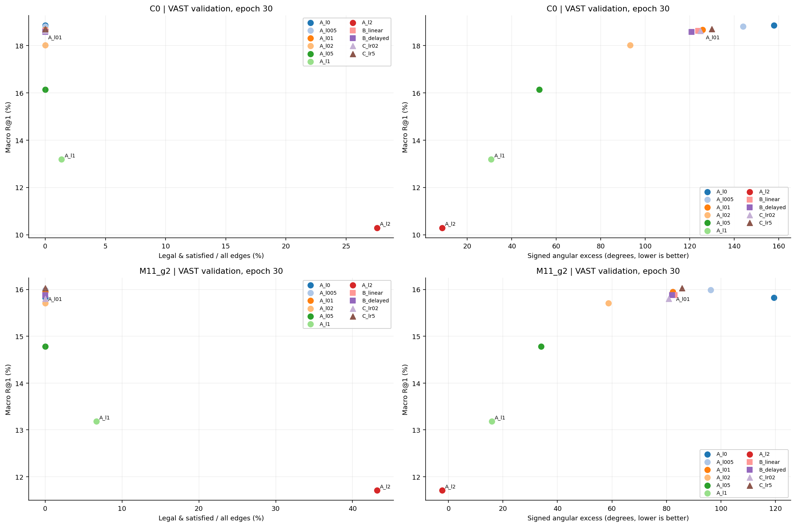
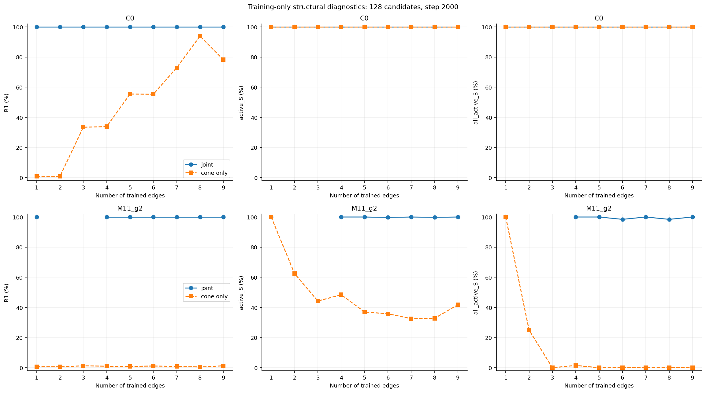

# 单变量改善蕴含满足率与检索取舍

[返回实验总览](../README.md)

| 字段 | 内容 |
| --- | --- |
| 编号 | EXP-20261026-server-b-entailment-singlefactor |
| 状态 | 56/58完成，2失败；全部本轮进程已退出 |
| 最后核对 | 2026-10-26T17:40:51.263057+00:00 UTC |
| 前序 | [512D MERU式scale对照](EXP-20261026-server-b-meru512-scale.md) |
| 权威报告 | [Markdown完整结果](../results/EXP-20261026-server-b-entailment-singlefactor/2026-10-26-results/REPORT.md) |

## 研究问题与协议

在尽量保留检索的前提下提高合法蕴含满足率，使用单变量比较辨认权重、时序、径向标量步长和逐边结构的作用。C0与M11_g2各自使用新训练的λ=.1对照；C0也是全局检索参照。没有检索损失硬阈值或性能提前淘汰。

22组全量：两路线各7个λ（0/.05/.1/.2/.5/1/2）、2个等累计权重时序（linear/delayed）、2个径向标量LR倍数（.2/5）。B/C均独立从对照初始化，只变所声明因素。36组训练诊断：两路线×9个逐边前缀图×joint/cone-only，每条保留边系数固定.1/9。共70个预先验证的单因素比较。

固定512D、seed50，VAST训练82608/验证2048；全量30轮9660更新、batch256；训练诊断固定128条、2000步、batch128。仅训练头部；未微调MSRVTT，未评估测试集。投影AMP FP16，官方MERU几何FP32，K=.1，原epsilon不改；真实有效梯度非有限即停止该组。仅七个无衰减径向标量参与C族LR干预。

主比较固定末轮；最佳检索和最佳合法满足率含epoch0，分别选模、单列附录。合法满足率分母为全部9N（D另报kN），同时报告合法覆盖、条件满足率与每视频九边同时满足。r/u/q来自真实512D特征。循环错配与最近错误视频不是人工非蕴含标签。

[完整冻结协议](../results/EXP-20261026-server-b-entailment-singlefactor/2026-10-26-results/protocol.json) · [源码与数据哈希](../results/EXP-20261026-server-b-entailment-singlefactor/2026-10-26-results/source_manifest.json) · [58组运行记录](../runs/EXP-20261026-server-b-entailment-singlefactor/README.md)

## 观察结果

- C0新对照：R@1 18.660%，合法满足率0.000%；本路线最高满足率条件C0__A_l2为27.572%，R@1 10.295%（相对对照-8.366 pp）。这是描述性取舍，不按预设容忍线筛选。
- C0九边训练诊断：joint的R@1/S=100.000%/100.000%；cone-only为78.255%/100.000%。样本数128，与全量验证分开解释。
- M11_g2新对照：R@1 15.951%，合法满足率0.000%；本路线最高满足率条件M11_g2__A_l2为43.202%，R@1 11.711%（相对对照-4.240 pp）。这是描述性取舍，不按预设容忍线筛选。
- M11_g2九边训练诊断：joint的R@1/S=100.000%/100.000%；cone-only为1.302%/41.840%。样本数128，与全量验证分开解释。

[全量末轮CSV](../results/EXP-20261026-server-b-entailment-singlefactor/2026-10-26-results/full_final.csv) · [训练诊断CSV](../results/EXP-20261026-server-b-entailment-singlefactor/2026-10-26-results/tiny_final.csv) · [70个因果对照差值](../results/EXP-20261026-server-b-entailment-singlefactor/2026-10-26-results/single_factor_deltas.csv)

## 图表

VAST validation 2048条，22个epoch30条件；[PDF](../results/EXP-20261026-server-b-entailment-singlefactor/2026-10-26-results/tradeoffs.pdf)。右列角度降低不等于严格包含。

固定128条训练集、step2000，joint与cone-only只在同一图中比较；[PDF](../results/EXP-20261026-server-b-entailment-singlefactor/2026-10-26-results/tiny_graphs.pdf)。完整半径箱线图、梯度曲线及多父兼容性见Markdown报告。

## 验证与限制

执行前22项CPU测试通过；终态独立审计复核1444个产物哈希、真实特征几何、保存的精确检索rank、选模规则、源代码不变、实际dtype和PID退出。58组共执行284110次更新；最高并发32、每卡最多4组。仅管理本任务登记进程。

[测试证据](../results/EXP-20261026-server-b-entailment-singlefactor/2026-10-26-results/implementation_tests.json) · [终态独立审计](../results/EXP-20261026-server-b-entailment-singlefactor/2026-10-26-results/audit.json) · [命令/PID/GPU](../results/EXP-20261026-server-b-entailment-singlefactor/2026-10-26-results/launch_records.json)

只有seed50，未验证跨种子稳定性；查看多个验证条件存在选择偏差。小样本拟合成功不等于全量泛化成功。未据此宣布唯一最佳方案。新实验与旧17组源码、结果分别保存，原有未提交修改保留。

## 下一步

依据完整Pareto取舍由用户选择需要进一步验证的方向；本轮不自动叠加干预、增补seed或启动微调。

## 变更记录

| UTC日期 | 事件 | 影响 |
| --- | --- | --- |
| 2026-10-26 | 执行已批准的58组单变量计划 | 新独立版本、70项对照验证、8卡有界并发 |
| 2026-10-26 | 完成汇总和审计 | 新增不可覆盖结果快照；不替换旧实验 |

远端状态尚未核实：自动审批拒绝了git fetch（外部网络及远端引用更新缺少明确授权）。本轮仅更新本地记录，未commit、push或上传。
