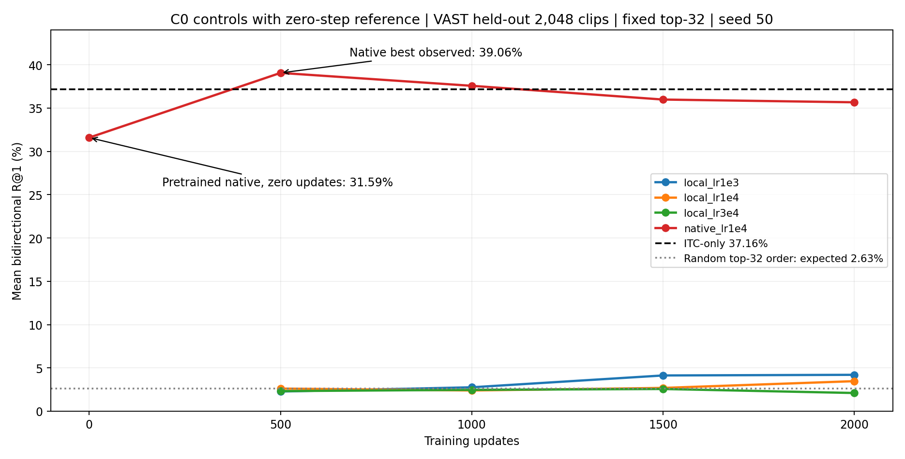
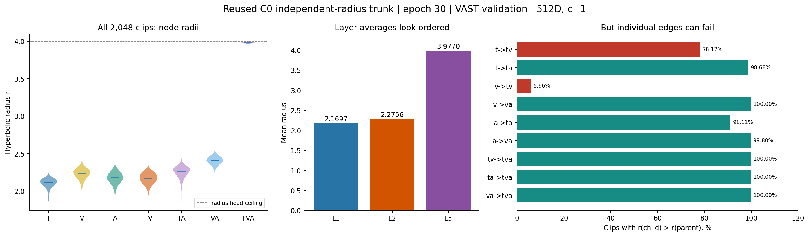

# ITM几何诊断：来源可分性没有转化为困难候选重排能力

[返回总览](../README.md) · `EXP-20261026-server-b-itm-geometry-diagnostics` · 原结果：2026-10-26～27；归档核对：2026-10-28T12:41:34.660651+00:00

**完整几何线性探针的双向R@1为21.2647%，比仅距离的19.5557%高1.7090pp，但仍显著低于原ITC-only的37.1582%。** 高来源AUROC不能证明层级匹配有效。早期轻量query matcher在2000步后仅2.10%～4.20%，没有通过结构对照；后续转向保留原生预训练交互的[ITM基线探索](EXP-20261027-server-b-itm-native-baseline.md)。

## 协议与证据

冻结30轮九对ITC/九边entailment trunk；验证2,048条、固定top32，漏召回保留在分母。两线性探针共用45→1模型、seed50、1000步、batch96、LR0.01，仅改变36个非距离特征是否置零；训练集4096 tuple归一化。错配复合节点现场重算。完整几何同时加入半径与锥违反量，不能单独归因于锥约束。

| 配对线性探针 | t→va R@1 (%) | va→t R@1 (%) |
|---|---:|---:|
| 仅距离 | <ins>15.0879</ins> | <ins>24.0234</ins> |
| 完整几何 | **18.4570** | **24.0723** |

[完整报告](../results/EXP-20261026-server-b-itm-geometry-diagnostics/2026-10-28-archive/GEOMETRY_PROBE_REPORT.md) · [机器结果](../results/EXP-20261026-server-b-itm-geometry-diagnostics/2026-10-28-archive/geometry_probe_results.json) · [困难来源诊断](../results/EXP-20261026-server-b-itm-geometry-diagnostics/2026-10-28-archive/HARD_DIAGNOSTIC_REPORT.md)。单seed且小幅差异未做种子稳定性验证；本探针不是token ITM，也不是PMRL对照。

## 早期结构与学习率对照

原生matcher LR1e-4在500步达到39.06%，2000步回落到35.67%；同候选零步原生matcher为31.59%。轻量matcher三学习率末轮仅3.47%、2.10%、4.20%。不同初始化结构的差距不证明所有统一matcher无效，但当前轻量基线不足以支撑进一步层级归因。

此图为四组seed50早期条件，与后续低学习率C0三seed是不同协议。[曲线PDF](../results/EXP-20261026-server-b-itm-geometry-diagnostics/2026-10-28-archive/analysis_20261027/07_c0_with_zero.pdf)。

半径分层只描述冻结表示，不能替代严格锥包含或有效重排。[完整分析及图注](../results/EXP-20261026-server-b-itm-geometry-diagnostics/2026-10-28-archive/analysis_20261027/REPORT.md) · [数值](../results/EXP-20261026-server-b-itm-geometry-diagnostics/2026-10-28-archive/analysis_20261027/analysis.json) · [逐边统计](../results/EXP-20261026-server-b-itm-geometry-diagnostics/2026-10-28-archive/analysis_20261027/edge_statistics.csv) · [图集PDF](../results/EXP-20261026-server-b-itm-geometry-diagnostics/2026-10-28-archive/analysis_20261027/all_figures.pdf)。

四组早期C0均有DONE；几何探针完成证据、协议与历史恢复信息见[结果目录](../results/EXP-20261026-server-b-itm-geometry-diagnostics/2026-10-28-archive/)及[运行索引](../runs/EXP-20261026-server-b-itm-geometry-diagnostics/README.md)。未追加训练或读取新的测试集。
