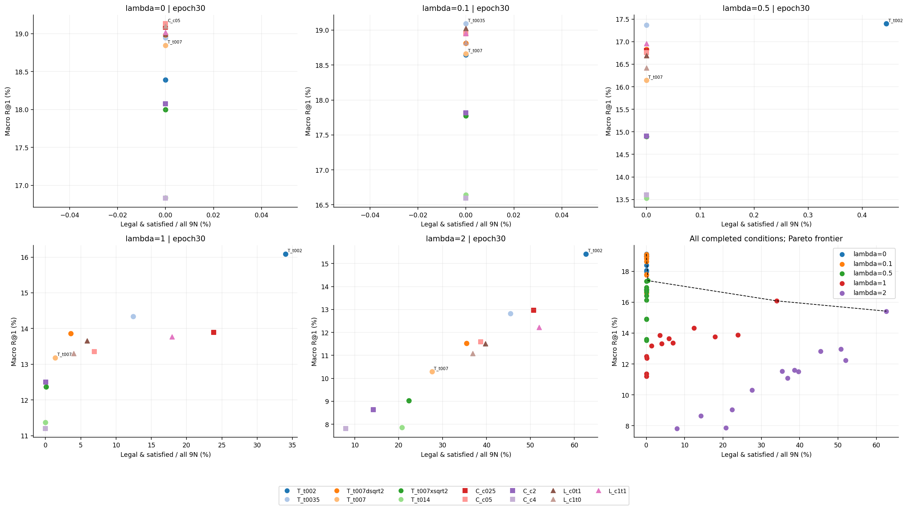
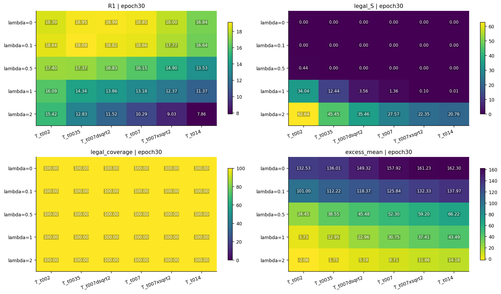
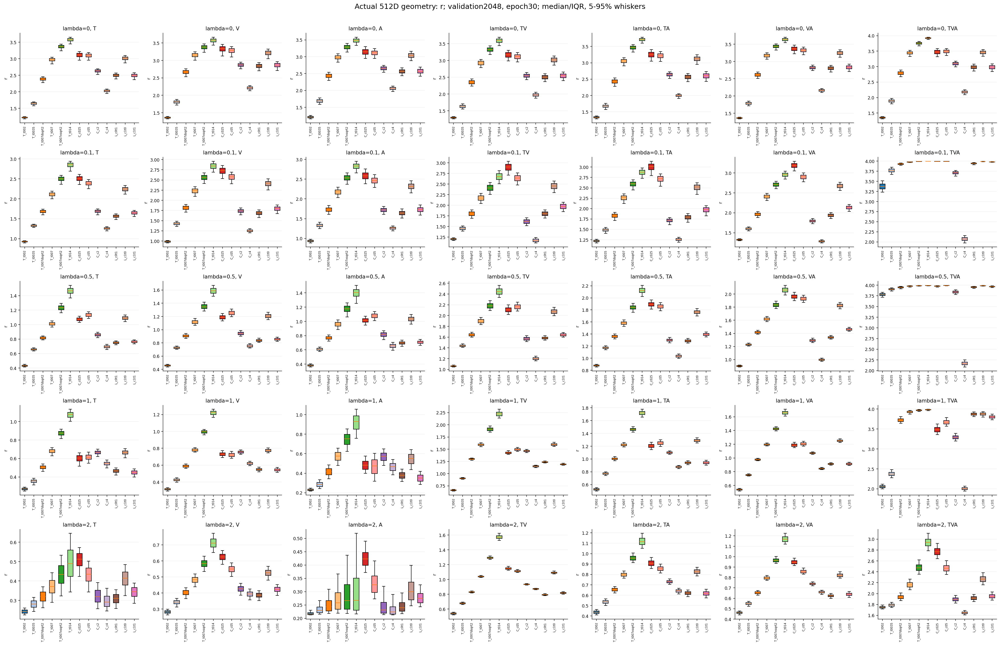
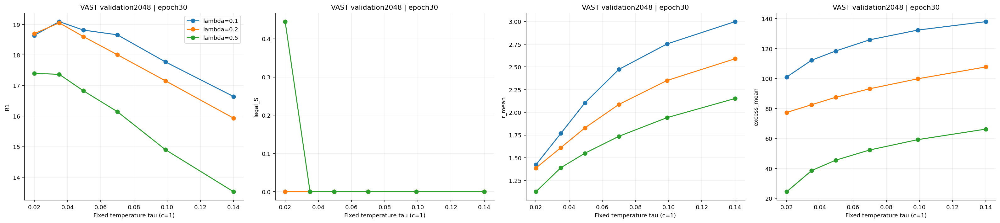
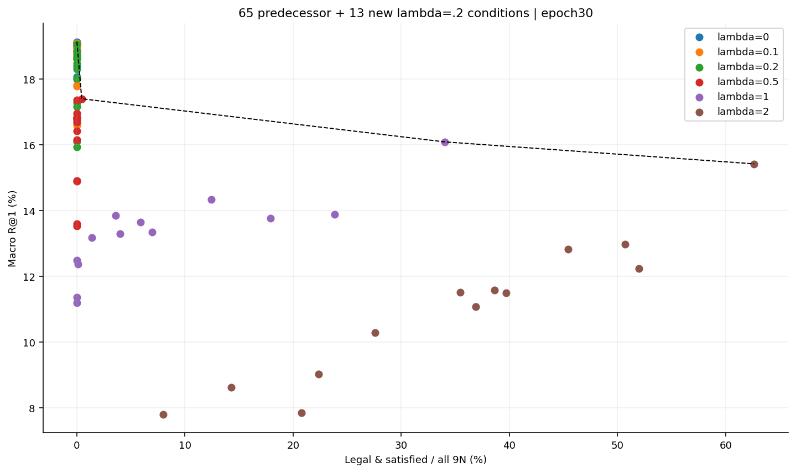
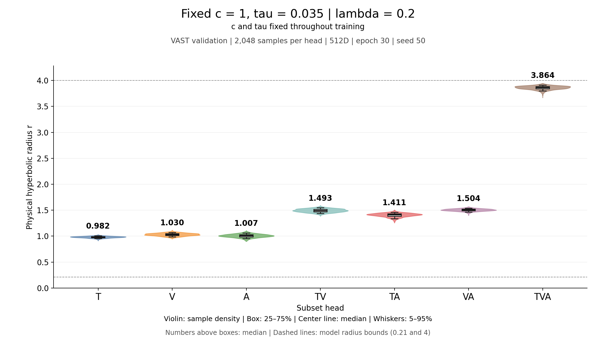
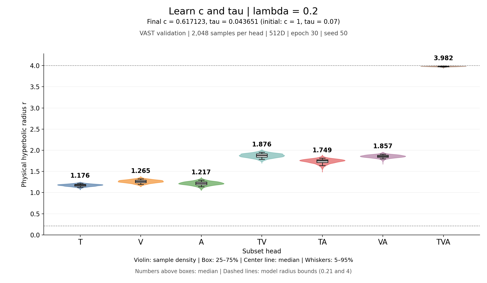
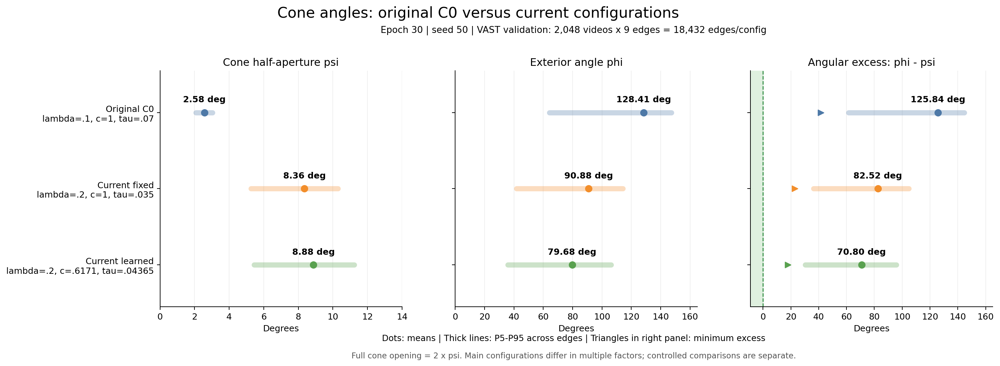
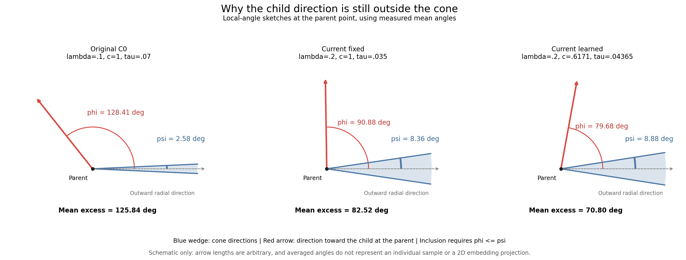
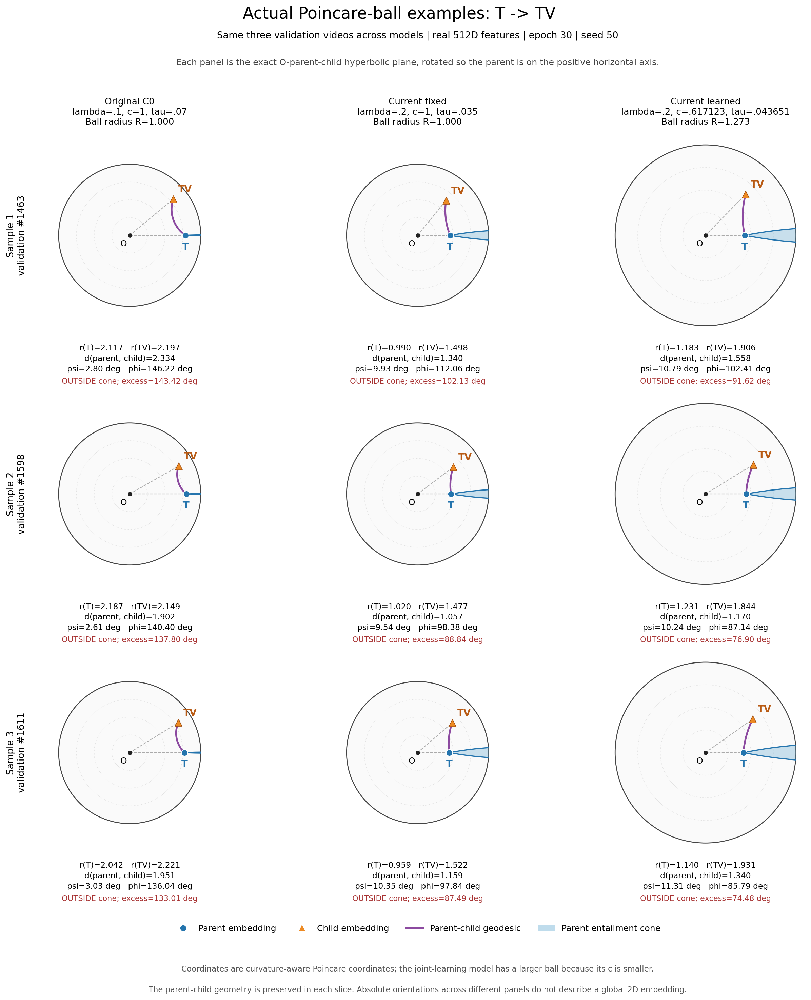

# C0温度、曲率与检索—蕴含取舍

[返回实验总览](../README.md)

| 字段 | 内容 |
| --- | --- |
| 编号 | EXP-20261027-server-b-c0-temperature-curvature |
| 状态 | 原65组完成；补充13/13完成、0失败；本轮进程全部退出 |
| 最后核对 | 2026-10-27T15:45:14.858701+00:00 UTC |
| 前序 | [单变量蕴含实验](EXP-20261026-server-b-entailment-singlefactor.md) |
| λ=.2补充结果 | [新报告](../results/EXP-20261027-server-b-c0-temperature-curvature/2026-10-27-lambda02-results/REPORT.md) · [匹配比较](../results/EXP-20261027-server-b-c0-temperature-curvature/2026-10-27-lambda02-results/LAMBDA_COMPARISON.md) |
| 原65组结果 | [完整Markdown报告](../results/EXP-20261027-server-b-c0-temperature-curvature/2026-10-27-results/REPORT.md) |
| 实现快照 | [最初冻结协议](../results/EXP-20261027-server-b-c0-temperature-curvature/2026-10-27-implementation/protocol.json)，保留未覆盖 |

## 研究问题与协议

检验C0温度和曲率能否改善检索与合法蕴含满足率的取舍。λ=0/.1/.5/1/2，各六个固定温度、四个新增固定曲率、三个新增学习开关条件，共65组。每个λ的c=1、τ=.07对照均新训练。学习开关是完整2×2条件归因；117项单因素比较包括65项λ内和52项相邻λ。20项τ√c匹配同时改变c和τ，只是辅助解释。

固定VAST train82608/validation2048，512D、seed50、batch256、每组30轮9660更新。相同初始化/数据顺序，物理r∈(.21,4)、初始r=1，x=direction·sinh(√c r)/√c，低曲率不补q下界。FP16投影与原版FP32几何、K=.1和epsilon保持固定；真实非有限训练停止并保存失败点。只训练头部，无微调或测试集。

主结果固定epoch30；最佳检索和最佳合法满足率含初始化、分别列出。S=合法且满足/全部9N，另报合法覆盖、条件满足率、九边同时满足、每边角度与错配控制。真实512D的r/u/q、c/τ/τ√c轨迹、实际边界占比、各参数梯度及统一物理半径局部导数均保留。没有检索硬门槛或性能提前淘汰。

[冻结协议](../results/EXP-20261027-server-b-c0-temperature-curvature/2026-10-27-results/protocol.json) · [源码与输入哈希](../results/EXP-20261027-server-b-c0-temperature-curvature/2026-10-27-results/source_manifest.json) · [运行索引](../runs/EXP-20261027-server-b-c0-temperature-curvature/README.md)

## 观察结果

下列最高S如有并列，按R@1展示一项，不表示唯一最优。

- 最高末轮检索：C0_l0__C_c05，R@1 19.132%，S/all 0.000%。
- 最高末轮合法满足率：C0_l2__T_t002，S/all 62.641%，R@1 15.422%。
- λ=0，本层最高S条件C0_l0__C_c05：R@1/S=19.132%/0.000%；相对同λ新对照ΔR@1=+0.285 pp，ΔS=+0.000 pp。
- λ=0.1，本层最高S条件C0_l01__T_t0035：R@1/S=19.092%/0.000%；相对同λ新对照ΔR@1=+0.431 pp，ΔS=+0.000 pp。
- λ=0.5，本层最高S条件C0_l05__T_t002：R@1/S=17.399%/0.445%；相对同λ新对照ΔR@1=+1.253 pp，ΔS=+0.445 pp。
- λ=1，本层最高S条件C0_l1__T_t002：R@1/S=16.089%/34.039%；相对同λ新对照ΔR@1=+2.905 pp，ΔS=+32.677 pp。
- λ=2，本层最高S条件C0_l2__T_t002：R@1/S=15.422%/62.641%；相对同λ新对照ΔR@1=+5.127 pp，ΔS=+35.069 pp。

全部双目标Pareto：C0_l0__C_c05, C0_l05__T_t002, C0_l1__T_t002, C0_l2__T_t002。完整表展示全部条件，不只列极值。单一seed、多条件验证选择，尚不能据此宣布普适最优或测试收益。

[65组末轮CSV](../results/EXP-20261027-server-b-c0-temperature-curvature/2026-10-27-results/full_final.csv) · [117项单因素差值](../results/EXP-20261027-server-b-c0-temperature-curvature/2026-10-27-results/single_factor_deltas.csv) · [20项尺度匹配辅助比较](../results/EXP-20261027-server-b-c0-temperature-curvature/2026-10-27-results/scale_matched_auxiliary.csv)

## 图表

VAST validation2048、epoch30；每个λ单独展示并给出所有条件Pareto。[PDF](../results/EXP-20261027-server-b-c0-temperature-curvature/2026-10-27-results/tradeoffs.pdf)。

固定c=1、五个λ×六个温度，全部末轮。[PDF](../results/EXP-20261027-server-b-c0-temperature-curvature/2026-10-27-results/temperature_matrix.pdf)。

每箱2048条512D特征，IQR/中位数/5–95%须线，按λ和七个头分列。[PDF](../results/EXP-20261027-server-b-c0-temperature-curvature/2026-10-27-results/distributions_r.pdf) · [r/u/q数值](../results/EXP-20261027-server-b-c0-temperature-curvature/2026-10-27-results/radius_statistics.csv)。u/q分布、曲率与学习开关、梯度轨迹详见主报告。

## 验证与限制

23项CPU测试通过；终态独立审计复核2925个产物哈希、真实r/u/q及九边几何、保存的精确检索rank、三种读出和选模、源码不变、实际dtype与PID退出。五个新对照中5/5与上一轮同λC0的末轮权重逐位相同，详细指标核对见审计。

共执行627900次更新（计划627900）；最高同时32组，每卡≤4组。准入显存边界与真实50更新的准备记录时间通过核验；运行保护来自封存代码，并非连续硬件跟踪证据。旧实验源码和数据保留。

[独立审计](../results/EXP-20261027-server-b-c0-temperature-curvature/2026-10-27-results/audit.json) · [测试](../results/EXP-20261027-server-b-c0-temperature-curvature/2026-10-27-results/implementation_tests.json) · [命令/PID/GPU和退出记录](../results/EXP-20261027-server-b-c0-temperature-curvature/2026-10-27-results/launch_records.json)

原始模型、特征、每轮权重和恢复点只保存在dataset_root/c0_temperature_curvature_20261027；不复制到日志仓库。报告只归档轻量数值和图表。错配不是语义真值，降低角度不等于严格包含，统一半径梯度也不等于实际受限参数更新。

## 下一步

根据完整Pareto及单因素差值选择需要进一步验证的设置；本轮不自动增加seed、叠加新干预或微调。

## λ=.2补充（已完成）

用户要求的13组补充已完成核验：13/13完成、0失败，共125580次更新。本轮与原65组累计78个条件，原65组源码、结果快照和运行记录全部保留。新增六个温度、四个曲率和三个学习开关，与原实验相同seed50、512D、30轮9660步及全部计算公式。

- λ=.2最高末轮检索：C0_l02__T_t0035，R@1=19.051%，S=0.000%。
- λ=.2最高末轮S=0.000%；并列时按R@1展示C0_l02__T_t0035。
- λ=.2的13组末轮S全部为0；增大到.2尚未在本轮网格内产生严格锥满足。检索、角度和半径的变化分别解释。

λ=.1的13组S也全部为0，最高检索为固定c=1、τ=.035的19.092%。λ=.1/.2/.5同配置的26项比较已逐项验证只改变λ；其中.1/.5来自前序记录，本轮只新训练.2。全部78组总体Pareto：C0_l0__C_c05, C0_l05__T_t002, C0_l1__T_t002, C0_l2__T_t002。

[λ=.2完整报告](../results/EXP-20261027-server-b-c0-temperature-curvature/2026-10-27-lambda02-results/REPORT.md) · [λ=.1/.2逐项比较](../results/EXP-20261027-server-b-c0-temperature-curvature/2026-10-27-lambda02-results/LAMBDA_COMPARISON.md) · [13组新末轮CSV](../results/EXP-20261027-server-b-c0-temperature-curvature/2026-10-27-lambda02-results/full_final.csv) · [78组汇总CSV](../results/EXP-20261027-server-b-c0-temperature-curvature/2026-10-27-lambda02-results/combined_78_final.csv)

VAST validation2048、固定epoch30，λ=.1/.5为原65组，λ=.2为本轮新训练。[PDF](../results/EXP-20261027-server-b-c0-temperature-curvature/2026-10-27-lambda02-results/neighbor_temperature.pdf)。

[PDF](../results/EXP-20261027-server-b-c0-temperature-curvature/2026-10-27-lambda02-results/combined_78_pareto.pdf) · [匹配来源与哈希](../results/EXP-20261027-server-b-c0-temperature-curvature/2026-10-27-lambda02-results/neighbors.json)。

25项CPU测试通过；终态审计核对585个产物哈希、真实几何、保存的检索rank、选模、dtype、源码不变与PID退出。新标准对照与更早λ=.2的C0__A_l02权重逐位一致：True。最高并发13组，全部本轮进程已退出。

[审计](../results/EXP-20261027-server-b-c0-temperature-curvature/2026-10-27-lambda02-results/audit.json) · [25项测试](../results/EXP-20261027-server-b-c0-temperature-curvature/2026-10-27-lambda02-results/implementation_tests.json) · [新源码/输入哈希](../results/EXP-20261027-server-b-c0-temperature-curvature/2026-10-27-lambda02-results/source_manifest.json) · [本轮启动和退出](../results/EXP-20261027-server-b-c0-temperature-curvature/2026-10-27-lambda02-results/launch_records.json) · [最初补充协议](../results/EXP-20261027-server-b-c0-temperature-curvature/2026-10-27-lambda02-implementation/protocol.json)

仅seed50的验证集结果；没有追加其他λ、seed、微调或测试。核对：2026-10-27T12:46:18.112303+00:00 UTC。

## λ=.2重点条件的独立半径图

按用户要求，将固定c=1、τ=.035和联合学习c、τ分别画成独立图。均为seed50、第30轮、2048条验证样本/头、真实512D特征重算的测地半径；两图使用相同坐标尺度。小提琴显示密度，箱体为IQR，须线为P5–P95，数字为中位数。

[固定参数PDF](../results/EXP-20261027-server-b-c0-temperature-curvature/2026-10-27-lambda02-radius-focus/radius_fixed_tau0035_c1_lambda02.pdf)。λ=.2，c和τ在训练中固定。

[联合学习PDF](../results/EXP-20261027-server-b-c0-temperature-curvature/2026-10-27-lambda02-radius-focus/radius_learned_c_tau_lambda02.pdf)。λ=.2，初始c=1、τ=.07，末轮c=.617123、τ=.043651。

梯度图的负值需区分：cosine<0表示两项损失梯度局部冲突；统一半径倍数a的dL/da<0表示增大半径会局部降低该损失。梯度范数和加权范数比例本身应非负，本轮13组所有保存记录已核对。该缩放诊断不等同于实际AdamW更新。

[图版说明与梯度符号解释](../results/EXP-20261027-server-b-c0-temperature-curvature/2026-10-27-lambda02-radius-focus/README.md) · [14个头的半径统计](../results/EXP-20261027-server-b-c0-temperature-curvature/2026-10-27-lambda02-radius-focus/radius_statistics.csv) · [末轮梯度数值](../results/EXP-20261027-server-b-c0-temperature-curvature/2026-10-27-lambda02-radius-focus/gradient_endpoints.csv) · [来源与哈希](../results/EXP-20261027-server-b-c0-temperature-curvature/2026-10-27-lambda02-radius-focus/provenance.json)

## 与最初C0的锥角可视化

按用户要求与最初C0比较。参照来自首次17组实验的C0原始末轮（c=1、τ=.07、λ=.1），已核对其样本ID、七个头的特征、几何和检索均与后来重新训练的标准对照精确一致。所有配置均为seed50、第30轮、VAST validation2048，角度由真实512D特征重算。

[总览PDF](../results/EXP-20261027-server-b-c0-temperature-curvature/2026-10-27-cone-angles-original/cone_angle_overview.pdf)。点是均值，线段为18432条边的P5–P95分布，右图三角形是最小超锥角。ψ为半开角，完整开口为2ψ；区间不是置信区间。

[示意PDF](../results/EXP-20261027-server-b-c0-temperature-curvature/2026-10-27-cone-angles-original/cone_mean_angle_schematic.pdf)。蓝色为父锥方向，红色为朝向子节点的方向；仅用实测平均角度作局部示意，箭头长度任意，不表示具体样本位置或二维嵌入投影。

原始C0的平均半开角为2.576°，当前固定组和联合学习组分别为8.356°、8.878°；平均外向夹角由128.411°降至90.875°、79.679°。当前最小超锥角仍为22.849°、17.813°，合法满足率均为0。主图属于多因素配置的读出比较，单变量解释另用四项已核对配置差异的匹配比较。

[全部图表、数据与解释](../results/EXP-20261027-server-b-c0-temperature-curvature/2026-10-27-cone-angles-original/README.md) · [真实角度对分布](../results/EXP-20261027-server-b-c0-temperature-curvature/2026-10-27-cone-angles-original/cone_angle_pair_density.png) · [单因素变化分解](../results/EXP-20261027-server-b-c0-temperature-curvature/2026-10-27-cone-angles-original/cone_single_factor_changes.png) · [来源与哈希](../results/EXP-20261027-server-b-c0-temperature-curvature/2026-10-27-cone-angles-original/provenance.json)

## 真实样本的庞加莱圆盘图

按用户澄清，直接显示真实样本在庞加莱圆盘中的父点、子点、测地线和父锥。固定随机选取验证索引1463、1598、1611；同一行是同一视频，三列分别为最初C0、当前固定c=1/τ=.035/λ=.2，以及λ=.2联合学习c/τ。均使用既有第30轮真实512D特征。

[T→TV PDF](../results/EXP-20261027-server-b-c0-temperature-curvature/2026-10-27-poincare-examples/poincare_t_to_tv_examples.pdf) · [TV→TVA PNG](../results/EXP-20261027-server-b-c0-temperature-curvature/2026-10-27-poincare-examples/poincare_tv_to_tva_examples.png) · [TV→TVA PDF](../results/EXP-20261027-server-b-c0-temperature-curvature/2026-10-27-poincare-examples/poincare_tv_to_tva_examples.pdf)

蓝点为父嵌入，橙色三角为子嵌入，紫线为双曲测地线，蓝色区域为父点蕴含锥。圆盘半径随曲率为1/√c，联合组约1.273，三列采用相同坐标尺度。每格取原点与该父子对张成的精确二维双曲截面，并旋转对齐父点；这保留该对点的半径、距离与锥角，不展示所有模态之间的共同二维布局。

18个父子对均通过几何核验；双曲距离的高精度重构误差约1.2e-14，角度与原FP32记录最大差异约0.000280°，入锥判定全部一致。前面的均值角度示意只作角度说明；样本空间位置以本节实际圆盘图为准。

[读图说明、抽样与方法](../results/EXP-20261027-server-b-c0-temperature-curvature/2026-10-27-poincare-examples/README.md) · [18个父子对坐标及指标](../results/EXP-20261027-server-b-c0-temperature-curvature/2026-10-27-poincare-examples/sample_geometry.csv) · [来源和保真核验](../results/EXP-20261027-server-b-c0-temperature-curvature/2026-10-27-poincare-examples/provenance.json)

## 变更记录

| UTC日期 | 事件 | 影响 |
| --- | --- | --- |
| 2026-10-27 | 23项测试与源码封存后运行65组 | 五个新对照，固定预算，有界8卡并发 |
| 2026-10-27 | 终态审计及本地结果归档 | 新增结果快照，保留实现快照和旧实验 |
| 2026-10-27 | 按用户要求补充λ=.2的13组 | 13/13完成，25项测试及终态审计通过；新增匹配报告，保留原65组 |
| 2026-10-27 | 新增两组独立半径图与梯度符号说明 | 使用既有epoch30特征，新增图版快照与统计核验 |
| 2026-10-27 | 新增与最初C0的锥角可视化 | 重算六个末轮配置、54项逐边分布；保留旧图版 |
| 2026-10-27 | 按澄清新增真实样本庞加莱图 | 三个样本、三种模型、两条父子边；距离与锥角保真核验通过 |

远端状态尚未核实：先前git fetch被自动审批拒绝（外部网络和远端引用更新缺少明确授权）。本轮未commit、push或上传。

## 2026-10-28 λ=.3联合学习补充（已完成）

按用户要求仅新增C0_l03__L_c1t1。曲率与温度均可学习，与.2/.5匹配配置只有λ不同；512D、seed50、batch256、VAST train82608/val2048，30轮9660步。原78组保留，累计79条件完成。

末轮R@1=18.107%，平均超锥角=52.064°，严格合法满足率=0.000%。[完整匹配报告](../results/EXP-20261027-server-b-c0-temperature-curvature/2026-10-28-lambda03-results/REPORT.md) · [独立核验](../results/EXP-20261027-server-b-c0-temperature-curvature/2026-10-28-lambda03-results/audit.json) · [运行记录](../runs/EXP-20261027-server-b-c0-temperature-curvature/20261028T122522-server-b-C0_l03__L_c1t1-seed50.md)。三组保存特征重算检索及几何通过，进程已退出；未微调或测试。

核对：2026-10-28T12:32:16.354652+00:00 UTC。远端状态未核实：git fetch被自动审批拒绝，未commit/push/upload。
