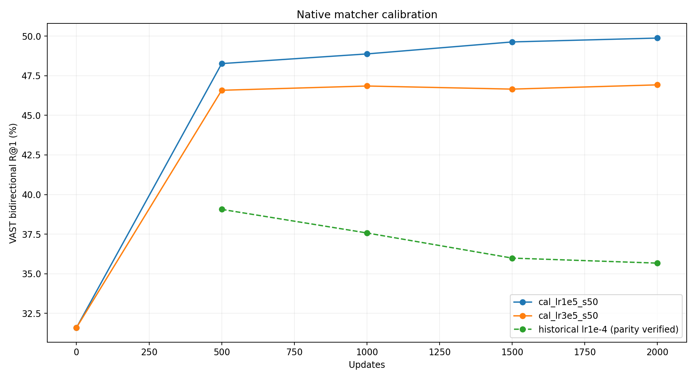

# 冻结ITC的ITM探索：保留C0，来源负例与hard采样未带来收益

[返回总览](../README.md) · `EXP-20261027-server-b-itm-native-baseline` · 结果完成：2026-10-28 04:17 UTC；归档核对：2026-10-28T12:41:34.660651+00:00

**C0三seed的VAST验证双向R@1为49.8128% ± 0.4189pp；hard-negative版本平均下降5.5583pp，三组配对差值全部为负。** 来源混合与多任务监督也没有超过C0。按预定验证门槛锁定C0后，外部MSRVTT884与VATEX可用子集的双向R@1分别为46.2104% ± 0.3440pp、79.1571% ± 0.1109pp。这里的标准差均是三个训练seed的样本标准差。

## 条件与选择规则

冻结现有512D七节点ITC trunk，仅训练保留原生VAST预训练交互结构的独立matcher；几何不作为输入或损失。训练82,608条、验证2,048条，来源视频分离；每步TVA曝光96，固定top32候选，候选漏召回计入失败。先校准学习率/预算，再统一使用2000步末点，不能事后逐变体挑历史最高点。辅助TV/TA任务增加计算，不能称为等计算预算。

C0使用LR1e-5；主任务为t↔va双向R@1，不是六方向平均。筛选seed50后，H_C0与C0做50/51/52配对；支持新方法要求平均增益>2σ且三个差值都为正。阈值为0.8377pp，H_C0未通过，因此最终选C0。没有测试集选模。

## 核心验证结果

| 相同2000步预算、三seed配对 | VAST双向R@1均值 (%) | 相对C0 (pp) |
|---|---:|---:|
| C0 | **49.8128** | — |
| H_C0，hard ρ=.5 | <ins>44.2546</ins> | −5.5583 |

seed50来源负例N-t、N-u分别为34.0088%、31.2988%，低于同seed C0的49.8779%。来源混合下M0、M-TV、M-TA、M-Both为33.9844%、31.7627%、33.6670%、33.7158%；hard下H-M0/H-M为43.0420%/42.1387%。这些筛选结果只描述seed50，不能当作三seed稳定性比较。

C0_s50音频相关a→tv、tv→a的R@1仅2.4902%、5.8594%；主任务提升不能等同于全方向均衡改善。完整六方向和来源诊断见[机器结果](../results/EXP-20261027-server-b-itm-native-baseline/2026-10-28-final/reports/results.json)。

## 锁定后外部评测

| 数据集 | 可用评测范围 | C0三seed双向R@1 (%) |
|---|---|---:|
| MSRVTT | 884视频 | 46.2104 ± 0.3440 |
| VATEX | 1,224视频 / 12,240 captions | 79.1571 ± 0.1109 |

两行是不同数据集，不参与同列排名。均非标准全量榜单；本轮没有同协议PMRL训练对照，不能据此声称超过PMRL。三份[外部结果](../results/EXP-20261027-server-b-itm-native-baseline/2026-10-28-final/external_results/)绑定同一[选择锁](../results/EXP-20261027-server-b-itm-native-baseline/2026-10-28-final/SELECTION_LOCK.json)。

图为源报告按各run固定预算末点绘制的结果；筛选seed与三seed复核需分别解读。[PDF](../results/EXP-20261027-server-b-itm-native-baseline/2026-10-28-final/reports/figures.pdf) · [第二张分析图](../results/EXP-20261027-server-b-itm-native-baseline/2026-10-28-final/reports/figure_2.png) · [完整原报告](../results/EXP-20261027-server-b-itm-native-baseline/2026-10-28-final/reports/REPORT.md)。

## 完成范围与限制

已核实16份run记录（C0_s50复用校准结果，不是16次独立训练）、各run的DONE及三份外部评测成功记录；[全局完成标记](../results/EXP-20261027-server-b-itm-native-baseline/2026-10-28-final/COMPLETE.json)与[调度终态](../results/EXP-20261027-server-b-itm-native-baseline/2026-10-28-final/logs/status.json)一致。失败/恢复记录保留于快照的attempts和[运行索引](../runs/EXP-20261027-server-b-itm-native-baseline/README.md)。

150条语义审查仍未人工完成，不报告假负例率；几何接入token matcher、边级matcher和联合trunk训练没有被本轮证明有效。此前10月27日“运行中”的[阶段报告](../results/EXP-20261027-server-b-itm-native-baseline/2026-10-28-final/history-20261027/REPORT.md)作为历史保留，当前权威状态以本卡及10月28日完成快照为准。
