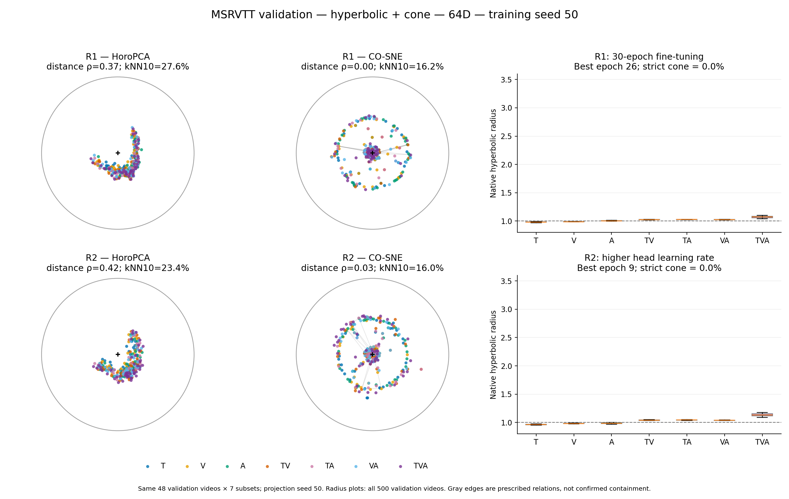
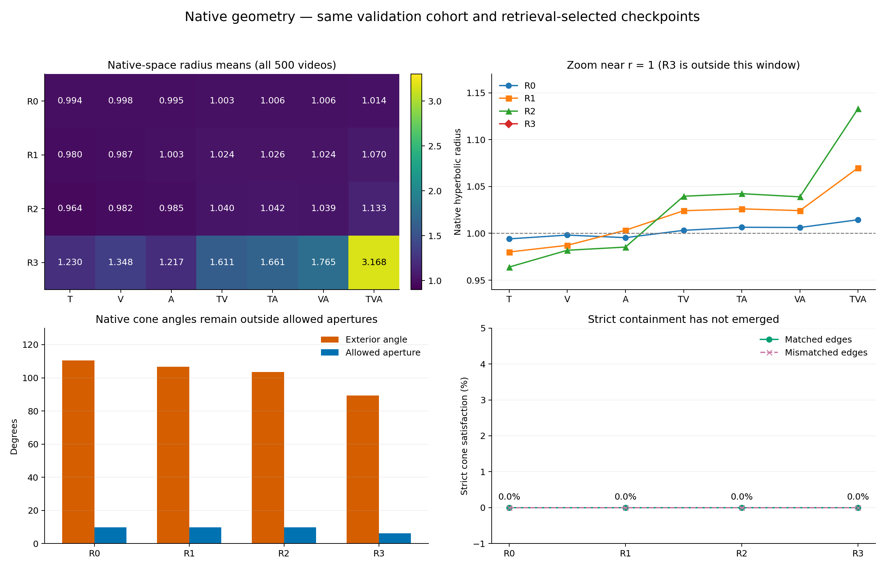
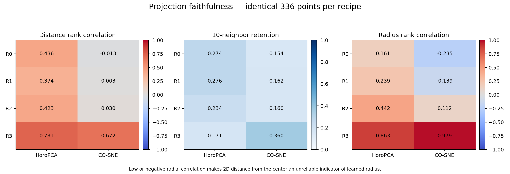

# 双曲64D训练方案：HoroPCA、CO-SNE与原空间诊断

本报告比较已完成的R0/R1/R2/R3双曲有锥模型。所有模型为64D、训练seed50、锥权重0.1，使用各自按检索指标选出的最佳checkpoint；这是验证集分析，未进行最终测试。

主要变化来自R3：单模态、双模态、三模态的原空间平均半径分别约1.265、1.679、3.168，明显脱离R0的r≈1状态。R1/R2径向分层变化较小。R3同时改变预训练数据、训练量与阶段，当前比较不能将变化单独归因于“训练更充分”或训练时长。四个方案在500个验证样本的严格父子锥约束及九边同时满足率仍为0%，径向分层改善不等于严格层级已经成立。

## 主图

上排R0，下排R3；左HoroPCA，中CO-SNE，右原空间半径。两个投影坐标均使用单位Poincaré圆盘，不做径向缩放。

[本图PDF](geometry_R0_vs_R3.pdf) · [全部四页PDF](geometry_validation_report.pdf)

[R1/R2 PDF](geometry_R1_vs_R2.pdf)

## 原空间半径与层级诊断

箱线图使用全部500个验证视频，箱体为四分位数、须为5%–95%，隐藏离群点；所有主图半径纵轴统一。半径是原空间双曲距离r=asinh(||spatial||)，不是二维点到圆心的欧氏距离。半径大小没有“越大越好”的性能含义。

| 方案 | 最佳轮次 | 单模态平均半径 | 双模态平均半径 | TVA平均半径 | 验证R@1↑ | 平均锥违反量↓ | 严格满足率↑ |
|---|---:|---:|---:|---:|---:|---:|---:|
| R0 | 5 | 0.996 | 1.005 | 1.014 | 25.93 | 1.759 | **0.00%** |
| R1 | 26 | 0.990 | 1.025 | 1.070 | **28.60** | 1.690 | **0.00%** |
| R2 | 9 | 0.977 | 1.040 | 1.133 | 26.73 | <ins>1.636</ins> | **0.00%** |
| R3 | 7 | 1.265 | 1.679 | 3.168 | <ins>28.10</ins> | **1.449** | **0.00%** |

严格满足率全为0的并列标记不表示成功。R3父子外角平均约89.25°、允许孔径约6.20°，方向条件仍未满足。

[原空间PDF](native_geometry_comparison.pdf) · [原空间汇总CSV](native_geometry.csv)

## 降维保真度

每个方案固定同一批48个验证视频、七子集共336点，抽样和投影seed均为50。颜色表示观测子集类型，不是语义类别；灰线只画两个视频的指定父子关系，不表示约束已成立。各模型独立拟合投影，仅以正交旋转/反射对齐R0，无平移或缩放。

下表排名仅在同一方案内比较两种投影。R3的CO-SNE半径相关性较高，但局部邻域保留仍只有约36%；HoroPCA约17%。R0/R1的CO-SNE半径相关性为负，二维中心聚集不能作为真实半径小的证据。

| 方案 | 投影 | 距离Spearman↑ | kNN10保留率↑ | 半径Spearman↑ |
|---|---|---:|---:|---:|
| R0 | HoroPCA | **0.436** | **27.4**% | **0.161** |
| R0 | CO-SNE | <ins>-0.013</ins> | <ins>15.4</ins>% | <ins>-0.235</ins> |
| R1 | HoroPCA | **0.374** | **27.6**% | **0.239** |
| R1 | CO-SNE | <ins>0.003</ins> | <ins>16.2</ins>% | <ins>-0.139</ins> |
| R2 | HoroPCA | **0.423** | **23.4**% | **0.442** |
| R2 | CO-SNE | <ins>0.030</ins> | <ins>16.0</ins>% | <ins>0.112</ins> |
| R3 | HoroPCA | **0.731** | <ins>17.1</ins>% | <ins>0.863</ins> |
| R3 | CO-SNE | <ins>0.672</ins> | **36.0**% | **0.979** |

[保真度CSV](projection_quality.csv) · [保真度PDF](projection_faithfulness.pdf)

## 实现与核验

复用此前作者实现及已记录兼容补丁：HoroPCA 500步、LR0.05，Fréchet中心化后以等距变换复位原始原点；CO-SNE 1000步、perplexity20、LR5、径向步长0.1、gamma0.1。没有根据图形好坏调参。

R1/R2/R3直接使用训练结束时重载best后保存的验证特征。R0仅补做一次验证推理，500个视频的检索和几何指标与登记记录完全一致，推理显存峰值5.709GiB，提取进程已退出。所有后续投影只用2个CPU线程。未停止、重启或修改正式训练任务。

四方案原空间边指标复算误差均为0；半径均值误差小于5e-16；Lorentz/Poincaré距离转换误差小于1.1e-14；HoroPCA紧凑目标和梯度与作者公式一致；CO-SNE内部更新与原作者实现的短程核对完全一致。四张PNG已进行视觉检查。

本次固定500视频验证集，与之前884视频测试集图不是同一批投影样本；只在本报告四方案间做匹配比较。单训练seed、单投影seed，不声称跨种子稳健性。

[完整来源与参数](provenance.json) · [数值检查](implementation_checks.json) · [作者来源](author_implementation_manifest.json) · [兼容补丁](author_patch_manifest.json)
