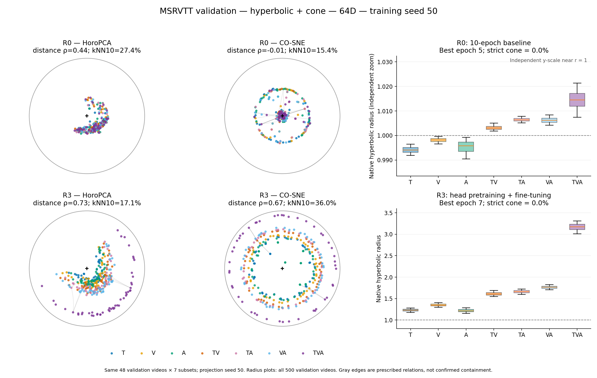

# R0/R3 半径图：baseline 独立纵轴

2026-10-27 图版调整。复用 10-23 的全部验证特征和既有 HoroPCA/CO-SNE 投影，不重新训练或拟合投影。

右上 R0（10-epoch baseline）的半径纵轴独立放大至约 0.9835–1.0324，以显示接近 1 的分布；右下 R3 保持 0.8–3.6。上下箱体的视觉高度不可直接比较，请读取各自刻度。箱体、5%–95% 须线及所有实验数值不变。

[本图 PDF](geometry_R0_vs_R3.pdf) · [原版报告及统一纵轴图](../2026-10-23-geometry-validation/README.md) · [绘图脚本](redraw.py) · [输入哈希与核验](provenance.json)

数据：MSRVTT 验证集 500 视频，64D，训练 seed50；投影为相同的 48 视频 × 7 子集，投影 seed50。R0/R3 分别为检索选出的 epoch5/epoch7，严格锥满足率均为 0%。
