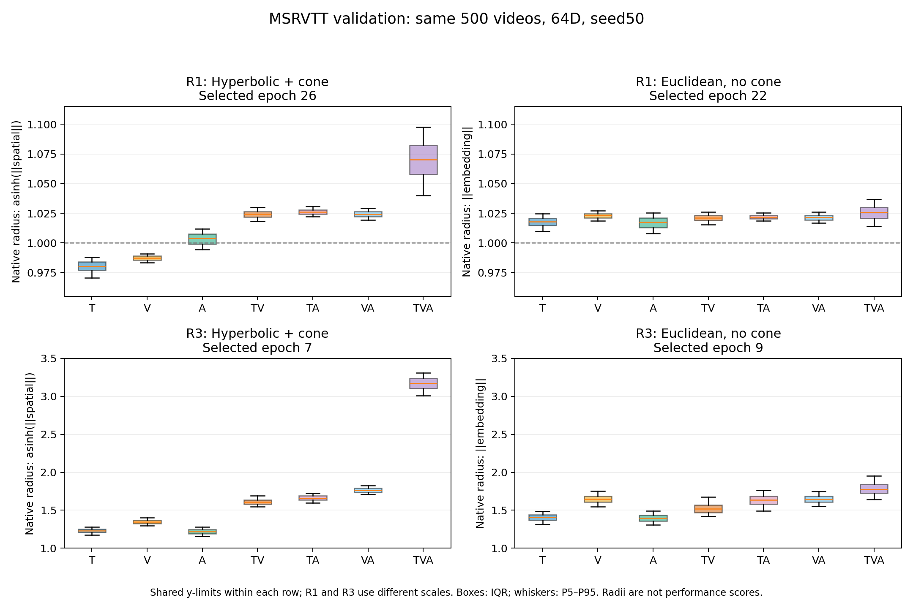

# 64D 同训练方案对比与 R1/R3 半径分布

核对时间：2026-10-27T18:09:19.284358+00:00。仅整理已有结果并在 CPU 上读取已保存验证特征；未训练、未新增测试推理。

本补充与[五方法最终测试报告](../2026-10-27-five-method-tests/README.md)配套。主报告比较各方法选中的方案；本补充在 R0/R1/R2/R3 各自内部比较方法，避免把不同训练方案混为同预算对照。

## 最终选中的双曲 R1：半径仍接近 1

使用与最终测试模型相同的最佳 checkpoint（微调 epoch26），下列半径来自 **500 个验证视频**，不是测试集。R1 为30轮微调，未增加VAST头部预训练。单模态/双模态/三模态平均半径约 **0.9902 / 1.0248 / 1.0699**；有轻微分层，但整体仍接近初始化 r=1。严格锥满足率为0%。

| 子集 | 平均半径 | 标准差 | P5 | 中位数 | P95 |
|---|---:|---:|---:|---:|---:|
| T | 0.9801 | 0.0054 | 0.9707 | 0.9802 | 0.9882 |
| V | 0.9872 | 0.0024 | 0.9833 | 0.9873 | 0.9907 |
| A | 1.0033 | 0.0055 | 0.9943 | 1.0039 | 1.0118 |
| TV | 1.0241 | 0.0036 | 1.0181 | 1.0242 | 1.0301 |
| TA | 1.0261 | 0.0027 | 1.0220 | 1.0260 | 1.0308 |
| VA | 1.0242 | 0.0030 | 1.0194 | 1.0241 | 1.0292 |
| TVA | 1.0699 | 0.0173 | 1.0399 | 1.0704 | 1.0976 |

## R1 与 R3 的半径分布

[PDF](radius_R1_R3.pdf) · [完整七头分位数 CSV](radius_statistics.csv)

同一行采用相同纵轴范围；R1 行放大至0.955–1.115，R3 行为1.0–3.5，不能直接比较上下箱体视觉高度。每个头500条数据，箱体为IQR，须为P5–P95，隐藏离群点。双曲半径为 asinh(||spatial||)，欧氏半径为 ||embedding||，均由原64D特征计算，未使用二维投影。不同几何的相同数值不代表相同的距离结构。

| 方法 | 方案 | 单模态平均半径 | 双模态平均半径 | TVA平均半径 |
|---|---|---:|---:|---:|
| 双曲有锥 | R1 | 0.9902 | 1.0248 | 1.0699 |
| 双曲有锥 | R3 | 1.2650 | 1.6791 | 3.1685 |
| 欧氏无锥 | R1 | 1.0191 | 1.0214 | 1.0254 |
| 欧氏无锥 | R3 | 1.4834 | 1.6015 | 1.7846 |

半径没有越大越好的性能方向，因此不标最优。R3双曲的径向分层明显强于R1；欧氏R3也整体向外移动，但层间分离较弱。欧氏R3的V均值约1.6465，高于TV约1.5254，说明层均值排序不能替代逐边排序。双曲R1和R3的严格锥满足率均为0%；不能把较强径向分层称为已经形成严格包含层级。

## 双曲有锥与欧氏无锥：同方案验证集比较

所有数值来自相同500视频验证集、64D、seed50、六方向macro，按每个方案内的两个方法分别排名。每个方法/方案仍使用各自验证最优checkpoint，因此选中epoch可不同。R0=10轮；R1=30轮；R2=10轮且提高头部学习率；R3=VAST头部预训练后10轮微调。双曲有锥与欧氏无锥同时改变几何和锥目标，不能视为纯曲率消融。

| 方案 | 方法 | 最佳epoch | 验证R@1 ↑ | 验证R@5 ↑ | 验证R@10 ↑ |
|---|---|---:|---:|---:|---:|
| R0 | 双曲有锥 | 5 | <ins>25.9333</ins> | **52.0000** | <ins>63.1333</ins> |
| R0 | 欧氏无锥 | 7 | **26.0667** | <ins>51.7000</ins> | **64.4000** |
| R1 | 双曲有锥 | 26 | <ins>28.6000</ins> | <ins>54.5667</ins> | **66.8667** |
| R1 | 欧氏无锥 | 22 | **28.7333** | **54.9000** | <ins>66.4667</ins> |
| R2 | 双曲有锥 | 9 | <ins>26.7333</ins> | **53.7333** | <ins>65.8667</ins> |
| R2 | 欧氏无锥 | 10 | **26.8333** | <ins>53.5000</ins> | **66.2667** |
| R3 | 双曲有锥 | 7 | <ins>28.1000</ins> | <ins>55.1000</ins> | **65.9333** |
| R3 | 欧氏无锥 | 9 | **28.2667** | **55.3000** | <ins>65.8000</ins> |

R3双曲/欧氏验证R@1为28.1000%/28.2667%，R@5为55.1000%/55.3000%，R@10为65.9333%/65.8000%。双方R3的R@1都略低于各自R1，但R@5略高；不存在所有指标一致改善的结论。单seed差异不代表稳定优势。

## 同方案最终测试：目前可用的 R1 对照

| 方法 | 方案 | 测试R@1 ↑ | 测试R@5 ↑ | 测试R@10 ↑ |
|---|---|---:|---:|---:|
| 双曲有锥 | R1 | **22.1342** | <ins>45.9842</ins> | <ins>57.2398</ins> |
| 欧氏无锥 | R1 | <ins>21.8137</ins> | **46.0219** | **57.6923** |

这里使用884视频测试集。现有 method_evaluations 中**没有双曲有锥R3或欧氏无锥R3的最终测试JSON**；对应joint目录只保存验证结果。上面的R3数字不可标为最终测试结果，本次没有补跑测试或更改选模规则。

## 五方法同方案验证表

### R0

| 方法 | 最佳epoch | 验证R@1 ↑ | 验证R@5 ↑ | 验证R@10 ↑ |
|---|---:|---:|---:|---:|
| 双曲有锥 | 5 | <ins>25.9333</ins> | **52.0000** | 63.1333 |
| 欧氏无锥 | 7 | **26.0667** | 51.7000 | **64.4000** |
| PMRL | 6 | 25.7667 | <ins>51.8333</ins> | <ins>63.4333</ins> |
| VAST | 7 | 20.5333 | 43.2333 | 54.4333 |
| GRAM | 10 | 21.2000 | 41.9000 | 50.7000 |

### R1

| 方法 | 最佳epoch | 验证R@1 ↑ | 验证R@5 ↑ | 验证R@10 ↑ |
|---|---:|---:|---:|---:|
| 双曲有锥 | 26 | <ins>28.6000</ins> | <ins>54.5667</ins> | **66.8667** |
| 欧氏无锥 | 22 | **28.7333** | **54.9000** | <ins>66.4667</ins> |
| PMRL | 23 | 26.3667 | 53.3333 | 65.8667 |
| VAST | 27 | 23.4000 | 48.3333 | 59.0333 |
| GRAM | 7 | 21.4000 | 41.7333 | 50.6000 |

### R2

| 方法 | 最佳epoch | 验证R@1 ↑ | 验证R@5 ↑ | 验证R@10 ↑ |
|---|---:|---:|---:|---:|
| 双曲有锥 | 9 | <ins>26.7333</ins> | **53.7333** | <ins>65.8667</ins> |
| 欧氏无锥 | 10 | **26.8333** | <ins>53.5000</ins> | **66.2667** |
| PMRL | 6 | 26.1000 | 51.9667 | 64.0000 |
| VAST | 7 | 20.9667 | 44.6000 | 55.4000 |
| GRAM | 10 | 20.0667 | 41.6000 | 50.3000 |

### R3

| 方法 | 最佳epoch | 验证R@1 ↑ | 验证R@5 ↑ | 验证R@10 ↑ |
|---|---:|---:|---:|---:|
| 双曲有锥 | 7 | <ins>28.1000</ins> | <ins>55.1000</ins> | **65.9333** |
| 欧氏无锥 | 9 | **28.2667** | **55.3000** | <ins>65.8000</ins> |
| PMRL | 8 | 27.5000 | 53.0667 | 64.2667 |
| VAST | 9 | 24.5333 | 48.0000 | 58.8000 |
| GRAM | 9 | 13.9667 | 28.0333 | 35.5333 |

原生方法保留各自目标和前向路径；相同方案统一的是训练安排，不代表目标、模型结构或计算量完全一致。

## 数据与核验

[全部同方案验证指标](validation_recipes.csv) · [结构化结果](results.json) · [来源与核验](provenance.json) · [生成脚本](summarize.py)

核对五方法选模文件与全体锁哈希、四个R1/R3的DONE与选模checkpoint元数据、相同500个验证ID、真实64D特征半径均值及P5/P95与原记录一致；R1测试记录核对相同884候选及checkpoint。未加载模型权重或重跑训练/推理。std为同一checkpoint跨验证视频的总体标准差，不是训练种子标准差；分位区间不是置信区间。
