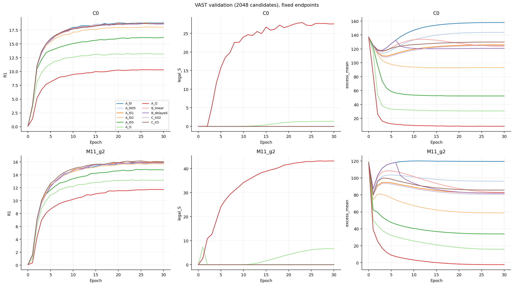
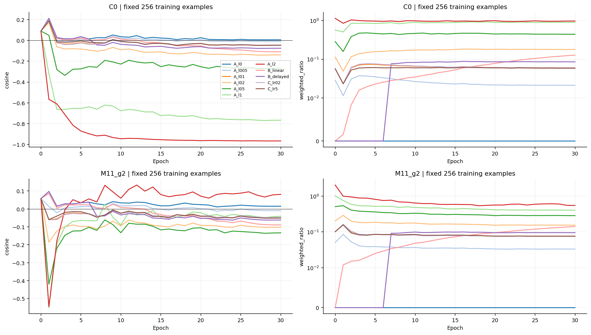
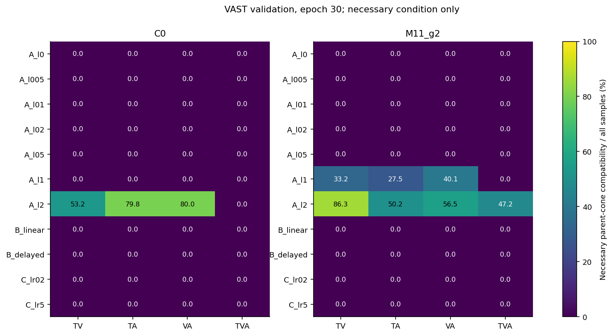
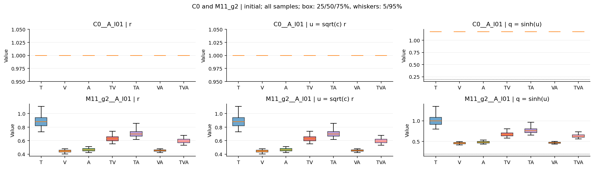
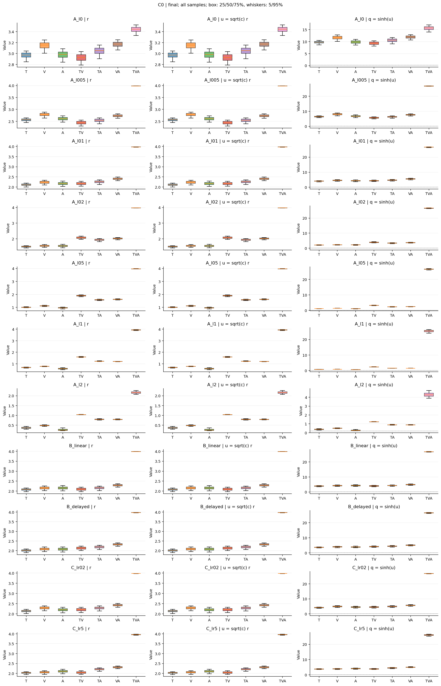
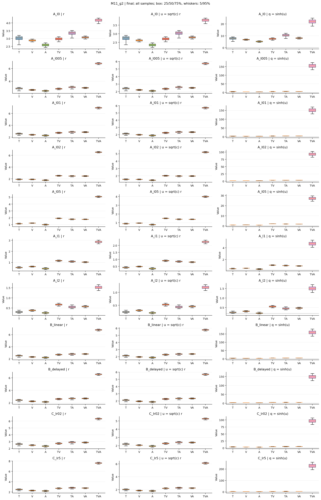
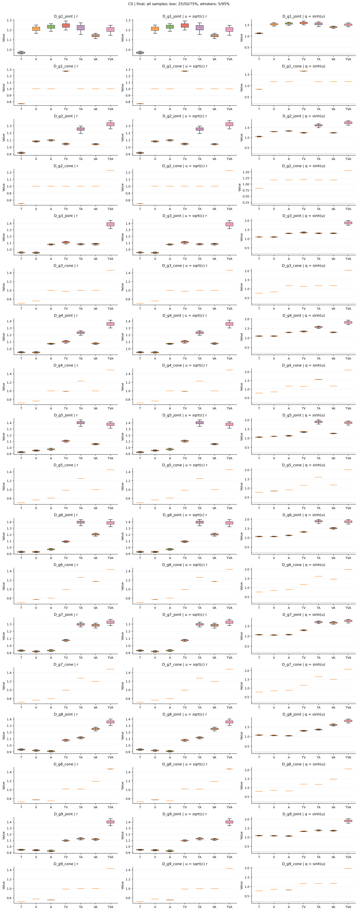
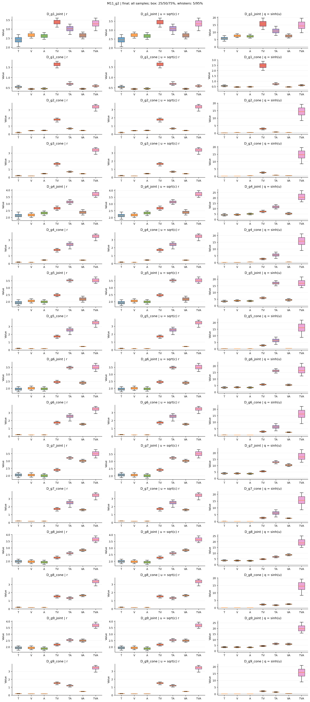

# 512D单变量蕴含实验报告

生成时间：2026-10-26T17:39:31.031655+00:00（UTC）。56/58完成，2失败。

## 口径与范围

本轮22组全量实验在VAST训练82608条上训练头部30轮（9660次更新），仅在固定2048条验证集评估。36组结构诊断在固定128条训练子集上训练2000步并原集读出。均为512D、seed50；未微调MSRVTT，未评估测试集。主表只用完成的预定末轮；最佳轮次单列附录，不补填缺失末轮。

S指父子均合法且严格满足锥包含的边数/全部评估边；官方FP32公式、阈值1e-7 radians不变。完整图分母为9N；结构诊断另报active分母kN。合法对内满足率同时报告，避免把域外点当成功。所有百分比差值为百分点。比较表按显示三位小数标记最优和次优；只作描述，不代表统计显著。

A仅变λ；B仅变λ时序且Σλ相同；C仅变七个无衰减径向标量的LR；D仅逐条加边或在相同图上关闭对比项，所有已有边系数固定0.1/9。B/C均独立对照λ=.1，从相同原始权重开始。无检索损失硬阈值、无性能淘汰。

## 全量主结果：VAST validation，epoch 30

| 条件 | 状态 | R@1 ↑ | R@5 ↑ | R@10 ↑ | 合法且满足/全部 ↑ | 合法对内满足 ↑ | 合法覆盖 ↑ | 九边同时满足 ↑ | 角度超额均值° ↓ | ΔR@1路线pp | ΔR@1 C0pp |
| --- | --- | --- | --- | --- | --- | --- | --- | --- | --- | --- | --- |
| C0__A_l0 | completed | **18.848** | **37.622** | **46.948** | 0.000 | 0.000 | **100.000** | <ins>0.000</ins> | 157.920 | **0.187** | **0.187** |
| C0__A_l005 | completed | <ins>18.807</ins> | <ins>37.533</ins> | <ins>46.899</ins> | 0.000 | 0.000 | **100.000** | <ins>0.000</ins> | 143.868 | <ins>0.146</ins> | <ins>0.146</ins> |
| C0__A_l01 | completed | 18.660 | 37.223 | 46.859 | 0.000 | 0.000 | **100.000** | <ins>0.000</ins> | 125.835 | 0.000 | 0.000 |
| C0__A_l02 | completed | 18.009 | 36.483 | 46.159 | 0.000 | 0.000 | **100.000** | <ins>0.000</ins> | 93.159 | -0.651 | -0.651 |
| C0__A_l05 | completed | 16.146 | 33.716 | 43.188 | 0.000 | 0.000 | **100.000** | <ins>0.000</ins> | 52.296 | -2.515 | -2.515 |
| C0__A_l1 | completed | 13.184 | 29.777 | 38.794 | 1.362 | 1.362 | **100.000** | <ins>0.000</ins> | 30.750 | -5.477 | -5.477 |
| C0__A_l2 | completed | 10.295 | 24.447 | 32.935 | <ins>27.572</ins> | <ins>27.572</ins> | **100.000** | <ins>0.000</ins> | <ins>8.708</ins> | -8.366 | -8.366 |
| C0__B_linear | completed | 18.628 | 37.231 | 46.777 | 0.000 | 0.000 | **100.000** | <ins>0.000</ins> | 123.853 | -0.033 | -0.033 |
| C0__B_delayed | completed | 18.571 | 37.077 | 46.745 | 0.000 | 0.000 | **100.000** | <ins>0.000</ins> | 120.831 | -0.090 | -0.090 |
| C0__C_lr02 | completed | 18.628 | 37.158 | 46.818 | 0.000 | 0.000 | **100.000** | <ins>0.000</ins> | 124.806 | -0.033 | -0.033 |
| C0__C_lr5 | completed | 18.693 | 37.394 | 46.891 | 0.000 | 0.000 | **100.000** | <ins>0.000</ins> | 129.899 | 0.033 | 0.033 |
| M11_g2__A_l0 | completed | 15.828 | 32.544 | 41.398 | 0.000 | 0.000 | **100.000** | <ins>0.000</ins> | 119.506 | -0.122 | -2.832 |
| M11_g2__A_l005 | completed | 15.991 | 32.878 | 41.691 | 0.000 | 0.000 | **100.000** | <ins>0.000</ins> | 96.171 | 0.041 | -2.669 |
| M11_g2__A_l01 | completed | 15.951 | 32.975 | 41.968 | 0.000 | 0.000 | **100.000** | <ins>0.000</ins> | 82.383 | 0.000 | -2.710 |
| M11_g2__A_l02 | completed | 15.706 | 32.992 | 42.057 | 0.000 | 0.000 | **100.000** | <ins>0.000</ins> | 58.735 | -0.244 | -2.954 |
| M11_g2__A_l05 | completed | 14.779 | 31.519 | 41.121 | 0.000 | 0.000 | **100.000** | <ins>0.000</ins> | 33.937 | -1.172 | -3.882 |
| M11_g2__A_l1 | completed | 13.184 | 29.736 | 38.371 | 6.641 | 6.641 | **100.000** | <ins>0.000</ins> | 15.878 | -2.767 | -5.477 |
| M11_g2__A_l2 | completed | 11.711 | 27.580 | 36.019 | **43.202** | **49.227** | <ins>87.760</ins> | **1.074** | **-2.301** | -4.240 | -6.950 |
| M11_g2__B_linear | completed | 15.877 | 32.926 | 41.960 | 0.000 | 0.000 | **100.000** | <ins>0.000</ins> | 83.048 | -0.073 | -2.783 |
| M11_g2__B_delayed | completed | 15.877 | 33.024 | 42.098 | 0.000 | 0.000 | **100.000** | <ins>0.000</ins> | 82.116 | -0.073 | -2.783 |
| M11_g2__C_lr02 | completed | 15.804 | 32.910 | 41.797 | 0.000 | 0.000 | **100.000** | <ins>0.000</ins> | 80.797 | -0.146 | -2.856 |
| M11_g2__C_lr5 | completed | 16.032 | 33.203 | 42.285 | 0.000 | 0.000 | **100.000** | <ins>0.000</ins> | 85.682 | 0.081 | -2.629 |

## 完整取舍与Pareto集合

Pareto使用未舍入的末轮值，同时最大化R@1和合法满足率；角度超额仅是次要诊断，降低角度不等于包含成立。所有条件保留，不预先设置检索损失容忍线。

[PDF](tradeoffs.pdf) · [完整末轮数值](full_final.csv) · [70个单因素差值](single_factor_deltas.csv)

- C0：满足率/R@1集合：C0__A_l0, C0__A_l1, C0__A_l2；角度/R@1集合：C0__A_l0, C0__A_l005, C0__A_l01, C0__A_l02, C0__A_l05, C0__A_l1, C0__A_l2, C0__B_linear, C0__B_delayed, C0__C_lr5

- M11_g2：满足率/R@1集合：M11_g2__A_l1, M11_g2__A_l2, M11_g2__C_lr5；角度/R@1集合：M11_g2__A_l01, M11_g2__A_l02, M11_g2__A_l05, M11_g2__A_l1, M11_g2__A_l2, M11_g2__B_delayed, M11_g2__C_lr02, M11_g2__C_lr5

- pooled：满足率/R@1集合：C0__A_l0, M11_g2__A_l1, M11_g2__A_l2；角度/R@1集合：C0__A_l0, C0__A_l005, C0__A_l01, C0__A_l02, C0__A_l05, C0__B_linear, C0__B_delayed, C0__C_lr5, M11_g2__A_l05, M11_g2__A_l1, M11_g2__A_l2

C0：新对照R@1=18.660%、S=0.000%；本路线最高S条件C0__A_l2达到S=27.572%、R@1=10.295%，相对对照分别+27.572/-8.366 pp。最高S仅描述一端取舍，不预先认定用户应选它。

M11_g2：新对照R@1=15.951%、S=0.000%；本路线最高S条件M11_g2__A_l2达到S=43.202%、R@1=11.711%，相对对照分别+43.202/-4.240 pp。最高S仅描述一端取舍，不预先认定用户应选它。

权重时序的4组末轮S均为0%；相对各自路线对照的R@1变化范围为-0.090至-0.033 pp，本轮没有观察到这类干预提升严格包含。

径向标量LR的4组末轮S均为0%；相对各自路线对照的R@1变化范围为-0.146至+0.081 pp，本轮没有观察到这类干预提升严格包含。

## 全量末轮六方向检索

### R@1 (%)

| 条件 | t2v ↑ | v2t ↑ | t2a ↑ | a2t ↑ | v2a ↑ | a2v ↑ |
| --- | --- | --- | --- | --- | --- | --- |
| C0__A_l0 | <ins>34.082</ins> | 33.203 | 6.152 | **5.762** | <ins>16.504</ins> | **17.383** |
| C0__A_l005 | **34.229** | 33.203 | **6.250** | <ins>5.664</ins> | 16.455 | <ins>17.041</ins> |
| C0__A_l01 | 33.984 | **33.594** | <ins>6.201</ins> | 5.518 | 16.406 | 16.260 |
| C0__A_l02 | 33.203 | 33.350 | 5.566 | 5.029 | 15.479 | 15.430 |
| C0__A_l05 | 29.883 | 30.811 | 5.029 | 4.932 | 12.988 | 13.232 |
| C0__A_l1 | 24.854 | 25.391 | 3.760 | 3.809 | 10.254 | 11.035 |
| C0__A_l2 | 19.336 | 21.436 | 3.662 | 2.246 | 8.545 | 6.543 |
| C0__B_linear | 33.789 | 33.252 | **6.250** | 5.615 | 16.211 | 16.650 |
| C0__B_delayed | 33.984 | 33.350 | 6.152 | 5.566 | 16.113 | 16.260 |
| C0__C_lr02 | <ins>34.082</ins> | <ins>33.496</ins> | 6.152 | 5.566 | 16.309 | 16.162 |
| C0__C_lr5 | 33.789 | 33.252 | 6.006 | <ins>5.664</ins> | **16.553** | 16.895 |
| M11_g2__A_l0 | 30.371 | 29.443 | 4.541 | 4.248 | 13.965 | 12.402 |
| M11_g2__A_l005 | 30.762 | 29.785 | 5.029 | 4.248 | 13.770 | 12.354 |
| M11_g2__A_l01 | 30.908 | 29.541 | 4.736 | 4.346 | 13.379 | 12.793 |
| M11_g2__A_l02 | 29.932 | 29.492 | 4.248 | 4.199 | 13.037 | 13.330 |
| M11_g2__A_l05 | 27.539 | 28.613 | 3.711 | 4.102 | 12.158 | 12.549 |
| M11_g2__A_l1 | 23.535 | 25.488 | 3.955 | 3.857 | 11.865 | 10.400 |
| M11_g2__A_l2 | 21.094 | 23.828 | 3.369 | 3.320 | 10.449 | 8.203 |
| M11_g2__B_linear | 30.469 | 29.150 | 4.688 | 4.395 | 13.379 | 13.184 |
| M11_g2__B_delayed | 30.518 | 29.297 | 4.736 | 4.395 | 13.379 | 12.939 |
| M11_g2__C_lr02 | 31.006 | 29.590 | 4.541 | 4.297 | 13.037 | 12.354 |
| M11_g2__C_lr5 | 30.518 | 29.395 | 4.639 | 4.541 | 13.867 | 13.232 |

### R@5 (%)

| 条件 | t2v ↑ | v2t ↑ | t2a ↑ | a2t ↑ | v2a ↑ | a2v ↑ |
| --- | --- | --- | --- | --- | --- | --- |
| C0__A_l0 | **57.959** | **58.252** | **15.820** | **16.064** | **38.965** | **38.672** |
| C0__A_l005 | <ins>57.812</ins> | **58.252** | 15.674 | <ins>16.016</ins> | <ins>38.867</ins> | <ins>38.574</ins> |
| C0__A_l01 | 57.617 | 57.910 | 15.479 | 15.820 | 38.477 | 38.037 |
| C0__A_l02 | 56.689 | 56.250 | 15.674 | 15.186 | 37.793 | 37.305 |
| C0__A_l05 | 53.613 | 53.906 | 14.062 | 13.428 | 33.838 | 33.447 |
| C0__A_l1 | 48.096 | 47.998 | 12.158 | 12.207 | 29.150 | 29.053 |
| C0__A_l2 | 41.748 | 42.383 | 11.182 | 8.301 | 22.852 | 20.215 |
| C0__B_linear | 57.471 | 57.666 | <ins>15.723</ins> | 15.723 | 38.574 | 38.232 |
| C0__B_delayed | 57.178 | 57.666 | 15.430 | 15.625 | 38.428 | 38.135 |
| C0__C_lr02 | 57.568 | 57.861 | 15.527 | 15.918 | 38.184 | 37.891 |
| C0__C_lr5 | 57.617 | <ins>57.959</ins> | 15.625 | <ins>16.016</ins> | 38.818 | 38.330 |
| M11_g2__A_l0 | 53.418 | 52.734 | 14.404 | 12.744 | 32.617 | 29.346 |
| M11_g2__A_l005 | 53.467 | 53.076 | 14.648 | 13.037 | 32.910 | 30.127 |
| M11_g2__A_l01 | 53.369 | 52.979 | 15.234 | 12.939 | 33.057 | 30.273 |
| M11_g2__A_l02 | 53.027 | 53.125 | 14.404 | 13.721 | 33.057 | 30.615 |
| M11_g2__A_l05 | 50.684 | 51.514 | 13.037 | 12.402 | 31.641 | 29.834 |
| M11_g2__A_l1 | 47.412 | 48.682 | 13.037 | 10.645 | 30.957 | 27.686 |
| M11_g2__A_l2 | 43.994 | 46.875 | 11.816 | 10.156 | 28.223 | 24.414 |
| M11_g2__B_linear | 53.125 | 52.930 | 14.893 | 13.037 | 33.057 | 30.518 |
| M11_g2__B_delayed | 53.125 | 53.027 | 15.137 | 13.037 | 33.057 | 30.762 |
| M11_g2__C_lr02 | 53.320 | 53.076 | 15.088 | 12.549 | 33.301 | 30.127 |
| M11_g2__C_lr5 | 53.320 | 53.271 | 15.039 | 13.477 | 32.715 | 31.396 |

### R@10 (%)

| 条件 | t2v ↑ | v2t ↑ | t2a ↑ | a2t ↑ | v2a ↑ | a2v ↑ |
| --- | --- | --- | --- | --- | --- | --- |
| C0__A_l0 | 66.748 | <ins>67.480</ins> | <ins>23.926</ins> | <ins>24.219</ins> | 50.195 | **49.121** |
| C0__A_l005 | **66.895** | **67.529** | <ins>23.926</ins> | **24.268** | 50.146 | 48.633 |
| C0__A_l01 | <ins>66.797</ins> | 67.383 | 23.877 | <ins>24.219</ins> | <ins>50.342</ins> | 48.535 |
| C0__A_l02 | 66.602 | 66.699 | 23.682 | 23.486 | 48.535 | 47.949 |
| C0__A_l05 | 64.404 | 63.867 | 21.777 | 20.801 | 43.994 | 44.287 |
| C0__A_l1 | 58.447 | 58.545 | 19.092 | 18.799 | 39.502 | 38.379 |
| C0__A_l2 | 52.002 | 53.223 | 17.236 | 13.477 | 32.373 | 29.297 |
| C0__B_linear | 66.699 | 66.943 | 23.779 | 24.072 | **50.391** | <ins>48.779</ins> |
| C0__B_delayed | 66.504 | 67.334 | 23.877 | 23.926 | 50.049 | <ins>48.779</ins> |
| C0__C_lr02 | <ins>66.797</ins> | 67.236 | 23.730 | **24.268** | 50.244 | 48.633 |
| C0__C_lr5 | <ins>66.797</ins> | 67.383 | **24.170** | <ins>24.219</ins> | 50.146 | 48.633 |
| M11_g2__A_l0 | 63.281 | 62.109 | 20.996 | 19.092 | 43.506 | 39.404 |
| M11_g2__A_l005 | 63.330 | 62.842 | 21.143 | 19.189 | 44.092 | 39.551 |
| M11_g2__A_l01 | 63.525 | 62.939 | 21.240 | 19.531 | 44.287 | 40.283 |
| M11_g2__A_l02 | 63.037 | 63.086 | 21.240 | 20.801 | 43.506 | 40.674 |
| M11_g2__A_l05 | 60.693 | 61.035 | 21.045 | 20.898 | 42.480 | 40.576 |
| M11_g2__A_l1 | 56.885 | 58.154 | 19.678 | 17.773 | 41.309 | 36.426 |
| M11_g2__A_l2 | 54.590 | 55.957 | 19.238 | 16.260 | 38.086 | 31.982 |
| M11_g2__B_linear | 63.525 | 62.646 | 21.484 | 19.531 | 44.043 | 40.527 |
| M11_g2__B_delayed | 63.721 | 62.842 | 21.436 | 19.678 | 44.238 | 40.674 |
| M11_g2__C_lr02 | 63.428 | 62.891 | 21.387 | 19.238 | 43.896 | 39.941 |
| M11_g2__C_lr5 | 63.623 | 63.135 | 21.533 | 19.824 | 44.482 | 41.113 |

## 学习轨迹与梯度机制

[PDF](full_learning.pdf) · [逐轮数值](learning_curves.csv)

[PDF](gradient_conflicts.pdf) · [全参数、投影层及七个头的梯度](gradient_probes.csv)

梯度在固定训练probe上用模型副本测量，不进入更新；cosine<0表示该测量点的两个原始梯度方向冲突，weighted_ratio=λ||g_ent||/||g_contrast||。这不是全训练过程的因果证明。B的名义累计权重相等，不保证梯度作用量相等。非有限诊断点保留并形成图中缺口，不替代实际训练失败。固定probe和离散测量时刻未出现异常，也不能排除实际训练batch上的非有限梯度。

已记录梯度统计行12897，其中非有限参数行0；同一probe按多个scope统计，不是独立故障次数。

## 小样本逐边诊断：training subset，step 2000

只说明128条训练样本和本次初始化下的可优化性。joint与cone-only在同一图比较；Gk与Gk−1在同一目标比较。新增边后active分母也变，逐边表保留每条边的结果。小样本表及其选模附录仅在相同Gk的四个条件内标记最优/次优，不跨图排名。不能据此推断验证泛化或证明结构普遍不可行。

边顺序：G1: T→TV, G2: TV→TVA, G3: V→TV, G4: T→TA, G5: A→TA, G6: V→VA, G7: A→VA, G8: TA→TVA, G9: VA→TVA.

| 条件 | 状态 | 训练R@1 ↑ | 已训练边S ↑ | 全部已训练边同时满足 ↑ | 九边S ↑ | 九边同时满足 ↑ | 已训练边合法覆盖 ↑ | 已训练边角度超额° ↓ |
| --- | --- | --- | --- | --- | --- | --- | --- | --- |
| C0__D_g1_joint | completed | **100.000** | **100.000** | **100.000** | **11.111** | **0.000** | **100.000** | -2.317 |
| C0__D_g1_cone | completed | <ins>0.911</ins> | **100.000** | **100.000** | **11.111** | **0.000** | **100.000** | <ins>-4.267</ins> |
| C0__D_g2_joint | completed | **100.000** | **100.000** | **100.000** | **22.222** | **0.000** | **100.000** | <ins>-3.004</ins> |
| C0__D_g2_cone | completed | <ins>0.911</ins> | **100.000** | **100.000** | **22.222** | **0.000** | **100.000** | -1.998 |
| C0__D_g3_joint | completed | **100.000** | **100.000** | **100.000** | **33.333** | **0.000** | **100.000** | -2.997 |
| C0__D_g3_cone | completed | <ins>33.464</ins> | **100.000** | **100.000** | **33.333** | **0.000** | **100.000** | <ins>-3.548</ins> |
| C0__D_g4_joint | completed | **100.000** | **100.000** | **100.000** | **44.444** | **0.000** | **100.000** | -3.067 |
| C0__D_g4_cone | completed | <ins>33.854</ins> | **100.000** | **100.000** | **44.444** | **0.000** | **100.000** | <ins>-3.593</ins> |
| C0__D_g5_joint | completed | **100.000** | **100.000** | **100.000** | **55.556** | **0.000** | **100.000** | -2.062 |
| C0__D_g5_cone | completed | <ins>55.469</ins> | **100.000** | **100.000** | **55.556** | **0.000** | **100.000** | <ins>-3.519</ins> |
| C0__D_g6_joint | completed | **100.000** | **100.000** | **100.000** | <ins>66.667</ins> | **0.000** | **100.000** | -2.099 |
| C0__D_g6_cone | completed | <ins>55.339</ins> | **100.000** | **100.000** | <ins>66.667</ins> | **0.000** | **100.000** | <ins>-3.731</ins> |
| C0__D_g7_joint | completed | **100.000** | **100.000** | **100.000** | **77.778** | **0.000** | **100.000** | -2.229 |
| C0__D_g7_cone | completed | <ins>72.917</ins> | **100.000** | **100.000** | **77.778** | **0.000** | **100.000** | <ins>-3.143</ins> |
| C0__D_g8_joint | completed | **100.000** | **100.000** | **100.000** | **88.889** | **0.000** | **100.000** | -2.748 |
| C0__D_g8_cone | completed | <ins>93.880</ins> | **100.000** | **100.000** | **88.889** | **0.000** | **100.000** | <ins>-3.510</ins> |
| C0__D_g9_joint | completed | **100.000** | **100.000** | **100.000** | **100.000** | **100.000** | **100.000** | -2.850 |
| C0__D_g9_cone | completed | <ins>78.255</ins> | **100.000** | **100.000** | **100.000** | **100.000** | **100.000** | <ins>-3.154</ins> |
| M11_g2__D_g1_joint | completed | **100.000** | **100.000** | **100.000** | **11.111** | **0.000** | **100.000** | -0.674 |
| M11_g2__D_g1_cone | completed | 0.781 | **100.000** | **100.000** | **11.111** | **0.000** | **100.000** | **-4.284** |
| M11_g2__D_g2_joint | failed | — | — | — | — | — | — | — |
| M11_g2__D_g2_cone | completed | 0.651 | <ins>62.500</ins> | <ins>25.000</ins> | <ins>13.889</ins> | **0.000** | <ins>62.500</ins> | **-10.432** |
| M11_g2__D_g3_joint | failed | — | — | — | — | — | — | — |
| M11_g2__D_g3_cone | completed | 1.302 | <ins>44.271</ins> | <ins>0.000</ins> | <ins>14.757</ins> | **0.000** | <ins>44.271</ins> | **-10.457** |
| M11_g2__D_g4_joint | completed | **100.000** | **100.000** | **100.000** | **44.444** | **0.000** | **100.000** | -0.531 |
| M11_g2__D_g4_cone | completed | 1.042 | <ins>48.438</ins> | <ins>1.562</ins> | <ins>21.528</ins> | **0.000** | <ins>48.438</ins> | **-13.745** |
| M11_g2__D_g5_joint | completed | **100.000** | **100.000** | **100.000** | **55.556** | **0.000** | **100.000** | -0.263 |
| M11_g2__D_g5_cone | completed | 0.911 | <ins>37.031</ins> | <ins>0.000</ins> | <ins>20.573</ins> | **0.000** | <ins>37.031</ins> | **-11.869** |
| M11_g2__D_g6_joint | completed | **100.000** | <ins>99.740</ins> | <ins>98.438</ins> | **66.753** | **0.000** | **100.000** | -0.200 |
| M11_g2__D_g6_cone | completed | 1.172 | 35.807 | 0.000 | 23.872 | **0.000** | <ins>35.807</ins> | **-11.422** |
| M11_g2__D_g7_joint | completed | **100.000** | **100.000** | **100.000** | **77.778** | **0.000** | **100.000** | -0.295 |
| M11_g2__D_g7_cone | completed | 0.911 | <ins>32.589</ins> | <ins>0.000</ins> | <ins>25.347</ins> | **0.000** | <ins>32.589</ins> | **-10.394** |
| M11_g2__D_g8_joint | completed | **100.000** | <ins>99.805</ins> | <ins>98.438</ins> | <ins>88.715</ins> | **0.000** | **100.000** | -0.313 |
| M11_g2__D_g8_cone | completed | 0.521 | 32.812 | 0.000 | 29.167 | **0.000** | <ins>32.812</ins> | **-8.744** |
| M11_g2__D_g9_joint | completed | **100.000** | **100.000** | **100.000** | **100.000** | **100.000** | **100.000** | -0.302 |
| M11_g2__D_g9_cone | completed | 1.302 | <ins>41.840</ins> | <ins>0.000</ins> | <ins>41.840</ins> | <ins>0.000</ins> | <ins>41.840</ins> | **-10.085** |

[PDF](tiny_graphs.pdf) · [原始表](tiny_final.csv) · [逐边指标](edge_metrics.csv)

九边终点同时检查非特异性包含；下表均为同一九边图、128条训练样本，因此四个条件可以并列。

| 条件 | 训练R@1 ↑ | 正配S ↑ | 九边同时满足 ↑ | 循环错配S | 最近错误视频S |
| --- | --- | --- | --- | --- | --- |
| C0__D_g9_joint | **100.000** | **100.000** | **100.000** | 0.000 | 0.000 |
| C0__D_g9_cone | <ins>78.255</ins> | **100.000** | **100.000** | 0.000 | 0.174 |
| M11_g2__D_g9_joint | **100.000** | **100.000** | **100.000** | 0.000 | 0.000 |
| M11_g2__D_g9_cone | 1.302 | <ins>41.840</ins> | <ins>0.000</ins> | 7.986 | 6.771 |

## 多父兼容与错配控制

[PDF](parent_compatibility.pdf)

该兼容指标是父锥存在交集的必要条件，不是实际子节点满足全部父锥的充分证据。循环错配与最近错误视频的满足率用于观察非特异性包含；它们没有人工非蕴含标签，不能当成语义假阳性的真实标注。

| 条件 | 正配S ↑ | 循环错配S | 最近错误视频S | 角度区分AUC ↑ | TV兼容 ↑ | TA兼容 ↑ | VA兼容 ↑ | TVA兼容 ↑ |
| --- | --- | --- | --- | --- | --- | --- | --- | --- |
| C0__A_l0 | 0.000 | 0.000 | 0.000 | 0.993 | 0.000 | 0.000 | 0.000 | <ins>0.000</ins> |
| C0__A_l005 | 0.000 | 0.000 | 0.000 | <ins>0.994</ins> | 0.000 | 0.000 | 0.000 | <ins>0.000</ins> |
| C0__A_l01 | 0.000 | 0.000 | 0.000 | <ins>0.994</ins> | 0.000 | 0.000 | 0.000 | <ins>0.000</ins> |
| C0__A_l02 | 0.000 | 0.000 | 0.000 | <ins>0.994</ins> | 0.000 | 0.000 | 0.000 | <ins>0.000</ins> |
| C0__A_l05 | 0.000 | 0.000 | 0.000 | 0.992 | 0.000 | 0.000 | 0.000 | <ins>0.000</ins> |
| C0__A_l1 | 1.362 | 0.000 | 0.000 | 0.988 | 0.000 | 0.000 | 0.000 | <ins>0.000</ins> |
| C0__A_l2 | <ins>27.572</ins> | 0.369 | 14.280 | 0.986 | <ins>53.174</ins> | **79.785** | **79.980** | <ins>0.000</ins> |
| C0__B_linear | 0.000 | 0.000 | 0.000 | <ins>0.994</ins> | 0.000 | 0.000 | 0.000 | <ins>0.000</ins> |
| C0__B_delayed | 0.000 | 0.000 | 0.000 | <ins>0.994</ins> | 0.000 | 0.000 | 0.000 | <ins>0.000</ins> |
| C0__C_lr02 | 0.000 | 0.000 | 0.000 | <ins>0.994</ins> | 0.000 | 0.000 | 0.000 | <ins>0.000</ins> |
| C0__C_lr5 | 0.000 | 0.000 | 0.000 | **0.995** | 0.000 | 0.000 | 0.000 | <ins>0.000</ins> |
| M11_g2__A_l0 | 0.000 | 0.000 | 0.000 | 0.972 | 0.000 | 0.000 | 0.000 | <ins>0.000</ins> |
| M11_g2__A_l005 | 0.000 | 0.000 | 0.000 | 0.976 | 0.000 | 0.000 | 0.000 | <ins>0.000</ins> |
| M11_g2__A_l01 | 0.000 | 0.000 | 0.000 | 0.985 | 0.000 | 0.000 | 0.000 | <ins>0.000</ins> |
| M11_g2__A_l02 | 0.000 | 0.000 | 0.000 | 0.992 | 0.000 | 0.000 | 0.000 | <ins>0.000</ins> |
| M11_g2__A_l05 | 0.000 | 0.000 | 0.000 | 0.992 | 0.000 | 0.000 | 0.000 | <ins>0.000</ins> |
| M11_g2__A_l1 | 6.641 | 0.011 | 0.087 | 0.987 | 33.203 | 27.539 | 40.137 | <ins>0.000</ins> |
| M11_g2__A_l2 | **43.202** | 0.434 | 3.998 | 0.977 | **86.279** | <ins>50.244</ins> | <ins>56.543</ins> | **47.168** |
| M11_g2__B_linear | 0.000 | 0.000 | 0.000 | 0.985 | 0.000 | 0.000 | 0.000 | <ins>0.000</ins> |
| M11_g2__B_delayed | 0.000 | 0.000 | 0.000 | 0.986 | 0.000 | 0.000 | 0.000 | <ins>0.000</ins> |
| M11_g2__C_lr02 | 0.000 | 0.000 | 0.000 | 0.982 | 0.000 | 0.000 | 0.000 | <ins>0.000</ins> |
| M11_g2__C_lr5 | 0.000 | 0.000 | 0.000 | 0.987 | 0.000 | 0.000 | 0.000 | <ins>0.000</ins> |

## 真实512D半径分布

从保存的真实512D特征计算r=d_c(0,x)、u=√c·r和q=sinh(u)=√c||x_spatial||。r在不同曲率之间受尺度影响，u/q用于辅助比较；q≥0.2是本实验合法域阈值。所有样本均入统计，箱体为25/50/75分位、须为5/95分位，不画离群点但不删除样本。完整最小/最大值和标准差见CSV。

[全条件、所有读出的r/u/q统计](radius_statistics.csv)

### 初始化（两路线）

[PDF](radii_initial.pdf)

### C0全量末轮

[PDF](radii_full_C0.pdf)

### M11_g2全量末轮

[PDF](radii_full_M11_g2.pdf)

### C0训练诊断末步

[PDF](radii_tiny_C0.pdf)

### M11_g2训练诊断末步

[PDF](radii_tiny_M11_g2.pdf)

## 选模附录：不能代替末轮

最佳检索按R@1、R@5、较早读出排序；最佳合法满足按合法且满足/全部、R@1、较早读出排序。均包含初始化。下表明确step/epoch；与末轮主比较分开。

### full / best_retrieval

| 条件 | epoch | step | R@1 ↑ | R@5 ↑ | R@10 ↑ | 九边S ↑ | active S ↑ | 角度超额° ↓ |
| --- | --- | --- | --- | --- | --- | --- | --- | --- |
| C0__A_l0 | 30 | 9660 | **18.848** | **37.622** | **46.948** | 0.000 | 0.000 | 157.920 |
| C0__A_l005 | 29 | 9338 | <ins>18.823</ins> | <ins>37.516</ins> | 46.891 | 0.000 | 0.000 | 143.867 |
| C0__A_l01 | 26 | 8372 | 18.774 | 37.166 | 46.826 | 0.000 | 0.000 | 125.791 |
| C0__A_l02 | 26 | 8372 | 18.034 | 36.548 | 46.232 | 0.000 | 0.000 | 93.146 |
| C0__A_l05 | 30 | 9660 | 16.146 | 33.716 | 43.188 | 0.000 | 0.000 | 52.296 |
| C0__A_l1 | 22 | 7084 | 13.265 | 29.704 | 38.900 | 1.248 | 1.248 | 30.717 |
| C0__A_l2 | 26 | 8372 | 10.319 | 24.471 | 33.008 | <ins>27.696</ins> | <ins>27.696</ins> | <ins>8.692</ins> |
| C0__B_linear | 20 | 6440 | 18.750 | 37.101 | 46.696 | 0.000 | 0.000 | 128.211 |
| C0__B_delayed | 26 | 8372 | 18.693 | 36.995 | 46.688 | 0.000 | 0.000 | 120.819 |
| C0__C_lr02 | 25 | 8050 | 18.701 | 37.069 | 46.785 | 0.000 | 0.000 | 124.722 |
| C0__C_lr5 | 24 | 7728 | 18.717 | 37.354 | <ins>46.899</ins> | 0.000 | 0.000 | 129.756 |
| M11_g2__A_l0 | 24 | 7728 | 15.869 | 32.633 | 41.488 | 0.000 | 0.000 | 119.547 |
| M11_g2__A_l005 | 30 | 9660 | 15.991 | 32.878 | 41.691 | 0.000 | 0.000 | 96.171 |
| M11_g2__A_l01 | 23 | 7406 | 16.016 | 32.967 | 42.041 | 0.000 | 0.000 | 82.707 |
| M11_g2__A_l02 | 28 | 9016 | 15.755 | 33.000 | 42.025 | 0.000 | 0.000 | 58.745 |
| M11_g2__A_l05 | 26 | 8372 | 14.852 | 31.486 | 41.113 | 0.000 | 0.000 | 34.010 |
| M11_g2__A_l1 | 23 | 7406 | 13.224 | 29.688 | 38.192 | 5.556 | 5.556 | 16.645 |
| M11_g2__A_l2 | 27 | 8694 | 11.735 | 27.580 | 35.978 | **43.224** | **43.224** | **-2.275** |
| M11_g2__B_linear | 23 | 7406 | 15.910 | 32.910 | 41.911 | 0.000 | 0.000 | 85.087 |
| M11_g2__B_delayed | 25 | 8050 | 15.942 | 32.910 | 42.147 | 0.000 | 0.000 | 82.315 |
| M11_g2__C_lr02 | 25 | 8050 | 15.828 | 32.886 | 41.772 | 0.000 | 0.000 | 80.939 |
| M11_g2__C_lr5 | 25 | 8050 | 16.162 | 33.203 | 42.253 | 0.000 | 0.000 | 85.796 |

### full / best_legal

| 条件 | epoch | step | R@1 ↑ | R@5 ↑ | R@10 ↑ | 九边S ↑ | active S ↑ | 角度超额° ↓ |
| --- | --- | --- | --- | --- | --- | --- | --- | --- |
| C0__A_l0 | 30 | 9660 | **18.848** | **37.622** | <ins>46.948</ins> | 0.000 | 0.000 | 157.920 |
| C0__A_l005 | 25 | 8050 | <ins>18.823</ins> | <ins>37.354</ins> | **47.030** | 0.000 | 0.000 | 143.742 |
| C0__A_l01 | 26 | 8372 | 18.774 | 37.166 | 46.826 | 0.000 | 0.000 | 125.791 |
| C0__A_l02 | 26 | 8372 | 18.034 | 36.548 | 46.232 | 0.000 | 0.000 | 93.146 |
| C0__A_l05 | 30 | 9660 | 16.146 | 33.716 | 43.188 | 0.000 | 0.000 | 52.296 |
| C0__A_l1 | 30 | 9660 | 13.184 | 29.777 | 38.794 | 1.362 | 1.362 | 30.750 |
| C0__A_l2 | 23 | 7406 | 10.278 | 24.398 | 32.772 | <ins>27.930</ins> | <ins>27.930</ins> | <ins>8.605</ins> |
| C0__B_linear | 20 | 6440 | 18.750 | 37.101 | 46.696 | 0.000 | 0.000 | 128.211 |
| C0__B_delayed | 26 | 8372 | 18.693 | 36.995 | 46.688 | 0.000 | 0.000 | 120.819 |
| C0__C_lr02 | 25 | 8050 | 18.701 | 37.069 | 46.785 | 0.000 | 0.000 | 124.722 |
| C0__C_lr5 | 24 | 7728 | 18.717 | <ins>37.354</ins> | 46.899 | 0.000 | 0.000 | 129.756 |
| M11_g2__A_l0 | 24 | 7728 | 15.869 | 32.633 | 41.488 | 0.000 | 0.000 | 119.547 |
| M11_g2__A_l005 | 30 | 9660 | 15.991 | 32.878 | 41.691 | 0.000 | 0.000 | 96.171 |
| M11_g2__A_l01 | 23 | 7406 | 16.016 | 32.967 | 42.041 | 0.000 | 0.000 | 82.707 |
| M11_g2__A_l02 | 28 | 9016 | 15.755 | 33.000 | 42.025 | 0.000 | 0.000 | 58.745 |
| M11_g2__A_l05 | 1 | 322 | 1.497 | 5.160 | 8.651 | 0.016 | 0.016 | 62.410 |
| M11_g2__A_l1 | 1 | 322 | 0.977 | 3.735 | 6.372 | 7.395 | 7.395 | 50.403 |
| M11_g2__A_l2 | 27 | 8694 | 11.735 | 27.580 | 35.978 | **43.224** | **43.224** | **-2.275** |
| M11_g2__B_linear | 23 | 7406 | 15.910 | 32.910 | 41.911 | 0.000 | 0.000 | 85.087 |
| M11_g2__B_delayed | 25 | 8050 | 15.942 | 32.910 | 42.147 | 0.000 | 0.000 | 82.315 |
| M11_g2__C_lr02 | 25 | 8050 | 15.828 | 32.886 | 41.772 | 0.000 | 0.000 | 80.939 |
| M11_g2__C_lr5 | 25 | 8050 | 16.162 | 33.203 | 42.253 | 0.000 | 0.000 | 85.796 |

### tiny / best_retrieval

| 条件 | epoch | step | R@1 ↑ | R@5 ↑ | R@10 ↑ | 九边S ↑ | active S ↑ | 角度超额° ↓ |
| --- | --- | --- | --- | --- | --- | --- | --- | --- |
| C0__D_g1_joint | — | 200 | **100.000** | **100.000** | **100.000** | 0.000 | 0.000 | 117.286 |
| C0__D_g1_cone | — | 200 | <ins>1.042</ins> | <ins>4.036</ins> | <ins>7.812</ins> | <ins>10.851</ins> | <ins>97.656</ins> | 121.652 |
| C0__D_g2_joint | — | 200 | **100.000** | **100.000** | **100.000** | 0.000 | 0.000 | 117.021 |
| C0__D_g2_cone | — | 200 | <ins>1.172</ins> | <ins>4.036</ins> | <ins>8.464</ins> | <ins>11.111</ins> | <ins>50.000</ins> | <ins>106.388</ins> |
| C0__D_g3_joint | — | 200 | **100.000** | **100.000** | **100.000** | 0.000 | 0.000 | 116.725 |
| C0__D_g3_cone | — | 800 | <ins>33.854</ins> | <ins>36.328</ins> | <ins>38.151</ins> | **33.247** | **99.740** | <ins>87.131</ins> |
| C0__D_g4_joint | — | 200 | **100.000** | **100.000** | **100.000** | 0.000 | 0.000 | 116.527 |
| C0__D_g4_cone | — | 1000 | <ins>34.115</ins> | <ins>35.677</ins> | <ins>38.151</ins> | **44.444** | **100.000** | <ins>61.899</ins> |
| C0__D_g5_joint | — | 200 | **100.000** | **100.000** | **100.000** | 0.000 | 0.000 | 116.338 |
| C0__D_g5_cone | — | 1000 | <ins>56.771</ins> | <ins>68.359</ins> | <ins>73.698</ins> | **55.556** | **100.000** | **46.536** |
| C0__D_g6_joint | — | 200 | **100.000** | **100.000** | **100.000** | 0.000 | 0.000 | 115.972 |
| C0__D_g6_cone | — | 800 | <ins>58.333</ins> | <ins>68.359</ins> | <ins>71.875</ins> | **66.580** | **99.870** | **9.726** |
| C0__D_g7_joint | — | 200 | **100.000** | **100.000** | **100.000** | 0.000 | 0.000 | 115.678 |
| C0__D_g7_cone | — | 600 | <ins>76.562</ins> | <ins>92.448</ins> | <ins>95.964</ins> | **77.604** | **99.777** | **13.372** |
| C0__D_g8_joint | — | 200 | **100.000** | **100.000** | **100.000** | 0.000 | 0.000 | 115.408 |
| C0__D_g8_cone | — | 800 | <ins>94.792</ins> | <ins>98.698</ins> | <ins>99.609</ins> | **88.802** | **99.902** | **0.574** |
| C0__D_g9_joint | — | 200 | **100.000** | **100.000** | **100.000** | 0.000 | 0.000 | 115.079 |
| C0__D_g9_cone | — | 700 | <ins>88.802</ins> | <ins>98.438</ins> | <ins>99.479</ins> | **99.826** | **99.826** | <ins>-2.214</ins> |
| M11_g2__D_g1_joint | — | 200 | **100.000** | **100.000** | **100.000** | 0.000 | 0.000 | **97.065** |
| M11_g2__D_g1_cone | — | 300 | 0.781 | 3.776 | 7.422 | **11.111** | **100.000** | <ins>102.990</ins> |
| M11_g2__D_g2_cone | — | 200 | 0.651 | 3.776 | 7.422 | **12.587** | **56.641** | **79.606** |
| M11_g2__D_g3_cone | — | 300 | 1.302 | 5.859 | 9.635 | <ins>14.757</ins> | <ins>44.271</ins> | **48.654** |
| M11_g2__D_g4_joint | — | 200 | **100.000** | **100.000** | **100.000** | 0.000 | 0.000 | 88.542 |
| M11_g2__D_g4_cone | — | 200 | 1.432 | 4.297 | 8.203 | <ins>17.882</ins> | <ins>40.234</ins> | **46.865** |
| M11_g2__D_g5_joint | — | 200 | **100.000** | **100.000** | **100.000** | 0.000 | 0.000 | 87.452 |
| M11_g2__D_g5_cone | — | 100 | 1.432 | 3.776 | 8.984 | <ins>1.649</ins> | <ins>2.969</ins> | <ins>54.467</ins> |
| M11_g2__D_g6_joint | — | 200 | **100.000** | **100.000** | **100.000** | 0.000 | 0.000 | 84.204 |
| M11_g2__D_g6_cone | — | 300 | 1.172 | 5.078 | 10.677 | <ins>24.045</ins> | <ins>36.068</ins> | <ins>18.423</ins> |
| M11_g2__D_g7_joint | — | 200 | **100.000** | **100.000** | **100.000** | 0.000 | 0.000 | 82.655 |
| M11_g2__D_g7_cone | — | 200 | 1.172 | 4.427 | 8.724 | <ins>18.316</ins> | <ins>23.549</ins> | <ins>22.270</ins> |
| M11_g2__D_g8_joint | — | 200 | **100.000** | **100.000** | **100.000** | 0.000 | 0.000 | 79.428 |
| M11_g2__D_g8_cone | — | 200 | 0.911 | 4.818 | 9.115 | <ins>23.090</ins> | <ins>25.977</ins> | <ins>10.704</ins> |
| M11_g2__D_g9_joint | — | 200 | **100.000** | **100.000** | **100.000** | 0.000 | 0.000 | 77.054 |
| M11_g2__D_g9_cone | — | 300 | 1.302 | 6.120 | 10.938 | <ins>42.188</ins> | <ins>42.188</ins> | **-10.053** |

### tiny / best_legal

| 条件 | epoch | step | R@1 ↑ | R@5 ↑ | R@10 ↑ | 九边S ↑ | active S ↑ | 角度超额° ↓ |
| --- | --- | --- | --- | --- | --- | --- | --- | --- |
| C0__D_g1_joint | — | 800 | **100.000** | **100.000** | **100.000** | **11.111** | **100.000** | **88.692** |
| C0__D_g1_cone | — | 300 | <ins>1.042</ins> | <ins>4.036</ins> | <ins>7.812</ins> | **11.111** | **100.000** | 121.583 |
| C0__D_g2_joint | — | 700 | **100.000** | **100.000** | **100.000** | **22.222** | **100.000** | **67.284** |
| C0__D_g2_cone | — | 600 | <ins>0.911</ins> | <ins>4.427</ins> | <ins>8.854</ins> | **22.222** | **100.000** | 104.412 |
| C0__D_g3_joint | — | 800 | **100.000** | **100.000** | **100.000** | **33.333** | **100.000** | **40.046** |
| C0__D_g3_cone | — | 700 | <ins>33.594</ins> | <ins>35.938</ins> | <ins>38.411</ins> | **33.333** | **100.000** | 87.360 |
| C0__D_g4_joint | — | 1000 | **100.000** | **100.000** | **100.000** | **44.444** | **100.000** | <ins>28.887</ins> |
| C0__D_g4_cone | — | 1000 | <ins>34.115</ins> | <ins>35.677</ins> | <ins>38.151</ins> | **44.444** | **100.000** | 61.899 |
| C0__D_g5_joint | — | 1400 | **100.000** | **100.000** | **100.000** | **55.556** | **100.000** | **18.298** |
| C0__D_g5_cone | — | 1000 | <ins>56.771</ins> | <ins>68.359</ins> | <ins>73.698</ins> | **55.556** | **100.000** | 46.536 |
| C0__D_g6_joint | — | 1700 | **100.000** | **100.000** | **100.000** | <ins>66.667</ins> | **100.000** | 13.492 |
| C0__D_g6_cone | — | 700 | <ins>58.073</ins> | <ins>66.276</ins> | <ins>72.005</ins> | <ins>66.667</ins> | **100.000** | **11.284** |
| C0__D_g7_joint | — | 800 | **100.000** | **100.000** | **100.000** | **77.778** | **100.000** | 13.492 |
| C0__D_g7_cone | — | 900 | <ins>76.172</ins> | <ins>91.146</ins> | <ins>96.354</ins> | **77.778** | **100.000** | <ins>5.741</ins> |
| C0__D_g8_joint | — | 1000 | **100.000** | **100.000** | **100.000** | **88.889** | **100.000** | 2.157 |
| C0__D_g8_cone | — | 1200 | <ins>94.401</ins> | <ins>99.479</ins> | <ins>99.609</ins> | **88.889** | **100.000** | **-1.348** |
| C0__D_g9_joint | — | 1300 | **100.000** | **100.000** | **100.000** | **100.000** | **100.000** | -2.514 |
| C0__D_g9_cone | — | 1100 | <ins>79.167</ins> | <ins>97.266</ins> | <ins>98.958</ins> | **100.000** | **100.000** | <ins>-2.992</ins> |
| M11_g2__D_g1_joint | — | 1300 | **100.000** | **100.000** | **100.000** | **11.111** | **100.000** | <ins>90.535</ins> |
| M11_g2__D_g1_cone | — | 300 | 0.781 | 3.776 | 7.422 | **11.111** | **100.000** | 102.990 |
| M11_g2__D_g2_cone | — | 300 | 0.651 | 3.646 | 7.812 | <ins>13.976</ins> | <ins>62.891</ins> | <ins>69.247</ins> |
| M11_g2__D_g3_cone | — | 300 | 1.302 | 5.859 | 9.635 | <ins>14.757</ins> | <ins>44.271</ins> | <ins>48.654</ins> |
| M11_g2__D_g4_joint | — | 1100 | **100.000** | **100.000** | **100.000** | **44.444** | **100.000** | **27.880** |
| M11_g2__D_g4_cone | — | 300 | 1.042 | 3.906 | 9.115 | <ins>21.528</ins> | <ins>48.438</ins> | 41.293 |
| M11_g2__D_g5_joint | — | 2000 | **100.000** | **100.000** | **100.000** | **55.556** | **100.000** | <ins>26.412</ins> |
| M11_g2__D_g5_cone | — | 200 | 1.042 | 5.078 | 9.375 | <ins>21.007</ins> | <ins>37.812</ins> | 26.536 |
| M11_g2__D_g6_joint | — | 1900 | **100.000** | **100.000** | **100.000** | **66.753** | <ins>99.740</ins> | <ins>11.503</ins> |
| M11_g2__D_g6_cone | — | 300 | 1.172 | 5.078 | 10.677 | 24.045 | 36.068 | 18.423 |
| M11_g2__D_g7_joint | — | 2000 | **100.000** | **100.000** | **100.000** | **77.778** | **100.000** | **4.536** |
| M11_g2__D_g7_cone | — | 300 | 0.911 | 4.688 | 9.505 | <ins>25.347</ins> | <ins>32.589</ins> | 16.304 |
| M11_g2__D_g8_joint | — | 1700 | **100.000** | **100.000** | **100.000** | <ins>88.802</ins> | <ins>99.902</ins> | <ins>-0.045</ins> |
| M11_g2__D_g8_cone | — | 300 | 0.521 | 5.859 | 10.026 | 29.688 | 33.398 | 5.262 |
| M11_g2__D_g9_joint | — | 2000 | **100.000** | **100.000** | **100.000** | **100.000** | **100.000** | -0.302 |
| M11_g2__D_g9_cone | — | 300 | 1.302 | 6.120 | 10.938 | <ins>42.188</ins> | <ins>42.188</ins> | **-10.053** |

### 失败组的已保存最佳读出

以下直接读取失败前保存的最佳权重文件内的指标，预算未完成，单独展示；未补跑终点或最近错误视频评估。

| 条件 | 读出 | step | R@1 | 九边S | active S |
| --- | --- | --- | --- | --- | --- |
| M11_g2__D_g2_joint | best_retrieval | 200 | 100.000 | 0.000 | 0.000 |
| M11_g2__D_g2_joint | best_legal | 1600 | 100.000 | 22.222 | 100.000 |
| M11_g2__D_g3_joint | best_retrieval | 200 | 100.000 | 0.000 | 0.000 |
| M11_g2__D_g3_joint | best_legal | 1600 | 100.000 | 33.333 | 100.000 |

## 完整单因素比较

差值=处理组−对照组。70条预先声明的比较全部保留；缺失末轮不计算差值。D增加边时active指标的分母随k变，需结合[逐边指标](edge_metrics.csv)和[630条同边差值](edge_deltas.csv)判读；同边差值固定每边N分母，保留干预前后是否训练该边的标记。

### full

| 对照 | 处理 | 唯一因素 | ΔR@1 pp | Δ九边S pp | Δactive S pp | Δ角度° |
| --- | --- | --- | --- | --- | --- | --- |
| C0__A_l01 | C0__A_l0 | cone_weight | 0.187 | 0.000 | 0.000 | 32.084 |
| C0__A_l01 | C0__A_l005 | cone_weight | 0.146 | 0.000 | 0.000 | 18.033 |
| C0__A_l01 | C0__A_l02 | cone_weight | -0.651 | 0.000 | 0.000 | -32.676 |
| C0__A_l01 | C0__A_l05 | cone_weight | -2.515 | 0.000 | 0.000 | -73.539 |
| C0__A_l01 | C0__A_l1 | cone_weight | -5.477 | 1.362 | 1.362 | -95.085 |
| C0__A_l01 | C0__A_l2 | cone_weight | -8.366 | 27.572 | 27.572 | -117.128 |
| C0__A_l01 | C0__B_linear | cone_schedule | -0.033 | 0.000 | 0.000 | -1.982 |
| C0__A_l01 | C0__B_delayed | cone_schedule | -0.090 | 0.000 | 0.000 | -5.004 |
| C0__A_l01 | C0__C_lr02 | radial_scalar_lr | -0.033 | 0.000 | 0.000 | -1.030 |
| C0__A_l01 | C0__C_lr5 | radial_scalar_lr | 0.033 | 0.000 | 0.000 | 4.064 |
| M11_g2__A_l01 | M11_g2__A_l0 | cone_weight | -0.122 | 0.000 | 0.000 | 37.122 |
| M11_g2__A_l01 | M11_g2__A_l005 | cone_weight | 0.041 | 0.000 | 0.000 | 13.788 |
| M11_g2__A_l01 | M11_g2__A_l02 | cone_weight | -0.244 | 0.000 | 0.000 | -23.649 |
| M11_g2__A_l01 | M11_g2__A_l05 | cone_weight | -1.172 | 0.000 | 0.000 | -48.446 |
| M11_g2__A_l01 | M11_g2__A_l1 | cone_weight | -2.767 | 6.641 | 6.641 | -66.506 |
| M11_g2__A_l01 | M11_g2__A_l2 | cone_weight | -4.240 | 43.202 | 43.202 | -84.684 |
| M11_g2__A_l01 | M11_g2__B_linear | cone_schedule | -0.073 | 0.000 | 0.000 | 0.665 |
| M11_g2__A_l01 | M11_g2__B_delayed | cone_schedule | -0.073 | 0.000 | 0.000 | -0.267 |
| M11_g2__A_l01 | M11_g2__C_lr02 | radial_scalar_lr | -0.146 | 0.000 | 0.000 | -1.587 |
| M11_g2__A_l01 | M11_g2__C_lr5 | radial_scalar_lr | 0.081 | 0.000 | 0.000 | 3.299 |

### tiny

| 对照 | 处理 | 唯一因素 | ΔR@1 pp | Δ九边S pp | Δactive S pp | Δ角度° |
| --- | --- | --- | --- | --- | --- | --- |
| C0__D_g1_joint | C0__D_g1_cone | contrastive_weight | -99.089 | 0.000 | 0.000 | 38.792 |
| C0__D_g1_joint | C0__D_g2_joint | graph_size | 0.000 | 11.111 | 0.000 | -22.354 |
| C0__D_g1_cone | C0__D_g2_cone | graph_size | 0.000 | 11.111 | 0.000 | -16.714 |
| C0__D_g2_joint | C0__D_g2_cone | contrastive_weight | -99.089 | 0.000 | 0.000 | 44.433 |
| C0__D_g2_joint | C0__D_g3_joint | graph_size | 0.000 | 11.111 | 0.000 | -37.315 |
| C0__D_g2_cone | C0__D_g3_cone | graph_size | 32.552 | 11.111 | 0.000 | -18.196 |
| C0__D_g3_joint | C0__D_g3_cone | contrastive_weight | -66.536 | 0.000 | 0.000 | 63.551 |
| C0__D_g3_joint | C0__D_g4_joint | graph_size | 0.000 | 11.111 | 0.000 | -7.270 |
| C0__D_g3_cone | C0__D_g4_cone | graph_size | 0.391 | 11.111 | 0.000 | -25.432 |
| C0__D_g4_joint | C0__D_g4_cone | contrastive_weight | -66.146 | 0.000 | 0.000 | 45.389 |
| C0__D_g4_joint | C0__D_g5_joint | graph_size | 0.000 | 11.111 | 0.000 | 2.519 |
| C0__D_g4_cone | C0__D_g5_cone | graph_size | 21.615 | 11.111 | 0.000 | -15.931 |
| C0__D_g5_joint | C0__D_g5_cone | contrastive_weight | -44.531 | 0.000 | 0.000 | 26.939 |
| C0__D_g5_joint | C0__D_g6_joint | graph_size | 0.000 | 11.111 | 0.000 | -4.031 |
| C0__D_g5_cone | C0__D_g6_cone | graph_size | -0.130 | 11.111 | 0.000 | -40.114 |
| C0__D_g6_joint | C0__D_g6_cone | contrastive_weight | -44.661 | 0.000 | 0.000 | -9.143 |
| C0__D_g6_joint | C0__D_g7_joint | graph_size | 0.000 | 11.111 | 0.000 | -1.678 |
| C0__D_g6_cone | C0__D_g7_cone | graph_size | 17.578 | 11.111 | 0.000 | -1.840 |
| C0__D_g7_joint | C0__D_g7_cone | contrastive_weight | -27.083 | 0.000 | 0.000 | -9.306 |
| C0__D_g7_joint | C0__D_g8_joint | graph_size | 0.000 | 11.111 | 0.000 | -11.891 |
| C0__D_g7_cone | C0__D_g8_cone | graph_size | 20.964 | 11.111 | 0.000 | -4.394 |
| C0__D_g8_joint | C0__D_g8_cone | contrastive_weight | -6.120 | 0.000 | 0.000 | -1.808 |
| C0__D_g8_joint | C0__D_g9_joint | graph_size | 0.000 | 11.111 | 0.000 | -3.167 |
| C0__D_g8_cone | C0__D_g9_cone | graph_size | -15.625 | 11.111 | 0.000 | -1.662 |
| C0__D_g9_joint | C0__D_g9_cone | contrastive_weight | -21.745 | 0.000 | 0.000 | -0.304 |
| M11_g2__D_g1_joint | M11_g2__D_g1_cone | contrastive_weight | -99.219 | 0.000 | 0.000 | 12.681 |
| M11_g2__D_g1_joint | M11_g2__D_g2_joint | graph_size | — | — | — | — |
| M11_g2__D_g1_cone | M11_g2__D_g2_cone | graph_size | -0.130 | 2.778 | -37.500 | -33.747 |
| M11_g2__D_g2_joint | M11_g2__D_g2_cone | contrastive_weight | — | — | — | — |
| M11_g2__D_g2_joint | M11_g2__D_g3_joint | graph_size | — | — | — | — |
| M11_g2__D_g2_cone | M11_g2__D_g3_cone | graph_size | 0.651 | 0.868 | -18.229 | -20.705 |
| M11_g2__D_g3_joint | M11_g2__D_g3_cone | contrastive_weight | — | — | — | — |
| M11_g2__D_g3_joint | M11_g2__D_g4_joint | graph_size | — | — | — | — |
| M11_g2__D_g3_cone | M11_g2__D_g4_cone | graph_size | -0.260 | 6.771 | 4.167 | -7.275 |
| M11_g2__D_g4_joint | M11_g2__D_g4_cone | contrastive_weight | -98.958 | -22.917 | -51.562 | 13.651 |
| M11_g2__D_g4_joint | M11_g2__D_g5_joint | graph_size | 0.000 | 11.111 | 0.000 | -1.192 |
| M11_g2__D_g4_cone | M11_g2__D_g5_cone | graph_size | -0.130 | -0.955 | -11.406 | -20.209 |
| M11_g2__D_g5_joint | M11_g2__D_g5_cone | contrastive_weight | -99.089 | -34.983 | -62.969 | -5.367 |
| M11_g2__D_g5_joint | M11_g2__D_g6_joint | graph_size | 0.000 | 11.198 | -0.260 | -14.889 |
| M11_g2__D_g5_cone | M11_g2__D_g6_cone | graph_size | 0.260 | 3.299 | -1.224 | -2.677 |
| M11_g2__D_g6_joint | M11_g2__D_g6_cone | contrastive_weight | -98.828 | -42.882 | -63.932 | 6.845 |
| M11_g2__D_g6_joint | M11_g2__D_g7_joint | graph_size | 0.000 | 11.024 | 0.260 | -6.988 |
| M11_g2__D_g6_cone | M11_g2__D_g7_cone | graph_size | -0.260 | 1.476 | -3.218 | -2.112 |
| M11_g2__D_g7_joint | M11_g2__D_g7_cone | contrastive_weight | -99.089 | -52.431 | -67.411 | 11.720 |
| M11_g2__D_g7_joint | M11_g2__D_g8_joint | graph_size | 0.000 | 10.938 | -0.195 | -4.498 |
| M11_g2__D_g7_cone | M11_g2__D_g8_cone | graph_size | -0.391 | 3.819 | 0.223 | -11.033 |
| M11_g2__D_g8_joint | M11_g2__D_g8_cone | contrastive_weight | -99.479 | -59.549 | -66.992 | 5.186 |
| M11_g2__D_g8_joint | M11_g2__D_g9_joint | graph_size | 0.000 | 11.285 | 0.195 | -0.340 |
| M11_g2__D_g8_cone | M11_g2__D_g9_cone | graph_size | 0.781 | 12.674 | 9.028 | -15.308 |
| M11_g2__D_g9_joint | M11_g2__D_g9_cone | contrastive_weight | -98.698 | -58.160 | -58.160 | -9.783 |

## 失败、验证与局限

失败数：2。详细记录：[failures.json](failures.json)。主表不以最佳轮替代失败末轮。

| 条件 | 已完成更新 | 停止原因 |
| --- | --- | --- |
| M11_g2__D_g2_joint | 1971 | FloatingPointError('Nonfinite unscaled gradients') |
| M11_g2__D_g3_joint | 1619 | FloatingPointError('Nonfinite unscaled gradients') |

执行前22项CPU测试通过，覆盖基线输出/损失/梯度一致性、70项单变量关系、固定每边系数、λ累计量、径向LR分组、诊断无副作用、恢复等价和资源边界。训练代码已封存；本报告代码在独立analysis目录，不改变训练版本。最终完成/哈希/资源审计另见audit.json（完成后生成）。

本轮只有seed50，未给出跨种子置信区间。验证集上查看多组参数具有选择偏差，Pareto点是本轮描述而非已证明的最优方法。小样本原集读出不能与验证集数值混排。

[全读出](checkpoint_readouts.csv) · [汇总JSON](summary.json) · [输入指标SHA-256](provenance.json)。原始检查点与特征留在授权数据目录；日志仓库只同步精简数值与图，不含模型或数据。远端fetch被自动审批拒绝，远端状态尚未核实；未commit、push或上传。

终态审计：56完成、2失败；284110次实际更新；复核1444个产物SHA-256，登记训练进程及调度器均已退出。实际投影float16/几何float32已核实。

C0新旧对照：权重逐位相同=True，最大参数差=0.0；六方向检索相同=True，几何指标相同=True。

M11_g2新旧对照：权重逐位相同=True，最大参数差=0.0；六方向检索相同=True，几何指标相同=True。
