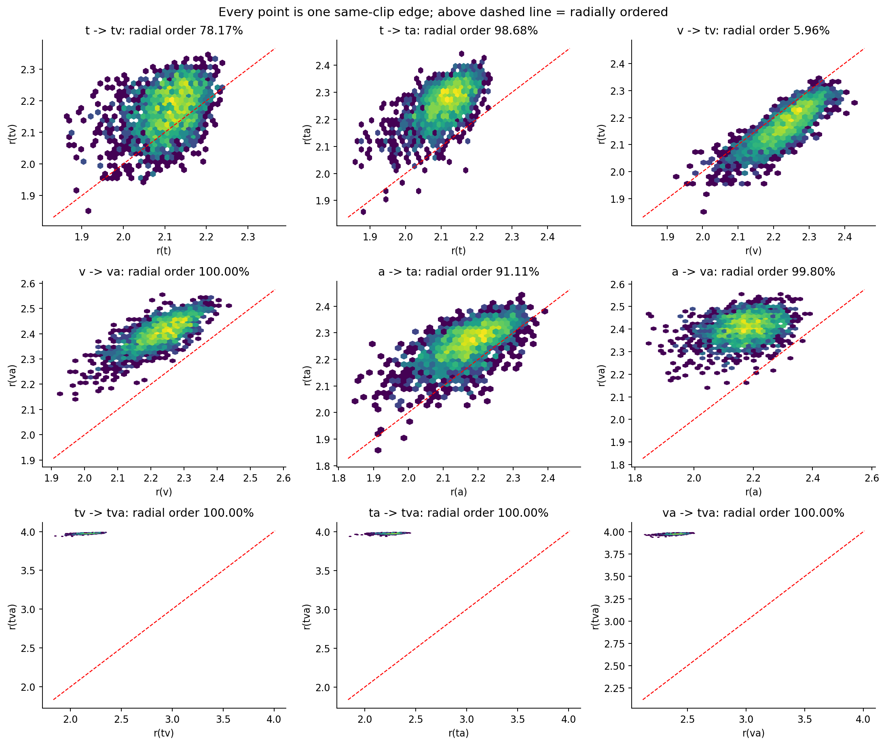
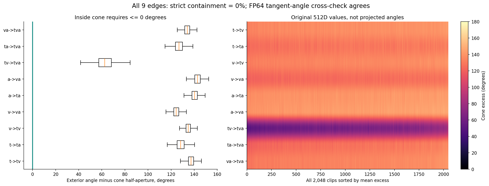
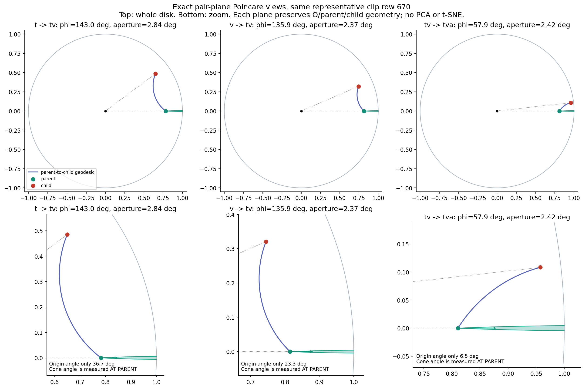
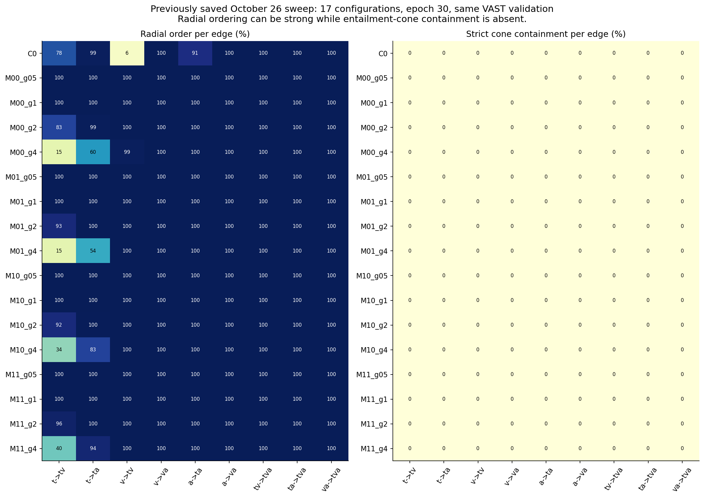
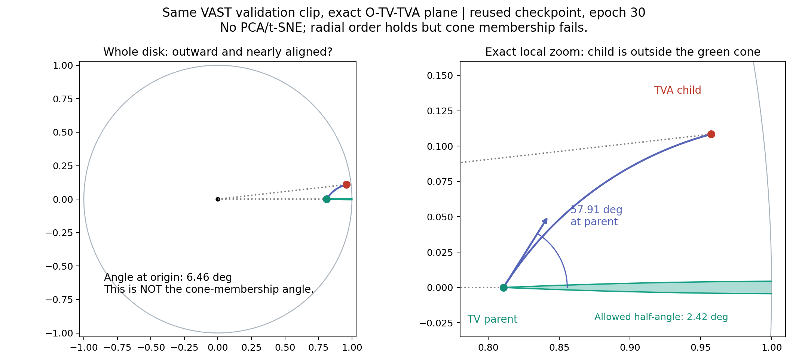

# ITM探索核查：线性探针、层级可视化和正式C0结果

核查日期：2026-10-27。原缓存与C0协调器已正常结束；四组C0均完成2000步，无失败，最后一组于2026-10-26 22:05 UTC结束。本文新图只读取既有checkpoint，另补一次零步原生matcher验证推理，没有重训trunk，也没有读取外部测试性能。

## 1. 两种线性探针具体是什么

它们都是诊断，不是拟议的完整ITM方法。输入不是视频/音频token，也不是BERT跨模态输出，而是冻结七节点表示上计算出的少量几何标量。

对于一个候选tuple `(t_i,v_j,a_k)`，先用冻结编码器的池化特征，重算其七个节点。TV节点使用`t_i,v_j`，TA使用`t_i,a_k`，VA使用`v_j,a_k`，TVA使用三者；不能把donor自己的完整TVA表示拿来代替混合tuple。

九条覆盖边是t→tv、v→tv、t→ta、a→ta、v→va、a→va、tv→tva、ta→tva、va→tva。每条边S→T计算：

`Gamma(S,T) = [d_H(z_S,z_T), r_S, r_T, r_T-r_S, max(0, phi(S,T)-aperture(S))]`

- **仅距离**：只启用九条边的九个距离，其余36列置零。
- **完整几何**：启用全部45列。这里“完整”只指计划规定的五类标量，并不包含512D向量的全部信息；半径差等列也存在冗余。

两者使用同一45→1线性层，共46个名义参数，输出`logit=w^T normalized_Gamma+b`。没有隐藏层。随后用二分类BCE训练同源匹配标签；sigmoid只是将logit变成分数，排序使用logit。两者trunk全冻结，只有线性层更新。

控制条件：零初始化、同一seed50、同一donor序列、1000步、每步96tuple、AdamW LR0.01、无weight decay；归一化均值/标准差只用4096条训练tuple。正例111占一半，负例112/121/122/123各占八分之一。这是E1-u来源分布。

**仅距离不等于原ITC分数。** 原主任务ITC使用不相交子集之间的`-d_H(z_t,z_va)`；线性探针使用九条集合覆盖边上的距离，再尝试判断完整tuple。因此，探针15%的召回并不是“原ITC距离本身只有15%”。

VAST验证集、同一top32候选：

| 方法 | t→va R@1 | va→t R@1 |
| --- | ---: | ---: |
| ITC-only | 37.26% | 37.06% |
| 仅距离线性探针 | 15.09% | 24.02% |
| 完整几何线性探针 | 18.46% | 24.07% |

完整几何对122的来源AUROC在均匀负例上为0.96165，在固定hard诊断上为0.57854。结论是这个简单读出不能替代细粒度matcher，随机来源判别高分也不能代替困难候选评测；这不证明几何作为token matcher的辅助输入无效。hard样本仍可能异源但语义相容，150条语义审查记录尚未完成。

## 2. 复用了什么，问题出现在哪里

本轮使用：`/data0/xiaobo.xia/yuxuan.gao/meru512_scale_pretrain_20261026/runs/C0/final.pt`，SHA256 `908b907c4ee1acc27674a1a571d5ff58b9c94cfd3988e437535543822681a318`。

这是10月26日那轮512D实验的**独立半径头C0**，不是MERU scale的M00/M01/M10/M11变体。冻结VAST编码器，七个子集头此前已训练30轮、9660步，目标为9-pair ITC加权0.1的9-edge entailment；曲率1，半径头范围约0.21到4。这里的旧“C0配置”与本轮“ITM C0基线”只是名字相同，含义不同。

本轮未重新训练这个trunk，而是从它的终点分叉。ITM训练只更新matcher，文本BERT用独立副本；几何节点和ITC候选不变。因此下面的几何现象早已存在于复用checkpoint，不是新ITM造成。

检查范围：VAST训练82608条、VAST held-out验证2048条。两者九条边的入锥计数都为0。v→tv径向递增率训练集6.0115%、验证集5.9570%。不是MSRVTT或VATEX上的结论；其他未指定checkpoint也不能直接套用此结论。

### 层均值排序确实存在

验证集层平均半径为L1=2.1697、L2=2.2756、L3=3.9770，所有clip都满足层平均排序。TVA也明显靠近半径头上限4。因此此前看到“外层更远”的图并没有错。

但是层均值掩盖了具体边。例如V平均半径2.2292，大于TV的2.1674，所以大部分v→tv反而向内。

### 半径更远仍不等于落入父锥

入锥要求父节点处的外角phi不超过它的半开角aperture。当前九条边平均外角约65.7°–145.6°，平均半开角只有约2.1°–2.8°。验证集最小超出量约41.53°；即使放宽30°仍为0%，不是严格阈值把近似满足的样本误判了。

我另用Lorentz切向量内积公式独立计算角度，与原公式最大差小于7.6e-8度；父子互换后也没有入锥。所有当前C0父点均处于锥公式的合法域。计算依据是原512D向量，不是二维投影的角度。

这张图取平均锥超出量位于中位数的同一个验证clip（row670，Je-SVwAa7D8.7），每个面板使用O、父、子张成的精确二维平面，再映射到Poincare圆盘。没有PCA/t-SNE，每个面板保留该三角形的双曲几何。不同边的平面不同，不能把面板合并成一棵二维树。

绿色是父点与父锥，红色是子点，蓝线是父到子的测地线。右侧tv→tva从**原点**看夹角只有6.46°，容易显得“方向很近、半径向外”；但在**父点**处，外角57.91°，允许半开角2.42°，子点明显不在父锥内。

### 与此前图的关系

10月26日旧`exact_geometry_examples.png`使用的是best available读出，其中C0为epoch26；那个面板本来就标有phi≈65.6°、aperture≈2.6°，不是入锥成功。该最佳轮次归档的九条入锥率也均为0。当前图使用epoch30终点，并单独放大锥附近以避免整张圆盘上的视觉误读。

这张对照来自10月26日17组的归档末轮指标：部分MERU配置逐边半径排序接近100%，但归档的严格入锥率仍为0。它只覆盖这一轮，不能代替其他服务器、维度或微调checkpoint的核查。

因此，更准确的结论是：**有径向分层，但这份checkpoint没有满足所定义的逐边锥包含。** 直接问题是方向/开角条件远未满足；优化目标权衡、半径分布、独立子集头等属于后续需控制变量检查的原因，不能只凭图就断言某一个是根因。

## 3. 正式ITM C0的实际结果

四组全部完成2000步，同一VAST验证集、固定top32、seed50、每步96fusion views，候选漏召回仍计未命中。下面都是验证结果，尚无PMRL公平测试结果。

| 条件 | 最佳验证步 | 最佳双向平均R@1 | 2000步双向平均R@1 |
| --- | ---: | ---: | ---: |
| ITC-only参考 | — | 37.16% | — |
| 原生VAST matcher，LR1e-4 | 500 | 39.06% | 35.67% |
| 轻量query matcher，LR1e-4 | 2000 | 3.47% | 3.47% |
| 轻量query matcher，LR3e-4 | 1500 | 2.56% | 2.10% |
| 轻量query matcher，LR1e-3 | 2000 | 4.20% | 4.20% |

另外补做了**零步原生matcher**：同一候选池上t→va=35.99%、va→t=27.20%、双向平均31.59%。因此原生matcher训练500步的39.06%比零步提高7.47个百分点，比ITC-only提高1.90个百分点；后期验证性能回落。仍缺多seed噪声估计和外部测试，不能声称稳健超过PMRL。

轻量query matcher是新初始化的小模型，原生matcher保留预训练BERT交互结构。前者在当前训练预算下明显不足，接近随机top32排序的2.63%期望，**结构对照没有通过**。这不证明所有统一matcher都无效，但不能在这个弱基线上继续堆E1/E2，然后把差异解释成层级贡献。

下一步应保留原生VAST交互能力，先修正统一接口的结构起点，再做seed噪声和单变量来源/局部监督/难负/几何对照；同时检查原生C0后期回落。E1/E2正式训练、几何接入token matcher、E6边级matcher、Tier B联合训练和PMRL公平对比都尚未完成。

## 文件

- `analysis.json`、`edge_statistics.csv`：几何、checkpoint与四组结果元数据。
- `train_val_geometry.json`：全部训练/验证节点的逐边核对。
- `native_zero_validation.json`：新补零步参照，只有VAST验证推理。
- `all_figures.pdf`：前六张图；`07_c0_with_zero.pdf`：补充零步后的C0曲线。
- 原历史实验和训练文件均未修改；本目录只新增分析产物。

补充：原生C0的2000步末轮来源诊断中，112（音频替换）AUROC=0.54567，121（视频替换）=0.98268，122（文本替换）=0.98322。这与仅用122模式训练时缺少单独音频错配监督的现象一致，但尚未通过消融证明其根因；这些末轮诊断不能与500步最佳checkpoint的指标混为同一模型结果。

单独放大同一tv→tva样本，便于阅读父点角度与原点角度的区别：

