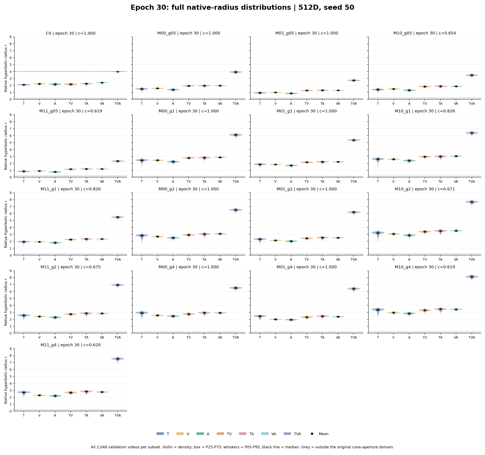
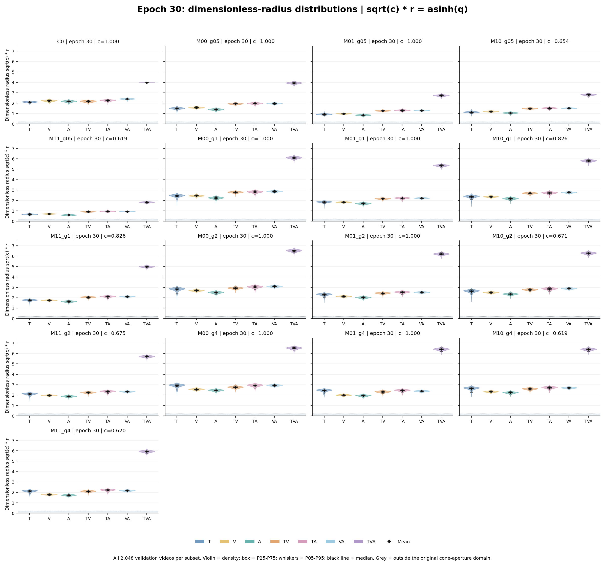
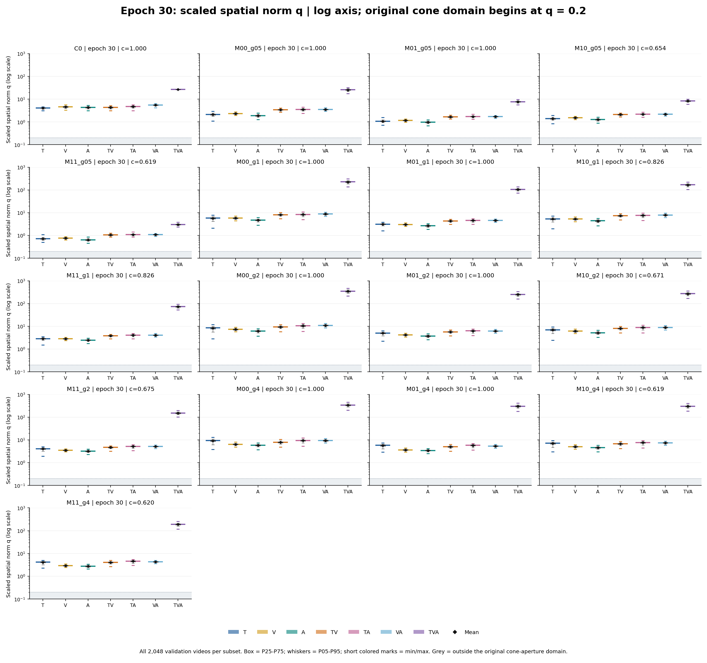
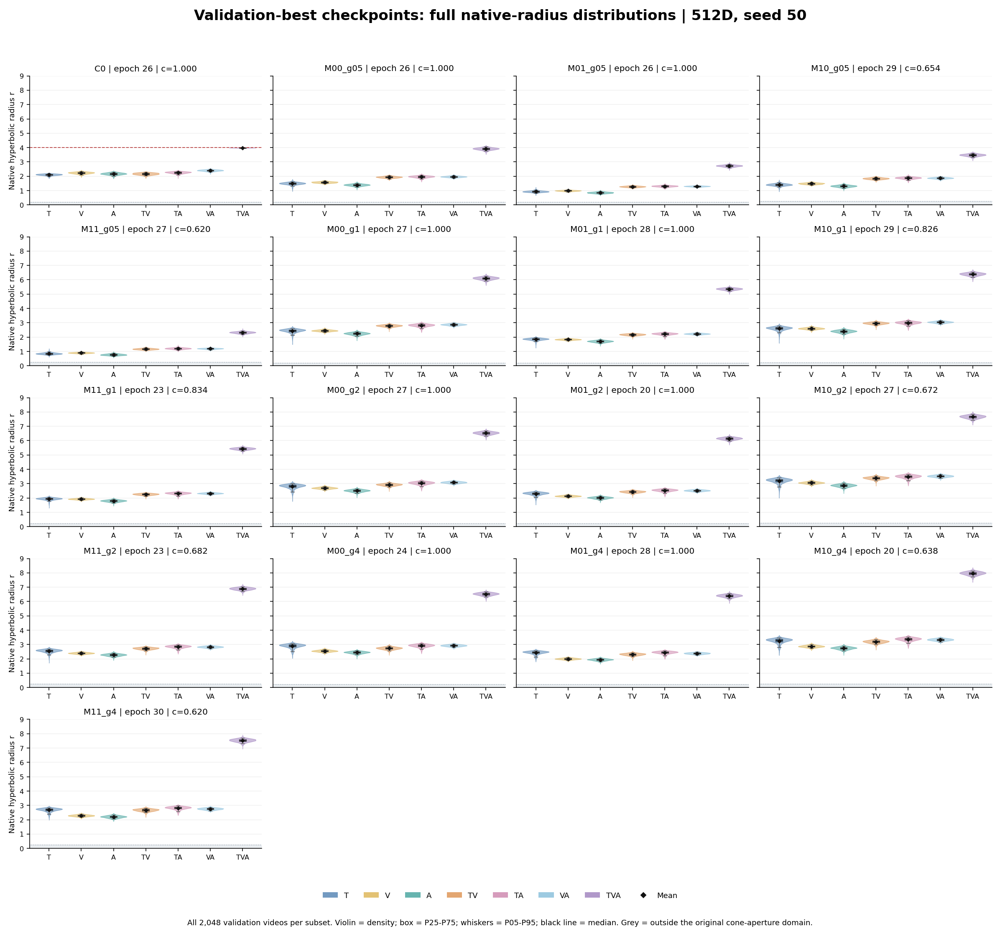
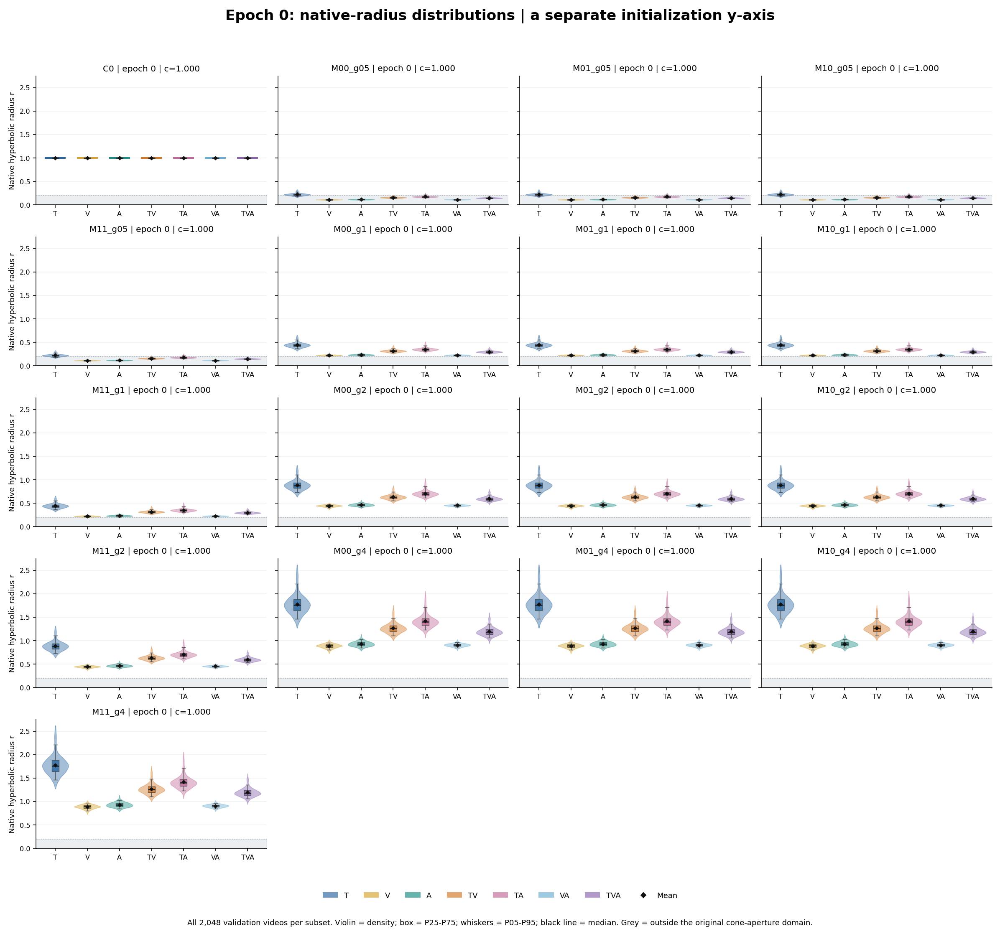

# 半径分布：初始化、末轮与最佳轮次

[新版主报告](REPORT_WITH_RADII.md) · [原始均值表](PARAMETERS.md) · [全部分布统计CSV](radius_distribution_statistics.csv) · [五页PDF](radius_distributions.pdf)

此前参数表只列出了均值，热力图也是均值。本补充直接使用每组保存的2,048个VAST验证视频表示，展示各子集的分布宽度、分位范围和极值。

## 读图与数值口径

- 每个小提琴使用该子集全部2,048个视频；轮廓表示密度估计。近乎常数的初始化半径用水平线表示，不拟合浮点噪声。
- 箱体为P25–P75，须为P05–P95；黑横线为中位数，黑菱形为均值。小提琴覆盖样本最小值到最大值。
- P05–P95是验证视频之间的分位范围，不是置信区间，也不是多seed标准差。表中标准差采用总体标准差。
- r是原空间双曲半径；不同模型曲率不同时，同时查看 `u = sqrt(c) * r = asinh(q)`。q定义为 `sqrt(c) * norm(spatial)`，直接决定开角。
- 灰色区域表示原始锥开角公式的定义域之外，不表示点离开了双曲空间。C0原始半径图的红虚线为其半径头上限4。
- 末轮和最佳轮次的r图使用相同纵轴；初始化图为显示较小的初始半径而使用独立纵轴。q图使用对数纵轴与箱线图。

## 第30轮末轮分布

## 最佳轮次与初始化

## 第30轮末轮：原空间半径r的统计

表中数值来自各子集全部2,048个视频，显示4位小数；完整精度及P25/P75、u和q统计见CSV。

### C0，epoch 30，c=1.000000

| 子集 | 均值 | 标准差 | P05 | 中位数 | P95 | 最小值 | 最大值 |
| --- | ---: | ---: | ---: | ---: | ---: | ---: | ---: |
| T | 2.1087 | 0.0589 | 2.0013 | 2.1152 | 2.1918 | 1.8581 | 2.2387 |
| V | 2.2292 | 0.0719 | 2.0986 | 2.2368 | 2.3334 | 1.9256 | 2.4357 |
| A | 2.1711 | 0.0810 | 2.0299 | 2.1748 | 2.2945 | 1.8470 | 2.3910 |
| TV | 2.1674 | 0.0735 | 2.0408 | 2.1715 | 2.2776 | 1.8515 | 2.3456 |
| TA | 2.2556 | 0.0722 | 2.1238 | 2.2662 | 2.3547 | 1.8580 | 2.4425 |
| VA | 2.4039 | 0.0571 | 2.3071 | 2.4071 | 2.4890 | 2.1400 | 2.5549 |
| TVA | 3.9770 | 0.0061 | 3.9663 | 3.9779 | 3.9853 | 3.9376 | 3.9895 |

### M00_g05，epoch 30，c=1.000000

| 子集 | 均值 | 标准差 | P05 | 中位数 | P95 | 最小值 | 最大值 |
| --- | ---: | ---: | ---: | ---: | ---: | ---: | ---: |
| T | 1.4956 | 0.0942 | 1.3359 | 1.5047 | 1.6227 | 0.9583 | 1.7965 |
| V | 1.5805 | 0.0551 | 1.4915 | 1.5810 | 1.6737 | 1.4023 | 1.7344 |
| A | 1.3933 | 0.0751 | 1.2651 | 1.3962 | 1.5114 | 1.0560 | 1.6261 |
| TV | 1.9413 | 0.0623 | 1.8348 | 1.9437 | 2.0413 | 1.7087 | 2.1156 |
| TA | 1.9670 | 0.0772 | 1.8287 | 1.9756 | 2.0770 | 1.6164 | 2.1958 |
| VA | 1.9714 | 0.0522 | 1.8817 | 1.9719 | 2.0583 | 1.7922 | 2.1302 |
| TVA | 3.9303 | 0.0885 | 3.7733 | 3.9363 | 4.0674 | 3.5487 | 4.1721 |

### M01_g05，epoch 30，c=1.000000

| 子集 | 均值 | 标准差 | P05 | 中位数 | P95 | 最小值 | 最大值 |
| --- | ---: | ---: | ---: | ---: | ---: | ---: | ---: |
| T | 0.9358 | 0.0621 | 0.8396 | 0.9336 | 1.0399 | 0.6686 | 1.2337 |
| V | 0.9906 | 0.0381 | 0.9262 | 0.9924 | 1.0527 | 0.8626 | 1.1017 |
| A | 0.8564 | 0.0542 | 0.7691 | 0.8566 | 0.9478 | 0.6462 | 1.0397 |
| TV | 1.2770 | 0.0471 | 1.2004 | 1.2770 | 1.3542 | 1.1072 | 1.4286 |
| TA | 1.3075 | 0.0555 | 1.2110 | 1.3110 | 1.3895 | 1.0890 | 1.5253 |
| VA | 1.2978 | 0.0383 | 1.2325 | 1.2999 | 1.3579 | 1.1549 | 1.4110 |
| TVA | 2.7340 | 0.0696 | 2.6173 | 2.7380 | 2.8426 | 2.4303 | 2.9826 |

### M10_g05，epoch 30，c=0.654003

| 子集 | 均值 | 标准差 | P05 | 中位数 | P95 | 最小值 | 最大值 |
| --- | ---: | ---: | ---: | ---: | ---: | ---: | ---: |
| T | 1.4059 | 0.0913 | 1.2577 | 1.4079 | 1.5461 | 0.9347 | 1.7510 |
| V | 1.4891 | 0.0575 | 1.3943 | 1.4915 | 1.5863 | 1.3075 | 1.6463 |
| A | 1.3106 | 0.0747 | 1.1855 | 1.3137 | 1.4293 | 0.9896 | 1.5457 |
| TV | 1.8403 | 0.0640 | 1.7316 | 1.8412 | 1.9462 | 1.5881 | 2.0250 |
| TA | 1.8788 | 0.0768 | 1.7420 | 1.8848 | 1.9904 | 1.5540 | 2.1335 |
| VA | 1.8715 | 0.0536 | 1.7792 | 1.8726 | 1.9588 | 1.6724 | 2.0238 |
| TVA | 3.4755 | 0.0863 | 3.3245 | 3.4805 | 3.6095 | 3.0908 | 3.7138 |

### M11_g05，epoch 30，c=0.618961

| 子集 | 均值 | 标准差 | P05 | 中位数 | P95 | 最小值 | 最大值 |
| --- | ---: | ---: | ---: | ---: | ---: | ---: | ---: |
| T | 0.8552 | 0.0653 | 0.7581 | 0.8505 | 0.9674 | 0.6132 | 1.1999 |
| V | 0.9033 | 0.0409 | 0.8342 | 0.9041 | 0.9690 | 0.7586 | 1.0319 |
| A | 0.7766 | 0.0570 | 0.6858 | 0.7743 | 0.8719 | 0.5616 | 0.9949 |
| TV | 1.1710 | 0.0494 | 1.0899 | 1.1699 | 1.2532 | 0.9946 | 1.3463 |
| TA | 1.2074 | 0.0574 | 1.1104 | 1.2086 | 1.2973 | 0.9938 | 1.4613 |
| VA | 1.1957 | 0.0408 | 1.1243 | 1.1987 | 1.2580 | 1.0405 | 1.3135 |
| TVA | 2.3273 | 0.0710 | 2.2086 | 2.3308 | 2.4397 | 2.0271 | 2.6056 |

### M00_g1，epoch 30，c=1.000000

| 子集 | 均值 | 标准差 | P05 | 中位数 | P95 | 最小值 | 最大值 |
| --- | ---: | ---: | ---: | ---: | ---: | ---: | ---: |
| T | 2.4382 | 0.1426 | 2.1518 | 2.4661 | 2.6078 | 1.4936 | 2.7635 |
| V | 2.4517 | 0.0643 | 2.3478 | 2.4507 | 2.5593 | 2.1995 | 2.6779 |
| A | 2.2450 | 0.0927 | 2.0862 | 2.2517 | 2.3848 | 1.7610 | 2.5121 |
| TV | 2.7914 | 0.0752 | 2.6624 | 2.7972 | 2.9028 | 2.3913 | 3.0128 |
| TA | 2.8159 | 0.1065 | 2.6092 | 2.8303 | 2.9607 | 2.3273 | 3.0814 |
| VA | 2.8740 | 0.0642 | 2.7671 | 2.8755 | 2.9783 | 2.6354 | 3.0653 |
| TVA | 6.1053 | 0.1060 | 5.9202 | 6.1141 | 6.2591 | 5.6132 | 6.4243 |

### M01_g1，epoch 30，c=1.000000

| 子集 | 均值 | 标准差 | P05 | 中位数 | P95 | 最小值 | 最大值 |
| --- | ---: | ---: | ---: | ---: | ---: | ---: | ---: |
| T | 1.8509 | 0.0859 | 1.7016 | 1.8625 | 1.9612 | 1.2533 | 2.0561 |
| V | 1.8380 | 0.0461 | 1.7616 | 1.8378 | 1.9152 | 1.6667 | 1.9902 |
| A | 1.7038 | 0.0704 | 1.5847 | 1.7069 | 1.8161 | 1.3765 | 1.9074 |
| TV | 2.1723 | 0.0600 | 2.0665 | 2.1765 | 2.2607 | 1.8675 | 2.3380 |
| TA | 2.2188 | 0.0819 | 2.0572 | 2.2311 | 2.3281 | 1.8511 | 2.4184 |
| VA | 2.2277 | 0.0488 | 2.1451 | 2.2277 | 2.3079 | 2.0431 | 2.3907 |
| TVA | 5.3551 | 0.0800 | 5.2161 | 5.3606 | 5.4725 | 4.9918 | 5.6207 |

### M10_g1，epoch 30，c=0.825926

| 子集 | 均值 | 标准差 | P05 | 中位数 | P95 | 最小值 | 最大值 |
| --- | ---: | ---: | ---: | ---: | ---: | ---: | ---: |
| T | 2.5925 | 0.1496 | 2.3046 | 2.6212 | 2.7718 | 1.5816 | 2.9407 |
| V | 2.6024 | 0.0682 | 2.4935 | 2.6020 | 2.7157 | 2.3219 | 2.8436 |
| A | 2.4001 | 0.0994 | 2.2298 | 2.4077 | 2.5500 | 1.8781 | 2.6906 |
| TV | 2.9647 | 0.0797 | 2.8266 | 2.9715 | 3.0824 | 2.5292 | 3.1988 |
| TA | 2.9930 | 0.1132 | 2.7765 | 3.0084 | 3.1462 | 2.4685 | 3.2734 |
| VA | 3.0444 | 0.0677 | 2.9295 | 3.0461 | 3.1547 | 2.7839 | 3.2492 |
| TVA | 6.3892 | 0.1098 | 6.1944 | 6.3988 | 6.5487 | 5.8747 | 6.7213 |

### M11_g1，epoch 30，c=0.825514

| 子集 | 均值 | 标准差 | P05 | 中位数 | P95 | 最小值 | 最大值 |
| --- | ---: | ---: | ---: | ---: | ---: | ---: | ---: |
| T | 1.9474 | 0.0882 | 1.7971 | 1.9588 | 2.0620 | 1.3173 | 2.1758 |
| V | 1.9353 | 0.0478 | 1.8561 | 1.9355 | 2.0151 | 1.7503 | 2.0942 |
| A | 1.8060 | 0.0737 | 1.6821 | 1.8094 | 1.9224 | 1.4565 | 2.0213 |
| TV | 2.2655 | 0.0624 | 2.1548 | 2.2697 | 2.3572 | 1.9416 | 2.4373 |
| TA | 2.3280 | 0.0849 | 2.1599 | 2.3412 | 2.4419 | 1.9415 | 2.5318 |
| VA | 2.3321 | 0.0507 | 2.2462 | 2.3325 | 2.4156 | 2.1367 | 2.5031 |
| TVA | 5.4821 | 0.0788 | 5.3441 | 5.4880 | 5.5989 | 5.1221 | 5.7470 |

### M00_g2，epoch 30，c=1.000000

| 子集 | 均值 | 标准差 | P05 | 中位数 | P95 | 最小值 | 最大值 |
| --- | ---: | ---: | ---: | ---: | ---: | ---: | ---: |
| T | 2.8048 | 0.1722 | 2.4364 | 2.8443 | 3.0008 | 1.7738 | 3.1724 |
| V | 2.6954 | 0.0697 | 2.5788 | 2.6947 | 2.8132 | 2.4498 | 2.9137 |
| A | 2.5083 | 0.0891 | 2.3491 | 2.5148 | 2.6422 | 2.0330 | 2.7714 |
| TV | 2.9291 | 0.0859 | 2.7825 | 2.9342 | 3.0580 | 2.4706 | 3.1843 |
| TA | 3.0350 | 0.1169 | 2.8097 | 3.0513 | 3.1893 | 2.4929 | 3.2961 |
| VA | 3.0876 | 0.0666 | 2.9744 | 3.0886 | 3.1924 | 2.8427 | 3.2809 |
| TVA | 6.5261 | 0.1050 | 6.3476 | 6.5348 | 6.6799 | 6.0515 | 6.8365 |

### M01_g2，epoch 30，c=1.000000

| 子集 | 均值 | 标准差 | P05 | 中位数 | P95 | 最小值 | 最大值 |
| --- | ---: | ---: | ---: | ---: | ---: | ---: | ---: |
| T | 2.3000 | 0.1242 | 2.0425 | 2.3255 | 2.4454 | 1.5486 | 2.5536 |
| V | 2.1364 | 0.0540 | 2.0462 | 2.1362 | 2.2284 | 1.9497 | 2.3057 |
| A | 2.0230 | 0.0738 | 1.8952 | 2.0268 | 2.1385 | 1.6906 | 2.2527 |
| TV | 2.4425 | 0.0734 | 2.3172 | 2.4481 | 2.5516 | 2.0437 | 2.6412 |
| TA | 2.5280 | 0.0989 | 2.3285 | 2.5450 | 2.6556 | 2.0859 | 2.7406 |
| VA | 2.5231 | 0.0554 | 2.4279 | 2.5244 | 2.6092 | 2.3162 | 2.6941 |
| TVA | 6.2003 | 0.0935 | 6.0350 | 6.2058 | 6.3380 | 5.7735 | 6.5043 |

### M10_g2，epoch 30，c=0.671432

| 子集 | 均值 | 标准差 | P05 | 中位数 | P95 | 最小值 | 最大值 |
| --- | ---: | ---: | ---: | ---: | ---: | ---: | ---: |
| T | 3.1916 | 0.1928 | 2.7859 | 3.2357 | 3.4137 | 2.0051 | 3.5948 |
| V | 3.0634 | 0.0777 | 2.9348 | 3.0637 | 3.1931 | 2.7912 | 3.3137 |
| A | 2.8720 | 0.1039 | 2.6901 | 2.8800 | 3.0296 | 2.3300 | 3.1834 |
| TV | 3.3915 | 0.0972 | 3.2195 | 3.4000 | 3.5347 | 2.8490 | 3.6744 |
| TA | 3.4873 | 0.1348 | 3.2240 | 3.5078 | 3.6650 | 2.8575 | 3.7851 |
| VA | 3.5259 | 0.0754 | 3.3960 | 3.5285 | 3.6451 | 3.2364 | 3.7481 |
| TVA | 7.6665 | 0.1216 | 7.4541 | 7.6762 | 7.8459 | 7.1080 | 8.0391 |

### M11_g2，epoch 30，c=0.674581

| 子集 | 均值 | 标准差 | P05 | 中位数 | P95 | 最小值 | 最大值 |
| --- | ---: | ---: | ---: | ---: | ---: | ---: | ---: |
| T | 2.5584 | 0.1268 | 2.3079 | 2.5818 | 2.7117 | 1.7316 | 2.8366 |
| V | 2.4056 | 0.0581 | 2.3079 | 2.4060 | 2.5037 | 2.2078 | 2.5856 |
| A | 2.2879 | 0.0829 | 2.1451 | 2.2917 | 2.4190 | 1.9158 | 2.5483 |
| TV | 2.7354 | 0.0801 | 2.5967 | 2.7437 | 2.8510 | 2.2878 | 2.9444 |
| TA | 2.8532 | 0.1095 | 2.6342 | 2.8728 | 2.9948 | 2.3582 | 3.0849 |
| VA | 2.8444 | 0.0618 | 2.7375 | 2.8461 | 2.9398 | 2.6096 | 3.0396 |
| TVA | 6.9466 | 0.0986 | 6.7737 | 6.9526 | 7.0909 | 6.4802 | 7.2799 |

### M00_g4，epoch 30，c=1.000000

| 子集 | 均值 | 标准差 | P05 | 中位数 | P95 | 最小值 | 最大值 |
| --- | ---: | ---: | ---: | ---: | ---: | ---: | ---: |
| T | 2.8943 | 0.1705 | 2.5146 | 2.9378 | 3.0853 | 2.0516 | 3.2558 |
| V | 2.5618 | 0.0718 | 2.4448 | 2.5604 | 2.6838 | 2.2976 | 2.7804 |
| A | 2.4586 | 0.0839 | 2.3086 | 2.4665 | 2.5837 | 2.0117 | 2.6853 |
| TV | 2.7552 | 0.0945 | 2.5945 | 2.7613 | 2.8993 | 2.2807 | 3.0416 |
| TA | 2.9245 | 0.1183 | 2.6911 | 2.9431 | 3.0778 | 2.3763 | 3.1980 |
| VA | 2.9349 | 0.0676 | 2.8192 | 2.9368 | 3.0408 | 2.6883 | 3.1374 |
| TVA | 6.5119 | 0.1045 | 6.3295 | 6.5220 | 6.6617 | 6.0120 | 6.8202 |

### M01_g4，epoch 30，c=1.000000

| 子集 | 均值 | 标准差 | P05 | 中位数 | P95 | 最小值 | 最大值 |
| --- | ---: | ---: | ---: | ---: | ---: | ---: | ---: |
| T | 2.4281 | 0.1343 | 2.1246 | 2.4625 | 2.5795 | 1.8032 | 2.6914 |
| V | 2.0033 | 0.0576 | 1.9076 | 2.0030 | 2.0990 | 1.7968 | 2.1886 |
| A | 1.9450 | 0.0710 | 1.8229 | 1.9486 | 2.0534 | 1.6457 | 2.1497 |
| TV | 2.3145 | 0.0842 | 2.1690 | 2.3206 | 2.4393 | 1.8891 | 2.5531 |
| TA | 2.4401 | 0.1026 | 2.2383 | 2.4579 | 2.5694 | 1.9843 | 2.6529 |
| VA | 2.3821 | 0.0589 | 2.2804 | 2.3845 | 2.4747 | 2.1782 | 2.5442 |
| TVA | 6.3979 | 0.1044 | 6.2123 | 6.4054 | 6.5533 | 5.8853 | 6.7290 |

### M10_g4，epoch 30，c=0.618779

| 子集 | 均值 | 标准差 | P05 | 中位数 | P95 | 最小值 | 最大值 |
| --- | ---: | ---: | ---: | ---: | ---: | ---: | ---: |
| T | 3.3345 | 0.1999 | 2.8836 | 3.3840 | 3.5577 | 2.3162 | 3.7478 |
| V | 2.9604 | 0.0819 | 2.8257 | 2.9598 | 3.0990 | 2.6613 | 3.2135 |
| A | 2.8397 | 0.0996 | 2.6631 | 2.8467 | 2.9898 | 2.3393 | 3.1260 |
| TV | 3.3000 | 0.1109 | 3.1080 | 3.3077 | 3.4646 | 2.7165 | 3.6202 |
| TA | 3.4460 | 0.1408 | 3.1706 | 3.4696 | 3.6268 | 2.8092 | 3.7499 |
| VA | 3.4325 | 0.0791 | 3.2968 | 3.4353 | 3.5561 | 3.1406 | 3.6458 |
| TVA | 8.1218 | 0.1296 | 7.8961 | 8.1316 | 8.3116 | 7.5214 | 8.5170 |

### M11_g4，epoch 30，c=0.619843

| 子集 | 均值 | 标准差 | P05 | 中位数 | P95 | 最小值 | 最大值 |
| --- | ---: | ---: | ---: | ---: | ---: | ---: | ---: |
| T | 2.6867 | 0.1363 | 2.3843 | 2.7190 | 2.8438 | 1.9831 | 2.9577 |
| V | 2.2877 | 0.0635 | 2.1806 | 2.2883 | 2.3925 | 2.0676 | 2.4918 |
| A | 2.2077 | 0.0832 | 2.0664 | 2.2100 | 2.3366 | 1.8917 | 2.4520 |
| TV | 2.6730 | 0.0947 | 2.5101 | 2.6821 | 2.8105 | 2.1802 | 2.9273 |
| TA | 2.8187 | 0.1168 | 2.5860 | 2.8382 | 2.9664 | 2.3097 | 3.0618 |
| VA | 2.7598 | 0.0691 | 2.6398 | 2.7626 | 2.8692 | 2.5209 | 2.9599 |
| TVA | 7.5329 | 0.1182 | 7.3205 | 7.5420 | 7.7058 | 6.9442 | 7.9234 |

## 验证检索最佳轮次：原空间半径r的统计

表中数值来自各子集全部2,048个视频，显示4位小数；完整精度及P25/P75、u和q统计见CSV。

### C0，epoch 26，c=1.000000

| 子集 | 均值 | 标准差 | P05 | 中位数 | P95 | 最小值 | 最大值 |
| --- | ---: | ---: | ---: | ---: | ---: | ---: | ---: |
| T | 2.1062 | 0.0588 | 1.9986 | 2.1125 | 2.1892 | 1.8559 | 2.2361 |
| V | 2.2286 | 0.0718 | 2.0976 | 2.2356 | 2.3327 | 1.9244 | 2.4345 |
| A | 2.1677 | 0.0812 | 2.0260 | 2.1716 | 2.2914 | 1.8430 | 2.3883 |
| TV | 2.1647 | 0.0735 | 2.0385 | 2.1693 | 2.2750 | 1.8482 | 2.3427 |
| TA | 2.2528 | 0.0724 | 2.1206 | 2.2636 | 2.3521 | 1.8543 | 2.4409 |
| VA | 2.4005 | 0.0572 | 2.3036 | 2.4041 | 2.4854 | 2.1366 | 2.5530 |
| TVA | 3.9767 | 0.0062 | 3.9660 | 3.9776 | 3.9851 | 3.9369 | 3.9894 |

### M00_g05，epoch 26，c=1.000000

| 子集 | 均值 | 标准差 | P05 | 中位数 | P95 | 最小值 | 最大值 |
| --- | ---: | ---: | ---: | ---: | ---: | ---: | ---: |
| T | 1.4922 | 0.0942 | 1.3327 | 1.5013 | 1.6194 | 0.9558 | 1.7933 |
| V | 1.5775 | 0.0551 | 1.4884 | 1.5781 | 1.6704 | 1.3994 | 1.7311 |
| A | 1.3902 | 0.0750 | 1.2623 | 1.3931 | 1.5078 | 1.0533 | 1.6226 |
| TV | 1.9377 | 0.0623 | 1.8313 | 1.9399 | 2.0379 | 1.7045 | 2.1119 |
| TA | 1.9627 | 0.0771 | 1.8244 | 1.9712 | 2.0720 | 1.6121 | 2.1914 |
| VA | 1.9673 | 0.0522 | 1.8785 | 1.9675 | 2.0533 | 1.7879 | 2.1265 |
| TVA | 3.9134 | 0.0884 | 3.7563 | 3.9199 | 4.0503 | 3.5319 | 4.1547 |

### M01_g05，epoch 26，c=1.000000

| 子集 | 均值 | 标准差 | P05 | 中位数 | P95 | 最小值 | 最大值 |
| --- | ---: | ---: | ---: | ---: | ---: | ---: | ---: |
| T | 0.9347 | 0.0622 | 0.8384 | 0.9323 | 1.0390 | 0.6672 | 1.2333 |
| V | 0.9900 | 0.0382 | 0.9252 | 0.9919 | 1.0521 | 0.8621 | 1.1011 |
| A | 0.8554 | 0.0542 | 0.7683 | 0.8557 | 0.9470 | 0.6452 | 1.0391 |
| TV | 1.2760 | 0.0472 | 1.1986 | 1.2761 | 1.3530 | 1.1054 | 1.4274 |
| TA | 1.3054 | 0.0556 | 1.2084 | 1.3087 | 1.3872 | 1.0868 | 1.5240 |
| VA | 1.2967 | 0.0383 | 1.2314 | 1.2988 | 1.3566 | 1.1526 | 1.4105 |
| TVA | 2.7226 | 0.0696 | 2.6060 | 2.7263 | 2.8311 | 2.4190 | 2.9720 |

### M10_g05，epoch 29，c=0.654022

| 子集 | 均值 | 标准差 | P05 | 中位数 | P95 | 最小值 | 最大值 |
| --- | ---: | ---: | ---: | ---: | ---: | ---: | ---: |
| T | 1.4058 | 0.0913 | 1.2576 | 1.4079 | 1.5460 | 0.9347 | 1.7509 |
| V | 1.4890 | 0.0575 | 1.3942 | 1.4914 | 1.5862 | 1.3074 | 1.6462 |
| A | 1.3105 | 0.0747 | 1.1854 | 1.3136 | 1.4293 | 0.9895 | 1.5456 |
| TV | 1.8403 | 0.0640 | 1.7315 | 1.8411 | 1.9461 | 1.5880 | 2.0249 |
| TA | 1.8787 | 0.0768 | 1.7419 | 1.8847 | 1.9903 | 1.5539 | 2.1335 |
| VA | 1.8714 | 0.0536 | 1.7791 | 1.8724 | 1.9587 | 1.6722 | 2.0236 |
| TVA | 3.4750 | 0.0863 | 3.3240 | 3.4800 | 3.6092 | 3.0904 | 3.7134 |

### M11_g05，epoch 27，c=0.619501

| 子集 | 均值 | 标准差 | P05 | 中位数 | P95 | 最小值 | 最大值 |
| --- | ---: | ---: | ---: | ---: | ---: | ---: | ---: |
| T | 0.8546 | 0.0654 | 0.7575 | 0.8499 | 0.9668 | 0.6125 | 1.1996 |
| V | 0.9029 | 0.0410 | 0.8338 | 0.9038 | 0.9688 | 0.7577 | 1.0315 |
| A | 0.7762 | 0.0569 | 0.6853 | 0.7739 | 0.8718 | 0.5612 | 0.9942 |
| TV | 1.1699 | 0.0495 | 1.0890 | 1.1688 | 1.2524 | 0.9929 | 1.3457 |
| TA | 1.2066 | 0.0574 | 1.1100 | 1.2082 | 1.2968 | 0.9932 | 1.4601 |
| VA | 1.1951 | 0.0408 | 1.1233 | 1.1981 | 1.2575 | 1.0396 | 1.3127 |
| TVA | 2.3230 | 0.0710 | 2.2044 | 2.3264 | 2.4357 | 2.0233 | 2.6010 |

### M00_g1，epoch 27，c=1.000000

| 子集 | 均值 | 标准差 | P05 | 中位数 | P95 | 最小值 | 最大值 |
| --- | ---: | ---: | ---: | ---: | ---: | ---: | ---: |
| T | 2.4368 | 0.1425 | 2.1510 | 2.4648 | 2.6063 | 1.4925 | 2.7620 |
| V | 2.4510 | 0.0643 | 2.3470 | 2.4501 | 2.5585 | 2.1984 | 2.6771 |
| A | 2.2439 | 0.0927 | 2.0852 | 2.2506 | 2.3836 | 1.7601 | 2.5111 |
| TV | 2.7901 | 0.0752 | 2.6613 | 2.7960 | 2.9017 | 2.3901 | 3.0113 |
| TA | 2.8148 | 0.1065 | 2.6084 | 2.8292 | 2.9596 | 2.3264 | 3.0804 |
| VA | 2.8729 | 0.0642 | 2.7663 | 2.8744 | 2.9772 | 2.6340 | 3.0647 |
| TVA | 6.1017 | 0.1058 | 5.9167 | 6.1101 | 6.2556 | 5.6110 | 6.4205 |

### M01_g1，epoch 28，c=1.000000

| 子集 | 均值 | 标准差 | P05 | 中位数 | P95 | 最小值 | 最大值 |
| --- | ---: | ---: | ---: | ---: | ---: | ---: | ---: |
| T | 1.8508 | 0.0859 | 1.7015 | 1.8624 | 1.9612 | 1.2532 | 2.0560 |
| V | 1.8382 | 0.0461 | 1.7616 | 1.8379 | 1.9155 | 1.6667 | 1.9905 |
| A | 1.7037 | 0.0704 | 1.5846 | 1.7068 | 1.8159 | 1.3764 | 1.9072 |
| TV | 2.1723 | 0.0601 | 2.0666 | 2.1766 | 2.2608 | 1.8675 | 2.3380 |
| TA | 2.2186 | 0.0818 | 2.0572 | 2.2310 | 2.3279 | 1.8512 | 2.4180 |
| VA | 2.2279 | 0.0488 | 2.1452 | 2.2280 | 2.3080 | 2.0431 | 2.3909 |
| TVA | 5.3541 | 0.0799 | 5.2152 | 5.3595 | 5.4716 | 4.9913 | 5.6195 |

### M10_g1，epoch 29，c=0.825952

| 子集 | 均值 | 标准差 | P05 | 中位数 | P95 | 最小值 | 最大值 |
| --- | ---: | ---: | ---: | ---: | ---: | ---: | ---: |
| T | 2.5924 | 0.1496 | 2.3046 | 2.6210 | 2.7718 | 1.5816 | 2.9407 |
| V | 2.6024 | 0.0682 | 2.4934 | 2.6020 | 2.7157 | 2.3219 | 2.8436 |
| A | 2.4000 | 0.0994 | 2.2297 | 2.4076 | 2.5499 | 1.8780 | 2.6906 |
| TV | 2.9647 | 0.0797 | 2.8265 | 2.9714 | 3.0824 | 2.5292 | 3.1987 |
| TA | 2.9929 | 0.1132 | 2.7764 | 3.0083 | 3.1460 | 2.4684 | 3.2733 |
| VA | 3.0443 | 0.0677 | 2.9295 | 3.0461 | 3.1546 | 2.7839 | 3.2492 |
| TVA | 6.3890 | 0.1098 | 6.1942 | 6.3986 | 6.5485 | 5.8745 | 6.7212 |

### M11_g1，epoch 23，c=0.833913

| 子集 | 均值 | 标准差 | P05 | 中位数 | P95 | 最小值 | 最大值 |
| --- | ---: | ---: | ---: | ---: | ---: | ---: | ---: |
| T | 1.9412 | 0.0889 | 1.7907 | 1.9527 | 2.0565 | 1.3074 | 2.1683 |
| V | 1.9293 | 0.0478 | 1.8504 | 1.9294 | 2.0088 | 1.7430 | 2.0885 |
| A | 1.8001 | 0.0740 | 1.6759 | 1.8035 | 1.9172 | 1.4489 | 2.0166 |
| TV | 2.2581 | 0.0623 | 2.1477 | 2.2625 | 2.3491 | 1.9366 | 2.4299 |
| TA | 2.3199 | 0.0850 | 2.1513 | 2.3330 | 2.4339 | 1.9331 | 2.5226 |
| VA | 2.3230 | 0.0508 | 2.2373 | 2.3230 | 2.4071 | 2.1280 | 2.4939 |
| TVA | 5.4337 | 0.0785 | 5.2968 | 5.4394 | 5.5489 | 5.0734 | 5.6978 |

### M00_g2，epoch 27，c=1.000000

| 子集 | 均值 | 标准差 | P05 | 中位数 | P95 | 最小值 | 最大值 |
| --- | ---: | ---: | ---: | ---: | ---: | ---: | ---: |
| T | 2.8034 | 0.1720 | 2.4355 | 2.8430 | 2.9993 | 1.7727 | 3.1707 |
| V | 2.6950 | 0.0697 | 2.5782 | 2.6942 | 2.8126 | 2.4494 | 2.9134 |
| A | 2.5069 | 0.0891 | 2.3477 | 2.5135 | 2.6407 | 2.0319 | 2.7698 |
| TV | 2.9275 | 0.0858 | 2.7811 | 2.9324 | 3.0564 | 2.4697 | 3.1821 |
| TA | 3.0339 | 0.1169 | 2.8085 | 3.0502 | 3.1883 | 2.4920 | 3.2949 |
| VA | 3.0865 | 0.0666 | 2.9732 | 3.0875 | 3.1911 | 2.8414 | 3.2794 |
| TVA | 6.5260 | 0.1049 | 6.3479 | 6.5346 | 6.6796 | 6.0517 | 6.8363 |

### M01_g2，epoch 20，c=1.000000

| 子集 | 均值 | 标准差 | P05 | 中位数 | P95 | 最小值 | 最大值 |
| --- | ---: | ---: | ---: | ---: | ---: | ---: | ---: |
| T | 2.2941 | 0.1251 | 2.0353 | 2.3200 | 2.4399 | 1.5302 | 2.5481 |
| V | 2.1330 | 0.0545 | 2.0419 | 2.1331 | 2.2251 | 1.9462 | 2.3040 |
| A | 2.0155 | 0.0746 | 1.8850 | 2.0192 | 2.1318 | 1.6770 | 2.2476 |
| TV | 2.4300 | 0.0734 | 2.3053 | 2.4353 | 2.5389 | 2.0355 | 2.6286 |
| TA | 2.5260 | 0.0991 | 2.3281 | 2.5424 | 2.6553 | 2.0823 | 2.7412 |
| VA | 2.5182 | 0.0564 | 2.4207 | 2.5196 | 2.6063 | 2.3090 | 2.6915 |
| TVA | 6.1435 | 0.0934 | 5.9836 | 6.1502 | 6.2830 | 5.7108 | 6.4530 |

### M10_g2，epoch 27，c=0.672011

| 子集 | 均值 | 标准差 | P05 | 中位数 | P95 | 最小值 | 最大值 |
| --- | ---: | ---: | ---: | ---: | ---: | ---: | ---: |
| T | 3.1891 | 0.1926 | 2.7841 | 3.2330 | 3.4109 | 2.0033 | 3.5919 |
| V | 3.0618 | 0.0777 | 2.9332 | 3.0623 | 3.1912 | 2.7898 | 3.3121 |
| A | 2.8697 | 0.1039 | 2.6879 | 2.8776 | 3.0272 | 2.3280 | 3.1805 |
| TV | 3.3886 | 0.0970 | 3.2171 | 3.3968 | 3.5320 | 2.8470 | 3.6707 |
| TA | 3.4848 | 0.1348 | 3.2213 | 3.5053 | 3.6626 | 2.8554 | 3.7825 |
| VA | 3.5236 | 0.0754 | 3.3938 | 3.5261 | 3.6430 | 3.2338 | 3.7461 |
| TVA | 7.6615 | 0.1215 | 7.4493 | 7.6710 | 7.8411 | 7.1041 | 8.0340 |

### M11_g2，epoch 23，c=0.681632

| 子集 | 均值 | 标准差 | P05 | 中位数 | P95 | 最小值 | 最大值 |
| --- | ---: | ---: | ---: | ---: | ---: | ---: | ---: |
| T | 2.5496 | 0.1277 | 2.2962 | 2.5737 | 2.7039 | 1.7188 | 2.8288 |
| V | 2.3964 | 0.0580 | 2.2986 | 2.3967 | 2.4941 | 2.1988 | 2.5764 |
| A | 2.2783 | 0.0831 | 2.1355 | 2.2823 | 2.4093 | 1.9046 | 2.5395 |
| TV | 2.7236 | 0.0800 | 2.5845 | 2.7312 | 2.8391 | 2.2788 | 2.9323 |
| TA | 2.8426 | 0.1095 | 2.6243 | 2.8625 | 2.9845 | 2.3477 | 3.0733 |
| VA | 2.8320 | 0.0618 | 2.7253 | 2.8333 | 2.9283 | 2.5970 | 3.0269 |
| TVA | 6.8904 | 0.0984 | 6.7169 | 6.8969 | 7.0344 | 6.4391 | 7.2242 |

### M00_g4，epoch 24，c=1.000000

| 子集 | 均值 | 标准差 | P05 | 中位数 | P95 | 最小值 | 最大值 |
| --- | ---: | ---: | ---: | ---: | ---: | ---: | ---: |
| T | 2.8852 | 0.1695 | 2.5068 | 2.9282 | 3.0752 | 2.0435 | 3.2446 |
| V | 2.5525 | 0.0718 | 2.4350 | 2.5510 | 2.6746 | 2.2891 | 2.7718 |
| A | 2.4478 | 0.0836 | 2.2981 | 2.4557 | 2.5717 | 2.0030 | 2.6753 |
| TV | 2.7411 | 0.0941 | 2.5811 | 2.7474 | 2.8856 | 2.2680 | 3.0276 |
| TA | 2.9142 | 0.1183 | 2.6813 | 2.9331 | 3.0670 | 2.3691 | 3.1857 |
| VA | 2.9278 | 0.0679 | 2.8106 | 2.9296 | 3.0345 | 2.6802 | 3.1322 |
| TVA | 6.5195 | 0.1055 | 6.3360 | 6.5292 | 6.6722 | 6.0155 | 6.8306 |

### M01_g4，epoch 28，c=1.000000

| 子集 | 均值 | 标准差 | P05 | 中位数 | P95 | 最小值 | 最大值 |
| --- | ---: | ---: | ---: | ---: | ---: | ---: | ---: |
| T | 2.4279 | 0.1343 | 2.1245 | 2.4624 | 2.5793 | 1.8031 | 2.6912 |
| V | 2.0034 | 0.0576 | 1.9077 | 2.0032 | 2.0993 | 1.7973 | 2.1888 |
| A | 1.9445 | 0.0709 | 1.8225 | 1.9483 | 2.0529 | 1.6455 | 2.1492 |
| TV | 2.3142 | 0.0842 | 2.1687 | 2.3203 | 2.4392 | 1.8889 | 2.5527 |
| TA | 2.4400 | 0.1026 | 2.2382 | 2.4578 | 2.5692 | 1.9842 | 2.6523 |
| VA | 2.3827 | 0.0590 | 2.2805 | 2.3852 | 2.4754 | 2.1782 | 2.5453 |
| TVA | 6.3976 | 0.1046 | 6.2109 | 6.4050 | 6.5530 | 5.8834 | 6.7285 |

### M10_g4，epoch 20，c=0.637940

| 子集 | 均值 | 标准差 | P05 | 中位数 | P95 | 最小值 | 最大值 |
| --- | ---: | ---: | ---: | ---: | ---: | ---: | ---: |
| T | 3.2519 | 0.1944 | 2.8095 | 3.3003 | 3.4687 | 2.2542 | 3.6504 |
| V | 2.8757 | 0.0809 | 2.7419 | 2.8744 | 3.0127 | 2.5827 | 3.1270 |
| A | 2.7495 | 0.0978 | 2.5749 | 2.7569 | 2.8970 | 2.2602 | 3.0325 |
| TV | 3.1951 | 0.1087 | 3.0055 | 3.2026 | 3.3581 | 2.6325 | 3.5099 |
| TA | 3.3605 | 0.1377 | 3.0904 | 3.3840 | 3.5383 | 2.7399 | 3.6517 |
| VA | 3.3373 | 0.0791 | 3.1995 | 3.3395 | 3.4611 | 3.0488 | 3.5507 |
| TVA | 7.9647 | 0.1307 | 7.7371 | 7.9746 | 8.1553 | 7.3497 | 8.3716 |

### M11_g4，epoch 30，c=0.619843

| 子集 | 均值 | 标准差 | P05 | 中位数 | P95 | 最小值 | 最大值 |
| --- | ---: | ---: | ---: | ---: | ---: | ---: | ---: |
| T | 2.6867 | 0.1363 | 2.3843 | 2.7190 | 2.8438 | 1.9831 | 2.9577 |
| V | 2.2877 | 0.0635 | 2.1806 | 2.2883 | 2.3925 | 2.0676 | 2.4918 |
| A | 2.2077 | 0.0832 | 2.0664 | 2.2100 | 2.3366 | 1.8917 | 2.4520 |
| TV | 2.6730 | 0.0947 | 2.5101 | 2.6821 | 2.8105 | 2.1802 | 2.9273 |
| TA | 2.8187 | 0.1168 | 2.5860 | 2.8382 | 2.9664 | 2.3097 | 3.0618 |
| VA | 2.7598 | 0.0691 | 2.6398 | 2.7626 | 2.8692 | 2.5209 | 2.9599 |
| TVA | 7.5329 | 0.1182 | 7.3205 | 7.5420 | 7.7058 | 6.9442 | 7.9234 |

## 第0轮初始化：原空间半径r的统计

表中数值来自各子集全部2,048个视频，显示4位小数；完整精度及P25/P75、u和q统计见CSV。

### C0，epoch 0，c=1.000000

| 子集 | 均值 | 标准差 | P05 | 中位数 | P95 | 最小值 | 最大值 |
| --- | ---: | ---: | ---: | ---: | ---: | ---: | ---: |
| T | 1.0000 | 0.0000 | 1.0000 | 1.0000 | 1.0000 | 1.0000 | 1.0000 |
| V | 1.0000 | 0.0000 | 1.0000 | 1.0000 | 1.0000 | 1.0000 | 1.0000 |
| A | 1.0000 | 0.0000 | 1.0000 | 1.0000 | 1.0000 | 1.0000 | 1.0000 |
| TV | 1.0000 | 0.0000 | 1.0000 | 1.0000 | 1.0000 | 1.0000 | 1.0000 |
| TA | 1.0000 | 0.0000 | 1.0000 | 1.0000 | 1.0000 | 1.0000 | 1.0000 |
| VA | 1.0000 | 0.0000 | 1.0000 | 1.0000 | 1.0000 | 1.0000 | 1.0000 |
| TVA | 1.0000 | 0.0000 | 1.0000 | 1.0000 | 1.0000 | 1.0000 | 1.0000 |

### M00_g05，epoch 0，c=1.000000

| 子集 | 均值 | 标准差 | P05 | 中位数 | P95 | 最小值 | 最大值 |
| --- | ---: | ---: | ---: | ---: | ---: | ---: | ---: |
| T | 0.2220 | 0.0271 | 0.1830 | 0.2196 | 0.2769 | 0.1590 | 0.3273 |
| V | 0.1109 | 0.0057 | 0.1008 | 0.1112 | 0.1198 | 0.0906 | 0.1276 |
| A | 0.1163 | 0.0068 | 0.1059 | 0.1159 | 0.1279 | 0.0978 | 0.1425 |
| TV | 0.1583 | 0.0140 | 0.1383 | 0.1568 | 0.1849 | 0.1253 | 0.2192 |
| TA | 0.1770 | 0.0176 | 0.1538 | 0.1746 | 0.2139 | 0.1331 | 0.2570 |
| VA | 0.1132 | 0.0043 | 0.1061 | 0.1133 | 0.1202 | 0.0984 | 0.1285 |
| TVA | 0.1491 | 0.0115 | 0.1333 | 0.1478 | 0.1699 | 0.1177 | 0.1995 |

### M01_g05，epoch 0，c=1.000000

| 子集 | 均值 | 标准差 | P05 | 中位数 | P95 | 最小值 | 最大值 |
| --- | ---: | ---: | ---: | ---: | ---: | ---: | ---: |
| T | 0.2220 | 0.0271 | 0.1830 | 0.2196 | 0.2769 | 0.1590 | 0.3273 |
| V | 0.1109 | 0.0057 | 0.1008 | 0.1112 | 0.1198 | 0.0906 | 0.1276 |
| A | 0.1163 | 0.0068 | 0.1059 | 0.1159 | 0.1279 | 0.0978 | 0.1425 |
| TV | 0.1583 | 0.0140 | 0.1383 | 0.1568 | 0.1849 | 0.1253 | 0.2192 |
| TA | 0.1770 | 0.0176 | 0.1538 | 0.1746 | 0.2139 | 0.1331 | 0.2570 |
| VA | 0.1132 | 0.0043 | 0.1061 | 0.1133 | 0.1202 | 0.0984 | 0.1285 |
| TVA | 0.1491 | 0.0115 | 0.1333 | 0.1478 | 0.1699 | 0.1177 | 0.1995 |

### M10_g05，epoch 0，c=1.000000

| 子集 | 均值 | 标准差 | P05 | 中位数 | P95 | 最小值 | 最大值 |
| --- | ---: | ---: | ---: | ---: | ---: | ---: | ---: |
| T | 0.2220 | 0.0271 | 0.1830 | 0.2196 | 0.2769 | 0.1590 | 0.3273 |
| V | 0.1109 | 0.0057 | 0.1008 | 0.1112 | 0.1198 | 0.0906 | 0.1276 |
| A | 0.1163 | 0.0068 | 0.1059 | 0.1159 | 0.1279 | 0.0978 | 0.1425 |
| TV | 0.1583 | 0.0140 | 0.1383 | 0.1568 | 0.1849 | 0.1253 | 0.2192 |
| TA | 0.1770 | 0.0176 | 0.1538 | 0.1746 | 0.2139 | 0.1331 | 0.2570 |
| VA | 0.1132 | 0.0043 | 0.1061 | 0.1133 | 0.1202 | 0.0984 | 0.1285 |
| TVA | 0.1491 | 0.0115 | 0.1333 | 0.1478 | 0.1699 | 0.1177 | 0.1995 |

### M11_g05，epoch 0，c=1.000000

| 子集 | 均值 | 标准差 | P05 | 中位数 | P95 | 最小值 | 最大值 |
| --- | ---: | ---: | ---: | ---: | ---: | ---: | ---: |
| T | 0.2220 | 0.0271 | 0.1830 | 0.2196 | 0.2769 | 0.1590 | 0.3273 |
| V | 0.1109 | 0.0057 | 0.1008 | 0.1112 | 0.1198 | 0.0906 | 0.1276 |
| A | 0.1163 | 0.0068 | 0.1059 | 0.1159 | 0.1279 | 0.0978 | 0.1425 |
| TV | 0.1583 | 0.0140 | 0.1383 | 0.1568 | 0.1849 | 0.1253 | 0.2192 |
| TA | 0.1770 | 0.0176 | 0.1538 | 0.1746 | 0.2139 | 0.1331 | 0.2570 |
| VA | 0.1132 | 0.0043 | 0.1061 | 0.1133 | 0.1202 | 0.0984 | 0.1285 |
| TVA | 0.1491 | 0.0115 | 0.1333 | 0.1478 | 0.1699 | 0.1177 | 0.1995 |

### M00_g1，epoch 0，c=1.000000

| 子集 | 均值 | 标准差 | P05 | 中位数 | P95 | 最小值 | 最大值 |
| --- | ---: | ---: | ---: | ---: | ---: | ---: | ---: |
| T | 0.4440 | 0.0543 | 0.3659 | 0.4392 | 0.5538 | 0.3179 | 0.6545 |
| V | 0.2217 | 0.0115 | 0.2017 | 0.2224 | 0.2396 | 0.1812 | 0.2552 |
| A | 0.2326 | 0.0135 | 0.2119 | 0.2317 | 0.2559 | 0.1957 | 0.2850 |
| TV | 0.3166 | 0.0279 | 0.2767 | 0.3137 | 0.3697 | 0.2507 | 0.4383 |
| TA | 0.3539 | 0.0352 | 0.3077 | 0.3492 | 0.4279 | 0.2663 | 0.5139 |
| VA | 0.2264 | 0.0086 | 0.2121 | 0.2267 | 0.2404 | 0.1969 | 0.2570 |
| TVA | 0.2982 | 0.0231 | 0.2667 | 0.2956 | 0.3398 | 0.2355 | 0.3989 |

### M01_g1，epoch 0，c=1.000000

| 子集 | 均值 | 标准差 | P05 | 中位数 | P95 | 最小值 | 最大值 |
| --- | ---: | ---: | ---: | ---: | ---: | ---: | ---: |
| T | 0.4440 | 0.0543 | 0.3659 | 0.4392 | 0.5538 | 0.3179 | 0.6545 |
| V | 0.2217 | 0.0115 | 0.2017 | 0.2224 | 0.2396 | 0.1812 | 0.2552 |
| A | 0.2326 | 0.0135 | 0.2119 | 0.2317 | 0.2559 | 0.1957 | 0.2850 |
| TV | 0.3166 | 0.0279 | 0.2767 | 0.3137 | 0.3697 | 0.2507 | 0.4383 |
| TA | 0.3539 | 0.0352 | 0.3077 | 0.3492 | 0.4279 | 0.2663 | 0.5139 |
| VA | 0.2264 | 0.0086 | 0.2121 | 0.2267 | 0.2404 | 0.1969 | 0.2570 |
| TVA | 0.2982 | 0.0231 | 0.2667 | 0.2956 | 0.3398 | 0.2355 | 0.3989 |

### M10_g1，epoch 0，c=1.000000

| 子集 | 均值 | 标准差 | P05 | 中位数 | P95 | 最小值 | 最大值 |
| --- | ---: | ---: | ---: | ---: | ---: | ---: | ---: |
| T | 0.4440 | 0.0543 | 0.3659 | 0.4392 | 0.5538 | 0.3179 | 0.6545 |
| V | 0.2217 | 0.0115 | 0.2017 | 0.2224 | 0.2396 | 0.1812 | 0.2552 |
| A | 0.2326 | 0.0135 | 0.2119 | 0.2317 | 0.2559 | 0.1957 | 0.2850 |
| TV | 0.3166 | 0.0279 | 0.2767 | 0.3137 | 0.3697 | 0.2507 | 0.4383 |
| TA | 0.3539 | 0.0352 | 0.3077 | 0.3492 | 0.4279 | 0.2663 | 0.5139 |
| VA | 0.2264 | 0.0086 | 0.2121 | 0.2267 | 0.2404 | 0.1969 | 0.2570 |
| TVA | 0.2982 | 0.0231 | 0.2667 | 0.2956 | 0.3398 | 0.2355 | 0.3989 |

### M11_g1，epoch 0，c=1.000000

| 子集 | 均值 | 标准差 | P05 | 中位数 | P95 | 最小值 | 最大值 |
| --- | ---: | ---: | ---: | ---: | ---: | ---: | ---: |
| T | 0.4440 | 0.0543 | 0.3659 | 0.4392 | 0.5538 | 0.3179 | 0.6545 |
| V | 0.2217 | 0.0115 | 0.2017 | 0.2224 | 0.2396 | 0.1812 | 0.2552 |
| A | 0.2326 | 0.0135 | 0.2119 | 0.2317 | 0.2559 | 0.1957 | 0.2850 |
| TV | 0.3166 | 0.0279 | 0.2767 | 0.3137 | 0.3697 | 0.2507 | 0.4383 |
| TA | 0.3539 | 0.0352 | 0.3077 | 0.3492 | 0.4279 | 0.2663 | 0.5139 |
| VA | 0.2264 | 0.0086 | 0.2121 | 0.2267 | 0.2404 | 0.1969 | 0.2570 |
| TVA | 0.2982 | 0.0231 | 0.2667 | 0.2956 | 0.3398 | 0.2355 | 0.3989 |

### M00_g2，epoch 0，c=1.000000

| 子集 | 均值 | 标准差 | P05 | 中位数 | P95 | 最小值 | 最大值 |
| --- | ---: | ---: | ---: | ---: | ---: | ---: | ---: |
| T | 0.8879 | 0.1085 | 0.7318 | 0.8783 | 1.1077 | 0.6359 | 1.3091 |
| V | 0.4435 | 0.0229 | 0.4033 | 0.4448 | 0.4791 | 0.3623 | 0.5104 |
| A | 0.4653 | 0.0271 | 0.4237 | 0.4635 | 0.5118 | 0.3914 | 0.5699 |
| TV | 0.6332 | 0.0559 | 0.5534 | 0.6273 | 0.7395 | 0.5013 | 0.8766 |
| TA | 0.7078 | 0.0705 | 0.6153 | 0.6984 | 0.8558 | 0.5326 | 1.0278 |
| VA | 0.4529 | 0.0173 | 0.4243 | 0.4533 | 0.4809 | 0.3937 | 0.5139 |
| TVA | 0.5964 | 0.0461 | 0.5333 | 0.5911 | 0.6795 | 0.4709 | 0.7979 |

### M01_g2，epoch 0，c=1.000000

| 子集 | 均值 | 标准差 | P05 | 中位数 | P95 | 最小值 | 最大值 |
| --- | ---: | ---: | ---: | ---: | ---: | ---: | ---: |
| T | 0.8879 | 0.1085 | 0.7318 | 0.8783 | 1.1077 | 0.6359 | 1.3091 |
| V | 0.4435 | 0.0229 | 0.4033 | 0.4448 | 0.4791 | 0.3623 | 0.5104 |
| A | 0.4653 | 0.0271 | 0.4237 | 0.4635 | 0.5118 | 0.3914 | 0.5699 |
| TV | 0.6332 | 0.0559 | 0.5534 | 0.6273 | 0.7395 | 0.5013 | 0.8766 |
| TA | 0.7078 | 0.0705 | 0.6153 | 0.6984 | 0.8558 | 0.5326 | 1.0278 |
| VA | 0.4529 | 0.0173 | 0.4243 | 0.4533 | 0.4809 | 0.3937 | 0.5139 |
| TVA | 0.5964 | 0.0461 | 0.5333 | 0.5911 | 0.6795 | 0.4709 | 0.7979 |

### M10_g2，epoch 0，c=1.000000

| 子集 | 均值 | 标准差 | P05 | 中位数 | P95 | 最小值 | 最大值 |
| --- | ---: | ---: | ---: | ---: | ---: | ---: | ---: |
| T | 0.8879 | 0.1085 | 0.7318 | 0.8783 | 1.1077 | 0.6359 | 1.3091 |
| V | 0.4435 | 0.0229 | 0.4033 | 0.4448 | 0.4791 | 0.3623 | 0.5104 |
| A | 0.4653 | 0.0271 | 0.4237 | 0.4635 | 0.5118 | 0.3914 | 0.5699 |
| TV | 0.6332 | 0.0559 | 0.5534 | 0.6273 | 0.7395 | 0.5013 | 0.8766 |
| TA | 0.7078 | 0.0705 | 0.6153 | 0.6984 | 0.8558 | 0.5326 | 1.0278 |
| VA | 0.4529 | 0.0173 | 0.4243 | 0.4533 | 0.4809 | 0.3937 | 0.5139 |
| TVA | 0.5964 | 0.0461 | 0.5333 | 0.5911 | 0.6795 | 0.4709 | 0.7979 |

### M11_g2，epoch 0，c=1.000000

| 子集 | 均值 | 标准差 | P05 | 中位数 | P95 | 最小值 | 最大值 |
| --- | ---: | ---: | ---: | ---: | ---: | ---: | ---: |
| T | 0.8879 | 0.1085 | 0.7318 | 0.8783 | 1.1077 | 0.6359 | 1.3091 |
| V | 0.4435 | 0.0229 | 0.4033 | 0.4448 | 0.4791 | 0.3623 | 0.5104 |
| A | 0.4653 | 0.0271 | 0.4237 | 0.4635 | 0.5118 | 0.3914 | 0.5699 |
| TV | 0.6332 | 0.0559 | 0.5534 | 0.6273 | 0.7395 | 0.5013 | 0.8766 |
| TA | 0.7078 | 0.0705 | 0.6153 | 0.6984 | 0.8558 | 0.5326 | 1.0278 |
| VA | 0.4529 | 0.0173 | 0.4243 | 0.4533 | 0.4809 | 0.3937 | 0.5139 |
| TVA | 0.5964 | 0.0461 | 0.5333 | 0.5911 | 0.6795 | 0.4709 | 0.7979 |

### M00_g4，epoch 0，c=1.000000

| 子集 | 均值 | 标准差 | P05 | 中位数 | P95 | 最小值 | 最大值 |
| --- | ---: | ---: | ---: | ---: | ---: | ---: | ---: |
| T | 1.7758 | 0.2171 | 1.4636 | 1.7566 | 2.2153 | 1.2717 | 2.6181 |
| V | 0.8869 | 0.0458 | 0.8066 | 0.8897 | 0.9583 | 0.7246 | 1.0209 |
| A | 0.9305 | 0.0541 | 0.8474 | 0.9270 | 1.0236 | 0.7827 | 1.1399 |
| TV | 1.2665 | 0.1117 | 1.1068 | 1.2547 | 1.4789 | 1.0027 | 1.7533 |
| TA | 1.4156 | 0.1410 | 1.2307 | 1.3968 | 1.7116 | 1.0652 | 2.0557 |
| VA | 0.9058 | 0.0346 | 0.8486 | 0.9066 | 0.9618 | 0.7875 | 1.0279 |
| TVA | 1.1929 | 0.0922 | 1.0666 | 1.1822 | 1.3591 | 0.9419 | 1.5957 |

### M01_g4，epoch 0，c=1.000000

| 子集 | 均值 | 标准差 | P05 | 中位数 | P95 | 最小值 | 最大值 |
| --- | ---: | ---: | ---: | ---: | ---: | ---: | ---: |
| T | 1.7758 | 0.2171 | 1.4636 | 1.7566 | 2.2153 | 1.2717 | 2.6181 |
| V | 0.8869 | 0.0458 | 0.8066 | 0.8897 | 0.9583 | 0.7246 | 1.0209 |
| A | 0.9305 | 0.0541 | 0.8474 | 0.9270 | 1.0236 | 0.7827 | 1.1399 |
| TV | 1.2665 | 0.1117 | 1.1068 | 1.2547 | 1.4789 | 1.0027 | 1.7533 |
| TA | 1.4156 | 0.1410 | 1.2307 | 1.3968 | 1.7116 | 1.0652 | 2.0557 |
| VA | 0.9058 | 0.0346 | 0.8486 | 0.9066 | 0.9618 | 0.7875 | 1.0279 |
| TVA | 1.1929 | 0.0922 | 1.0666 | 1.1822 | 1.3591 | 0.9419 | 1.5957 |

### M10_g4，epoch 0，c=1.000000

| 子集 | 均值 | 标准差 | P05 | 中位数 | P95 | 最小值 | 最大值 |
| --- | ---: | ---: | ---: | ---: | ---: | ---: | ---: |
| T | 1.7758 | 0.2171 | 1.4636 | 1.7566 | 2.2153 | 1.2717 | 2.6181 |
| V | 0.8869 | 0.0458 | 0.8066 | 0.8897 | 0.9583 | 0.7246 | 1.0209 |
| A | 0.9305 | 0.0541 | 0.8474 | 0.9270 | 1.0236 | 0.7827 | 1.1399 |
| TV | 1.2665 | 0.1117 | 1.1068 | 1.2547 | 1.4789 | 1.0027 | 1.7533 |
| TA | 1.4156 | 0.1410 | 1.2307 | 1.3968 | 1.7116 | 1.0652 | 2.0557 |
| VA | 0.9058 | 0.0346 | 0.8486 | 0.9066 | 0.9618 | 0.7875 | 1.0279 |
| TVA | 1.1929 | 0.0922 | 1.0666 | 1.1822 | 1.3591 | 0.9419 | 1.5957 |

### M11_g4，epoch 0，c=1.000000

| 子集 | 均值 | 标准差 | P05 | 中位数 | P95 | 最小值 | 最大值 |
| --- | ---: | ---: | ---: | ---: | ---: | ---: | ---: |
| T | 1.7758 | 0.2171 | 1.4636 | 1.7566 | 2.2153 | 1.2717 | 2.6181 |
| V | 0.8869 | 0.0458 | 0.8066 | 0.8897 | 0.9583 | 0.7246 | 1.0209 |
| A | 0.9305 | 0.0541 | 0.8474 | 0.9270 | 1.0236 | 0.7827 | 1.1399 |
| TV | 1.2665 | 0.1117 | 1.1068 | 1.2547 | 1.4789 | 1.0027 | 1.7533 |
| TA | 1.4156 | 0.1410 | 1.2307 | 1.3968 | 1.7116 | 1.0652 | 2.0557 |
| VA | 0.9058 | 0.0346 | 0.8486 | 0.9066 | 0.9618 | 0.7875 | 1.0279 |
| TVA | 1.1929 | 0.0922 | 1.0666 | 1.1822 | 1.3591 | 0.9419 | 1.5957 |

## 来源核验

[逐文件来源与校验信息](radius_distribution_provenance.json)。所有末轮和最佳轮次特征已核对完成记录中的SHA256；重新计算的FP32半径和q与保存值一致，均值、标准差及既有分位数与原JSON核对通过。
