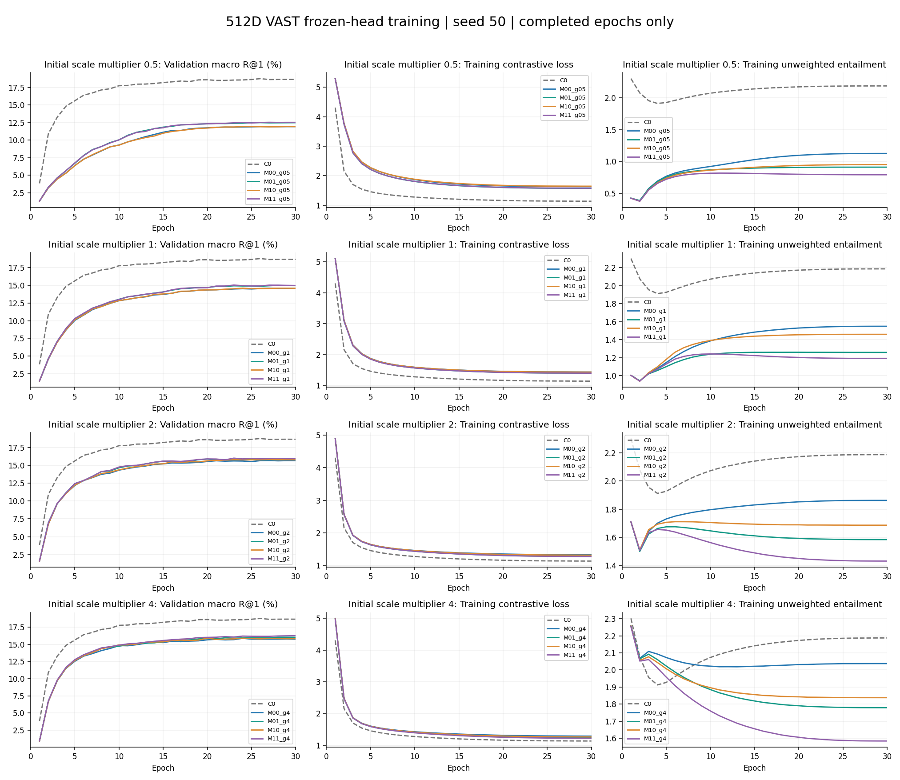
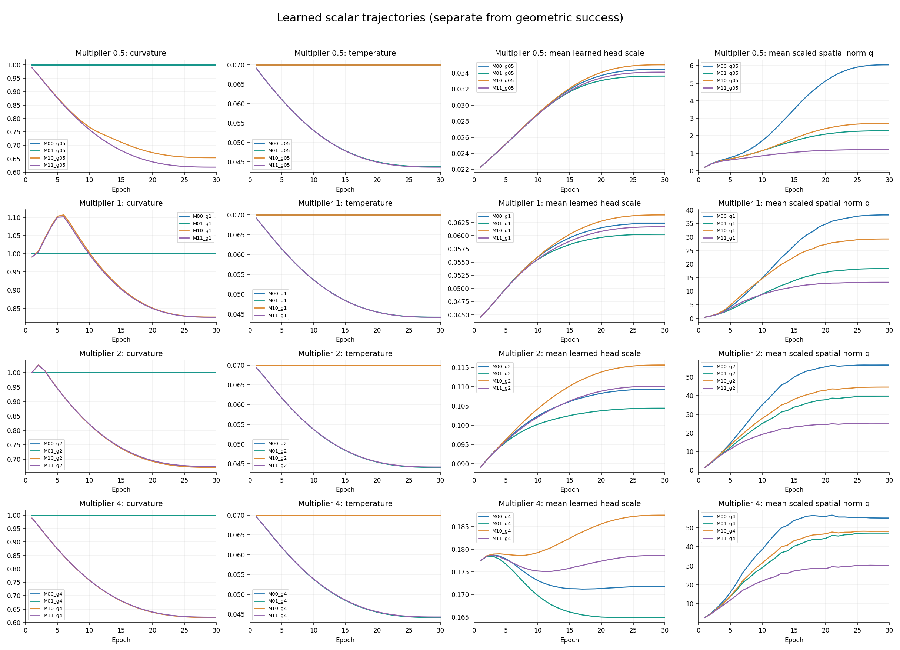
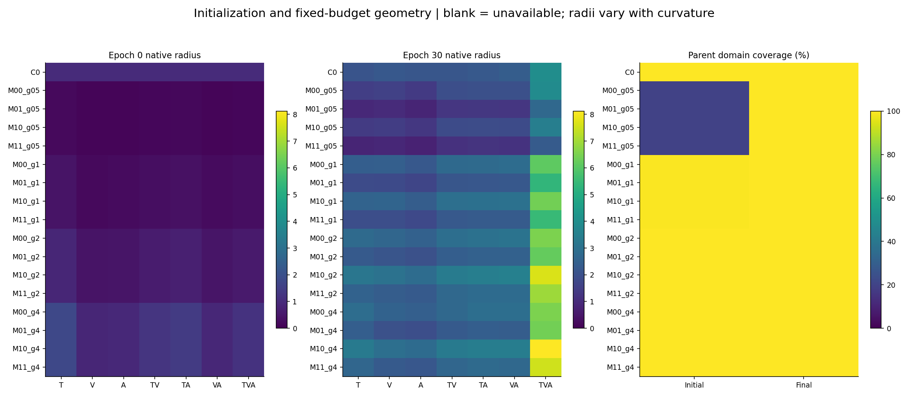
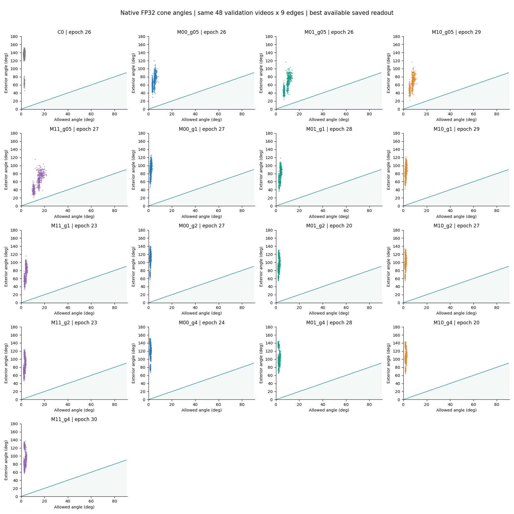
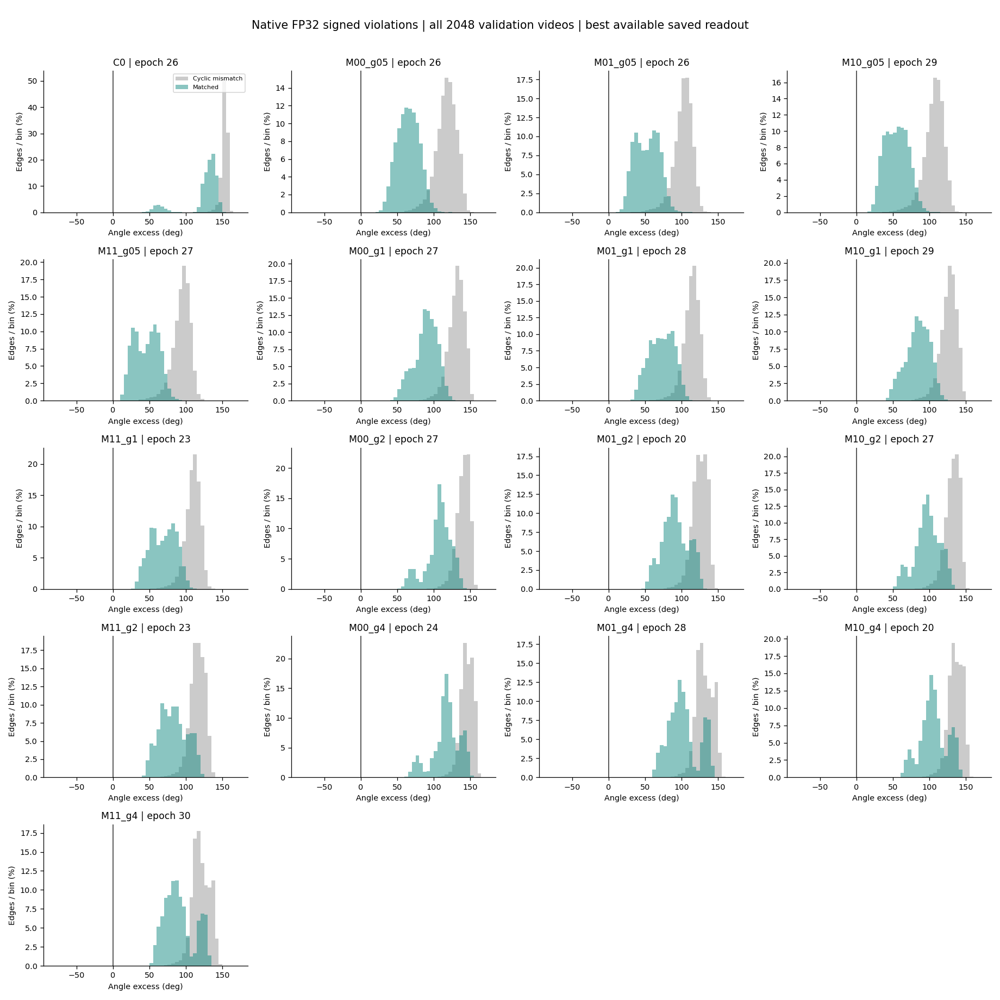
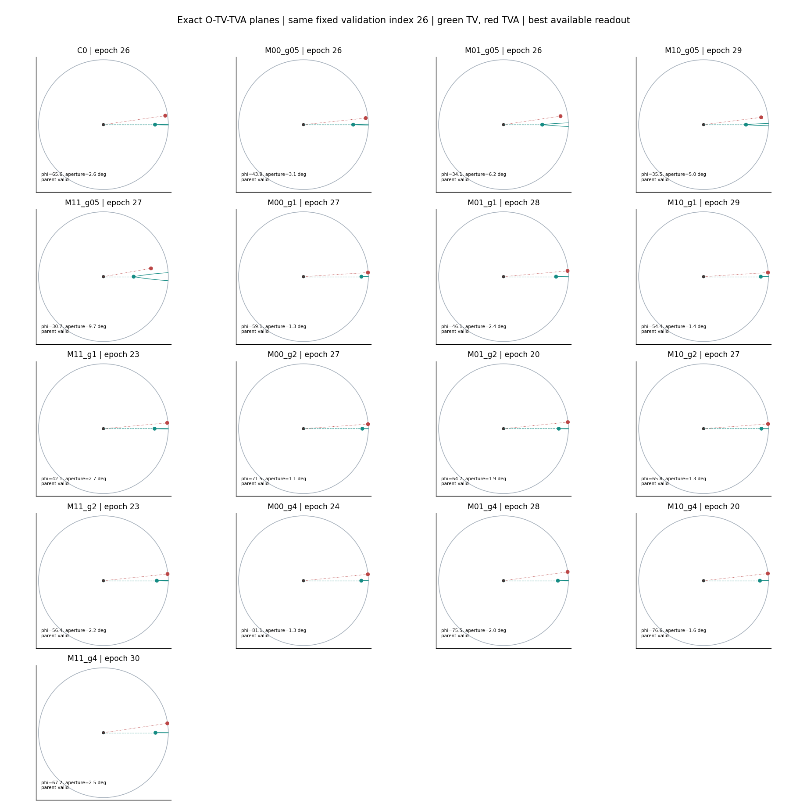
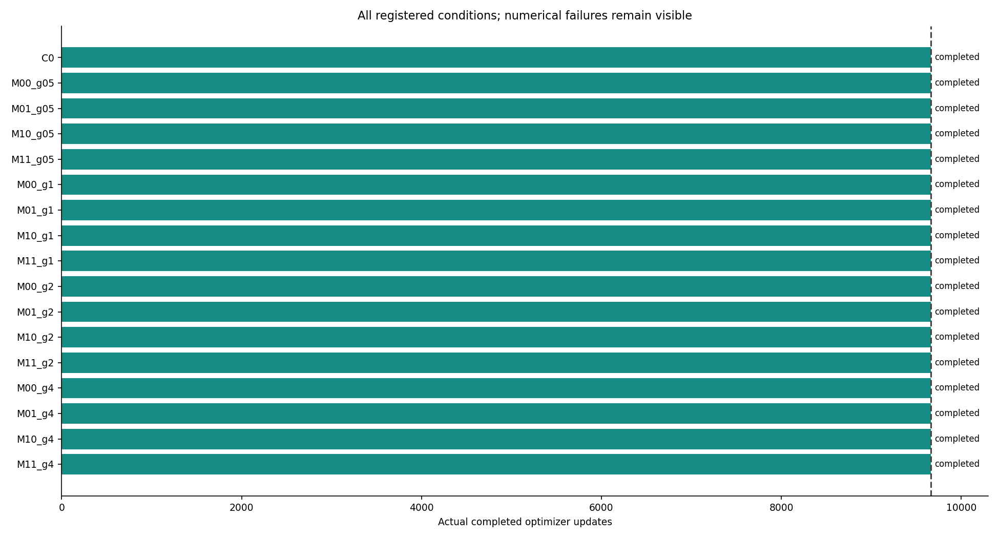

# 512D VAST：Scale、曲率与温度实验结果

[主报告](REPORT.md) · [逐方向结果](DIRECTIONS.md) · [逐边与错配结果](GEOMETRY.md) · [参数与半径](PARAMETERS.md)

完成时间：2026-10-26T14:43:59.160853+00:00。17/17组均完成30个epoch，每组9,660次更新，合计164,220次；0组数值失败。

数据口径：VAST训练82,608个样本，验证2,048个视频；512D、seed50。仅冻结编码器的头部预训练与验证，没有MSRVTT微调，也没有测试集评估。

结果按固定条件顺序展示，不添加方法排名或优劣判断。百分比及角度默认显示4位小数，参数显示6位；原始CSV/JSON保留完整数值精度。

## 条件说明

| 名称 | 曲率 c | 温度 tau | 表征方式 |
| --- | ---: | ---: | ---: |
| C0 | 固定1 | 固定0.07 | 独立半径头，初始r=1 |
| M00 | 固定1 | 固定0.07 | MERU式投影、可学习scale、指数映射 |
| M01 | 固定1 | 可学习，初值0.07 | 同M00 |
| M10 | 可学习，初值1 | 固定0.07 | 同M00 |
| M11 | 可学习，初值1 | 可学习，初值0.07 | 同M00 |

条件后缀g05/g1/g2/g4分别表示初始scale倍数0.5/1/2/4；初始scale为 `gamma / sqrt(512)`，训练中每个子集的scale仍可学习。T/V/A分别表示文本、视频、音频，TV/TA/VA/TVA表示对应融合子集。

末轮主表统一读取第30轮。最佳轮次附表按验证集六方向macro R@1读取，同分依次比较R@5、较早轮次，包含epoch0。此规则仅用于检查点读出，不用于淘汰方法。

## 第30轮末轮

### 检索结果

R@1/5/10为六个单模态检索方向的macro平均，单位为%。

| 条件 | 轮次 | R@1 (%) | R@5 (%) | R@10 (%) |
| --- | ---: | ---: | ---: | ---: |
| C0 | 30 | 18.6605 | 37.2233 | 46.8587 |
| M00_g05 | 30 | 11.9303 | 26.9368 | 35.7422 |
| M01_g05 | 30 | 12.4919 | 28.1169 | 37.1826 |
| M10_g05 | 30 | 11.9303 | 26.6764 | 35.4899 |
| M11_g05 | 30 | 12.5407 | 28.0599 | 37.3942 |
| M00_g1 | 30 | 14.5833 | 30.9814 | 40.1449 |
| M01_g1 | 30 | 14.9495 | 31.7301 | 40.7796 |
| M10_g1 | 30 | 14.5833 | 31.0954 | 40.2262 |
| M11_g1 | 30 | 14.9740 | 31.8034 | 40.8122 |
| M00_g2 | 30 | 15.6657 | 32.4707 | 41.3167 |
| M01_g2 | 30 | 15.8040 | 32.9427 | 42.0003 |
| M10_g2 | 30 | 15.7878 | 32.5521 | 41.5039 |
| M11_g2 | 30 | 15.9505 | 32.9753 | 41.9678 |
| M00_g4 | 30 | 15.7471 | 32.6172 | 41.8538 |
| M01_g4 | 30 | 16.0238 | 33.0811 | 42.2038 |
| M10_g4 | 30 | 15.8285 | 32.9346 | 42.1143 |
| M11_g4 | 30 | 16.2598 | 33.2194 | 42.5700 |

### 曲率、温度与角度

角度为原空间FP32计算结果，单位为度；超出量为外角减半开角的有符号均值。

| 条件 | 曲率 c | 温度 tau | 外角均值 | 半开角均值 | 超出量均值 |
| --- | ---: | ---: | ---: | ---: | ---: |
| C0 | 1.000000 | 0.070000 | 128.4109 | 2.5758 | 125.8351 |
| M00_g05 | 1.000000 | 0.070000 | 69.7358 | 4.7682 | 64.9676 |
| M01_g05 | 1.000000 | 0.043739 | 62.1304 | 9.5426 | 52.5878 |
| M10_g05 | 0.654003 | 0.070000 | 62.1790 | 7.3341 | 54.8449 |
| M11_g05 | 0.618961 | 0.043638 | 60.2335 | 14.5012 | 45.7323 |
| M00_g1 | 1.000000 | 0.070000 | 91.1119 | 1.9008 | 89.2111 |
| M01_g1 | 1.000000 | 0.044218 | 75.9618 | 3.4748 | 72.4870 |
| M10_g1 | 0.825926 | 0.070000 | 86.1301 | 2.0657 | 84.0644 |
| M11_g1 | 0.825514 | 0.044197 | 72.3677 | 3.7898 | 68.5779 |
| M00_g2 | 1.000000 | 0.070000 | 108.5949 | 1.4575 | 107.1374 |
| M01_g2 | 1.000000 | 0.044089 | 93.6060 | 2.4552 | 91.1508 |
| M10_g2 | 0.671432 | 0.070000 | 98.7707 | 1.7375 | 97.0333 |
| M11_g2 | 0.674581 | 0.044167 | 85.3105 | 2.9272 | 82.3834 |
| M00_g4 | 1.000000 | 0.070000 | 118.7079 | 1.5622 | 117.1457 |
| M01_g4 | 1.000000 | 0.044127 | 104.9286 | 2.6230 | 102.3056 |
| M10_g4 | 0.618779 | 0.070000 | 107.6601 | 1.9684 | 105.6917 |
| M11_g4 | 0.619843 | 0.044240 | 94.4167 | 3.3141 | 91.1026 |

### 定义域与包含率

每组包含2,048个视频的九条边，共18,432条配对。父点合法要求 `sqrt(c) * norm(spatial) >= 2K`，合法配对要求父子均合法。所有满足率列的单位为%。

| 条件 | 父点合法率 | 合法配对数 | 官方截断满足率 | 合法对中满足率 | 合法且满足/全部 | 九边全合法且满足 |
| --- | ---: | ---: | ---: | ---: | ---: | ---: |
| C0 | 100.0000 | 18,432 | 0.0000 | 0.0000 | 0.0000 | 0.0000 |
| M00_g05 | 100.0000 | 18,432 | 0.0000 | 0.0000 | 0.0000 | 0.0000 |
| M01_g05 | 100.0000 | 18,432 | 0.0000 | 0.0000 | 0.0000 | 0.0000 |
| M10_g05 | 100.0000 | 18,432 | 0.0000 | 0.0000 | 0.0000 | 0.0000 |
| M11_g05 | 100.0000 | 18,432 | 0.0000 | 0.0000 | 0.0000 | 0.0000 |
| M00_g1 | 100.0000 | 18,432 | 0.0000 | 0.0000 | 0.0000 | 0.0000 |
| M01_g1 | 100.0000 | 18,432 | 0.0000 | 0.0000 | 0.0000 | 0.0000 |
| M10_g1 | 100.0000 | 18,432 | 0.0000 | 0.0000 | 0.0000 | 0.0000 |
| M11_g1 | 100.0000 | 18,432 | 0.0000 | 0.0000 | 0.0000 | 0.0000 |
| M00_g2 | 100.0000 | 18,432 | 0.0000 | 0.0000 | 0.0000 | 0.0000 |
| M01_g2 | 100.0000 | 18,432 | 0.0000 | 0.0000 | 0.0000 | 0.0000 |
| M10_g2 | 100.0000 | 18,432 | 0.0000 | 0.0000 | 0.0000 | 0.0000 |
| M11_g2 | 100.0000 | 18,432 | 0.0000 | 0.0000 | 0.0000 | 0.0000 |
| M00_g4 | 100.0000 | 18,432 | 0.0000 | 0.0000 | 0.0000 | 0.0000 |
| M01_g4 | 100.0000 | 18,432 | 0.0000 | 0.0000 | 0.0000 | 0.0000 |
| M10_g4 | 100.0000 | 18,432 | 0.0000 | 0.0000 | 0.0000 | 0.0000 |
| M11_g4 | 100.0000 | 18,432 | 0.0000 | 0.0000 | 0.0000 | 0.0000 |

## 验证检索最佳轮次

### 检索结果

R@1/5/10为六个单模态检索方向的macro平均，单位为%。

| 条件 | 轮次 | R@1 (%) | R@5 (%) | R@10 (%) |
| --- | ---: | ---: | ---: | ---: |
| C0 | 26 | 18.7744 | 37.1663 | 46.8262 |
| M00_g05 | 26 | 11.9385 | 26.9124 | 35.6689 |
| M01_g05 | 26 | 12.5000 | 28.1087 | 37.1175 |
| M10_g05 | 29 | 11.9385 | 26.6846 | 35.4980 |
| M11_g05 | 27 | 12.5488 | 28.0518 | 37.3210 |
| M00_g1 | 27 | 14.5915 | 30.9326 | 40.0716 |
| M01_g1 | 28 | 14.9821 | 31.7383 | 40.7552 |
| M10_g1 | 29 | 14.5915 | 31.0872 | 40.2344 |
| M11_g1 | 23 | 15.0309 | 31.6081 | 40.6901 |
| M00_g2 | 27 | 15.6820 | 32.4626 | 41.3737 |
| M01_g2 | 20 | 15.8854 | 32.8206 | 41.7806 |
| M10_g2 | 27 | 15.8285 | 32.5358 | 41.5283 |
| M11_g2 | 23 | 16.0156 | 32.9671 | 42.0410 |
| M00_g4 | 24 | 15.8773 | 32.5928 | 41.7887 |
| M01_g4 | 28 | 16.0400 | 33.0566 | 42.1712 |
| M10_g4 | 20 | 15.9017 | 32.6497 | 41.7969 |
| M11_g4 | 30 | 16.2598 | 33.2194 | 42.5700 |

### 曲率、温度与角度

角度为原空间FP32计算结果，单位为度；超出量为外角减半开角的有符号均值。

| 条件 | 曲率 c | 温度 tau | 外角均值 | 半开角均值 | 超出量均值 |
| --- | ---: | ---: | ---: | ---: | ---: |
| C0 | 1.000000 | 0.070000 | 128.3732 | 2.5822 | 125.7909 |
| M00_g05 | 1.000000 | 0.070000 | 69.6613 | 4.7858 | 64.8755 |
| M01_g05 | 1.000000 | 0.043824 | 62.1364 | 9.5555 | 52.5810 |
| M10_g05 | 0.654022 | 0.070000 | 62.1794 | 7.3345 | 54.8449 |
| M11_g05 | 0.619501 | 0.043674 | 60.2549 | 14.5042 | 45.7507 |
| M00_g1 | 1.000000 | 0.070000 | 91.0876 | 1.9029 | 89.1847 |
| M01_g1 | 1.000000 | 0.044229 | 75.9638 | 3.4749 | 72.4889 |
| M10_g1 | 0.825952 | 0.070000 | 86.1301 | 2.0657 | 84.0644 |
| M11_g1 | 0.833913 | 0.044653 | 72.6204 | 3.7772 | 68.8432 |
| M00_g2 | 1.000000 | 0.070000 | 108.5884 | 1.4592 | 107.1292 |
| M01_g2 | 1.000000 | 0.045419 | 93.9199 | 2.4704 | 91.4495 |
| M10_g2 | 0.672011 | 0.070000 | 98.7796 | 1.7388 | 97.0409 |
| M11_g2 | 0.681632 | 0.044631 | 85.6268 | 2.9195 | 82.7074 |
| M00_g4 | 1.000000 | 0.070000 | 118.6430 | 1.5781 | 117.0648 |
| M01_g4 | 1.000000 | 0.044138 | 104.9336 | 2.6233 | 102.3103 |
| M10_g4 | 0.637940 | 0.070000 | 107.8375 | 2.0361 | 105.8014 |
| M11_g4 | 0.619843 | 0.044240 | 94.4167 | 3.3141 | 91.1026 |

### 定义域与包含率

每组包含2,048个视频的九条边，共18,432条配对。父点合法要求 `sqrt(c) * norm(spatial) >= 2K`，合法配对要求父子均合法。所有满足率列的单位为%。

| 条件 | 父点合法率 | 合法配对数 | 官方截断满足率 | 合法对中满足率 | 合法且满足/全部 | 九边全合法且满足 |
| --- | ---: | ---: | ---: | ---: | ---: | ---: |
| C0 | 100.0000 | 18,432 | 0.0000 | 0.0000 | 0.0000 | 0.0000 |
| M00_g05 | 100.0000 | 18,432 | 0.0000 | 0.0000 | 0.0000 | 0.0000 |
| M01_g05 | 100.0000 | 18,432 | 0.0000 | 0.0000 | 0.0000 | 0.0000 |
| M10_g05 | 100.0000 | 18,432 | 0.0000 | 0.0000 | 0.0000 | 0.0000 |
| M11_g05 | 100.0000 | 18,432 | 0.0000 | 0.0000 | 0.0000 | 0.0000 |
| M00_g1 | 100.0000 | 18,432 | 0.0000 | 0.0000 | 0.0000 | 0.0000 |
| M01_g1 | 100.0000 | 18,432 | 0.0000 | 0.0000 | 0.0000 | 0.0000 |
| M10_g1 | 100.0000 | 18,432 | 0.0000 | 0.0000 | 0.0000 | 0.0000 |
| M11_g1 | 100.0000 | 18,432 | 0.0000 | 0.0000 | 0.0000 | 0.0000 |
| M00_g2 | 100.0000 | 18,432 | 0.0000 | 0.0000 | 0.0000 | 0.0000 |
| M01_g2 | 100.0000 | 18,432 | 0.0000 | 0.0000 | 0.0000 | 0.0000 |
| M10_g2 | 100.0000 | 18,432 | 0.0000 | 0.0000 | 0.0000 | 0.0000 |
| M11_g2 | 100.0000 | 18,432 | 0.0000 | 0.0000 | 0.0000 | 0.0000 |
| M00_g4 | 100.0000 | 18,432 | 0.0000 | 0.0000 | 0.0000 | 0.0000 |
| M01_g4 | 100.0000 | 18,432 | 0.0000 | 0.0000 | 0.0000 | 0.0000 |
| M10_g4 | 100.0000 | 18,432 | 0.0000 | 0.0000 | 0.0000 | 0.0000 |
| M11_g4 | 100.0000 | 18,432 | 0.0000 | 0.0000 | 0.0000 | 0.0000 |

## 图件

[下载七页PDF](diagnostics.pdf)

### 训练与验证曲线

每行一个初始scale倍数；左为验证R@1，中为训练对比损失，右为未加权锥损失。C0参考曲线在各行重复展示。

### 曲率、温度和scale轨迹

展示每组随训练变化的曲率、温度、七头平均scale及平均无量纲范数q。

### 初始化与末轮几何

左、中分别为第0轮与第30轮的原空间半径均值，右为父节点定义域覆盖率。不同曲率下的原始半径应结合q与曲率共同读取。

### 原空间外角与半开角

使用各组验证检索最佳checkpoint，标题注明轮次。固定同一48个验证视频、每视频九条边；包含判定不来自二维投影。

### 正配对与循环错配的角度超出量

使用各组最佳checkpoint、全部2,048个验证视频。负值或零表示进入所用开角阈值，定义域是否有效需结合表格。

### 固定样本的几何切面

使用同一个固定验证索引，绘制经过原点、TV和TVA的二维切面。绿色为TV、红色为TVA；父节点在原始定义域外时标注clamped。

### 各条件实际更新数

每组实际完成9,660次参数更新。

## 完成与来源核验

18项CPU检查与3项报告检查通过。全部17组已核验训练预算、检查点与特征哈希、固定参数、实际FP16投影/FP32几何dtype，以及GPU准入记录。训练和协调器进程均已退出。

每组PyTorch保留显存峰值为0.166–0.176 GiB，CUDA上下文开销另计。实际最高并发16组、每卡最多两组；最后一组自动在GPU1启动。

训练源码摘要：`e55adfdb597052cd0866f9c2aed661737c9096eb00c018cd8fb2396edb2ca5a4`。

[末轮CSV](final_epoch.csv) · [最佳轮次CSV](best_validation.csv) · [完整原始JSON](results.json) · [完成核验](completion_summary.json) · [运行审计](run_audit.json)

本报告仅转换展示格式，没有重训、重新选模或修改原始数据。C0与MERU式条件的径向初始化不同；错配视频是配对控制，不等价于人工语义非蕴含标签。
