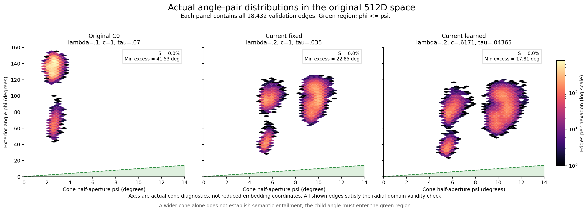
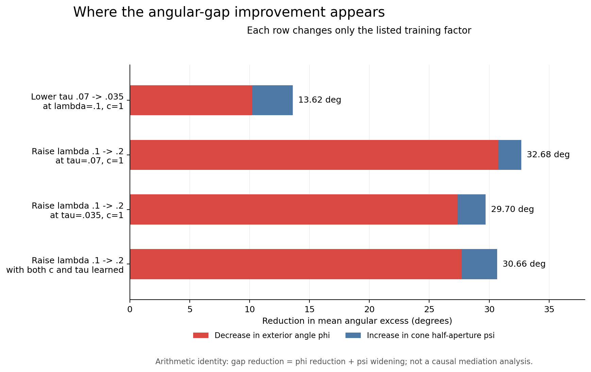

# 锥角可视化：与最初C0对照比较

“最初”采用2026-10-26首次17组实验中的C0原始末轮：c=1、τ=.07、λ=.1。已核对其2048条验证样本ID与七个头的特征，均与后来重新训练的标准对照逐位一致。所有图均比较第30轮，不混用不同训练阶段。

## 角度总览

[PDF](cone_angle_overview.pdf)。点为均值，粗线为全部9N条边的P5–P95，右图三角形为最小超锥角。分布区间不是置信区间。ψ为半开角，完整开口角是2ψ。

| 配置 | 平均半开角ψ° | 平均完整开口2ψ° | 平均外向夹角φ°↓ | 平均超锥角°↓ | 最小超锥角°↓ | 合法S%↑ | R@1%↑ |
| --- | ---: | ---: | ---: | ---: | ---: | ---: | ---: |
| 最初C0：λ=.1，c=1，τ=.07 | 2.576 | 5.152 | 128.411 | 125.835 | 41.531 | **0.000** | 18.660 |
| 当前固定：λ=.2，c=1，τ=.035 | 8.356 | 16.712 | <ins>90.875</ins> | <ins>82.519</ins> | <ins>22.849</ins> | **0.000** | **19.051** |
| 当前联合学习：λ=.2，c≈.6171，τ≈.04365 | 8.878 | 17.756 | **79.679** | **70.801** | **17.813** | **0.000** | <ins>18.750</ins> |

半开角仅描述宽度，没有单独的最优方向，因此不做性能排名。其他指标最优加粗、次优下划线，按三位小数处理并列；排名不代表统计显著性。

## 局部角度示意

[PDF](cone_mean_angle_schematic.pdf)。蓝色区域表示父锥允许的方向，红箭头表示父点处朝子点的方向。使用实测平均ψ/φ绘制，箭头长度任意；它不是具体样本坐标，也不是二维降维后的双曲嵌入。

## 全部角度对分布

[PDF](cone_angle_pair_density.pdf)。每张图包含2048×9=18432条正配对边，颜色为相同六边形分箱下的边数（对数色标）。绿色区域表示φ≤ψ；所画三组的径向合法覆盖均为100%，所有实际角度对仍位于该区域之外。

## 单因素变化的算术分解

[PDF](cone_single_factor_changes.pdf)。每行仅改变标明的训练因素，已用配置差异核对。超锥角均值的下降等于φ均值下降加ψ均值增加；这是数值分解，不是因果中介分析。

- Lower tau .07 -> .035 at lambda=.1, c=1：φ下降10.193°，ψ增大3.426°，超锥角下降13.619°。

- Raise lambda .1 -> .2 at tau=.07, c=1：φ下降30.741°，ψ增大1.935°，超锥角下降32.676°。

- Raise lambda .1 -> .2 at tau=.035, c=1：φ下降27.343°，ψ增大2.355°，超锥角下降29.697°。

- Raise lambda .1 -> .2 with both c and tau learned：φ下降27.677°，ψ增大2.979°，超锥角下降30.656°。

## 读图结论

相对最初C0，当前固定组的半开角从2.576°增至8.356°，联合学习组增至8.878°；外向夹角从128.411°降至90.875°和79.679°。对应超锥角均值从125.835°降至82.519°和70.801°。

当前固定组与联合组的最小超锥角仍为22.849°和17.813°，因此实际合法满足率仍为0。图中平均差值缩小主要对应φ下降，锥宽增加相对较小。

原始C0与两个当前配置之间同时改变了多个因素，只作整体读出比较；单变量解释以四项匹配对照为准。锥变宽本身不代表语义蕴含更好，还需要结合检索和错配区分能力。以上为单seed验证集观察。

## 数据与验证

[六个配置的统计](angle_statistics.csv) · [54项逐边统计](edge_angle_statistics.csv) · [四项单因素变化](single_factor_angle_changes.csv) · [来源与哈希](provenance.json)

所有角度从保存的真实512D特征用原版FP32几何重算，并与原始逐边及总体均值、分位数、最小/最大值和合法满足率核对。原始权重、特征和旧图版保持原样，本次仅新增可视化。
