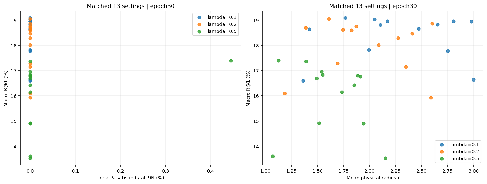

# λ=.1、.2、.5：相同设置的匹配比较

λ=.2的13组为本轮独立新训练；λ=.1和.5各13组来自前序已完成65组，原始末轮指标已按DONE哈希核对。固定同一初始化、seed50、512D、30轮9660步、VAST validation2048。26项跨λ比较逐项验证只改变cone_weight。所有主结果固定末轮，失败末轮留空。

λ=.1：13组S均为0，标准c=1、τ=.07的R@1=18.660%；最佳检索为固定τ=0.035000，c=1，R@1=19.092%。仅学温度R@1=19.027%，联合学习为18.953%。

λ=.2：本轮最高检索为固定τ=0.035000，c=1，R@1=19.051%、S=0.000%；最高S=0.000%，并列时按R@1展示的条件为固定τ=0.035000，c=1。标准c=1、τ=.07的R@1=18.009%、S=0.000%。

λ=.2的全部13组末轮合法满足率仍为0；相较λ=.1，加大到.2尚未在本组温度/曲率/学习开关网格中产生严格满足。角度、半径变化和检索变化应分别解读。

共同c=1、τ=.035设置下，λ=.1→.2的R@1/R@5/R@10分别为19.092/37.948/47.144% → 19.051/37.606/47.168%；平均r为1.768→1.612，平均超锥角φ−aperture为112.216°→82.519°。超锥角降低与严格合法满足分别报告，不能互相替代。

## λ=.1与λ=.2的13组直接对照

R@1和S均为百分比；Δ为.2减.1、单位百分点。每个性能列按三位小数标记最优/次优；不同对照的差值不跨行排名。学习组均由c=1、τ=.07初始化。

| 设置 | λ=.1 R@1↑ | λ=.2 R@1↑ | ΔR@1 pp | λ=.1 S↑ | λ=.2 S↑ | ΔS pp |
| --- | --- | --- | --- | --- | --- | --- |
| 固定τ=0.020000，c=1 | 18.644 | 18.701 | 0.057 | **0.000** | **0.000** | 0.000 |
| 固定τ=0.035000，c=1 | **19.092** | **19.051** | -0.041 | **0.000** | **0.000** | 0.000 |
| 固定τ=0.049497，c=1 | 18.815 | 18.604 | -0.212 | **0.000** | **0.000** | 0.000 |
| 固定τ=0.070000，c=1 | 18.660 | 18.009 | -0.651 | **0.000** | **0.000** | 0.000 |
| 固定τ=0.098995，c=1 | 17.773 | 17.155 | -0.618 | **0.000** | **0.000** | 0.000 |
| 固定τ=0.140000，c=1 | 16.642 | 15.934 | -0.708 | **0.000** | **0.000** | 0.000 |
| 固定c=.25，τ=.07 | 18.945 | <ins>18.864</ins> | -0.081 | **0.000** | **0.000** | 0.000 |
| 固定c=.5，τ=.07 | 18.953 | 18.465 | -0.488 | **0.000** | **0.000** | 0.000 |
| 固定c=2，τ=.07 | 17.814 | 17.285 | -0.529 | **0.000** | **0.000** | 0.000 |
| 固定c=4，τ=.07 | 16.593 | 16.097 | -0.496 | **0.000** | **0.000** | 0.000 |
| 仅学习τ | <ins>19.027</ins> | 18.620 | -0.407 | **0.000** | **0.000** | 0.000 |
| 仅学习c | 18.823 | 18.294 | -0.529 | **0.000** | **0.000** | 0.000 |
| 联合学习c、τ | 18.953 | 18.750 | -0.203 | **0.000** | **0.000** | 0.000 |

## 与λ=.5的同配置参照

| 设置 | λ=.2 R@1↑ | λ=.5 R@1↑ | λ=.2 S↑ | λ=.5 S↑ |
| --- | --- | --- | --- | --- |
| 固定τ=0.020000，c=1 | 18.701 | **17.399** | **0.000** | **0.445** |
| 固定τ=0.035000，c=1 | **19.051** | <ins>17.367</ins> | **0.000** | <ins>0.000</ins> |
| 固定τ=0.049497，c=1 | 18.604 | 16.829 | **0.000** | <ins>0.000</ins> |
| 固定τ=0.070000，c=1 | 18.009 | 16.146 | **0.000** | <ins>0.000</ins> |
| 固定τ=0.098995，c=1 | 17.155 | 14.901 | **0.000** | <ins>0.000</ins> |
| 固定τ=0.140000，c=1 | 15.934 | 13.525 | **0.000** | <ins>0.000</ins> |
| 固定c=.25，τ=.07 | <ins>18.864</ins> | 16.805 | **0.000** | <ins>0.000</ins> |
| 固定c=.5，τ=.07 | 18.465 | 16.756 | **0.000** | <ins>0.000</ins> |
| 固定c=2，τ=.07 | 17.285 | 14.909 | **0.000** | <ins>0.000</ins> |
| 固定c=4，τ=.07 | 16.097 | 13.599 | **0.000** | <ins>0.000</ins> |
| 仅学习τ | 18.620 | 16.691 | **0.000** | <ins>0.000</ins> |
| 仅学习c | 18.294 | 16.423 | **0.000** | <ins>0.000</ins> |
| 联合学习c、τ | 18.750 | 16.960 | **0.000** | <ins>0.000</ins> |

## 图表

[PDF](neighbor_tradeoffs.pdf) · [39组原始指标CSV](neighbors.csv) · [26项单λ差值CSV](neighbor_deltas.csv)

[PDF](neighbor_temperature.pdf)。三条曲线对应前序λ=.1、新λ=.2和前序λ=.5。

[PDF](combined_78_pareto.pdf) · [全部78组固定末轮CSV](combined_78_final.csv)。本轮只训练新增13组，原65组未重跑。

78组整体Pareto：C0_l0__C_c05, C0_l05__T_t002, C0_l1__T_t002, C0_l2__T_t002。

## 范围与来源

单个seed的验证集比较，未证明统计显著性、跨seed稳定性或测试集收益。S按全部9N计，合法覆盖、条件满足率和九边同时满足另见完整报告。四项τ√c尺度匹配同时改变两个字段，仅作辅助解释。来源路径与哈希见[neighbors.json](neighbors.json)。
