# C0温度与曲率：λ=.2的13组补充结果

生成于2026-10-27T12:42:35.259012+00:00 UTC；13/13完成，0失败。主表仅使用完成条件的epoch30；未完成/失败末轮留空。

## 固定协议与解释边界

VAST训练82608条、验证2048候选，512D、seed50、每组30轮9660更新、batch256。全部从相同投影初始化和r=1出发；仅训练头部。FP16投影、原版FP32几何，K=.1与epsilon不变。主满足率S为合法且满足/全部9N；条件满足率与合法覆盖另列。

c表示曲率的正幅值（截面曲率为−c）。物理r范围固定.21–4；x=direction·sinh(√c r)/√c，u=√c r，q=sinh(u)。低c不补q下界。c∈[.1,10]、τ≥.01仅对学习标量裁剪。本轮λ=.2的c=1、τ=.07对照重新训练。13项λ内单因素比较和4项τ√c双字段辅助比较均预先核对；另在邻接λ报告中用前序λ=.1/.5同协议结果作26项只改变λ的比较，旧结果清楚标记来源。尺度匹配不当作单因素因果效果。

同一组固定特征上改变正温度不改变检索排序；本实验研究训练轨迹。跨温度CE数值不用于性能排名。统一物理半径倍数a的dL/da是局部诊断，正值对应下降方向收缩、负值对应扩张；可能离开头部可行范围，不能代替实际优化器更新。

最优加粗、次优下划线，按同表显示到三位小数的不同值排序；并列同时标记。这些标记不代表统计显著性。单一seed50、多条件验证选择、没有测试集结论。循环错配和最近错误视频不是人工非蕴含标注。

## 主要读出

最高检索：C0_l02__T_t0035，R@1=19.051%，S=0.000%。最高合法满足率：C0_l02__T_t0035，S=0.000%，R@1=19.051%。S并列时按R@1展示其中一项。这些是本次验证集的观察极值，不能据此宣布唯一最佳方案。

完整双目标Pareto：C0_l02__T_t0035。

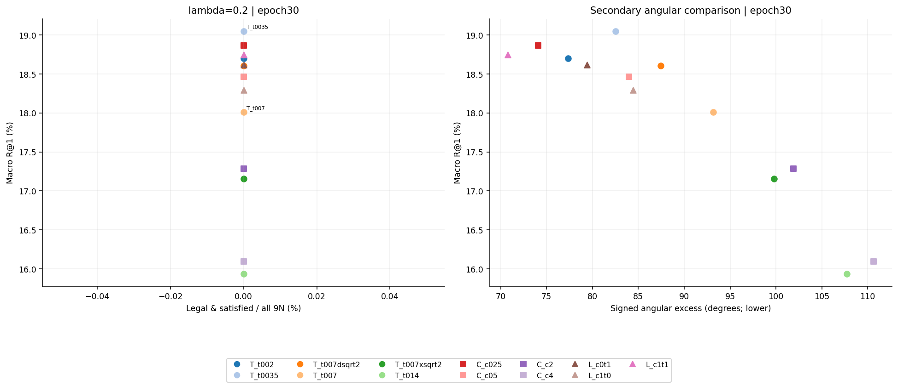

[PDF](tradeoffs.pdf)；全部同协议末轮；左侧为合法满足率，右侧为角度辅助比较，降低角度不等于严格满足。

<!-- LAMBDA NEIGHBOR COMPARISON -->

## 与已有λ=.1、.5的匹配比较

λ=.2的13组为本轮独立新训练；λ=.1和.5各13组来自前序已完成65组，原始末轮指标已按DONE哈希核对。固定同一初始化、seed50、512D、30轮9660步、VAST validation2048。26项跨λ比较逐项验证只改变cone_weight。所有主结果固定末轮，失败末轮留空。

λ=.1：13组S均为0，标准c=1、τ=.07的R@1=18.660%；最佳检索为固定τ=0.035000，c=1，R@1=19.092%。仅学温度R@1=19.027%，联合学习为18.953%。

λ=.2：本轮最高检索为固定τ=0.035000，c=1，R@1=19.051%、S=0.000%；最高S=0.000%，并列时按R@1展示的条件为固定τ=0.035000，c=1。标准c=1、τ=.07的R@1=18.009%、S=0.000%。

[13组直接对照、26项单λ差值和78组总览](LAMBDA_COMPARISON.md)

## 分λ的固定末轮结果

### λ=0.2

| 条件 | 状态 | R@1↑ | R@5↑ | R@10↑ | S/all↑ | 官方S↑ | 合法覆盖↑ | 条件S↑ | 九边同满足↑ | excess°↓ |
| --- | --- | --- | --- | --- | --- | --- | --- | --- | --- | --- |
| C0_l02__T_t002 | completed | 18.701 | 37.459 | <ins>47.127</ins> | **0.000** | **0.000** | **100.000** | **0.000** | **0.000** | 77.341 |
| C0_l02__T_t0035 | completed | **19.051** | <ins>37.606</ins> | **47.168** | **0.000** | **0.000** | **100.000** | **0.000** | **0.000** | 82.519 |
| C0_l02__T_t007dsqrt2 | completed | 18.604 | 37.321 | 46.810 | **0.000** | **0.000** | **100.000** | **0.000** | **0.000** | 87.454 |
| C0_l02__T_t007 | completed | 18.009 | 36.483 | 46.159 | **0.000** | **0.000** | **100.000** | **0.000** | **0.000** | 93.159 |
| C0_l02__T_t007xsqrt2 | completed | 17.155 | 35.221 | 44.832 | **0.000** | **0.000** | **100.000** | **0.000** | **0.000** | 99.816 |
| C0_l02__T_t014 | completed | 15.934 | 33.293 | 42.830 | **0.000** | **0.000** | **100.000** | **0.000** | **0.000** | 107.722 |
| C0_l02__C_c025 | completed | <ins>18.864</ins> | **37.622** | 46.948 | **0.000** | **0.000** | **100.000** | **0.000** | **0.000** | <ins>74.073</ins> |
| C0_l02__C_c05 | completed | 18.465 | 37.109 | 46.761 | **0.000** | **0.000** | **100.000** | **0.000** | **0.000** | 83.989 |
| C0_l02__C_c2 | completed | 17.285 | 35.449 | 44.897 | **0.000** | **0.000** | **100.000** | **0.000** | **0.000** | 101.887 |
| C0_l02__C_c4 | completed | 16.097 | 33.569 | 43.172 | **0.000** | **0.000** | **100.000** | **0.000** | **0.000** | 110.646 |
| C0_l02__L_c0t1 | completed | 18.620 | 37.126 | 46.647 | **0.000** | **0.000** | **100.000** | **0.000** | **0.000** | 79.400 |
| C0_l02__L_c1t0 | completed | 18.294 | 36.890 | 46.533 | **0.000** | **0.000** | **100.000** | **0.000** | **0.000** | 84.435 |
| C0_l02__L_c1t1 | completed | 18.750 | 37.288 | 46.737 | **0.000** | **0.000** | **100.000** | **0.000** | **0.000** | **70.801** |

## 温度、曲率与学习开关

温度矩阵固定c=1；曲率矩阵固定τ=.07；学习开关矩阵顺序为都不学习、仅学τ、仅学c、都学习。都不学习复用同λ新对照。

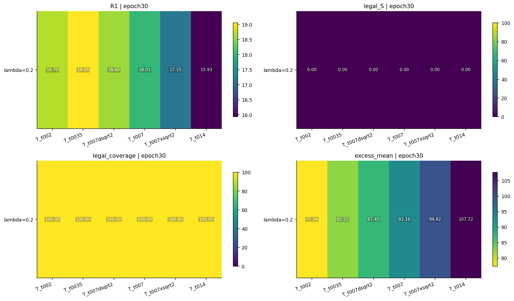

[PDF](temperature_matrix.pdf)

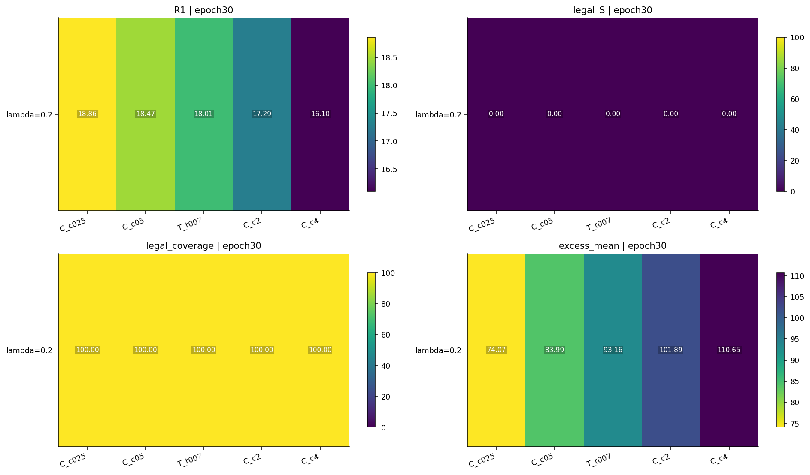

[PDF](curvature_matrix.pdf)

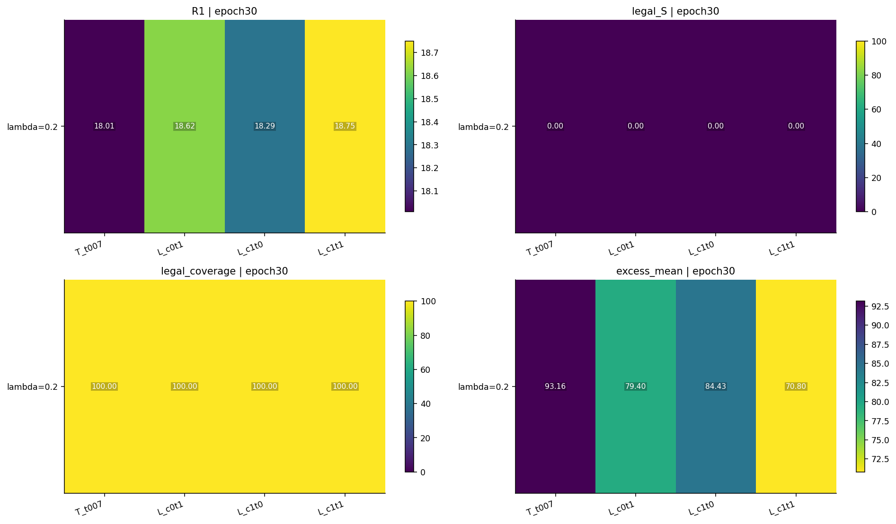

[PDF](learning_switches_matrix.pdf)

## 标量、物理半径与有效温度

[标量轨迹PDF](scalar_trajectories.pdf) · [逐轮数值](learning_curves.csv)

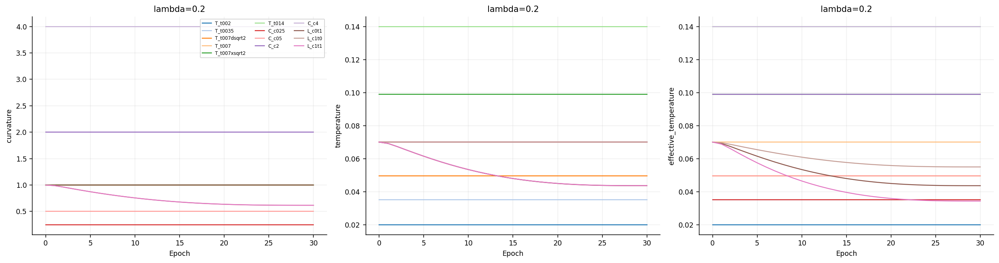

| 条件 | 末轮c | 末轮τ | 末轮τ√c | 七头均值r | 七头均值u | 七头均值q | c下界步占比 | c上界步占比 | τ下界步占比 |
| --- | --- | --- | --- | --- | --- | --- | --- | --- | --- |
| C0_l02__T_t002 | 1.000 | 0.020 | 0.020 | 1.388 | 1.388 | 4.078 | 0.000 | 0.000 | 0.000 |
| C0_l02__T_t0035 | 1.000 | 0.035 | 0.035 | 1.612 | 1.612 | 4.782 | 0.000 | 0.000 | 0.000 |
| C0_l02__T_t007dsqrt2 | 1.000 | 0.049 | 0.049 | 1.829 | 1.829 | 5.490 | 0.000 | 0.000 | 0.000 |
| C0_l02__T_t007 | 1.000 | 0.070 | 0.070 | 2.087 | 2.087 | 6.333 | 0.000 | 0.000 | 0.000 |
| C0_l02__T_t007xsqrt2 | 1.000 | 0.099 | 0.099 | 2.351 | 2.351 | 7.336 | 0.000 | 0.000 | 0.000 |
| C0_l02__T_t014 | 1.000 | 0.140 | 0.140 | 2.590 | 2.590 | 8.479 | 0.000 | 0.000 | 0.000 |
| C0_l02__C_c025 | 0.250 | 0.070 | 0.035 | 2.601 | 1.301 | 1.813 | 0.000 | 0.000 | 0.000 |
| C0_l02__C_c05 | 0.500 | 0.070 | 0.049 | 2.409 | 1.703 | 3.111 | 0.000 | 0.000 | 0.000 |
| C0_l02__C_c2 | 2.000 | 0.070 | 0.099 | 1.693 | 2.394 | 15.051 | 0.000 | 0.000 | 0.000 |
| C0_l02__C_c4 | 4.000 | 0.070 | 0.140 | 1.186 | 2.371 | 8.374 | 0.000 | 0.000 | 0.000 |
| C0_l02__L_c0t1 | 1.000 | 0.044 | 0.044 | 1.746 | 1.746 | 5.308 | 0.000 | 0.000 | 0.000 |
| C0_l02__L_c1t0 | 0.617 | 0.070 | 0.055 | 2.276 | 1.787 | 3.650 | 0.000 | 0.000 | 0.000 |
| C0_l02__L_c1t1 | 0.617 | 0.044 | 0.034 | 1.873 | 1.471 | 2.950 | 0.000 | 0.000 | 0.000 |

边界占比为实际更新后逐步计数；每轮322步等权汇总。失败条件该列若存在只覆盖已完成轮数。几何量是描述性量，没有统一优劣方向，不做排名。

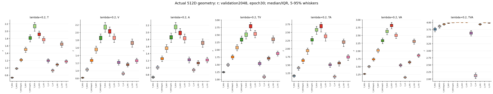

[PDF](distributions_r.pdf)。每箱2048条真实验证特征，箱体IQR、中位数、5–95%须线；q用对数轴，红线q=.2为域边界。失败条件缺失。

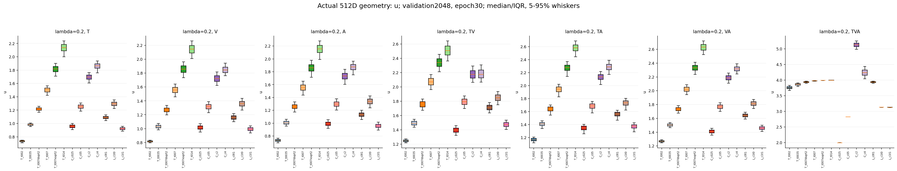

[PDF](distributions_u.pdf)。每箱2048条真实验证特征，箱体IQR、中位数、5–95%须线；q用对数轴，红线q=.2为域边界。失败条件缺失。

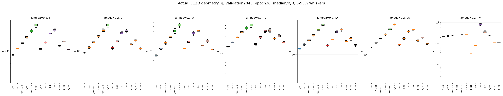

[PDF](distributions_q.pdf)。每箱2048条真实验证特征，箱体IQR、中位数、5–95%须线；q用对数轴，红线q=.2为域边界。失败条件缺失。

## 梯度与学习轨迹

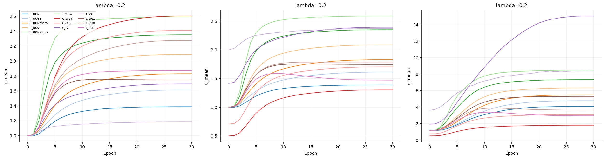

[半径轨迹PDF](radius_trajectories.pdf) · [每个头的逐轮r/u/q均值与分位数](radius_history.csv)。图为七头均值，逐头数值保留。

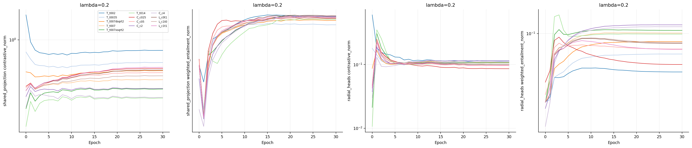

[梯度范数PDF](gradient_norms.pdf) · [实际训练标量梯度CSV](scalar_training_gradients.csv)。实际c/τ标量梯度范数为每25步保存的unscale后、裁剪前值（不保留符号），对应该次更新前参数；同条记录的标量值是更新后值。

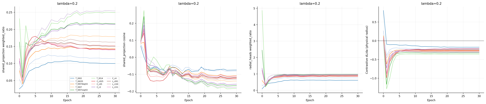

[梯度PDF](gradient_trajectories.pdf) · [完整投影/径向头/标量/各头梯度](gradient_probes.csv)

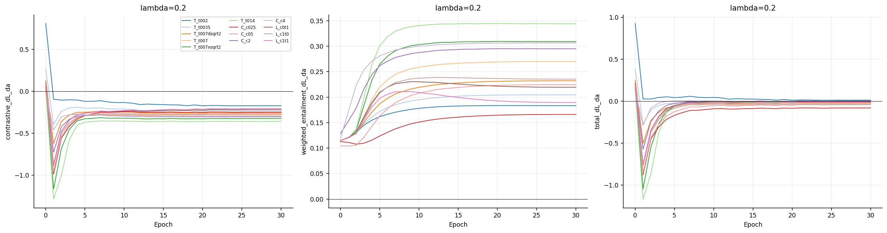

[径向梯度PDF](uniform_radius_gradients.pdf) · [精确数值](uniform_radius_gradients.csv)

固定256条训练probe，在副本上计算，恢复RNG且不更新训练参数。横轴使用实际checkpoint_step/322。非有限诊断独立记录，不能与真实训练失败混淆。

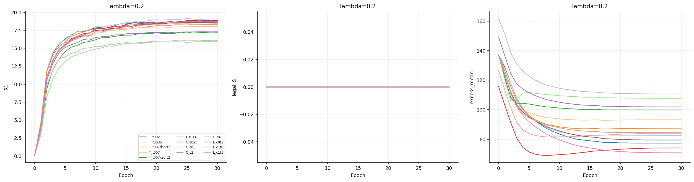

[PDF](learning_curves.pdf) · [角度辅助取舍](angular_tradeoff.png) · [角度PDF](angular_tradeoff.pdf)

## 单变量差值与尺度匹配

差值均为处理减对照；角度越小越好，其余性能方向见主表。这里只展示本轮预先定义的比较；不同对照的差值不跨行排名。缺失末轮不以最佳值补齐。

[13项λ内单因素差值CSV](single_factor_deltas.csv) · [每边差值CSV](edge_deltas.csv)

### within_lambda

| 对照 | 处理 | 唯一因素 | ΔR@1 pp | ΔS pp | Δ覆盖 pp | Δexcess° |
| --- | --- | --- | --- | --- | --- | --- |
| C0_l02__T_t007 | C0_l02__T_t002 | temperature_initial | 0.692 | 0.000 | 0.000 | -15.818 |
| C0_l02__T_t007 | C0_l02__T_t0035 | temperature_initial | 1.042 | 0.000 | 0.000 | -10.640 |
| C0_l02__T_t007 | C0_l02__T_t007dsqrt2 | temperature_initial | 0.594 | 0.000 | 0.000 | -5.705 |
| C0_l02__T_t007 | C0_l02__T_t007xsqrt2 | temperature_initial | -0.854 | 0.000 | 0.000 | 6.657 |
| C0_l02__T_t007 | C0_l02__T_t014 | temperature_initial | -2.075 | 0.000 | 0.000 | 14.563 |
| C0_l02__T_t007 | C0_l02__C_c025 | curvature_initial | 0.854 | 0.000 | 0.000 | -19.086 |
| C0_l02__T_t007 | C0_l02__C_c05 | curvature_initial | 0.456 | 0.000 | 0.000 | -9.170 |
| C0_l02__T_t007 | C0_l02__C_c2 | curvature_initial | -0.724 | 0.000 | 0.000 | 8.728 |
| C0_l02__T_t007 | C0_l02__C_c4 | curvature_initial | -1.912 | 0.000 | 0.000 | 17.487 |
| C0_l02__T_t007 | C0_l02__L_c0t1 | learn_temperature | 0.610 | 0.000 | 0.000 | -13.760 |
| C0_l02__T_t007 | C0_l02__L_c1t0 | learn_curvature | 0.285 | 0.000 | 0.000 | -8.725 |
| C0_l02__L_c1t0 | C0_l02__L_c1t1 | learn_temperature | 0.456 | 0.000 | 0.000 | -13.633 |
| C0_l02__L_c0t1 | C0_l02__L_c1t1 | learn_curvature | 0.130 | 0.000 | 0.000 | -8.599 |

### τ√c匹配：双字段辅助比较

| 曲率条件 | 温度条件 | 共同初始τ√c | ΔR@1 pp | ΔS pp | Δr | Δu |
| --- | --- | --- | --- | --- | --- | --- |
| C0_l02__C_c025 | C0_l02__T_t0035 | 0.035 | -0.187 | 0.000 | 0.990 | -0.311 |
| C0_l02__C_c05 | C0_l02__T_t007dsqrt2 | 0.049 | -0.138 | 0.000 | 0.580 | -0.126 |
| C0_l02__C_c2 | C0_l02__T_t007xsqrt2 | 0.099 | 0.130 | 0.000 | -0.658 | 0.044 |
| C0_l02__C_c4 | C0_l02__T_t014 | 0.140 | 0.163 | 0.000 | -1.404 | -0.219 |

差值为曲率条件减温度条件。相同τ√c不保证相同物理r→u映射或训练轨迹；该比较不能单独把差异归因于曲率。

## 每条边、错配控制与兼容性

[全部initial/final/best读出的每边角度、满足率、径向顺序和错配CSV](edge_metrics.csv) · [r/u/q详细统计](radius_statistics.csv)。兼容性与六方向检索见[完整主表CSV](full_final.csv)。

## 最佳检索与最佳合法满足率（独立附录）

两种选模包含epoch0。最佳检索按R@1、R@5、较早step；最佳合法满足率按S/all、R@1、较早step。均未代替主表末轮；失败条件的已保存最佳点也单列。

### best_retrieval

| 条件 | 终态 | epoch | step | R@1↑ | S/all↑ | 覆盖↑ |
| --- | --- | --- | --- | --- | --- | --- |
| C0_l02__T_t002 | completed | 29 | 9338 | 18.734 | **0.000** | **100.000** |
| C0_l02__T_t0035 | completed | 25 | 8050 | **19.157** | **0.000** | **100.000** |
| C0_l02__T_t007dsqrt2 | completed | 26 | 8372 | 18.709 | **0.000** | **100.000** |
| C0_l02__T_t007 | completed | 26 | 8372 | 18.034 | **0.000** | **100.000** |
| C0_l02__T_t007xsqrt2 | completed | 26 | 8372 | 17.261 | **0.000** | **100.000** |
| C0_l02__T_t014 | completed | 27 | 8694 | 15.983 | **0.000** | **100.000** |
| C0_l02__C_c025 | completed | 29 | 9338 | <ins>18.888</ins> | **0.000** | **100.000** |
| C0_l02__C_c05 | completed | 28 | 9016 | 18.506 | **0.000** | **100.000** |
| C0_l02__C_c2 | completed | 30 | 9660 | 17.285 | **0.000** | **100.000** |
| C0_l02__C_c4 | completed | 27 | 8694 | 16.121 | **0.000** | **100.000** |
| C0_l02__L_c0t1 | completed | 30 | 9660 | 18.620 | **0.000** | **100.000** |
| C0_l02__L_c1t0 | completed | 26 | 8372 | 18.327 | **0.000** | **100.000** |
| C0_l02__L_c1t1 | completed | 26 | 8372 | 18.783 | **0.000** | **100.000** |

### best_legal

| 条件 | 终态 | epoch | step | R@1↑ | S/all↑ | 覆盖↑ |
| --- | --- | --- | --- | --- | --- | --- |
| C0_l02__T_t002 | completed | 29 | 9338 | 18.734 | **0.000** | **100.000** |
| C0_l02__T_t0035 | completed | 25 | 8050 | **19.157** | **0.000** | **100.000** |
| C0_l02__T_t007dsqrt2 | completed | 26 | 8372 | 18.709 | **0.000** | **100.000** |
| C0_l02__T_t007 | completed | 26 | 8372 | 18.034 | **0.000** | **100.000** |
| C0_l02__T_t007xsqrt2 | completed | 26 | 8372 | 17.261 | **0.000** | **100.000** |
| C0_l02__T_t014 | completed | 27 | 8694 | 15.983 | **0.000** | **100.000** |
| C0_l02__C_c025 | completed | 29 | 9338 | <ins>18.888</ins> | **0.000** | **100.000** |
| C0_l02__C_c05 | completed | 28 | 9016 | 18.506 | **0.000** | **100.000** |
| C0_l02__C_c2 | completed | 27 | 8694 | 17.285 | **0.000** | **100.000** |
| C0_l02__C_c4 | completed | 25 | 8050 | 16.121 | **0.000** | **100.000** |
| C0_l02__L_c0t1 | completed | 30 | 9660 | 18.620 | **0.000** | **100.000** |
| C0_l02__L_c1t0 | completed | 26 | 8372 | 18.327 | **0.000** | **100.000** |
| C0_l02__L_c1t1 | completed | 26 | 8372 | 18.783 | **0.000** | **100.000** |

## 失败与核验

本轮未记录训练失败。

正式终态核验见同目录audit.json（仅所有条件结束后生成）；覆盖封存源码、原始产物哈希、真实特征r/u/q/锥几何、保存的检索rank、选模、实际dtype、旧λ=.2标准对照复现和登记PID退出。分析来源见[provenance.json](provenance.json)。不改动旧源码、旧结果或其他人的任务。

完整机器结果：[summary.json](summary.json) · [所有checkpoint读出CSV](checkpoint_readouts.csv)。仅本地归档，远端状态尚未核实，未commit/push/upload。
