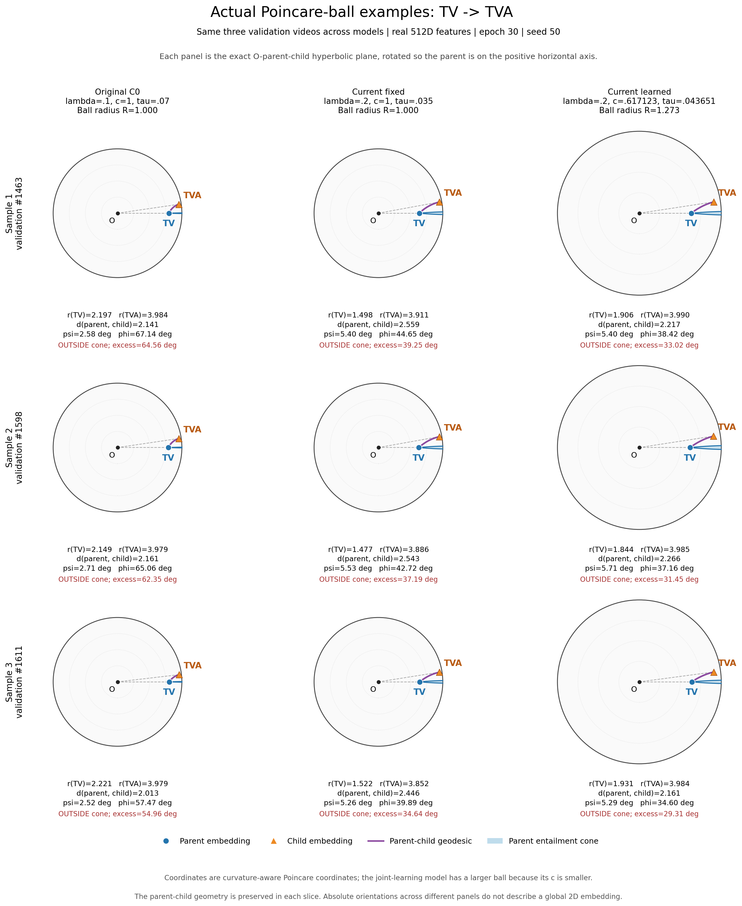

# 真实样本在庞加莱圆盘中的位置与蕴含锥

这次画的是实际样本嵌入转换后的庞加莱位置、真实父子测地线与父点锥区域。固定取验证索引1463、1598、1611三条样本，三种模型使用同一批样本；选择由seed50随机生成，未按角度或效果挑选。均为第30轮。

三列依次为最初C0（λ=.1、c=1、τ=.07）、当前固定组（λ=.2、c=1、τ=.035）、当前联合学习组（λ=.2，末轮c=.617123、τ=.043651）。

## T→TV：真实样本

[PDF](poincare_t_to_tv_examples.pdf)

## TV→TVA：真实样本

[PDF](poincare_tv_to_tva_examples.pdf)

## 怎么读图

黑色圆是庞加莱球边界，O是原点。蓝色圆点为父嵌入，橙色三角为子嵌入，紫色弧线为连接它们的双曲测地线；蓝色填充区域是父点的蕴含锥，边界也由测地线构成。灰虚线连接原点，帮助观察径向位置。

图使用曲率对应的真实庞加莱坐标，球半径为1/√c；联合学习组的球半径约1.273，所以圆盘更大。三列使用相同坐标尺度。r和d标注的是原双曲空间的测地半径与距离，不是图上的欧氏距离。

每个圆盘只截取原点、该父点和该子点所在的二维双曲平面，保留这三个点的几何。父点统一旋转到水平正方向，子点选取上半平面方向；不同面板的绝对朝向不用于比较其他样本或其他模态的位置。

## 几何核验

18个实际父子对均保持原空间的双曲距离（同一高精度计算下最大误差1.199e-14）；相对原FP32读出的角度最大差异为0.000280°，半径最大差异为2.660e-07。锥内/外判定全部一致。还核对了测地线端点、恒速距离关系，以及锥边界圆与球边界的正交条件。

这是保真父子截面，不是把七个头任意压缩到一个共同二维平面；因此它可用于判断所画父子对是否在锥内，但不展示所有模态、所有样本之间的全局布局。

测地线采用标准Möbius表达式，参见[Geoopt几何文档](https://geoopt.readthedocs.io/en/latest/extended/stereographic.html#geoopt.manifolds.stereographic.math.geodesic)。绘图转换用FP64控制数值误差，训练结果与原始指标未改变。

[18个父子对的位置与指标](sample_geometry.csv) · [抽样记录](sample_selection.json) · [数据来源、公式与验证](provenance.json)
