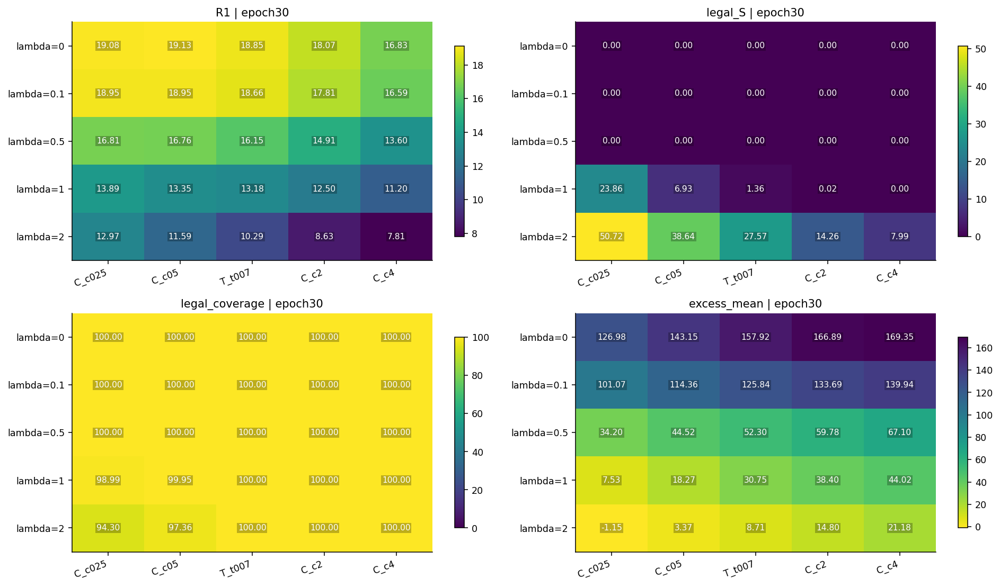
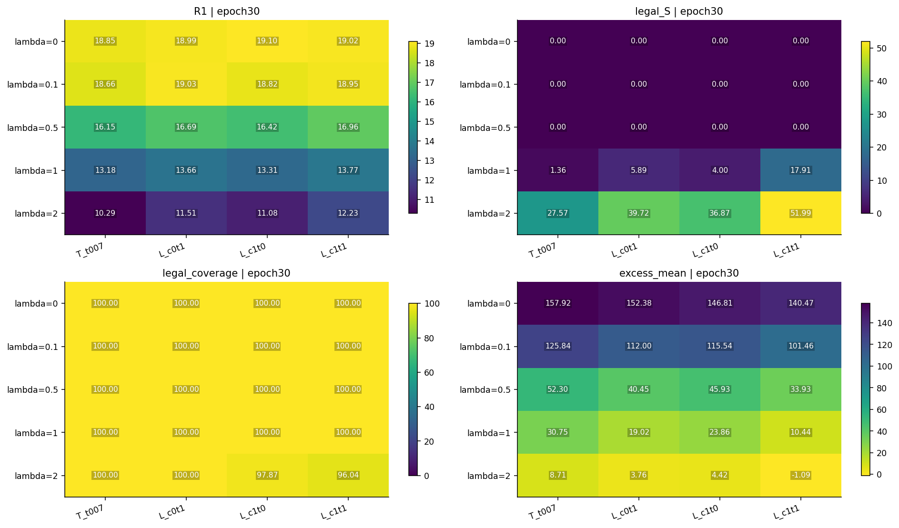
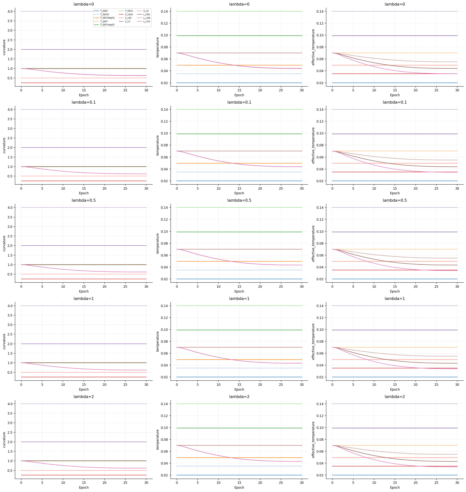
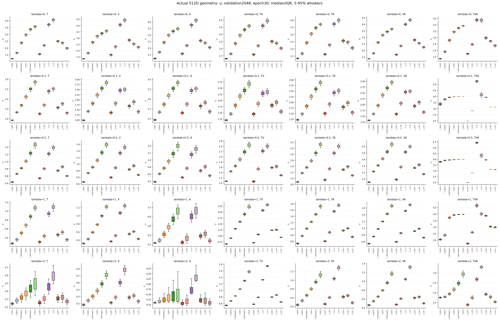
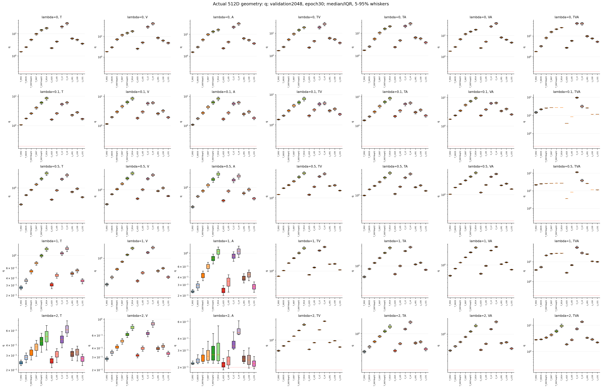
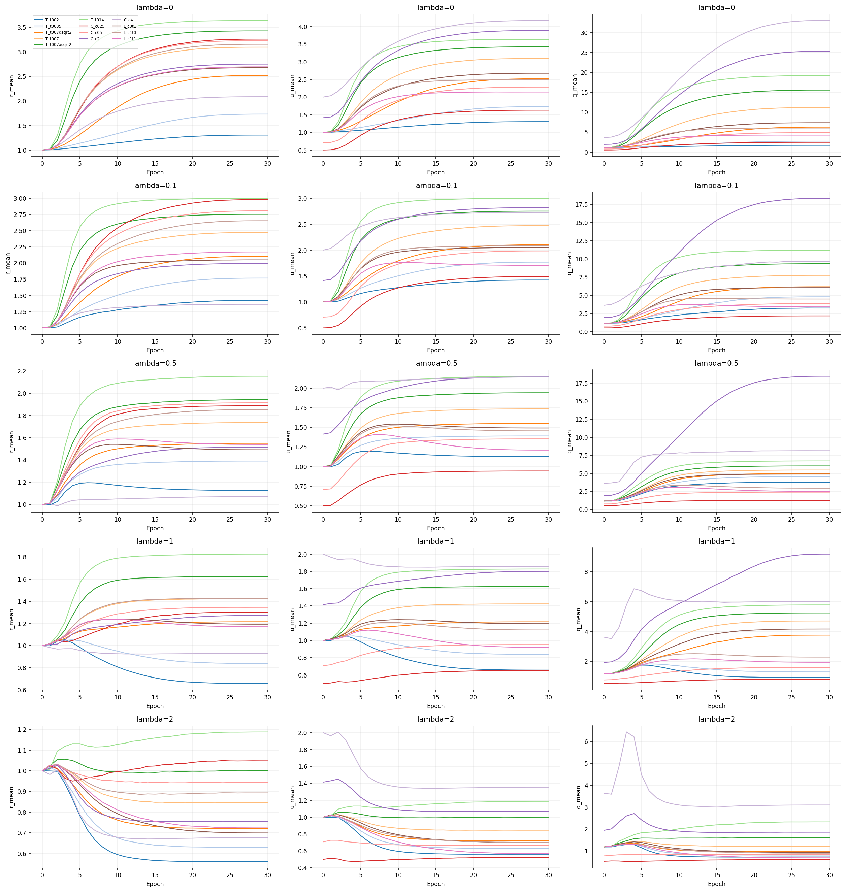
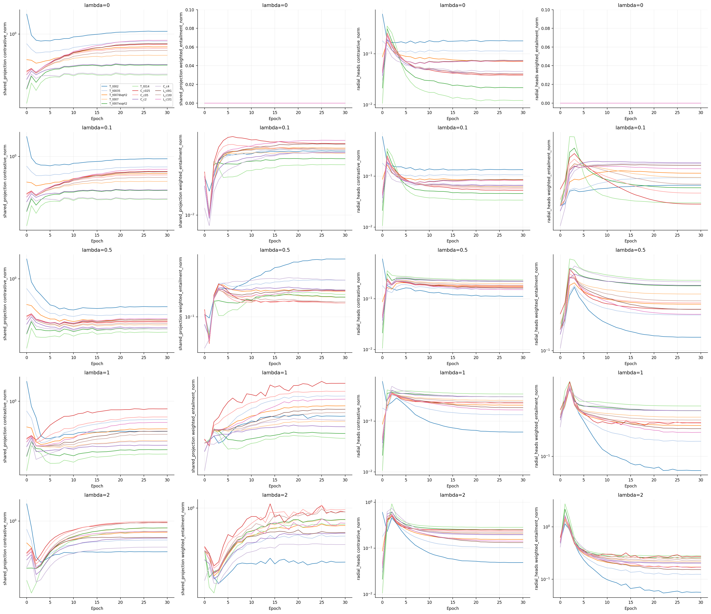
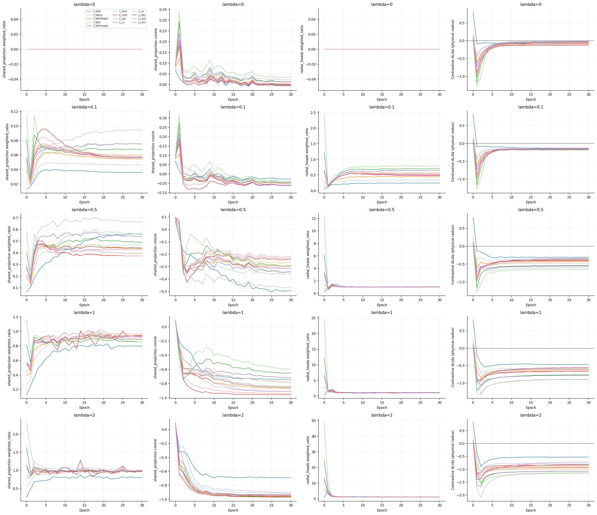
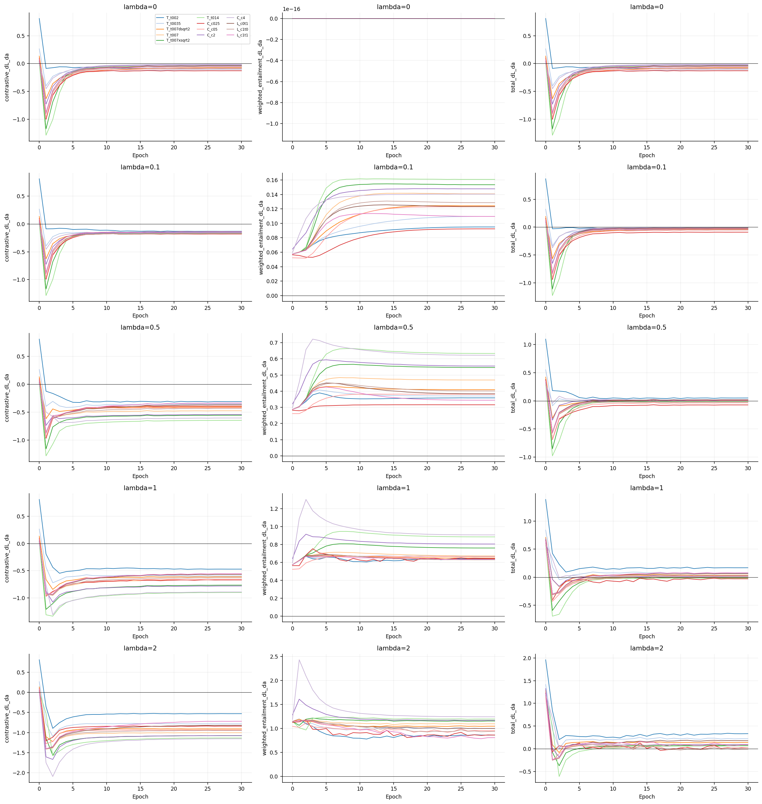
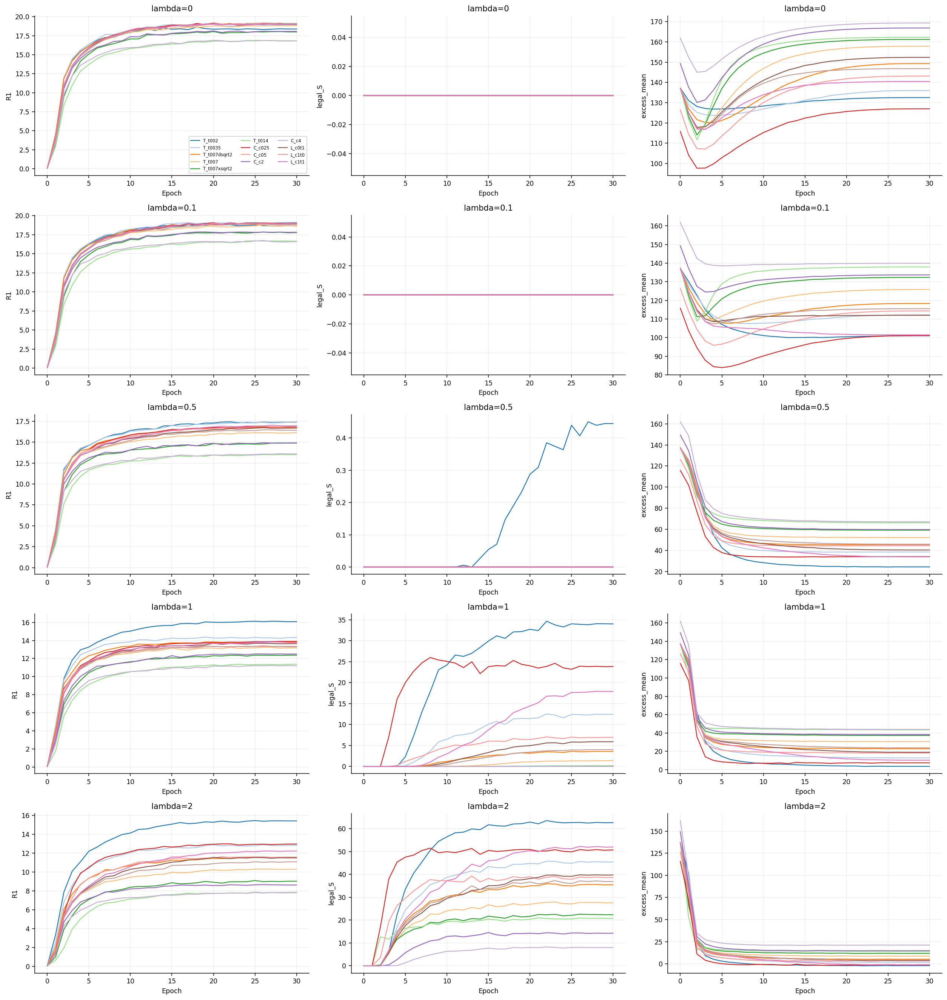

# C0温度与曲率：65组完整结果

生成于2026-10-27T09:27:49.541717+00:00 UTC；65/65完成，0失败。主表仅使用完成条件的epoch30；未完成/失败末轮留空。

## 固定协议与解释边界

VAST训练82608条、验证2048候选，512D、seed50、每组30轮9660更新、batch256。全部从相同投影初始化和r=1出发；仅训练头部。FP16投影、原版FP32几何，K=.1与epsilon不变。主满足率S为合法且满足/全部9N；条件满足率与合法覆盖另列。

c表示曲率的正幅值（截面曲率为−c）。物理r范围固定.21–4；x=direction·sinh(√c r)/√c，u=√c r，q=sinh(u)。低c不补q下界。c∈[.1,10]、τ≥.01仅对学习标量裁剪。每个λ的c=1、τ=.07对照均重新训练。117项预先核对的单变量比较包括65项λ内和52项相邻λ；20项τ√c匹配同时改变c和τ，只是辅助解释，不能当作单因素因果效果。

同一组固定特征上改变正温度不改变检索排序；本实验研究训练轨迹。跨温度CE数值不用于性能排名。统一物理半径倍数a的dL/da是局部诊断，正值对应下降方向收缩、负值对应扩张；可能离开头部可行范围，不能代替实际优化器更新。

最优加粗、次优下划线，按同表显示到三位小数的不同值排序；并列同时标记。这些标记不代表统计显著性。单一seed50、多条件验证选择、没有测试集结论。循环错配和最近错误视频不是人工非蕴含标注。

## 主要读出

最高检索：C0_l0__C_c05，R@1=19.132%，S=0.000%。最高合法满足率：C0_l2__T_t002，S=62.641%，R@1=15.422%。这些是本次验证集的观察极值，不能据此宣布唯一最佳方案。

完整双目标Pareto：C0_l0__C_c05, C0_l05__T_t002, C0_l1__T_t002, C0_l2__T_t002。

[PDF](tradeoffs.pdf)；全部同协议末轮，折线只连接未被其他完成条件同时支配的点。

<!-- BEGIN DERIVED INSIGHTS -->

## 结果解读（固定末轮）

65组完成、0组失败。五个c=1、τ=.07的新对照中，5/5与上一轮同λ条件的权重、检索和几何逐位/精确一致。以下均为seed50的验证集描述，未做跨seed或测试验证。

### 是否同时改善两个目标

65项λ内单因素比较中，19项同时出现ΔR@1>0和Δ合法满足率>0。该计数只描述本轮观察，不代表显著性或普遍规律；全部117项差值仍保留，包括负结果。

- C0_l05__T_t007 → C0_l05__T_t002（仅改temperature_initial）：ΔR@1=+1.253 pp、ΔS=+0.445 pp；处理末轮R@1/S=17.399%/0.445%。

- C0_l1__T_t007 → C0_l1__T_t002（仅改temperature_initial）：ΔR@1=+2.905 pp、ΔS=+32.677 pp；处理末轮R@1/S=16.089%/34.039%。

- C0_l1__T_t007 → C0_l1__T_t0035（仅改temperature_initial）：ΔR@1=+1.156 pp、ΔS=+11.079 pp；处理末轮R@1/S=14.339%/12.440%。

- C0_l1__T_t007 → C0_l1__T_t007dsqrt2（仅改temperature_initial）：ΔR@1=+0.675 pp、ΔS=+2.203 pp；处理末轮R@1/S=13.859%/3.564%。

- C0_l1__T_t007 → C0_l1__C_c025（仅改curvature_initial）：ΔR@1=+0.708 pp、ΔS=+22.499 pp；处理末轮R@1/S=13.892%/23.861%。

- C0_l1__T_t007 → C0_l1__C_c05（仅改curvature_initial）：ΔR@1=+0.171 pp、ΔS=+5.572 pp；处理末轮R@1/S=13.354%/6.934%。

- C0_l1__T_t007 → C0_l1__L_c0t1（仅改learn_temperature）：ΔR@1=+0.472 pp、ΔS=+4.530 pp；处理末轮R@1/S=13.656%/5.892%。

- C0_l1__T_t007 → C0_l1__L_c1t0（仅改learn_curvature）：ΔR@1=+0.122 pp、ΔS=+2.642 pp；处理末轮R@1/S=13.306%/4.004%。

- C0_l1__L_c1t0 → C0_l1__L_c1t1（仅改learn_temperature）：ΔR@1=+0.464 pp、ΔS=+13.911 pp；处理末轮R@1/S=13.770%/17.914%。

- C0_l2__T_t007 → C0_l2__T_t002（仅改temperature_initial）：ΔR@1=+5.127 pp、ΔS=+35.069 pp；处理末轮R@1/S=15.422%/62.641%。

- C0_l2__T_t007 → C0_l2__T_t0035（仅改temperature_initial）：ΔR@1=+2.531 pp、ΔS=+17.882 pp；处理末轮R@1/S=12.826%/45.454%。

- C0_l2__T_t007 → C0_l2__T_t007dsqrt2（仅改temperature_initial）：ΔR@1=+1.229 pp、ΔS=+7.888 pp；处理末轮R@1/S=11.523%/35.460%。

- C0_l2__T_t007 → C0_l2__C_c025（仅改curvature_initial）：ΔR@1=+2.677 pp、ΔS=+23.150 pp；处理末轮R@1/S=12.972%/50.722%。

- C0_l2__T_t007 → C0_l2__C_c05（仅改curvature_initial）：ΔR@1=+1.294 pp、ΔS=+11.068 pp；处理末轮R@1/S=11.589%/38.639%。

- C0_l2__T_t007 → C0_l2__L_c0t1（仅改learn_temperature）：ΔR@1=+1.213 pp、ΔS=+12.147 pp；处理末轮R@1/S=11.507%/39.719%。

- C0_l2__T_t007 → C0_l2__L_c1t0（仅改learn_curvature）：ΔR@1=+0.789 pp、ΔS=+9.294 pp；处理末轮R@1/S=11.084%/36.865%。

- C0_l2__L_c1t0 → C0_l2__L_c1t1（仅改learn_temperature）：ΔR@1=+1.147 pp、ΔS=+15.126 pp；处理末轮R@1/S=12.231%/51.991%。

- C0_l1__L_c0t1 → C0_l1__L_c1t1（仅改learn_curvature）：ΔR@1=+0.114 pp、ΔS=+12.023 pp；处理末轮R@1/S=13.770%/17.914%。

- C0_l2__L_c0t1 → C0_l2__L_c1t1（仅改learn_curvature）：ΔR@1=+0.724 pp、ΔS=+12.272 pp；处理末轮R@1/S=12.231%/51.991%。

### 温度与半径

温度标签t002/t0035/t007dsqrt2/t007/t007xsqrt2/t014依次代表.02、.035、.07/√2、.07、.07√2、.14。下列比较保持c=1，并固定各自λ；报告扫描端点和本层温度扫描的最高检索点，不把端点趋势当作整条曲线单调。r为七头、2048条验证特征的平均物理半径。

- λ=0：温度扫描最高检索在τ=0.049497，R@1=18.986%、S=0.000%。 τ=.02→.14时，平均r 1.304→3.637，R@1 18.392%→16.838%，S 0.000%→0.000%。

- λ=0.1：温度扫描最高检索在τ=0.035000，R@1=19.092%、S=0.000%。 τ=.02→.14时，平均r 1.424→2.999，R@1 18.644%→16.642%，S 0.000%→0.000%。

- λ=0.5：温度扫描最高检索在τ=0.020000，R@1=17.399%、S=0.445%。 τ=.02→.14时，平均r 1.127→2.153，R@1 17.399%→13.525%，S 0.445%→0.000%。

- λ=1：温度扫描最高检索在τ=0.020000，R@1=16.089%、S=34.039%。 τ=.02→.14时，平均r 0.657→1.827，R@1 16.089%→11.369%，S 34.039%→0.005%。

- λ=2：温度扫描最高检索在τ=0.020000，R@1=15.422%、S=62.641%。 τ=.02→.14时，平均r 0.561→1.187，R@1 15.422%→7.861%，S 62.641%→20.763%。

训练得到的半径会随温度变化，不能把固定特征下的温度缩放等同于重新训练。固定特征的正温度缩放保持检索排序；表中检索差异来自不同训练过程。

### 固定曲率与尺度匹配

曲率扫描保持τ=.07和相同物理r范围，因而同时改变u=√c r及距离前因子。τ√c匹配是双字段辅助比较，不用于单因素归因。下列最高S若有并列，按R@1展示其中一项，并非唯一最优。

- λ=0：曲率扫描中最高S条件为c=0.5，R@1/S=19.132%/0.000%，平均r/u=3.228/2.283，合法覆盖=100.000%。

- λ=0.1：曲率扫描中最高S条件为c=0.5，R@1/S=18.953%/0.000%，平均r/u=2.807/1.985，合法覆盖=100.000%。

- λ=0.5：曲率扫描中最高S条件为c=0.25，R@1/S=16.805%/0.000%，平均r/u=1.888/0.944，合法覆盖=100.000%。

- λ=1：曲率扫描中最高S条件为c=0.25，R@1/S=13.892%/23.861%，平均r/u=1.302/0.651，合法覆盖=98.991%。

- λ=2：曲率扫描中最高S条件为c=0.25，R@1/S=12.972%/50.722%，平均r/u=1.048/0.524，合法覆盖=94.303%。

20项尺度匹配中，绝对检索差最大的一对为C0_l05__C_c025与C0_l05__T_t0035：共同τ√c=0.035000，曲率条件减温度条件ΔR@1=-0.562 pp、ΔS=+0.000 pp、Δu均值=-0.447。相同有效温度没有消除物理半径参数化下的全部训练差异。

### 学习温度、曲率和两者

下表述是三个配置的绝对终态。联合学习的单因素效果应分别对照只学习其中一项，见预先定义差值；不把联合设置相对固定基准的变化归因于单一参数。学习组的终态受初始化、学习率与30轮预算约束，不代表c或τ的全局最优。

- λ=0：仅学τ：c=1.000，τ=0.043994，τ√c=0.043994，R@1/S=18.994%/0.000%；仅学c：c=0.622，τ=0.070000，τ√c=0.055227，R@1/S=19.100%/0.000%；两者均学：c=0.634，τ=0.044257，τ√c=0.035227，R@1/S=19.019%/0.000%。

- λ=0.1：仅学τ：c=1.000，τ=0.043763，τ√c=0.043763，R@1/S=19.027%/0.000%；仅学c：c=0.617，τ=0.070000，τ√c=0.054980，R@1/S=18.823%/0.000%；两者均学：c=0.618，τ=0.043860，τ√c=0.034471，R@1/S=18.953%/0.000%。

- λ=0.5：仅学τ：c=1.000，τ=0.043406，τ√c=0.043406，R@1/S=16.691%/0.000%；仅学c：c=0.617，τ=0.070000，τ√c=0.054984，R@1/S=16.423%/0.000%；两者均学：c=0.617，τ=0.043423，τ√c=0.034114，R@1/S=16.960%/0.000%。

- λ=1：仅学τ：c=1.000，τ=0.043266，τ√c=0.043266，R@1/S=13.656%/5.892%；仅学c：c=0.617，τ=0.070000，τ√c=0.054990，R@1/S=13.306%/4.004%；两者均学：c=0.617，τ=0.043263，τ√c=0.033984，R@1/S=13.770%/17.914%。

- λ=2：仅学τ：c=1.000，τ=0.043159，τ√c=0.043159，R@1/S=11.507%/39.719%；仅学c：c=0.617，τ=0.070000，τ√c=0.055000，R@1/S=11.084%/36.865%；两者均学：c=0.618，τ=0.043169，τ√c=0.033925，R@1/S=12.231%/51.991%。

完成轮内边界步占比的跨条件最大值：curvature_lower=0.000000, curvature_upper=0.000000, temperature_lower=0.000000。这些是实际逐步计数的汇总，不以末轮是否触边替代。

### 合法域、错配与严格九边包含

末轮合法覆盖最低为C0_l2__C_c025的94.303%；该点官方满足率=55.968%，合法且满足/全部9N=50.722%，条件满足率=53.786%。域外边保留在9N分母中。

最高S条件C0_l2__T_t002的九边平均合法满足率为62.641%，但同一视频九边同时合法满足为13.525%；循环错配/最近错误视频的平均合法满足率为0.477%/8.789%。错配不是人工非蕴含标签，单独高S也不能证明语义层级已成立。

### 梯度证据的适用范围

[统一物理半径梯度](uniform_radius_gradients.csv)在固定方向、c和τ的副本上测量a=1处导数。正值对应局部收缩方向，负值对应局部扩张方向；实际AdamW更新同时改变多个参数、受半径范围及标量裁剪限制。投影/径向头的范数与余弦说明局部冲突强度，不构成训练变化的唯一因果解释。

固定256条训练probe与2048条验证结果分开记录；诊断没有修改训练参数或RNG。实际训练的c/τ梯度文件保存的是unscale后、裁剪前范数，不含符号。

<!-- END DERIVED INSIGHTS -->

## 分λ的固定末轮结果

### λ=0

| 条件 | 状态 | R@1↑ | R@5↑ | R@10↑ | S/all↑ | 官方S↑ | 合法覆盖↑ | 条件S↑ | 九边同满足↑ | excess°↓ |
| --- | --- | --- | --- | --- | --- | --- | --- | --- | --- | --- |
| C0_l0__T_t002 | completed | 18.392 | 36.987 | 46.240 | **0.000** | **0.000** | **100.000** | **0.000** | **0.000** | <ins>132.527</ins> |
| C0_l0__T_t0035 | completed | 18.945 | 37.801 | 47.070 | **0.000** | **0.000** | **100.000** | **0.000** | **0.000** | 136.010 |
| C0_l0__T_t007dsqrt2 | completed | 18.986 | **37.874** | **47.176** | **0.000** | **0.000** | **100.000** | **0.000** | **0.000** | 149.324 |
| C0_l0__T_t007 | completed | 18.848 | 37.622 | 46.948 | **0.000** | **0.000** | **100.000** | **0.000** | **0.000** | 157.920 |
| C0_l0__T_t007xsqrt2 | completed | 18.001 | 36.556 | 46.061 | **0.000** | **0.000** | **100.000** | **0.000** | **0.000** | 161.231 |
| C0_l0__T_t014 | completed | 16.838 | 34.652 | 44.132 | **0.000** | **0.000** | **100.000** | **0.000** | **0.000** | 162.301 |
| C0_l0__C_c025 | completed | 19.084 | 37.638 | 47.078 | **0.000** | **0.000** | **100.000** | **0.000** | **0.000** | **126.981** |
| C0_l0__C_c05 | completed | **19.132** | <ins>37.826</ins> | <ins>47.168</ins> | **0.000** | **0.000** | **100.000** | **0.000** | **0.000** | 143.153 |
| C0_l0__C_c2 | completed | 18.075 | 36.426 | 46.012 | **0.000** | **0.000** | **100.000** | **0.000** | **0.000** | 166.886 |
| C0_l0__C_c4 | completed | 16.829 | 34.717 | 44.320 | **0.000** | **0.000** | **100.000** | **0.000** | **0.000** | 169.351 |
| C0_l0__L_c0t1 | completed | 18.994 | 37.638 | 47.070 | **0.000** | **0.000** | **100.000** | **0.000** | **0.000** | 152.384 |
| C0_l0__L_c1t0 | completed | <ins>19.100</ins> | 37.752 | 47.095 | **0.000** | **0.000** | **100.000** | **0.000** | **0.000** | 146.807 |
| C0_l0__L_c1t1 | completed | 19.019 | 37.630 | 46.777 | **0.000** | **0.000** | **100.000** | **0.000** | **0.000** | 140.474 |

### λ=0.1

| 条件 | 状态 | R@1↑ | R@5↑ | R@10↑ | S/all↑ | 官方S↑ | 合法覆盖↑ | 条件S↑ | 九边同满足↑ | excess°↓ |
| --- | --- | --- | --- | --- | --- | --- | --- | --- | --- | --- |
| C0_l01__T_t002 | completed | 18.644 | 37.459 | 46.842 | **0.000** | **0.000** | **100.000** | **0.000** | **0.000** | **101.004** |
| C0_l01__T_t0035 | completed | **19.092** | **37.948** | 47.144 | **0.000** | **0.000** | **100.000** | **0.000** | **0.000** | 112.216 |
| C0_l01__T_t007dsqrt2 | completed | 18.815 | <ins>37.891</ins> | <ins>47.249</ins> | **0.000** | **0.000** | **100.000** | **0.000** | **0.000** | 118.366 |
| C0_l01__T_t007 | completed | 18.660 | 37.223 | 46.859 | **0.000** | **0.000** | **100.000** | **0.000** | **0.000** | 125.835 |
| C0_l01__T_t007xsqrt2 | completed | 17.773 | 36.230 | 45.793 | **0.000** | **0.000** | **100.000** | **0.000** | **0.000** | 132.329 |
| C0_l01__T_t014 | completed | 16.642 | 34.473 | 43.905 | **0.000** | **0.000** | **100.000** | **0.000** | **0.000** | 137.974 |
| C0_l01__C_c025 | completed | 18.945 | 37.826 | <ins>47.249</ins> | **0.000** | **0.000** | **100.000** | **0.000** | **0.000** | <ins>101.067</ins> |
| C0_l01__C_c05 | completed | 18.953 | 37.695 | 47.070 | **0.000** | **0.000** | **100.000** | **0.000** | **0.000** | 114.358 |
| C0_l01__C_c2 | completed | 17.814 | 36.263 | 45.955 | **0.000** | **0.000** | **100.000** | **0.000** | **0.000** | 133.692 |
| C0_l01__C_c4 | completed | 16.593 | 34.489 | 44.116 | **0.000** | **0.000** | **100.000** | **0.000** | **0.000** | 139.945 |
| C0_l01__L_c0t1 | completed | <ins>19.027</ins> | 37.712 | **47.290** | **0.000** | **0.000** | **100.000** | **0.000** | **0.000** | 112.001 |
| C0_l01__L_c1t0 | completed | 18.823 | 37.541 | 47.005 | **0.000** | **0.000** | **100.000** | **0.000** | **0.000** | 115.538 |
| C0_l01__L_c1t1 | completed | 18.953 | 37.744 | 47.176 | **0.000** | **0.000** | **100.000** | **0.000** | **0.000** | 101.457 |

### λ=0.5

| 条件 | 状态 | R@1↑ | R@5↑ | R@10↑ | S/all↑ | 官方S↑ | 合法覆盖↑ | 条件S↑ | 九边同满足↑ | excess°↓ |
| --- | --- | --- | --- | --- | --- | --- | --- | --- | --- | --- |
| C0_l05__T_t002 | completed | **17.399** | <ins>35.360</ins> | <ins>44.702</ins> | **0.445** | **0.445** | **100.000** | **0.445** | **0.000** | **24.445** |
| C0_l05__T_t0035 | completed | <ins>17.367</ins> | **35.392** | **44.718** | <ins>0.000</ins> | <ins>0.000</ins> | **100.000** | <ins>0.000</ins> | **0.000** | 38.547 |
| C0_l05__T_t007dsqrt2 | completed | 16.829 | 34.798 | 44.035 | <ins>0.000</ins> | <ins>0.000</ins> | **100.000** | <ins>0.000</ins> | **0.000** | 45.482 |
| C0_l05__T_t007 | completed | 16.146 | 33.716 | 43.188 | <ins>0.000</ins> | <ins>0.000</ins> | **100.000** | <ins>0.000</ins> | **0.000** | 52.296 |
| C0_l05__T_t007xsqrt2 | completed | 14.901 | 31.982 | 41.659 | <ins>0.000</ins> | <ins>0.000</ins> | **100.000** | <ins>0.000</ins> | **0.000** | 59.201 |
| C0_l05__T_t014 | completed | 13.525 | 30.330 | 39.526 | <ins>0.000</ins> | <ins>0.000</ins> | **100.000** | <ins>0.000</ins> | **0.000** | 66.224 |
| C0_l05__C_c025 | completed | 16.805 | 34.904 | 44.352 | <ins>0.000</ins> | <ins>0.000</ins> | **100.000** | <ins>0.000</ins> | **0.000** | 34.205 |
| C0_l05__C_c05 | completed | 16.756 | 34.578 | 44.084 | <ins>0.000</ins> | <ins>0.000</ins> | **100.000** | <ins>0.000</ins> | **0.000** | 44.522 |
| C0_l05__C_c2 | completed | 14.909 | 32.121 | 41.813 | <ins>0.000</ins> | <ins>0.000</ins> | **100.000** | <ins>0.000</ins> | **0.000** | 59.782 |
| C0_l05__C_c4 | completed | 13.599 | 30.290 | 39.372 | <ins>0.000</ins> | <ins>0.000</ins> | **100.000** | <ins>0.000</ins> | **0.000** | 67.103 |
| C0_l05__L_c0t1 | completed | 16.691 | 34.578 | 43.840 | <ins>0.000</ins> | <ins>0.000</ins> | **100.000** | <ins>0.000</ins> | **0.000** | 40.449 |
| C0_l05__L_c1t0 | completed | 16.423 | 34.237 | 43.709 | <ins>0.000</ins> | <ins>0.000</ins> | **100.000** | <ins>0.000</ins> | **0.000** | 45.926 |
| C0_l05__L_c1t1 | completed | 16.960 | 34.945 | 44.263 | <ins>0.000</ins> | <ins>0.000</ins> | **100.000** | <ins>0.000</ins> | **0.000** | <ins>33.931</ins> |

### λ=1

| 条件 | 状态 | R@1↑ | R@5↑ | R@10↑ | S/all↑ | 官方S↑ | 合法覆盖↑ | 条件S↑ | 九边同满足↑ | excess°↓ |
| --- | --- | --- | --- | --- | --- | --- | --- | --- | --- | --- |
| C0_l1__T_t002 | completed | **16.089** | **33.488** | **42.839** | **34.039** | **34.039** | **100.000** | **34.039** | **0.000** | **3.731** |
| C0_l1__T_t0035 | completed | <ins>14.339</ins> | <ins>31.095</ins> | <ins>40.446</ins> | 12.440 | 12.440 | **100.000** | 12.440 | **0.000** | 12.952 |
| C0_l1__T_t007dsqrt2 | completed | 13.859 | 30.729 | 39.819 | 3.564 | 3.564 | **100.000** | 3.564 | **0.000** | 22.957 |
| C0_l1__T_t007 | completed | 13.184 | 29.777 | 38.794 | 1.362 | 1.362 | **100.000** | 1.362 | **0.000** | 30.750 |
| C0_l1__T_t007xsqrt2 | completed | 12.370 | 28.345 | 37.370 | 0.103 | 0.103 | **100.000** | 0.103 | **0.000** | 37.407 |
| C0_l1__T_t014 | completed | 11.369 | 26.676 | 35.750 | 0.005 | 0.005 | **100.000** | 0.005 | **0.000** | 43.491 |
| C0_l1__C_c025 | completed | 13.892 | 30.656 | 39.860 | <ins>23.861</ins> | <ins>24.783</ins> | 98.991 | <ins>24.104</ins> | **0.000** | <ins>7.530</ins> |
| C0_l1__C_c05 | completed | 13.354 | 29.858 | 38.826 | 6.934 | 6.988 | <ins>99.946</ins> | 6.937 | **0.000** | 18.270 |
| C0_l1__C_c2 | completed | 12.500 | 28.556 | 37.467 | 0.016 | 0.016 | **100.000** | 0.016 | **0.000** | 38.402 |
| C0_l1__C_c4 | completed | 11.198 | 26.554 | 35.433 | 0.000 | 0.000 | **100.000** | 0.000 | **0.000** | 44.018 |
| C0_l1__L_c0t1 | completed | 13.656 | 30.558 | 39.478 | 5.892 | 5.892 | **100.000** | 5.892 | **0.000** | 19.018 |
| C0_l1__L_c1t0 | completed | 13.306 | 30.119 | 39.087 | 4.004 | 4.004 | **100.000** | 4.004 | **0.000** | 23.857 |
| C0_l1__L_c1t1 | completed | 13.770 | 30.705 | 39.852 | 17.914 | 17.914 | **100.000** | 17.914 | **0.000** | 10.437 |

### λ=2

| 条件 | 状态 | R@1↑ | R@5↑ | R@10↑ | S/all↑ | 官方S↑ | 合法覆盖↑ | 条件S↑ | 九边同满足↑ | excess°↓ |
| --- | --- | --- | --- | --- | --- | --- | --- | --- | --- | --- |
| C0_l2__T_t002 | completed | **15.422** | **32.699** | **42.236** | **62.641** | **62.641** | **100.000** | **62.641** | **13.525** | **-2.060** |
| C0_l2__T_t0035 | completed | 12.826 | 29.126 | 38.005 | 45.454 | 45.454 | **100.000** | 45.454 | 1.465 | 1.747 |
| C0_l2__T_t007dsqrt2 | completed | 11.523 | 26.766 | 35.653 | 35.460 | 35.460 | **100.000** | 35.460 | 0.049 | 5.194 |
| C0_l2__T_t007 | completed | 10.295 | 24.447 | 32.935 | 27.572 | 27.572 | **100.000** | 27.572 | 0.000 | 8.708 |
| C0_l2__T_t007xsqrt2 | completed | 9.033 | 22.298 | 30.396 | 22.347 | 22.347 | **100.000** | 22.347 | 0.000 | 11.857 |
| C0_l2__T_t014 | completed | 7.861 | 20.093 | 27.808 | 20.763 | 20.763 | **100.000** | 20.763 | 0.000 | 14.184 |
| C0_l2__C_c025 | completed | <ins>12.972</ins> | <ins>29.395</ins> | <ins>38.411</ins> | 50.722 | <ins>55.968</ins> | 94.303 | 53.786 | <ins>3.955</ins> | <ins>-1.151</ins> |
| C0_l2__C_c05 | completed | 11.589 | 26.945 | 35.775 | 38.639 | 41.108 | 97.363 | 39.686 | 0.098 | 3.366 |
| C0_l2__C_c2 | completed | 8.634 | 22.030 | 30.566 | 14.258 | 14.258 | **100.000** | 14.258 | 0.000 | 14.804 |
| C0_l2__C_c4 | completed | 7.812 | 20.483 | 28.817 | 7.986 | 7.986 | **100.000** | 7.986 | 0.000 | 21.180 |
| C0_l2__L_c0t1 | completed | 11.507 | 26.961 | 35.832 | 39.719 | 39.719 | **100.000** | 39.719 | 0.146 | 3.758 |
| C0_l2__L_c1t0 | completed | 11.084 | 25.920 | 34.521 | 36.865 | 38.813 | <ins>97.873</ins> | 37.666 | 0.000 | 4.422 |
| C0_l2__L_c1t1 | completed | 12.231 | 28.377 | 37.150 | <ins>51.991</ins> | 55.680 | 96.039 | <ins>54.135</ins> | 3.662 | -1.089 |

## 温度、曲率与学习开关

温度矩阵固定c=1；曲率矩阵固定τ=.07；学习开关矩阵顺序为都不学习、仅学τ、仅学c、都学习。都不学习复用同λ新对照。

[PDF](temperature_matrix.pdf)

[PDF](curvature_matrix.pdf)

[PDF](learning_switches_matrix.pdf)

## 标量、物理半径与有效温度

[标量轨迹PDF](scalar_trajectories.pdf) · [逐轮数值](learning_curves.csv)

| 条件 | 末轮c | 末轮τ | 末轮τ√c | 七头均值r | 七头均值u | 七头均值q | c下界步占比 | c上界步占比 | τ下界步占比 |
| --- | --- | --- | --- | --- | --- | --- | --- | --- | --- |
| C0_l0__T_t002 | 1.000 | 0.020 | 0.020 | 1.304 | 1.304 | 1.709 | 0.000 | 0.000 | 0.000 |
| C0_l0__T_t0035 | 1.000 | 0.035 | 0.035 | 1.731 | 1.731 | 2.749 | 0.000 | 0.000 | 0.000 |
| C0_l0__T_t007dsqrt2 | 1.000 | 0.049 | 0.049 | 2.520 | 2.520 | 6.263 | 0.000 | 0.000 | 0.000 |
| C0_l0__T_t007 | 1.000 | 0.070 | 0.070 | 3.094 | 3.094 | 11.196 | 0.000 | 0.000 | 0.000 |
| C0_l0__T_t007xsqrt2 | 1.000 | 0.099 | 0.099 | 3.425 | 3.425 | 15.553 | 0.000 | 0.000 | 0.000 |
| C0_l0__T_t014 | 1.000 | 0.140 | 0.140 | 3.637 | 3.637 | 19.180 | 0.000 | 0.000 | 0.000 |
| C0_l0__C_c025 | 0.250 | 0.070 | 0.035 | 3.258 | 1.629 | 2.458 | 0.000 | 0.000 | 0.000 |
| C0_l0__C_c05 | 0.500 | 0.070 | 0.049 | 3.228 | 2.283 | 4.881 | 0.000 | 0.000 | 0.000 |
| C0_l0__C_c2 | 2.000 | 0.070 | 0.099 | 2.749 | 3.887 | 25.285 | 0.000 | 0.000 | 0.000 |
| C0_l0__C_c4 | 4.000 | 0.070 | 0.140 | 2.085 | 4.170 | 33.011 | 0.000 | 0.000 | 0.000 |
| C0_l0__L_c0t1 | 1.000 | 0.044 | 0.044 | 2.676 | 2.676 | 7.362 | 0.000 | 0.000 | 0.000 |
| C0_l0__L_c1t0 | 0.622 | 0.070 | 0.055 | 3.153 | 2.488 | 6.031 | 0.000 | 0.000 | 0.000 |
| C0_l0__L_c1t1 | 0.634 | 0.044 | 0.035 | 2.693 | 2.143 | 4.255 | 0.000 | 0.000 | 0.000 |
| C0_l01__T_t002 | 1.000 | 0.020 | 0.020 | 1.424 | 1.424 | 3.247 | 0.000 | 0.000 | 0.000 |
| C0_l01__T_t0035 | 1.000 | 0.035 | 0.035 | 1.768 | 1.768 | 4.796 | 0.000 | 0.000 | 0.000 |
| C0_l01__T_t007dsqrt2 | 1.000 | 0.049 | 0.049 | 2.104 | 2.104 | 6.171 | 0.000 | 0.000 | 0.000 |
| C0_l01__T_t007 | 1.000 | 0.070 | 0.070 | 2.473 | 2.473 | 7.747 | 0.000 | 0.000 | 0.000 |
| C0_l01__T_t007xsqrt2 | 1.000 | 0.099 | 0.099 | 2.753 | 2.753 | 9.346 | 0.000 | 0.000 | 0.000 |
| C0_l01__T_t014 | 1.000 | 0.140 | 0.140 | 2.999 | 2.999 | 11.186 | 0.000 | 0.000 | 0.000 |
| C0_l01__C_c025 | 0.250 | 0.070 | 0.035 | 2.980 | 1.490 | 2.173 | 0.000 | 0.000 | 0.000 |
| C0_l01__C_c05 | 0.500 | 0.070 | 0.049 | 2.807 | 1.985 | 3.865 | 0.000 | 0.000 | 0.000 |
| C0_l01__C_c2 | 2.000 | 0.070 | 0.099 | 1.994 | 2.820 | 18.331 | 0.000 | 0.000 | 0.000 |
| C0_l01__C_c4 | 4.000 | 0.070 | 0.140 | 1.364 | 2.728 | 9.673 | 0.000 | 0.000 | 0.000 |
| C0_l01__L_c0t1 | 1.000 | 0.044 | 0.044 | 2.050 | 2.050 | 6.051 | 0.000 | 0.000 | 0.000 |
| C0_l01__L_c1t0 | 0.617 | 0.070 | 0.055 | 2.654 | 2.084 | 4.488 | 0.000 | 0.000 | 0.000 |
| C0_l01__L_c1t1 | 0.618 | 0.044 | 0.034 | 2.172 | 1.707 | 3.413 | 0.000 | 0.000 | 0.000 |
| C0_l05__T_t002 | 1.000 | 0.020 | 0.020 | 1.127 | 1.127 | 3.782 | 0.000 | 0.000 | 0.000 |
| C0_l05__T_t0035 | 1.000 | 0.035 | 0.035 | 1.391 | 1.391 | 4.561 | 0.000 | 0.000 | 0.000 |
| C0_l05__T_t007dsqrt2 | 1.000 | 0.049 | 0.049 | 1.550 | 1.550 | 4.984 | 0.000 | 0.000 | 0.000 |
| C0_l05__T_t007 | 1.000 | 0.070 | 0.070 | 1.737 | 1.737 | 5.470 | 0.000 | 0.000 | 0.000 |
| C0_l05__T_t007xsqrt2 | 1.000 | 0.099 | 0.099 | 1.942 | 1.942 | 6.038 | 0.000 | 0.000 | 0.000 |
| C0_l05__T_t014 | 1.000 | 0.140 | 0.140 | 2.153 | 2.153 | 6.728 | 0.000 | 0.000 | 0.000 |
| C0_l05__C_c025 | 0.250 | 0.070 | 0.035 | 1.888 | 0.944 | 1.258 | 0.000 | 0.000 | 0.000 |
| C0_l05__C_c05 | 0.500 | 0.070 | 0.049 | 1.914 | 1.353 | 2.408 | 0.000 | 0.000 | 0.000 |
| C0_l05__C_c2 | 2.000 | 0.070 | 0.099 | 1.516 | 2.144 | 18.452 | 0.000 | 0.000 | 0.000 |
| C0_l05__C_c4 | 4.000 | 0.070 | 0.140 | 1.071 | 2.142 | 8.141 | 0.000 | 0.000 | 0.000 |
| C0_l05__L_c0t1 | 1.000 | 0.043 | 0.043 | 1.492 | 1.492 | 4.904 | 0.000 | 0.000 | 0.000 |
| C0_l05__L_c1t0 | 0.617 | 0.070 | 0.055 | 1.853 | 1.456 | 2.956 | 0.000 | 0.000 | 0.000 |
| C0_l05__L_c1t1 | 0.617 | 0.043 | 0.034 | 1.540 | 1.210 | 2.515 | 0.000 | 0.000 | 0.000 |
| C0_l1__T_t002 | 1.000 | 0.020 | 0.020 | 0.657 | 0.657 | 0.927 | 0.000 | 0.000 | 0.000 |
| C0_l1__T_t0035 | 1.000 | 0.035 | 0.035 | 0.838 | 0.838 | 1.305 | 0.000 | 0.000 | 0.000 |
| C0_l1__T_t007dsqrt2 | 1.000 | 0.049 | 0.049 | 1.216 | 1.216 | 3.763 | 0.000 | 0.000 | 0.000 |
| C0_l1__T_t007 | 1.000 | 0.070 | 0.070 | 1.424 | 1.424 | 4.709 | 0.000 | 0.000 | 0.000 |
| C0_l1__T_t007xsqrt2 | 1.000 | 0.099 | 0.099 | 1.625 | 1.625 | 5.247 | 0.000 | 0.000 | 0.000 |
| C0_l1__T_t014 | 1.000 | 0.140 | 0.140 | 1.827 | 1.827 | 5.783 | 0.000 | 0.000 | 0.000 |
| C0_l1__C_c025 | 0.250 | 0.070 | 0.035 | 1.302 | 0.651 | 0.820 | 0.000 | 0.000 | 0.000 |
| C0_l1__C_c05 | 0.500 | 0.070 | 0.049 | 1.346 | 0.952 | 1.604 | 0.000 | 0.000 | 0.000 |
| C0_l1__C_c2 | 2.000 | 0.070 | 0.099 | 1.273 | 1.800 | 9.180 | 0.000 | 0.000 | 0.000 |
| C0_l1__C_c4 | 4.000 | 0.070 | 0.140 | 0.929 | 1.859 | 5.998 | 0.000 | 0.000 | 0.000 |
| C0_l1__L_c0t1 | 1.000 | 0.043 | 0.043 | 1.194 | 1.194 | 4.171 | 0.000 | 0.000 | 0.000 |
| C0_l1__L_c1t0 | 0.617 | 0.070 | 0.055 | 1.428 | 1.122 | 2.295 | 0.000 | 0.000 | 0.000 |
| C0_l1__L_c1t1 | 0.617 | 0.043 | 0.034 | 1.171 | 0.920 | 1.949 | 0.000 | 0.000 | 0.000 |
| C0_l2__T_t002 | 1.000 | 0.020 | 0.020 | 0.561 | 0.561 | 0.720 | 0.000 | 0.000 | 0.000 |
| C0_l2__T_t0035 | 1.000 | 0.035 | 0.035 | 0.629 | 0.629 | 0.806 | 0.000 | 0.000 | 0.000 |
| C0_l2__T_t007dsqrt2 | 1.000 | 0.049 | 0.049 | 0.721 | 0.721 | 0.960 | 0.000 | 0.000 | 0.000 |
| C0_l2__T_t007 | 1.000 | 0.070 | 0.070 | 0.845 | 0.845 | 1.208 | 0.000 | 0.000 | 0.000 |
| C0_l2__T_t007xsqrt2 | 1.000 | 0.099 | 0.099 | 1.000 | 1.000 | 1.603 | 0.000 | 0.000 | 0.000 |
| C0_l2__T_t014 | 1.000 | 0.140 | 0.140 | 1.187 | 1.187 | 2.321 | 0.000 | 0.000 | 0.000 |
| C0_l2__C_c025 | 0.250 | 0.070 | 0.035 | 1.048 | 0.524 | 0.605 | 0.000 | 0.000 | 0.000 |
| C0_l2__C_c05 | 0.500 | 0.070 | 0.049 | 0.943 | 0.667 | 0.840 | 0.000 | 0.000 | 0.000 |
| C0_l2__C_c2 | 2.000 | 0.070 | 0.099 | 0.756 | 1.069 | 1.850 | 0.000 | 0.000 | 0.000 |
| C0_l2__C_c4 | 4.000 | 0.070 | 0.140 | 0.677 | 1.355 | 3.093 | 0.000 | 0.000 | 0.000 |
| C0_l2__L_c0t1 | 1.000 | 0.043 | 0.043 | 0.699 | 0.699 | 0.928 | 0.000 | 0.000 | 0.000 |
| C0_l2__L_c1t0 | 0.617 | 0.070 | 0.055 | 0.893 | 0.702 | 0.892 | 0.000 | 0.000 | 0.000 |
| C0_l2__L_c1t1 | 0.618 | 0.043 | 0.034 | 0.724 | 0.569 | 0.679 | 0.000 | 0.000 | 0.000 |

边界占比为实际更新后逐步计数；每轮322步等权汇总。失败条件该列若存在只覆盖已完成轮数。几何量是描述性量，没有统一优劣方向，不做排名。

[PDF](distributions_r.pdf)。每箱2048条真实验证特征，箱体IQR、中位数、5–95%须线；q用对数轴，红线q=.2为域边界。失败条件缺失。

[PDF](distributions_u.pdf)。每箱2048条真实验证特征，箱体IQR、中位数、5–95%须线；q用对数轴，红线q=.2为域边界。失败条件缺失。

[PDF](distributions_q.pdf)。每箱2048条真实验证特征，箱体IQR、中位数、5–95%须线；q用对数轴，红线q=.2为域边界。失败条件缺失。

## 梯度与学习轨迹

[半径轨迹PDF](radius_trajectories.pdf) · [每个头的逐轮r/u/q均值与分位数](radius_history.csv)。图为七头均值，逐头数值保留。

[梯度范数PDF](gradient_norms.pdf) · [实际训练标量梯度CSV](scalar_training_gradients.csv)。实际c/τ标量梯度范数为每25步保存的unscale后、裁剪前值（不保留符号），对应该次更新前参数；同条记录的标量值是更新后值。

[梯度PDF](gradient_trajectories.pdf) · [完整投影/径向头/标量/各头梯度](gradient_probes.csv)

[径向梯度PDF](uniform_radius_gradients.pdf) · [精确数值](uniform_radius_gradients.csv)

固定256条训练probe，在副本上计算，恢复RNG且不更新训练参数。横轴使用实际checkpoint_step/322。非有限诊断独立记录，不能与真实训练失败混淆。

[PDF](learning_curves.pdf) · [角度辅助取舍](angular_tradeoff.png) · [角度PDF](angular_tradeoff.pdf)

## 单变量差值与尺度匹配

差值均为处理减对照；角度越小越好，其余性能方向见主表。这里只展示本轮预先定义的比较；不同对照的差值不跨行排名。缺失末轮不以最佳值补齐。

[117项完整单因素差值CSV](single_factor_deltas.csv) · [每边差值CSV](edge_deltas.csv)

### within_lambda

| 对照 | 处理 | 唯一因素 | ΔR@1 pp | ΔS pp | Δ覆盖 pp | Δexcess° |
| --- | --- | --- | --- | --- | --- | --- |
| C0_l0__T_t007 | C0_l0__T_t002 | temperature_initial | -0.456 | 0.000 | 0.000 | -25.393 |
| C0_l0__T_t007 | C0_l0__T_t0035 | temperature_initial | 0.098 | 0.000 | 0.000 | -21.910 |
| C0_l0__T_t007 | C0_l0__T_t007dsqrt2 | temperature_initial | 0.138 | 0.000 | 0.000 | -8.596 |
| C0_l0__T_t007 | C0_l0__T_t007xsqrt2 | temperature_initial | -0.846 | 0.000 | 0.000 | 3.312 |
| C0_l0__T_t007 | C0_l0__T_t014 | temperature_initial | -2.010 | 0.000 | 0.000 | 4.381 |
| C0_l0__T_t007 | C0_l0__C_c025 | curvature_initial | 0.236 | 0.000 | 0.000 | -30.938 |
| C0_l0__T_t007 | C0_l0__C_c05 | curvature_initial | 0.285 | 0.000 | 0.000 | -14.767 |
| C0_l0__T_t007 | C0_l0__C_c2 | curvature_initial | -0.773 | 0.000 | 0.000 | 8.966 |
| C0_l0__T_t007 | C0_l0__C_c4 | curvature_initial | -2.018 | 0.000 | 0.000 | 11.432 |
| C0_l0__T_t007 | C0_l0__L_c0t1 | learn_temperature | 0.146 | 0.000 | 0.000 | -5.535 |
| C0_l0__T_t007 | C0_l0__L_c1t0 | learn_curvature | 0.252 | 0.000 | 0.000 | -11.112 |
| C0_l0__L_c1t0 | C0_l0__L_c1t1 | learn_temperature | -0.081 | 0.000 | 0.000 | -6.333 |
| C0_l01__T_t007 | C0_l01__T_t002 | temperature_initial | -0.016 | 0.000 | 0.000 | -24.831 |
| C0_l01__T_t007 | C0_l01__T_t0035 | temperature_initial | 0.431 | 0.000 | 0.000 | -13.619 |
| C0_l01__T_t007 | C0_l01__T_t007dsqrt2 | temperature_initial | 0.155 | 0.000 | 0.000 | -7.469 |
| C0_l01__T_t007 | C0_l01__T_t007xsqrt2 | temperature_initial | -0.887 | 0.000 | 0.000 | 6.494 |
| C0_l01__T_t007 | C0_l01__T_t014 | temperature_initial | -2.018 | 0.000 | 0.000 | 12.139 |
| C0_l01__T_t007 | C0_l01__C_c025 | curvature_initial | 0.285 | 0.000 | 0.000 | -24.769 |
| C0_l01__T_t007 | C0_l01__C_c05 | curvature_initial | 0.293 | 0.000 | 0.000 | -11.477 |
| C0_l01__T_t007 | C0_l01__C_c2 | curvature_initial | -0.846 | 0.000 | 0.000 | 7.856 |
| C0_l01__T_t007 | C0_l01__C_c4 | curvature_initial | -2.067 | 0.000 | 0.000 | 14.110 |
| C0_l01__T_t007 | C0_l01__L_c0t1 | learn_temperature | 0.366 | 0.000 | 0.000 | -13.834 |
| C0_l01__T_t007 | C0_l01__L_c1t0 | learn_curvature | 0.163 | 0.000 | 0.000 | -10.297 |
| C0_l01__L_c1t0 | C0_l01__L_c1t1 | learn_temperature | 0.130 | 0.000 | 0.000 | -14.080 |
| C0_l05__T_t007 | C0_l05__T_t002 | temperature_initial | 1.253 | 0.445 | 0.000 | -27.851 |
| C0_l05__T_t007 | C0_l05__T_t0035 | temperature_initial | 1.221 | 0.000 | 0.000 | -13.749 |
| C0_l05__T_t007 | C0_l05__T_t007dsqrt2 | temperature_initial | 0.684 | 0.000 | 0.000 | -6.813 |
| C0_l05__T_t007 | C0_l05__T_t007xsqrt2 | temperature_initial | -1.245 | 0.000 | 0.000 | 6.905 |
| C0_l05__T_t007 | C0_l05__T_t014 | temperature_initial | -2.620 | 0.000 | 0.000 | 13.928 |
| C0_l05__T_t007 | C0_l05__C_c025 | curvature_initial | 0.659 | 0.000 | 0.000 | -18.091 |
| C0_l05__T_t007 | C0_l05__C_c05 | curvature_initial | 0.610 | 0.000 | 0.000 | -7.773 |
| C0_l05__T_t007 | C0_l05__C_c2 | curvature_initial | -1.237 | 0.000 | 0.000 | 7.487 |
| C0_l05__T_t007 | C0_l05__C_c4 | curvature_initial | -2.547 | 0.000 | 0.000 | 14.807 |
| C0_l05__T_t007 | C0_l05__L_c0t1 | learn_temperature | 0.545 | 0.000 | 0.000 | -11.847 |
| C0_l05__T_t007 | C0_l05__L_c1t0 | learn_curvature | 0.277 | 0.000 | 0.000 | -6.370 |
| C0_l05__L_c1t0 | C0_l05__L_c1t1 | learn_temperature | 0.537 | 0.000 | 0.000 | -11.995 |
| C0_l1__T_t007 | C0_l1__T_t002 | temperature_initial | 2.905 | 32.677 | 0.000 | -27.020 |
| C0_l1__T_t007 | C0_l1__T_t0035 | temperature_initial | 1.156 | 11.079 | 0.000 | -17.798 |
| C0_l1__T_t007 | C0_l1__T_t007dsqrt2 | temperature_initial | 0.675 | 2.203 | 0.000 | -7.793 |
| C0_l1__T_t007 | C0_l1__T_t007xsqrt2 | temperature_initial | -0.814 | -1.259 | 0.000 | 6.656 |
| C0_l1__T_t007 | C0_l1__T_t014 | temperature_initial | -1.815 | -1.356 | 0.000 | 12.741 |
| C0_l1__T_t007 | C0_l1__C_c025 | curvature_initial | 0.708 | 22.499 | -1.009 | -23.221 |
| C0_l1__T_t007 | C0_l1__C_c05 | curvature_initial | 0.171 | 5.572 | -0.054 | -12.480 |
| C0_l1__T_t007 | C0_l1__C_c2 | curvature_initial | -0.684 | -1.345 | 0.000 | 7.652 |
| C0_l1__T_t007 | C0_l1__C_c4 | curvature_initial | -1.986 | -1.362 | 0.000 | 13.268 |
| C0_l1__T_t007 | C0_l1__L_c0t1 | learn_temperature | 0.472 | 4.530 | 0.000 | -11.732 |
| C0_l1__T_t007 | C0_l1__L_c1t0 | learn_curvature | 0.122 | 2.642 | 0.000 | -6.894 |
| C0_l1__L_c1t0 | C0_l1__L_c1t1 | learn_temperature | 0.464 | 13.911 | 0.000 | -13.419 |
| C0_l2__T_t007 | C0_l2__T_t002 | temperature_initial | 5.127 | 35.069 | 0.000 | -10.768 |
| C0_l2__T_t007 | C0_l2__T_t0035 | temperature_initial | 2.531 | 17.882 | 0.000 | -6.960 |
| C0_l2__T_t007 | C0_l2__T_t007dsqrt2 | temperature_initial | 1.229 | 7.888 | 0.000 | -3.513 |
| C0_l2__T_t007 | C0_l2__T_t007xsqrt2 | temperature_initial | -1.261 | -5.225 | 0.000 | 3.150 |
| C0_l2__T_t007 | C0_l2__T_t014 | temperature_initial | -2.433 | -6.809 | 0.000 | 5.476 |
| C0_l2__T_t007 | C0_l2__C_c025 | curvature_initial | 2.677 | 23.150 | -5.697 | -9.858 |
| C0_l2__T_t007 | C0_l2__C_c05 | curvature_initial | 1.294 | 11.068 | -2.637 | -5.341 |
| C0_l2__T_t007 | C0_l2__C_c2 | curvature_initial | -1.660 | -13.314 | 0.000 | 6.097 |
| C0_l2__T_t007 | C0_l2__C_c4 | curvature_initial | -2.482 | -19.586 | 0.000 | 12.472 |
| C0_l2__T_t007 | C0_l2__L_c0t1 | learn_temperature | 1.213 | 12.147 | 0.000 | -4.950 |
| C0_l2__T_t007 | C0_l2__L_c1t0 | learn_curvature | 0.789 | 9.294 | -2.127 | -4.286 |
| C0_l2__L_c1t0 | C0_l2__L_c1t1 | learn_temperature | 1.147 | 15.126 | -1.834 | -5.511 |
| C0_l0__L_c0t1 | C0_l0__L_c1t1 | learn_curvature | 0.024 | 0.000 | 0.000 | -11.910 |
| C0_l01__L_c0t1 | C0_l01__L_c1t1 | learn_curvature | -0.073 | 0.000 | 0.000 | -10.544 |
| C0_l05__L_c0t1 | C0_l05__L_c1t1 | learn_curvature | 0.269 | 0.000 | 0.000 | -6.518 |
| C0_l1__L_c0t1 | C0_l1__L_c1t1 | learn_curvature | 0.114 | 12.023 | 0.000 | -8.581 |
| C0_l2__L_c0t1 | C0_l2__L_c1t1 | learn_curvature | 0.724 | 12.272 | -3.961 | -4.847 |

### adjacent_lambda

| 对照 | 处理 | 唯一因素 | ΔR@1 pp | ΔS pp | Δ覆盖 pp | Δexcess° |
| --- | --- | --- | --- | --- | --- | --- |
| C0_l0__T_t002 | C0_l01__T_t002 | cone_weight | 0.252 | 0.000 | 0.000 | -31.523 |
| C0_l0__T_t0035 | C0_l01__T_t0035 | cone_weight | 0.146 | 0.000 | 0.000 | -23.793 |
| C0_l0__T_t007dsqrt2 | C0_l01__T_t007dsqrt2 | cone_weight | -0.171 | 0.000 | 0.000 | -30.957 |
| C0_l0__T_t007 | C0_l01__T_t007 | cone_weight | -0.187 | 0.000 | 0.000 | -32.084 |
| C0_l0__T_t007xsqrt2 | C0_l01__T_t007xsqrt2 | cone_weight | -0.228 | 0.000 | 0.000 | -28.902 |
| C0_l0__T_t014 | C0_l01__T_t014 | cone_weight | -0.195 | 0.000 | 0.000 | -24.327 |
| C0_l0__C_c025 | C0_l01__C_c025 | cone_weight | -0.138 | 0.000 | 0.000 | -25.915 |
| C0_l0__C_c05 | C0_l01__C_c05 | cone_weight | -0.179 | 0.000 | 0.000 | -28.795 |
| C0_l0__C_c2 | C0_l01__C_c2 | cone_weight | -0.260 | 0.000 | 0.000 | -33.194 |
| C0_l0__C_c4 | C0_l01__C_c4 | cone_weight | -0.236 | 0.000 | 0.000 | -29.406 |
| C0_l0__L_c0t1 | C0_l01__L_c0t1 | cone_weight | 0.033 | 0.000 | 0.000 | -40.383 |
| C0_l0__L_c1t0 | C0_l01__L_c1t0 | cone_weight | -0.277 | 0.000 | 0.000 | -31.270 |
| C0_l0__L_c1t1 | C0_l01__L_c1t1 | cone_weight | -0.065 | 0.000 | 0.000 | -39.017 |
| C0_l01__T_t002 | C0_l05__T_t002 | cone_weight | -1.245 | 0.445 | 0.000 | -76.558 |
| C0_l01__T_t0035 | C0_l05__T_t0035 | cone_weight | -1.725 | 0.000 | 0.000 | -73.670 |
| C0_l01__T_t007dsqrt2 | C0_l05__T_t007dsqrt2 | cone_weight | -1.986 | 0.000 | 0.000 | -72.884 |
| C0_l01__T_t007 | C0_l05__T_t007 | cone_weight | -2.515 | 0.000 | 0.000 | -73.539 |
| C0_l01__T_t007xsqrt2 | C0_l05__T_t007xsqrt2 | cone_weight | -2.873 | 0.000 | 0.000 | -73.128 |
| C0_l01__T_t014 | C0_l05__T_t014 | cone_weight | -3.117 | 0.000 | 0.000 | -71.750 |
| C0_l01__C_c025 | C0_l05__C_c025 | cone_weight | -2.140 | 0.000 | 0.000 | -66.862 |
| C0_l01__C_c05 | C0_l05__C_c05 | cone_weight | -2.197 | 0.000 | 0.000 | -69.835 |
| C0_l01__C_c2 | C0_l05__C_c2 | cone_weight | -2.905 | 0.000 | 0.000 | -73.909 |
| C0_l01__C_c4 | C0_l05__C_c4 | cone_weight | -2.995 | 0.000 | 0.000 | -72.841 |
| C0_l01__L_c0t1 | C0_l05__L_c0t1 | cone_weight | -2.336 | 0.000 | 0.000 | -71.552 |
| C0_l01__L_c1t0 | C0_l05__L_c1t0 | cone_weight | -2.401 | 0.000 | 0.000 | -69.611 |
| C0_l01__L_c1t1 | C0_l05__L_c1t1 | cone_weight | -1.994 | 0.000 | 0.000 | -67.526 |
| C0_l05__T_t002 | C0_l1__T_t002 | cone_weight | -1.310 | 33.594 | 0.000 | -20.715 |
| C0_l05__T_t0035 | C0_l1__T_t0035 | cone_weight | -3.027 | 12.440 | 0.000 | -25.595 |
| C0_l05__T_t007dsqrt2 | C0_l1__T_t007dsqrt2 | cone_weight | -2.970 | 3.564 | 0.000 | -22.526 |
| C0_l05__T_t007 | C0_l1__T_t007 | cone_weight | -2.962 | 1.362 | 0.000 | -21.546 |
| C0_l05__T_t007xsqrt2 | C0_l1__T_t007xsqrt2 | cone_weight | -2.531 | 0.103 | 0.000 | -21.794 |
| C0_l05__T_t014 | C0_l1__T_t014 | cone_weight | -2.157 | 0.005 | 0.000 | -22.732 |
| C0_l05__C_c025 | C0_l1__C_c025 | cone_weight | -2.913 | 23.861 | -1.009 | -26.675 |
| C0_l05__C_c05 | C0_l1__C_c05 | cone_weight | -3.402 | 6.934 | -0.054 | -26.253 |
| C0_l05__C_c2 | C0_l1__C_c2 | cone_weight | -2.409 | 0.016 | 0.000 | -21.380 |
| C0_l05__C_c4 | C0_l1__C_c4 | cone_weight | -2.401 | 0.000 | 0.000 | -23.085 |
| C0_l05__L_c0t1 | C0_l1__L_c0t1 | cone_weight | -3.035 | 5.892 | 0.000 | -21.431 |
| C0_l05__L_c1t0 | C0_l1__L_c1t0 | cone_weight | -3.117 | 4.004 | 0.000 | -22.070 |
| C0_l05__L_c1t1 | C0_l1__L_c1t1 | cone_weight | -3.190 | 17.914 | 0.000 | -23.494 |
| C0_l1__T_t002 | C0_l2__T_t002 | cone_weight | -0.667 | 28.602 | 0.000 | -5.791 |
| C0_l1__T_t0035 | C0_l2__T_t0035 | cone_weight | -1.514 | 33.013 | 0.000 | -11.205 |
| C0_l1__T_t007dsqrt2 | C0_l2__T_t007dsqrt2 | cone_weight | -2.336 | 31.896 | 0.000 | -17.762 |
| C0_l1__T_t007 | C0_l2__T_t007 | cone_weight | -2.889 | 26.210 | 0.000 | -22.043 |
| C0_l1__T_t007xsqrt2 | C0_l2__T_t007xsqrt2 | cone_weight | -3.337 | 22.244 | 0.000 | -25.549 |
| C0_l1__T_t014 | C0_l2__T_t014 | cone_weight | -3.507 | 20.757 | 0.000 | -29.307 |
| C0_l1__C_c025 | C0_l2__C_c025 | cone_weight | -0.920 | 26.861 | -4.688 | -8.680 |
| C0_l1__C_c05 | C0_l2__C_c05 | cone_weight | -1.766 | 31.706 | -2.582 | -14.904 |
| C0_l1__C_c2 | C0_l2__C_c2 | cone_weight | -3.866 | 14.242 | 0.000 | -23.598 |
| C0_l1__C_c4 | C0_l2__C_c4 | cone_weight | -3.385 | 7.986 | 0.000 | -22.839 |
| C0_l1__L_c0t1 | C0_l2__L_c0t1 | cone_weight | -2.148 | 33.827 | 0.000 | -15.261 |
| C0_l1__L_c1t0 | C0_l2__L_c1t0 | cone_weight | -2.222 | 32.861 | -2.127 | -19.435 |
| C0_l1__L_c1t1 | C0_l2__L_c1t1 | cone_weight | -1.538 | 34.077 | -3.961 | -11.527 |

### τ√c匹配：双字段辅助比较

| 曲率条件 | 温度条件 | 共同初始τ√c | ΔR@1 pp | ΔS pp | Δr | Δu |
| --- | --- | --- | --- | --- | --- | --- |
| C0_l0__C_c025 | C0_l0__T_t0035 | 0.035 | 0.138 | 0.000 | 1.527 | -0.102 |
| C0_l0__C_c05 | C0_l0__T_t007dsqrt2 | 0.049 | 0.146 | 0.000 | 0.708 | -0.237 |
| C0_l0__C_c2 | C0_l0__T_t007xsqrt2 | 0.099 | 0.073 | 0.000 | -0.676 | 0.462 |
| C0_l0__C_c4 | C0_l0__T_t014 | 0.140 | -0.008 | 0.000 | -1.552 | 0.533 |
| C0_l01__C_c025 | C0_l01__T_t0035 | 0.035 | -0.146 | 0.000 | 1.212 | -0.278 |
| C0_l01__C_c05 | C0_l01__T_t007dsqrt2 | 0.049 | 0.138 | 0.000 | 0.702 | -0.120 |
| C0_l01__C_c2 | C0_l01__T_t007xsqrt2 | 0.099 | 0.041 | 0.000 | -0.759 | 0.067 |
| C0_l01__C_c4 | C0_l01__T_t014 | 0.140 | -0.049 | 0.000 | -1.635 | -0.271 |
| C0_l05__C_c025 | C0_l05__T_t0035 | 0.035 | -0.562 | 0.000 | 0.497 | -0.447 |
| C0_l05__C_c05 | C0_l05__T_t007dsqrt2 | 0.049 | -0.073 | 0.000 | 0.364 | -0.197 |
| C0_l05__C_c2 | C0_l05__T_t007xsqrt2 | 0.099 | 0.008 | 0.000 | -0.426 | 0.202 |
| C0_l05__C_c4 | C0_l05__T_t014 | 0.140 | 0.073 | 0.000 | -1.081 | -0.010 |
| C0_l1__C_c025 | C0_l1__T_t0035 | 0.035 | -0.448 | 11.420 | 0.465 | -0.187 |
| C0_l1__C_c05 | C0_l1__T_t007dsqrt2 | 0.049 | -0.505 | 3.369 | 0.130 | -0.264 |
| C0_l1__C_c2 | C0_l1__T_t007xsqrt2 | 0.099 | 0.130 | -0.087 | -0.352 | 0.175 |
| C0_l1__C_c4 | C0_l1__T_t014 | 0.140 | -0.171 | -0.005 | -0.898 | 0.031 |
| C0_l2__C_c025 | C0_l2__T_t0035 | 0.035 | 0.146 | 5.268 | 0.418 | -0.105 |
| C0_l2__C_c05 | C0_l2__T_t007dsqrt2 | 0.049 | 0.065 | 3.179 | 0.223 | -0.054 |
| C0_l2__C_c2 | C0_l2__T_t007xsqrt2 | 0.099 | -0.399 | -8.089 | -0.244 | 0.069 |
| C0_l2__C_c4 | C0_l2__T_t014 | 0.140 | -0.049 | -12.777 | -0.510 | 0.167 |

差值为曲率条件减温度条件。相同τ√c不保证相同物理r→u映射或训练轨迹；该比较不能单独把差异归因于曲率。

## 每条边、错配控制与兼容性

[全部initial/final/best读出的每边角度、满足率、径向顺序和错配CSV](edge_metrics.csv) · [r/u/q详细统计](radius_statistics.csv)。兼容性与六方向检索见[完整主表CSV](full_final.csv)。

## 最佳检索与最佳合法满足率（独立附录）

两种选模包含epoch0。最佳检索按R@1、R@5、较早step；最佳合法满足率按S/all、R@1、较早step。均未代替主表末轮；失败条件的已保存最佳点也单列。

### best_retrieval

| 条件 | 终态 | epoch | step | R@1↑ | S/all↑ | 覆盖↑ |
| --- | --- | --- | --- | --- | --- | --- |
| C0_l0__T_t002 | completed | 18 | 5796 | 18.652 | 0.000 | **100.000** |
| C0_l0__T_t0035 | completed | 18 | 5796 | 19.019 | 0.000 | **100.000** |
| C0_l0__T_t007dsqrt2 | completed | 24 | 7728 | 19.116 | 0.000 | **100.000** |
| C0_l0__T_t007 | completed | 30 | 9660 | 18.848 | 0.000 | **100.000** |
| C0_l0__T_t007xsqrt2 | completed | 20 | 6440 | 18.058 | 0.000 | **100.000** |
| C0_l0__T_t014 | completed | 26 | 8372 | 16.886 | 0.000 | **100.000** |
| C0_l0__C_c025 | completed | 20 | 6440 | **19.181** | 0.000 | **100.000** |
| C0_l0__C_c05 | completed | 20 | 6440 | <ins>19.165</ins> | 0.000 | **100.000** |
| C0_l0__C_c2 | completed | 20 | 6440 | 18.140 | 0.000 | **100.000** |
| C0_l0__C_c4 | completed | 20 | 6440 | 16.903 | 0.000 | **100.000** |
| C0_l0__L_c0t1 | completed | 20 | 6440 | 19.116 | 0.000 | **100.000** |
| C0_l0__L_c1t0 | completed | 27 | 8694 | 19.149 | 0.000 | **100.000** |
| C0_l0__L_c1t1 | completed | 26 | 8372 | 19.084 | 0.000 | **100.000** |
| C0_l01__T_t002 | completed | 21 | 6762 | 18.888 | 0.000 | **100.000** |
| C0_l01__T_t0035 | completed | 29 | 9338 | 19.108 | 0.000 | **100.000** |
| C0_l01__T_t007dsqrt2 | completed | 22 | 7084 | 18.962 | 0.000 | **100.000** |
| C0_l01__T_t007 | completed | 26 | 8372 | 18.774 | 0.000 | **100.000** |
| C0_l01__T_t007xsqrt2 | completed | 26 | 8372 | 17.839 | 0.000 | **100.000** |
| C0_l01__T_t014 | completed | 25 | 8050 | 16.691 | 0.000 | **100.000** |
| C0_l01__C_c025 | completed | 20 | 6440 | 19.084 | 0.000 | **100.000** |
| C0_l01__C_c05 | completed | 24 | 7728 | 19.051 | 0.000 | **100.000** |
| C0_l01__C_c2 | completed | 19 | 6118 | 17.855 | 0.000 | **100.000** |
| C0_l01__C_c4 | completed | 26 | 8372 | 16.740 | 0.000 | **100.000** |
| C0_l01__L_c0t1 | completed | 24 | 7728 | 19.051 | 0.000 | **100.000** |
| C0_l01__L_c1t0 | completed | 24 | 7728 | 18.945 | 0.000 | **100.000** |
| C0_l01__L_c1t1 | completed | 22 | 7084 | 19.035 | 0.000 | **100.000** |
| C0_l05__T_t002 | completed | 22 | 7084 | 17.440 | 0.385 | **100.000** |
| C0_l05__T_t0035 | completed | 24 | 7728 | 17.407 | 0.000 | **100.000** |
| C0_l05__T_t007dsqrt2 | completed | 26 | 8372 | 16.862 | 0.000 | **100.000** |
| C0_l05__T_t007 | completed | 30 | 9660 | 16.146 | 0.000 | **100.000** |
| C0_l05__T_t007xsqrt2 | completed | 28 | 9016 | 14.909 | 0.000 | **100.000** |
| C0_l05__T_t014 | completed | 30 | 9660 | 13.525 | 0.000 | **100.000** |
| C0_l05__C_c025 | completed | 27 | 8694 | 16.821 | 0.000 | **100.000** |
| C0_l05__C_c05 | completed | 28 | 9016 | 16.756 | 0.000 | **100.000** |
| C0_l05__C_c2 | completed | 26 | 8372 | 14.933 | 0.000 | **100.000** |
| C0_l05__C_c4 | completed | 28 | 9016 | 13.623 | 0.000 | **100.000** |
| C0_l05__L_c0t1 | completed | 26 | 8372 | 16.732 | 0.000 | **100.000** |
| C0_l05__L_c1t0 | completed | 26 | 8372 | 16.471 | 0.000 | **100.000** |
| C0_l05__L_c1t1 | completed | 27 | 8694 | 17.033 | 0.000 | **100.000** |
| C0_l1__T_t002 | completed | 27 | 8694 | 16.130 | 33.838 | **100.000** |
| C0_l1__T_t0035 | completed | 19 | 6118 | 14.372 | 11.480 | **100.000** |
| C0_l1__T_t007dsqrt2 | completed | 30 | 9660 | 13.859 | 3.564 | **100.000** |
| C0_l1__T_t007 | completed | 22 | 7084 | 13.265 | 1.248 | **100.000** |
| C0_l1__T_t007xsqrt2 | completed | 30 | 9660 | 12.370 | 0.103 | **100.000** |
| C0_l1__T_t014 | completed | 30 | 9660 | 11.369 | 0.005 | **100.000** |
| C0_l1__C_c025 | completed | 29 | 9338 | 13.892 | 23.823 | 99.002 |
| C0_l1__C_c05 | completed | 26 | 8372 | 13.411 | 6.852 | <ins>99.946</ins> |
| C0_l1__C_c2 | completed | 28 | 9016 | 12.516 | 0.016 | **100.000** |
| C0_l1__C_c4 | completed | 27 | 8694 | 11.239 | 0.000 | **100.000** |
| C0_l1__L_c0t1 | completed | 25 | 8050 | 13.688 | 5.827 | **100.000** |
| C0_l1__L_c1t0 | completed | 19 | 6118 | 13.387 | 3.299 | **100.000** |
| C0_l1__L_c1t1 | completed | 28 | 9016 | 13.818 | 17.947 | **100.000** |
| C0_l2__T_t002 | completed | 25 | 8050 | 15.454 | **62.668** | **100.000** |
| C0_l2__T_t0035 | completed | 26 | 8372 | 12.891 | 45.627 | **100.000** |
| C0_l2__T_t007dsqrt2 | completed | 25 | 8050 | 11.572 | 34.923 | **100.000** |
| C0_l2__T_t007 | completed | 26 | 8372 | 10.319 | 27.696 | **100.000** |
| C0_l2__T_t007xsqrt2 | completed | 25 | 8050 | 9.106 | 22.103 | **100.000** |
| C0_l2__T_t014 | completed | 25 | 8050 | 7.886 | 20.519 | **100.000** |
| C0_l2__C_c025 | completed | 22 | 7084 | 12.996 | 50.244 | 93.392 |
| C0_l2__C_c05 | completed | 21 | 6762 | 11.629 | 37.923 | 97.635 |
| C0_l2__C_c2 | completed | 26 | 8372 | 8.675 | 14.377 | **100.000** |
| C0_l2__C_c4 | completed | 25 | 8050 | 7.837 | 8.002 | **100.000** |
| C0_l2__L_c0t1 | completed | 20 | 6440 | 11.556 | 38.194 | **100.000** |
| C0_l2__L_c1t0 | completed | 25 | 8050 | 11.092 | 35.938 | 98.014 |
| C0_l2__L_c1t1 | completed | 30 | 9660 | 12.231 | <ins>51.991</ins> | 96.039 |

### best_legal

| 条件 | 终态 | epoch | step | R@1↑ | S/all↑ | 覆盖↑ |
| --- | --- | --- | --- | --- | --- | --- |
| C0_l0__T_t002 | completed | 18 | 5796 | 18.652 | 0.000 | **100.000** |
| C0_l0__T_t0035 | completed | 18 | 5796 | 19.019 | 0.000 | **100.000** |
| C0_l0__T_t007dsqrt2 | completed | 24 | 7728 | 19.116 | 0.000 | **100.000** |
| C0_l0__T_t007 | completed | 30 | 9660 | 18.848 | 0.000 | **100.000** |
| C0_l0__T_t007xsqrt2 | completed | 20 | 6440 | 18.058 | 0.000 | **100.000** |
| C0_l0__T_t014 | completed | 26 | 8372 | 16.886 | 0.000 | **100.000** |
| C0_l0__C_c025 | completed | 20 | 6440 | **19.181** | 0.000 | **100.000** |
| C0_l0__C_c05 | completed | 20 | 6440 | <ins>19.165</ins> | 0.000 | **100.000** |
| C0_l0__C_c2 | completed | 20 | 6440 | 18.140 | 0.000 | **100.000** |
| C0_l0__C_c4 | completed | 20 | 6440 | 16.903 | 0.000 | **100.000** |
| C0_l0__L_c0t1 | completed | 20 | 6440 | 19.116 | 0.000 | **100.000** |
| C0_l0__L_c1t0 | completed | 27 | 8694 | 19.149 | 0.000 | **100.000** |
| C0_l0__L_c1t1 | completed | 26 | 8372 | 19.084 | 0.000 | **100.000** |
| C0_l01__T_t002 | completed | 21 | 6762 | 18.888 | 0.000 | **100.000** |
| C0_l01__T_t0035 | completed | 29 | 9338 | 19.108 | 0.000 | **100.000** |
| C0_l01__T_t007dsqrt2 | completed | 22 | 7084 | 18.962 | 0.000 | **100.000** |
| C0_l01__T_t007 | completed | 26 | 8372 | 18.774 | 0.000 | **100.000** |
| C0_l01__T_t007xsqrt2 | completed | 26 | 8372 | 17.839 | 0.000 | **100.000** |
| C0_l01__T_t014 | completed | 25 | 8050 | 16.691 | 0.000 | **100.000** |
| C0_l01__C_c025 | completed | 20 | 6440 | 19.084 | 0.000 | **100.000** |
| C0_l01__C_c05 | completed | 24 | 7728 | 19.051 | 0.000 | **100.000** |
| C0_l01__C_c2 | completed | 19 | 6118 | 17.855 | 0.000 | **100.000** |
| C0_l01__C_c4 | completed | 26 | 8372 | 16.740 | 0.000 | **100.000** |
| C0_l01__L_c0t1 | completed | 24 | 7728 | 19.051 | 0.000 | **100.000** |
| C0_l01__L_c1t0 | completed | 24 | 7728 | 18.945 | 0.000 | **100.000** |
| C0_l01__L_c1t1 | completed | 22 | 7084 | 19.035 | 0.000 | **100.000** |
| C0_l05__T_t002 | completed | 27 | 8694 | 17.367 | 0.450 | **100.000** |
| C0_l05__T_t0035 | completed | 24 | 7728 | 17.407 | 0.000 | **100.000** |
| C0_l05__T_t007dsqrt2 | completed | 26 | 8372 | 16.862 | 0.000 | **100.000** |
| C0_l05__T_t007 | completed | 30 | 9660 | 16.146 | 0.000 | **100.000** |
| C0_l05__T_t007xsqrt2 | completed | 28 | 9016 | 14.909 | 0.000 | **100.000** |
| C0_l05__T_t014 | completed | 28 | 9016 | 13.525 | 0.000 | **100.000** |
| C0_l05__C_c025 | completed | 24 | 7728 | 16.821 | 0.000 | **100.000** |
| C0_l05__C_c05 | completed | 27 | 8694 | 16.756 | 0.000 | **100.000** |
| C0_l05__C_c2 | completed | 26 | 8372 | 14.933 | 0.000 | **100.000** |
| C0_l05__C_c4 | completed | 28 | 9016 | 13.623 | 0.000 | **100.000** |
| C0_l05__L_c0t1 | completed | 26 | 8372 | 16.732 | 0.000 | **100.000** |
| C0_l05__L_c1t0 | completed | 26 | 8372 | 16.471 | 0.000 | **100.000** |
| C0_l05__L_c1t1 | completed | 27 | 8694 | 17.033 | 0.000 | **100.000** |
| C0_l1__T_t002 | completed | 22 | 7084 | 16.024 | 34.684 | **100.000** |
| C0_l1__T_t0035 | completed | 22 | 7084 | 14.331 | 12.549 | **100.000** |
| C0_l1__T_t007dsqrt2 | completed | 25 | 8050 | 13.835 | 3.602 | **100.000** |
| C0_l1__T_t007 | completed | 30 | 9660 | 13.184 | 1.362 | **100.000** |
| C0_l1__T_t007xsqrt2 | completed | 30 | 9660 | 12.370 | 0.103 | **100.000** |
| C0_l1__T_t014 | completed | 23 | 7406 | 11.369 | 0.005 | **100.000** |
| C0_l1__C_c025 | completed | 8 | 2576 | 12.809 | 26.009 | 98.633 |
| C0_l1__C_c05 | completed | 22 | 7084 | 13.289 | 7.053 | <ins>99.946</ins> |
| C0_l1__C_c2 | completed | 28 | 9016 | 12.516 | 0.016 | **100.000** |
| C0_l1__C_c4 | completed | 27 | 8694 | 11.239 | 0.000 | **100.000** |
| C0_l1__L_c0t1 | completed | 28 | 9016 | 13.631 | 5.897 | **100.000** |
| C0_l1__L_c1t0 | completed | 29 | 9338 | 13.306 | 4.004 | **100.000** |
| C0_l1__L_c1t1 | completed | 28 | 9016 | 13.818 | 17.947 | **100.000** |
| C0_l2__T_t002 | completed | 22 | 7084 | 15.316 | **63.531** | **100.000** |
| C0_l2__T_t0035 | completed | 22 | 7084 | 12.826 | 45.785 | **100.000** |
| C0_l2__T_t007dsqrt2 | completed | 22 | 7084 | 11.442 | 35.910 | **100.000** |
| C0_l2__T_t007 | completed | 23 | 7406 | 10.278 | 27.930 | **100.000** |
| C0_l2__T_t007xsqrt2 | completed | 26 | 8372 | 8.993 | 22.597 | **100.000** |
| C0_l2__T_t014 | completed | 21 | 6762 | 7.731 | 21.018 | **100.000** |
| C0_l2__C_c025 | completed | 8 | 2576 | 11.792 | 51.487 | 95.801 |
| C0_l2__C_c05 | completed | 13 | 4186 | 11.043 | 39.296 | 97.580 |
| C0_l2__C_c2 | completed | 15 | 4830 | 8.537 | 14.545 | **100.000** |
| C0_l2__C_c4 | completed | 22 | 7084 | 7.772 | 8.241 | **100.000** |
| C0_l2__L_c0t1 | completed | 26 | 8372 | 11.532 | 39.806 | **100.000** |
| C0_l2__L_c1t0 | completed | 23 | 7406 | 10.986 | 37.294 | 97.645 |
| C0_l2__L_c1t1 | completed | 26 | 8372 | 12.231 | <ins>52.262</ins> | 96.257 |

## 失败与核验

本轮未记录训练失败。

正式终态核验见同目录audit.json（仅所有条件结束后生成）；覆盖封存源码、原始产物哈希、真实特征r/u/q/锥几何、保存的检索rank、选模、实际dtype、五个旧C0对照复现和登记PID退出。分析来源见[provenance.json](provenance.json)。不改动旧源码、旧结果或其他人的任务。

完整机器结果：[summary.json](summary.json) · [所有checkpoint读出CSV](checkpoint_readouts.csv)。仅本地归档，远端状态尚未核实，未commit/push/upload。
